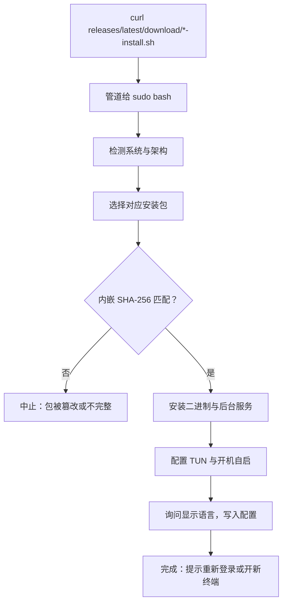

# 安装期校验链

> 本篇描述的是**安装器的设计意图与可见行为**，来源为 README 口径（F-019 ~ F-024）与构建脚本对安装器的改写规则（F-062 ~ F-063）。安装器本体位于 CI 束内，本包未逐行审阅（见 [核验报告](../references/verification.md)第三节）。

## 一键安装的完整链路



关键点有三个：

1. **架构检测在下载之前**：决定取 amd64 还是 arm64 包（F-019）。
2. **校验锚点在安装器内部**：安装器内嵌目标包的 SHA-256（如 `DEB_SHA256_AMD64`、`PKG_SHA256`、`ZipSha256`，见 F-049 ~ F-052），下载完成后本地比对。
3. **服务化安装**：安装器负责装后台服务、配置 TUN、开机自启，而不是让用户手动跑前台进程（F-019、F-027）。

## 两套校验和的分工

这里最容易混淆，必须分开：

| 校验和 | 生成者 | 存在于 | 回答的问题 |
|--------|--------|--------|-----------|
| 安装器内嵌 SHA-256 | 上游 CI / 本仓构建脚本 | 安装器脚本源码 | 「我刚下载的这个包，是不是安装器期望的那个包？」 |
| `SHA256SUMS.txt` | 本仓 `build_release.py` | Release 资产目录 | 「我在 Release 页下载的文件，是否与发布者上传的逐字节一致？」 |

二者都不能回答「发布者是否可信」——那是签名要解决的问题，而本仓未使用签名（D-1、[06](06-trust-model-and-boundaries.md)）。

## 离线安装：把网络环节从信任面里拿掉

一键安装需要两次网络请求（脚本 + 安装包）。离线安装把两次都变成本地文件（F-022）：

| 平台 | 需要准备 | 执行方式 |
|------|---------|---------|
| Linux | `skyline-linux-cli-universal-*.tar.gz`（含 `install.sh` 与两个 deb） | 解压后 `sudo bash install.sh` |
| macOS | `.pkg` + `skyline-macos-install.sh` 放在同一目录 | `sudo bash skyline-macos-install.sh` |
| Windows | 含 `install.cmd` 的 zip（管理员 PowerShell） | 解压后运行 `install.cmd` |

离线路径的额外收益：`--check` 可以在**不安装、不提权**的情况下先验包（F-023）：

```bash
bash skyline-linux-install.sh --check ./skyline-linux-cli_3.0.1_amd64.deb
```

这一步是唯一能在装机前独立复核「包完整性」的入口，建议高风险环境先跑它再安装。

## 进度条不是装饰：它是版本自检

构建脚本会向安装器注入分步进度条，并要求**步骤标记必须命中**，否则构建失败（F-062、F-063）：

| 安装器 | 步骤数 | 步骤标记要求 |
|--------|--------|-------------|
| bash 版 | 6 步；`--check` 时 3 步 | 安装器内必须存在对应 `stage` 标记，数量不符即中止 |
| PowerShell 版 | 4 步 | 同上；真正的安装动作由包内 `install.ps1` 完成 |

这条设计的意义：**如果上游悄悄改了安装流程（少一步、多一步、换措辞），本仓的发布会直接失败**，而不是把「进度条显示 3 步、实际做了 5 步」的包发出去。它把「用户在终端看到的过程」也纳入了版本契约。

## 失败模式与处置

| 现象 | 可能原因 | 处置 |
|------|---------|------|
| 校验失败后立即退出 | 下载被代理/CDN 劫持或截断 | 换网络重试；改用离线包 + `--check` 自行核验 |
| Linux 装完连接失败 | 缺少 `/dev/net/tun`（VPS/容器常见） | 容器加 `--device /dev/net/tun --cap-add NET_ADMIN`（F-027） |
| `skyline: command not found` | PATH 未刷新 | Windows 开新终端；Linux 注销重登（F-028） |
| 安装成功但服务未启动 | 无 systemd 的环境（容器） | 该环境本就无法装服务；用 `debian:12` 容器验证时只要求安装器退出 0（F-042） |
| macOS 弹「背景项目已添加」 | 系统要求确认 | 系统设置 → 通用 → 登录项与扩展 中允许（F-026） |

## 信任面的三层收缩

```text
一键安装（最宽）：信任 GitHub + 信任安装器脚本 + 信任包
离线安装（较窄）：信任你搬运文件的过程 + 信任安装器脚本
离线 + --check（最窄）：先用包内/安装器内哈希确认包未被改动，再决定是否执行
```

没有一层能消除「安装器脚本本身可信吗」这个问题——它始终是以 root 执行的远端脚本（D-2）。能做的只是把它固定到具体 tag、先下载再看。

## 主题关联

- [02 发行拓扑](02-distribution-topology.md)：安装器里的地址为什么必须先被 `retag()` 改写。
- [06 信任模型](06-trust-model-and-boundaries.md)：完整性、来源、抗失陷三件事的区别。
- 演练 [00 安装、校验与卸载](../examples/00-install-verify-uninstall.md)。
