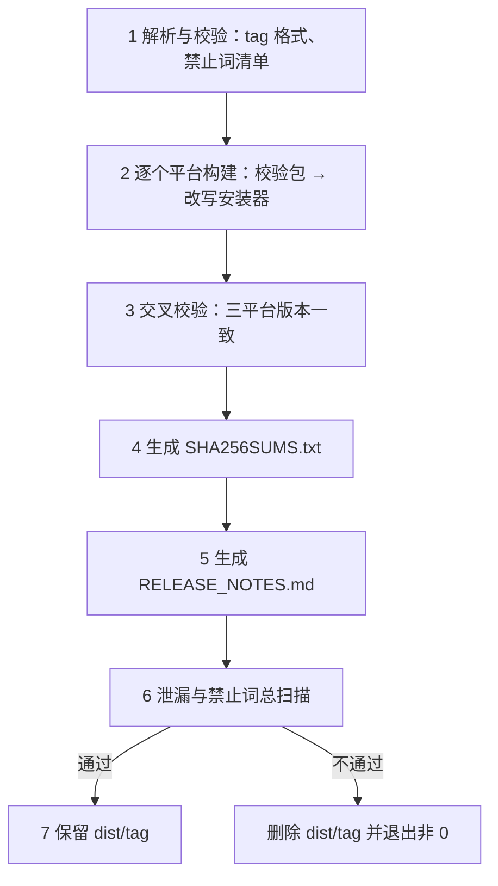

# 暂存管线

一次 `python3 tools/build_release.py v3.0.1` 做的事，可以拆成七段。顺序不能换，因为后段依赖前段的产物。

## 第 1 段：解析与前置校验

- tag 必须匹配 `^v\d+\.\d+\.\d+([-.][0-9A-Za-z.-]+)?$`（F-045）。
- 禁止词清单必须存在且非空：默认 `~/.config/skylinevpn-release/forbidden-terms`，可用 `SKYLINE_FORBIDDEN_TERMS` 覆盖（F-057）。**没有清单一律拒绝运行**。

第二点是本仓最反直觉的设计：构建脚本依赖一个**不在仓库里**的文件。原因是清单内容本身就是需要保密的对象（例如内部代号、未公开合作方）。代价是换机即不可用（D-3），收益是清单不随代码泄露。

## 第 2 段：逐平台构建

三个平台的共同套路是：**先用安装器自带的哈希校验包，再改写安装器**。

| 平台 | 校验 | 改写/发布 |
|------|------|----------|
| Linux | 按 `DEB_SHA256_AMD64` / `DEB_SHA256_ARM64` 校验两个 deb（F-049） | 解包 universal tar.gz，要求包内 `install.sh` 与外层逐字一致；必要时以 root 属主重打 tar.gz（F-050） |
| macOS | 按 `PKG_SHA256` 校验 `.pkg`（F-051） | 只发布 `.pkg` + 安装器，丢弃束内 tar.gz 与副本 |
| Windows | 按 `ZipSha256` 校验 zip（F-052） | 校验 ARM64 三个变量同进同退；按包内 `core/skyline-cli-core.version` 的 `arch=` 判架构（F-053） |

**为什么先校验再改写？** 因为改写后的安装器已不再与上游逐字相同。若先改后校验，哈希必然对不上；而先校验，等于用上游的哈希作为「这个包确实来自本次 CI」的凭据。

**四个原子操作**构成了改写的全部语法（F-046 ~ F-048）：

| 函数 | 语义 | 反模式 |
|------|------|--------|
| `one(pattern)` | glob 必须恰好命中 1 个文件 | 0 个 → 上游改了命名；≥2 个 → 上游多给了包 |
| `var(name, quote)` | 按变量名与引号风格提取值 | 引号风格变了就读不到 |
| `sub(text, regex, repl, count_min, count_max)` | 替换并断言命中次数 | 命中 0 次说明上游已改格式；命中过多说明误伤 |
| `retag(text, tag)` | 把所有 `/releases/download/<旧tag>/` 改为新 tag | 漏改 → 安装器指向旧包 |

这四者共同的哲学：**把「我以为上游长这样」变成可执行断言**。任何假设破裂，构建立即失败，而不是产出「看起来正常」的坏包。

## 第 3 段：跨平台版本一致性

三平台 app version 必须完全相同，否则中止（F-054）。这是防止「Linux 发 3.0.2、Windows 还停在 3.0.1」这类半发布状态。

注意：tag 与 app version 不一致**不中止**，只提示（C-3）。也就是说，这条校验保证的是「三平台彼此一致」，不是「与 tag 一致」。

## 第 4、5 段：清单与说明

- `SHA256SUMS.txt` 在 notes 之前生成，覆盖当时目录内全部资产，因此 **notes 自身不在清单里**（F-060）。读清单时不要以为漏了一项。
- `RELEASE_NOTES.md` 包含：防诈骗声明、唯一官网、三平台一键安装命令、资产表、三平台 build 号（F-061）。它是面向用户的**唯一**发布说明，也是钓鱼风险提示的落点。

## 第 6 段：泄漏与禁止词扫描

扫描分两类命中和三种处置：

| 命中位置 | 处置 |
|---------|------|
| 生成物（`RELEASE_NOTES.md`、`SHA256SUMS.txt`） | 恒为致命，直接失败 |
| 上游资产（包内任意文件） | 默认致命；`--accept-upstream-terms` 下降级为警告 |
| 安装器中指向其他 tag 的下载地址 | 恒为致命（F-056） |

扫描器的覆盖面是这段最值得学的部分（F-058）：

1. **解容器**：gzip / xz / zstd / Apple pbzx 逐个解压；
2. **递归归档**：zip / tar / ar（`.deb`）/ xar（`.pkg`）递归到最后一层普通文件；
3. **双编码匹配**：同一关键字同时以 UTF-8 与 UTF-16LE 字节序列搜索（Windows 资源常见 UTF-16）。

`LEAK_PATTERNS` 共 15 条，覆盖 CDN/云存储痕迹、Telegram、开发群、`.github/workflows`、非本仓 GitHub 链接、内部计划编号、App 会话、`session` 串、邮箱等（F-055）。

**为什么 `--accept-upstream-terms` 存在？** 上游二进制里可能包含我们无法修改的字符串（例如第三方 SDK 的域名）。这个开关让「已知且接受的上游残留」不阻塞发布，但同时把风险显性化为警告输出（F-059）。

## 第 7 段：失败即删除

任何致命错误都会删除 `dist/<tag>`（F-059）。这条看似粗暴，实则关键：**不存在半个发布目录**。发布门只认「目录存在且校验通过」，所以删除即等于「本次暂存作废」。

## 可迁移的三条工程模式

1. **断言式改写**：所有对外部格式的假设都写成带命中次数的替换，破裂即失败。
2. **自洽校验**：改写完成后再独立断言「没有残留旧地址」，而不是信任改写函数没漏。
3. **深层扫描**：对二进制交付物，按容器格式递归到最后一层文件再匹配关键字，并覆盖多种字符编码。

## 主题关联

- [05 身份与泄漏门](05-identity-and-leak-gates.md)：另一套门禁，管的是「谁提交、从哪推送」，与这里的「内容里有什么」互补。
- [02 发行拓扑](02-distribution-topology.md)：`dist/<tag>` 之后去哪。
