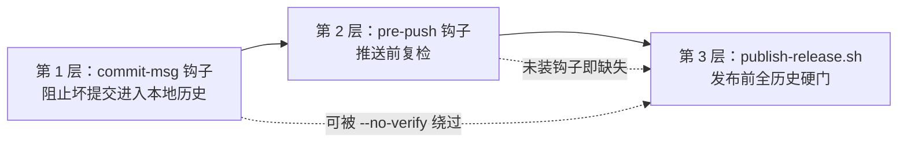

# 身份锁与泄漏门

## 三层门禁



| 层 | 触发时机 | 检查内容 | 能否绕过 |
|----|---------|---------|---------|
| commit-msg | `git commit` | 提交信息泄漏、信息内禁止词、暂存区智能体文件、暂存区禁止词（F-066） | 可 `--no-verify` |
| pre-push | `git push` | 调用同一脚本做复检（F-070） | 可 `--no-verify` |
| 发布门 | `publish-release.sh` | token 属主、身份全历史、dist 校验和、HEAD 与远端一致、人工确认（F-071、F-072） | 不可绕过 |

设计意图很清楚：**前两层是快速反馈，第三层才是硬约束**。钩子只装在本地 `.git/hooks`，不随仓库分发（F-070），所以「新克隆必须先跑 `tools/install-hooks.sh`」是维护者的第一步。

## 为什么要区分「作者」和「提交者」

身份锁要求：

- **作者**必须是 `skyline-projext <176280006+skyline-projext@users.noreply.github.com>`；
- **提交者**允许是该身份，或 `GitHub <noreply@github.com>`（F-065）。

原因是 squash merge：GitHub 在网页端合并 PR 时，会把提交者改写为平台账号（F-006）。如果只允许一个身份，正常的 PR 合并流程会被自己的门禁拦下。这条例外不是放宽，而是**精确描述平台行为的必然结果**。

## 提交信息里的禁用踪迹

`MSG_LEAKS` 拦截的是一类特定字符串（F-068）：

| 类别 | 示例 |
|------|------|
| 协作署名 | `co-authored-by`、`signed-off-by`、`reviewed-by` |
| 工具署名 | `generated-by`、`claude-session` |
| 模型/厂商 | `claude.ai`、`anthropic`、`claude code` |
| 会话标识 | `session_*` |

这与「禁止智能体文件」是同一套政策的两个面：**既不让工具生成的文件进仓库，也不让提交信息暴露工具痕迹**。

## 智能体文件清单

`AGENT_FILES` 覆盖的范围（F-069）比多数人预想的大：

```text
CLAUDE.md  AGENTS.md  GEMINI.md  MEMORY.md
.mcp.json  .cursorrules  copilot-instructions.md
.claude/  .cursor/  .codex/  .aider*  .continue/  memory/
*.jsonl
```

两类风险：

1. **提示词与规则泄露**：这些文件往往包含内部工作流、项目结构、甚至密钥引用。
2. **会话记录泄露**：`*.jsonl` 是常见对话日志格式，可能夹带完整对话。

注意 `.gitignore` 也屏蔽了同类文件（F-012），这是**双保险**：忽略防误提交，门禁防「已 `git add -f` 强制添加」。

## 全历史检查为什么必要

`check-identity.sh` 的完整模式不只查 HEAD 的工作区，而是（F-067）：

- HEAD 上每个提交的作者与提交者；
- 每个提交的提交信息；
- 历史上出现过的所有文件名（即使后来删掉）；
- 每个已提交版本的内容与当前索引。

理由：一个文件「现在不在工作区」，不代表它「从未进入过历史」。Git 历史一旦推送就无法真正收回，因此发布前必须按「历史全量」而非「当前快照」判定。

## 发布门的五个前置条件

`publish-release.sh` 在调用 `gh release create` 之前依次要求（F-072）：

1. `dist/<tag>` 已暂存且含 `RELEASE_NOTES.md`；
2. `SHA256SUMS.txt` 校验通过；
3. 身份检查通过；
4. 本地 `HEAD` 等于 `origin/main`（防止发布未推送的提交）；
5. 终端回打发布账号名确认。

其中第 4 条最容易被忽略：如果本地领先远端，Release 将指向一个远端不存在的提交，tag 与源码就对不上了。

token 的处理同样刻意：优先读环境变量 `GH_TOKEN`，否则从 `~/.zshrc` 里的 `export_ghp_skylinevpn_token` 读取，并先校验 token 属主（F-071）。**token 不写入仓库、不写入 `dist/`、不出现在命令回显里**。

## 门禁的已知缺口

| 缺口 | 说明 | 缓解 |
|------|------|------|
| 钩子需手动安装 | 新克隆默认无保护（D-5） | 发布门兜底；仓库文档把 `install-hooks.sh` 列为第一步 |
| 服务端未强制 | 仓库内未见分支保护配置，无法从本仓证明服务端拒绝直推 | 未知；只能说「流程要求走 PR + squash」（F-036） |
| 正则误伤/漏检 | 邮箱、裸 `CI` 等模式可能命中正常文本；加密或未知压缩格式可能漏检（D-4） | 接受误伤（失败即停），漏检范围在 [verification.md](../references/verification.md) 中明示 |
| 禁止词清单在仓库外 | 缺失即不可发布（D-3） | 换机前先恢复清单；这是保密性优先的取舍 |

## 给维护者的最小准备清单

```bash
git clone git@github.com:skyline-projext/skylinevpn-cli.git
cd skylinevpn-cli
tools/install-hooks.sh            # 锁定身份 + 装两个钩子
# 确保 ~/.config/skylinevpn-release/forbidden-terms 存在且非空
tools/check-identity.sh           # 首次全历史自检
```

## 主题关联

- [04 暂存管线](04-release-staging-pipeline.md)：内容层扫描（包里有什么）。
- [06 信任模型](06-trust-model-and-boundaries.md)：这些门禁在威胁模型中的位置。
- [演练 02 发布 Runbook](../examples/02-maintainer-release-runbook.md)。
