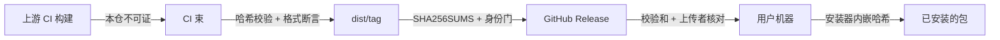

# 信任模型与边界

## 三种常被混为一谈的保证

| 保证 | 含义 | 本仓是否提供 | 依据 |
|------|------|-------------|------|
| **完整性** | 文件在传输/存储中未被改动 | 提供（SHA-256，两处） | F-019、F-049 ~ F-052、F-060 |
| **来源一致性** | 下载到的东西确实来自本仓的发布流程 | 部分提供（上传者身份核对 + 单一发布入口） | F-039、F-072 |
| **抗发布方失陷** | 即使发布账号/构建机被攻陷，用户仍能识别恶意包 | **不提供**（无签名、无透明日志、无可复现构建） | D-1 |

一句话：**这条链证明「东西没变、流程走过」，不证明「东西是安全的」。**

## 逐环节能证明什么



| 环节 | 可证明 | 不可证明 |
|------|--------|---------|
| CI 构建 | 无 | 构建环境是否干净、是否可复现 |
| 束 → dist | 包与安装器内嵌哈希一致；安装器格式未漂移；无禁用字符串 | 包内二进制行为 |
| dist → Release | 资产清单自洽；发布者身份；HEAD 与 main 一致 | 发布者账号未被盗 |
| Release → 用户 | 下载文件未被篡改 | 安装器脚本自身可信（它以 root 执行） |
| 安装后 | 装上的包与安装器期望的一致 | 运行时行为、流量处理、DNS 处理 |

## 威胁模型

| 威胁 | 是否缓解 | 说明 |
|------|---------|------|
| 传输中篡改 / 下载截断 | ✅ 缓解 | 双重 SHA-256（安装器内嵌 + `SHA256SUMS`） |
| 镜像站/代理投毒 | ✅ 缓解 | 同上；但须确认校验和取自官方 Release |
| 钓鱼站分发假安装器 | ⚠️ 部分缓解 | README 明确唯一官网与钓鱼域名（F-017），notes 中也带防诈骗声明（F-061）；但无法阻止用户访问假站 |
| 内部信息随包泄露 | ✅ 缓解 | 15 条泄漏正则 + 禁止词 + 递归解包扫描（F-055、F-058） |
| 智能体痕迹进入仓库 | ✅ 缓解 | 文件清单 + 提交信息正则 + 全历史检查（F-068、F-069） |
| 发布账号被盗 | ❌ 未缓解 | 无签名；攻击者可同时替换包与校验和（D-1） |
| 构建机被植入后门 | ❌ 未缓解 | 无 SBOM、无可复现构建、无第三方审计 |
| 上游 CI 束本身被替换 | ⚠️ 弱缓解 | 仅能以安装器内嵌哈希为准，而该哈希同样来自同一束 |

## 用户侧可独立执行的四步核验

以下动作只需要浏览器与终端，不依赖本仓脚本：

```bash
# 1. 从官方 Release 下载资产与 SHA256SUMS.txt
# 2. 校验
sha256sum -c SHA256SUMS.txt          # macOS: shasum -a 256 -c
# 3. 核对 Release 与每个资产的上传者均为 skyline-projext（网页可见）
# 4. 可选：安装前用 --check 再验一次包
bash skyline-linux-install.sh --check ./skyline-linux-cli_*.deb
```

第 3 步常被跳过，但它检查的是「来源」而非「完整性」——如果资产由其他账号上传，即使哈希对得上也不应安装。

## 为什么「完整性」会被误当成「安全」

三点心理机制值得警惕：

1. **长十六进制串带来确定感**：看起来像密码学保证，实际上只是抗随机损坏与简单篡改。
2. **多层校验制造冗余错觉**：两套哈希都通过，仍可能同时被同一攻击者替换。
3. **「官方 Release」被当作信任根**：它只是信任的入口，不是信任的证明。

本束在 [verification.md](../references/verification.md) 中以 D-1 明确记录这一限制，避免读者把「校验通过」误读为「可安全运行于高敏感环境」。

## 对封闭二进制的理性期待

产品闭源（F-009），仓库无源码（F-007）。因此：

- **可以**评价：发布流程是否严谨、门禁是否可绕过、信息是否收敛、版本是否自洽。
- **不可以**评价：隧道协议安全性、加密实现、日志是否记录流量、节点是否可信。
- 若确需后者，只能靠独立逆向、沙箱观测或第三方审计，且应把结论与「发行工程」分开陈述。

## 主题关联

- [04 暂存管线](04-release-staging-pipeline.md)：内容扫描的具体覆盖面。
- [05 身份与泄漏门](05-identity-and-leak-gates.md)：发布者身份如何被约束。
- [核验报告](../references/verification.md)：D-1 ~ D-7 的完整对抗意见。
