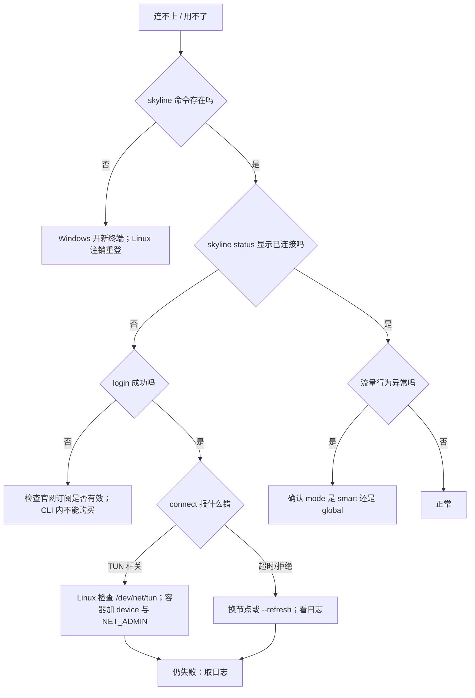

# 演练 01：日常使用与故障排除

> **性质**：命令取自 README（F-014 ~ F-018、F-026 ~ F-028），**未实机执行**；输出示例仅示意结构，不是本包复现结果。

## 一次典型会话

```bash
skyline login          # 输入官网账号与密码
skyline nodes          # 列出节点；节点多时用 --refresh 强制刷新
skyline connect --best # 交给自动选择
skyline status         # 查看当前连接与模式
```

需要固定节点时：

```bash
skyline connect 12     # 12 为 nodes 列表中的编号
```

切换路由模式：

```bash
skyline mode smart     # 智能分流（默认推荐）
skyline mode global    # 全局
```

退出登录（保留或清除本地数据）：

```bash
skyline logout
skyline logout --purge # 连本地登录数据一并删除
```

界面语言：

```bash
skyline lang chinese
skyline lang english
```

## 排障决策树



## 症状对照表

| 症状 | 首查项 | 依据 |
|------|--------|------|
| `skyline: command not found` | 是否重开终端 / 重新登录 | F-028 |
| 登录失败 | 官网订阅是否有效、账号是否同一 | F-016 |
| `connect` 报 TUN / 设备错误 | `/dev/net/tun` 是否存在；容器权限 | F-027 |
| 节点列表为空 | `skyline nodes --refresh` | F-015 |
| 部分网站走代理、部分不走 | 当前模式是否为 `smart`；需要全量时切 `global` | F-015 |
| macOS 首次运行有系统提示 | 登录项与扩展中允许 `skyline` | F-026 |
| 连接时断时续 | 换节点；查看日志时间线 | F-014、F-026 |

## 日志位置

| 平台 | 路径 |
|------|------|
| Linux | `/var/log/skyline/` |
| macOS | `/Library/Logs/Skyline/` |
| Windows | `%ProgramData%\Skyline CLI\logs` |

求助时建议附：`skyline version` 输出、`skyline status` 输出、日志尾部若干行、所在平台与架构。**不要附账号密码与订阅链接**。

## Linux VPS / 容器补充

```bash
ls -l /dev/net/tun
# 容器运行需带：
#   --device /dev/net/tun --cap-add NET_ADMIN
```

容器内通常没有 systemd，后台服务无法常驻；这类环境的正确期待是「安装器能完成安装」，而不是「服务自动拉起」（与发布测试口径一致，F-042）。

## 主题关联

- [01 产品面](../concepts/01-product-surface.md)：命令与模式的完整表。
- [演练 00 安装与卸载](00-install-verify-uninstall.md)：命令找不到时先回到安装步骤。
