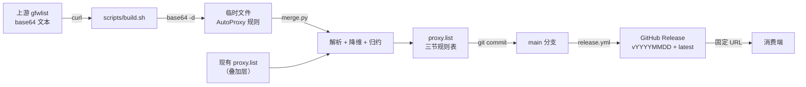

# 00 定位与全景：一份数据文件构成的仓库

## 1. 仓库里到底有什么

`git ls-tree` 的结论很简单：**7 个受版本控制的文件**（F-007）。

| 文件 | 行数 / 体量 | 角色 |
|------|-----------|------|
| `proxy.list` | 26,706 行 / 389,288 字节 | **产物**：三节规则表 |
| `scripts/merge.py` | 90 行 | **编译器**：解析、降维、归约、落盘 |
| `scripts/build.sh` | 13 行 | **取料器**：下载上游并解码，调用编译器 |
| `.github/workflows/release.yml` | 47 行 | **发布器**：定时跑、按需提交、发 Release |
| `README.md` | 15 行 | 唯一的用户文档：下载地址 |
| `LICENSE` | 8 行 | 专有许可，AS IS |
| `.gitignore` | 51 行 | 秘密与本地（含 AI 工具）文件排除 |

除此之外没有源码、没有测试、没有依赖清单、没有构建产物目录。仓库的**全部价值浓缩在一份文本文件里**，其余六个文件都是为了让这份文件能持续、可重复地产生并被下载。

## 2. 三个角色

三个角色各司其职：

- **取料器**只负责「把上游变成可解析的文本」，不关心语义（F-025 ~ F-031）。
- **编译器**是唯一理解格式的地方：它同时定义「输入怎么读」和「输出怎么写」（F-032 ~ F-044）。
- **发布器**只负责「跑、提交、发版」，不参与内容判断（F-045 ~ F-058）。

这种切分带来的直接后果是：**格式契约只存在于 `merge.py` 里**。没有任何文档描述三节语义，`README` 只给出下载地址（F-064、C-4）。这是本仓最大的可读性缺口，也是本束 [01](01-rule-file-format.md) 存在的原因。

## 3. 它是什么，不是什么

| 是 | 不是 |
|----|------|
| 一份按周更新的代理规则数据源 | VPN 客户端，也不含任何协议实现 |
| 一个「定时编译 + 固定地址分发」的最小样本 | 通用规则引擎，仓内不含匹配器 |
| 上游 gfwlist 的**增量合并**结果 | 上游的镜像或全量重建结果（本地策展条目会保留） |
| 一个只做流程一致性的自动化仓库 | 一条可审计的供应链（无签名、无摘要、无内容量断言） |

最后一行需要强调：`skylinevpn-cli` 那套「命中数断言 + 递归泄漏扫描 + 身份锁 + 发布门」在这里**一条都没有**。两个仓库同属一个组织，但工程强度相差一个量级（见 [05](05-boundaries-and-risk-model.md) 与 D-1、D-2）。

## 4. 版本节拍

仓库自 2026-10-16 初始化，到 2026-11-16 共 **7 次提交、7 个 tag**（F-002、F-005）。时间线可以分成两段：

| 阶段 | 时间 | 动作 |
|------|------|------|
| 建仓 | 2026-10-16（同一天 3 次提交） | 初始清单 + 两批策展条目（流媒体/AI/加密/交易所；金融/SaaS/云/AI/学术） |
| 自动化 | 2026-10-19 起每周一 | 由 `release.yml` 拉上游、合并、提交、发版 |

两批策展提交的规模（+237/−7、+766/−20）远大于此后每周的自动提交（+1、+8、+5、+1）（F-009 ~ F-011）。这说明日常更新的真实增量很小，**机器维护的是新鲜度，人维护的是覆盖面**。

## 5. 阅读地图

- 关心「文件怎么解释」→ [01 规则文件格式](01-rule-file-format.md)
- 关心「上游怎么进来」→ [02 上游消化](02-upstream-digestion-pipeline.md)
- 关心「为什么条目会变少」→ [03 归约算法](03-reduction-algorithm.md)
- 关心「下载地址为什么不变」→ [04 发布通道](04-release-channel-and-fixed-url.md)
- 关心「这套东西能信到什么程度」→ [05 风险与边界](05-boundaries-and-risk-model.md)

## 关键事实

F-007（7 个文件）、F-013 ~ F-016（数据文件结构）、F-025 ~ F-031（取料）、F-045 ~ F-058（发布）、F-064（README 只有下载地址）。
