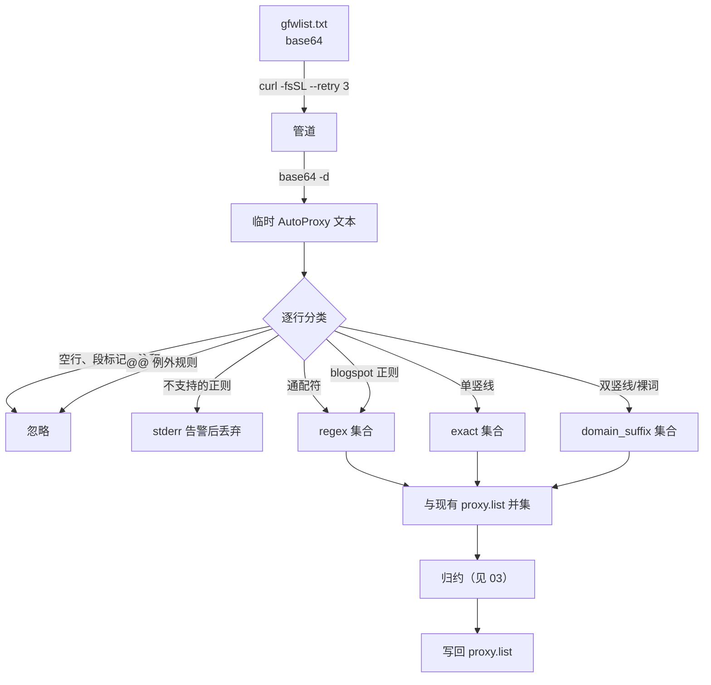

# 02 上游消化：从 gfwlist 到三节规则

## 1. 取料：build.sh 的四步

`scripts/build.sh` 只有 10 行有效逻辑，但四步缺一不可（F-025 ~ F-031）：

```bash
SRC_URL="${SRC_URL:-https://raw.githubusercontent.com/gfwlist/gfwlist/master/gfwlist.txt}"
ROOT="$(cd "$(dirname "$0")/.." && pwd)"
LIST="${1:-$ROOT/proxy.list}"

tmp=$(mktemp)
trap 'rm -f "$tmp"' EXIT

curl -fsSL --retry 3 "$SRC_URL" | base64 -d > "$tmp"
python3 "$ROOT/scripts/merge.py" "$tmp" "$LIST"
```

| 步 | 内容 | 设计意图 |
|----|------|---------|
| 1 | `SRC_URL` 可被环境变量覆盖 | 换源不需要改代码（见 [演练 02](../examples/02-maintainer-runbook.md)） |
| 2 | `LIST` 默认仓库根 `proxy.list`，可被第一个位置参数覆盖 | 工作流显式传 `proxy.list`，本地可指向别处试跑 |
| 3 | `mktemp` + `trap ... EXIT` | 中间文件不落地残留 |
| 4 | `curl -fsSL --retry 3` 下载后经 `base64 -d` 解码落临时文件 | 上游是 **base64 编码**的文本，不是明文规则 |

`-fsSL` 的四个开关合起来是「失败即退出、静默但显示错误、跟随重定向」。配合 `set -euo pipefail`（F-025），管道中任一环失败都会中止脚本——**这是本仓唯一的硬断言**：至少能保证「没抓到东西就不写盘」。

## 2. 为什么要 base64

gfwlist 以 base64 形式发布，历史上是为了让规则文本在任意通道中传输时不被中间层按内容特征拦截或改写。对本仓而言，这个选择带来两个后果：

1. **取料器必须解码**，多了一步 `base64 -d`；
2. **解码成功不等于内容合法**。base64 是宽容编码，解码结果可能仍是乱码或不完整的 AutoProxy 文本，而 `merge.py` 对无法解析的行基本采取「跳过」策略（见下节）。

后者是 D-2 的根源：只要 `curl` 返回 200，管线就会继续走到底。

## 3. 降维：AutoProxy 语法 → 三节

`merge.py` 的 `parse_upstream()` 按行扫描，先做四类过滤，再做语法判定（F-035 ~ F-037）：

```text
空行 / 以 "[" 开头（段标记）/ 以 "!" 开头（注释）/ 以 "@@" 开头（例外规则）
        → 全部跳过

以 "/" 开头且以 "/" 结尾（URL 正则）
        → 含 "blogspot" 时转成 .+blogspot\..+$ 放入 regex
        → 否则打印 "skip unsupported regex" 到 stderr，丢弃

其余行 → host_of() 提取主机
        → 含 "*"  → 转成 (^|\.)host$ 形式放入 regex
        → 单竖线 |http://host → exact
        → ||host 与裸关键词     → domain_suffix
```

映射表如下：

| 上游形态 | 落到哪一节 | 说明 |
|---------|-----------|------|
| 双竖线加主机（`\|\|example.com`） | `domain_suffix` | 域名后缀（含子域） |
| 裸关键词（`example.com`） | `domain_suffix` | 与双竖线同等对待 |
| 单竖线加 URL（`\|http://example.com`） | `exact` | 只匹配该主机 |
| 通配符（`*.example.com`） | `regex` | `*` 转成 `[^.]*`，整体包成 `(^|\.)…$` |
| URL 正则且含 blogspot | `regex` | 唯一被支持的正则形态 |
| URL 正则（其他） | **丢弃** | 仅打印 stderr 告警 |
| 例外规则（`@@` 开头） | **丢弃** | 三节结构无法表达排除 |

`host_of()` 的处理链是：去掉开头竖线 → 去掉 `http(s)://` → 按 `[/^:]` 取第一段 → 去首尾点 → 转小写（F-033）。因此 `||Example.COM/path` 会规整为 `example.com`。

## 4. 被丢弃的两类信息

上表最后两行是本仓最重要的语义损失：

**（1）`@@` 例外规则全部丢弃。** 注释写得很直白：「sections cannot express exclusions」。也就是说，如果上游认为某站点「不应被代理」，本仓的产物无法表达这个否定，只能让它保持被代理状态。这会造成**过覆盖**——用户可能发现某些本应直连的站点被走了代理。

**（2）非 blogspot 的 URL 正则全部丢弃。** 这类规则通常是「按 URL 路径匹配」的细粒度规则（如某站点的特定路径），而本仓的匹配对象是**主机名**，无法承载路径维度。丢弃是合理降维，但同样意味着语义从「URL 级」粗化成「主机级」。

这两点是**设计取舍而非缺陷**：三节模型换取的是可读、可缓存、可 diff 的规则表。但对外描述时不能说「完整继承了 gfwlist」，准确说法是「取其主机级规则并忽略例外与路径约束」（C-3）。

## 5. 弱容错哲学

把本仓与同组的 [skylinevpn-cli](../skylinevpn-cli/index.md) 对照，会看到两种截然不同的工程哲学：

| 维度 | skylinevpn-cli | skylinevpn-proxylist |
|------|---------------|---------------------|
| 外部输入不可预期时 | 命中数断言：期望 N 次替换，不符即失败 | 打印告警，继续执行 |
| 失败后果 | 构建失败，不产出坏包 | 产出「少了一些规则」的包，照常提交 |
| 适用前提 | 产物会被安装到用户机器 | 产物是一份可再生的规则表 |

弱容错在「数据可再生、错误可下一轮修正」的场景是合理的；但它把「发现异常」的责任完全交给了人。第 4 节的 `skip unsupported regex` 只会出现在 **Actions 日志**里，没有人会每周去看。

## 6. 一次完整的数据流



注意最后一步是**写回同一个文件**（`open(list_path, "w")`，F-043、F-044），没有备份、没有双写、没有临时文件原子替换。配合「读现有文件作为叠加层」，形成一个闭环：**每一轮的输入都包含上一轮的输出**。

## 关键事实

F-025 ~ F-031（取料）、F-033 ~ F-039（语法判定）、F-043、F-044（就地写回）、C-3（语义损失）、D-2（弱断言）、D-3（例外丢弃）。
