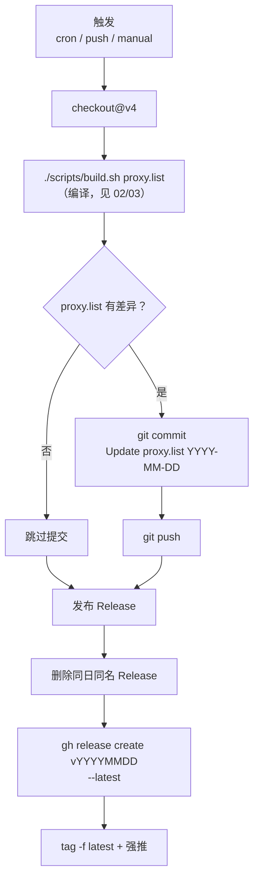

# 04 发布通道：日期 tag、latest 别名与固定下载地址

## 1. 三种触发

`release.yml` 接受三种触发（F-045 ~ F-047）：

| 触发 | 配置 | 用途 |
|------|------|------|
| 定时 | `cron: "0 0 * * 1"`（每周一 00:00 UTC） | 主力节拍：拉上游、看是否有新规则 |
| 推送 | `push` 到 `main` 且路径含 `proxy.list` | 人工策展提交后立即发版 |
| 手动 | `workflow_dispatch` | 补跑、验证改动 |

注意 `push` 的 `paths` 过滤只认 `proxy.list`：改脚本、改 README 都不会触发发布。这是很克制的设计——**发布只跟随数据变化**。

权限声明为 `contents: write`（F-048），使用默认 `GITHUB_TOKEN`，因此工作流可以推提交、推 tag、建 Release（F-057）。

## 2. 三个步骤



**第一步是编译，不是校验。** 工作流不检查上游是否合理、不比对条目数，直接调用 `build.sh`（F-050）。所有内容判断都在 `merge.py` 内部完成（见 [02](02-upstream-digestion-pipeline.md)）。

**第二步是条件提交**（F-051、F-052）。提交者身份被硬编码为 `skyline-projext` 与对应的 GitHub noreply 邮箱，保证 CI 提交与人工提交可区分。提交信息只含日期。

**第三步是发布**（F-054 ~ F-058）：

```bash
TAG="v$(date -u +%Y%m%d)"
RULES=$(grep -vcE "^(#|$)" proxy.list)
gh release delete "$TAG" --yes --cleanup-tag 2>/dev/null || true
gh release create "$TAG" proxy.list \
  --title "proxy.list $TAG" \
  --notes "Rules: ${RULES}. License: Skyline Networking Tech LLC." \
  --target "$(git rev-parse HEAD)" \
  --latest
git tag -f latest HEAD
git push -f origin refs/tags/latest
```

## 3. 同日重发：删除再创建

`gh release delete ... || true` 的语义是：**如果今天已经发过，就先删掉（含 tag），再重建**。于是「同一天多次运行」是幂等的——最终只留一个当天 Release。

代价是（D-6）：

- Release 的资产 ID、创建时间会变化；
- 已经缓存了旧资产的客户端，下次请求会拿到 `ETag` 变化的新资产，但文件可能逐字节相同；
- 没有「内容版本号」可以判断「这份表到底是不是我看过的那份」。

由于 `v20261109` 已证明「tag 日期 ≠ 内容日期」（F-006），消费端**不能**把 tag 当作内容指纹。

## 4. latest 的三重指代

「latest」在本仓出现三次，机制完全不同，极易混淆（C-1）：

| 出现位置 | 实际机制 | 谁在用 |
|---------|---------|--------|
| `gh release create --latest` | GitHub 的「Latest release」标记，决定 `/releases/latest` 解析到哪个 Release | 浏览器与 API |
| `git tag -f latest` + 强推 | 一个**真实存在的 git tag**，被强制移动到最新提交 | `raw.githubusercontent.com/<repo>/latest/proxy.list` |
| README 的 `/releases/latest/download/proxy.list` | 走 Release 资产 + latest 标记 | 普通用户 |

三者能同时对，是因为每次发布都同时做了「设 latest 标记」和「移动 latest tag」。但它们**不是同一份存储**：一个指向 Release 资产，一个指向仓库内文件快照。若某次只成功了一半（例如 tag 推成功、Release 创建失败），两条通道就会分叉。

## 5. 两条下载通道

| 通道 | URL | 特点 |
|------|-----|------|
| Release 资产（README 推荐） | `https://github.com/skyline-projext/skylinevpn-proxylist/releases/latest/download/proxy.list` | 走 CDN；文件名稳定；不暴露仓库内路径 |
| 仓库快照 | `https://raw.githubusercontent.com/<repo>/latest/proxy.list` | 直接读 tag 快照；更新可能滞后于 Release |

README 只写第一条，并在 `curl` 示例里给出完整命令（F-064）：

```bash
curl -fsSL https://github.com/skyline-projext/skylinevpn-proxylist/releases/latest/download/proxy.list -o proxy.list
```

没有校验和、没有签名、没有 `If-None-Match` 示例。接入方若要判断「是否需要更新」，只能比对内容或依赖 HTTP 缓存头（见 [演练 01](../examples/01-consumer-integration.md)）。

## 6. tag 不是不可变对象

`git tag -f latest` 加 `git push -f` 意味着 **`latest` 这个人可读的 tag 每周都会被重写**。这带来两个非直觉后果：

1. 任何「按 tag 固定版本」的做法在 `latest` 上都失效——它不是版本，是别名；
2. 由于强推，别人已经 fetch 过的 `latest` 会与远端分叉，本地需要 `git fetch --tags -f` 或删除后重取。

真正的不可变版本是日期 tag（`v20261019` 等）。但它们也**不是永久不可变**：同日重发的 `delete --cleanup-tag` 会把当天的日期 tag 一起删掉重建。因此严格说，本仓没有「不可变版本」，只有「按周刷新的快照」。

## 7. 版本节拍与内容节拍

| tag | 指向提交 | 提交日期 | 说明 |
|-----|---------|---------|------|
| `v20261016` | `53bfff1` | 2026-10-16 | 建仓当天第三批策展 |
| `v20261019` | `22babbc` | 2026-10-19 | 首个自动周更 |
| `v20261026` | `7d4603a` | 2026-10-26 | +8 行 |
| `v20261102` | `85eb82d` | 2026-11-02 | +5 行 |
| `v20261109` | `85eb82d` | **2026-11-02** | **无内容变化，仍发版** |
| `v20261116` | `9c6567c` | 2026-11-16 | +1 行 |
| `latest` | `9c6567c` | 2026-11-16 | 别名 |

`v20261109` 是本仓最有教育意义的一条数据：它证明发布流程**不判断内容是否变化就发版**（F-006、I-5）。「每周一个版本」是时间承诺，「每周都有新规则」不是。

## 关键事实

F-045 ~ F-058（工作流）、F-006（tag 与提交错位）、F-064（README 通道）、C-1（latest 三重指代）、C-2（版本节拍）、D-6（同日重发）。
