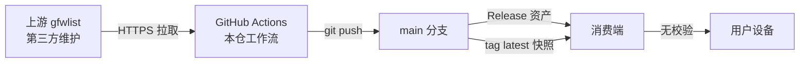

# 05 风险与边界：这条流水线能保证什么

## 1. 信任链

链上每一环的保证强度：

| 环节 | 保证 | 不保证 |
|------|------|--------|
| 上游拉取 | TLS 传输、`curl -f` 失败即退 | 上游内容正确、完整、未被篡改 |
| 编译 | 确定性归约、排序、幂等 | 输入语义完整（`@@` 与路径正则被丢弃） |
| 提交 | 有差异才提交、提交者固定 | 提交内容经过人工审核 |
| 发布 | 日期 tag、latest 别名、同日幂等 | 产物可验证（无摘要、无签名） |
| 消费 | 固定 URL 可持续获取 | 下载内容与发布内容一致、来源可信 |

一句话：**这条链保证的是「每周都有一次可重复的流程」，不是「每次产出的内容都可信」。**

## 2. 弱断言：最需要补的一环

`build.sh` 的唯一硬断言是「`curl` 失败则中止」（F-025、F-032 的对比见 [02](02-upstream-digestion-pipeline.md)）。

只要上游返回 200，后面的路径就一路绿灯：`base64 -d` 解出乱码 → `merge.py` 跳过不认识的行 → 剩下两行表头 → 写回 → `git diff` 有差异（清空了 2.6 万行）→ 提交 → 发布。**整个过程没有任何一步会报错。**

最低成本的补法有三道，按性价比排序：

| 断言 | 实现 | 拦截的问题 |
|------|------|-----------|
| 条目数下界 | `[ $(grep -vcE "^(#|$)" proxy.list) -ge 20000 ]` | 上游异常导致近空表 |
| 相对跌幅上限 | 与上一版比较，跌幅 > 20% 即失败 | 上游大规模删规则 |
| 文件摘要 | 随 Release 附带 `sha256sum` | 传输与存储篡改 |

这三条都不需要改数据结构，属于「一小时工程」。本包不主张它们「应该存在」——仓主可能刻意保持轻量——但任何把这份清单用于生产的环境，都应在**接入侧**补上等价检查（见 [演练 01](../examples/01-consumer-integration.md)）。

## 3. 结构性代价（不是 bug）

以下四点已经在正文各处出现过，集中列出以免误判为缺陷：

| 代价 | 来源 | 影响 |
|------|------|------|
| 例外规则丢弃 | 三节无法表达否定（F-035、D-3） | 过覆盖：本应直连的站点被代理 |
| 路径级规则降维 | 匹配对象是主机名（F-036） | 无法表达「同站不同路径」的差异 |
| 只增不减 | 并集 + 就地覆写（F-043、D-4） | 规模单调增长，失效域名永久残留 |
| 消费端语义未定义 | 仓内无匹配器、无格式文档（F-066、D-5） | 客户端各行其是，归约可能变成行为变更 |

判断标准很简单：**只要消费端与归约端对「后缀含子域」的理解一致，前三项就是可接受的工程取舍；一旦不一致，第一项和第四项会叠加成真实故障。**

## 4. 许可与合规

`LICENSE` 只有 6 行有效文本（F-063）：

- 版权归 Skyline Networking Tech LLC；
- 仓库与 `proxy.list` 按 **AS IS** 提供，不附带任何明示或暗示担保；
- 因使用该清单产生的索赔、损害或其他责任，由使用者承担。

因此：

1. 本仓**不承诺可用性**——某站点是否真的可达、是否被正确代理，都不在担保范围内；
2. 本仓**不承诺合法性**——清单覆盖新闻、社交、AI、流媒体、金融、成人内容等多类站点（F-020 抽样），在特定司法辖区使用可能触及当地法规；
3. 本仓**不提供格式支持**——README 只给下载地址（F-064），格式问题没有官方答复渠道（仓库无 Issue 模板、无讨论区配置，F-067）。

本知识包只做工程解读，**不提供任何规避网络管制的操作建议**，也不对清单内容的适用性作评价。

## 5. 仓库治理的旁证

`.gitignore` 51 行，分三块（F-059 ~ F-062）：

| 块 | 内容 | 说明 |
|----|------|------|
| 秘密 | `.env`、`*.pem`、`*.key`、`*.token`、`id_rsa*`、`secrets/` 等 | 防止误提交凭据 |
| 本地草稿 | `w.list`、`proxy-not-in-gfwlist.txt`、`image.png` | 说明作者曾在本地维护「未收录清单」 |
| AI/Agent 文件 | `CLAUDE.md`、`AGENTS.md`、`.claude/`、`.cursor/`、`.windsurf/`、`.codex/` 等 | 作者在本地使用多种 AI 编码工具，且明确不提交 |

第三块值得注意：它**不是安全风险**，而是一条工作方式证据——本仓的策展提交（那两批 +237/+766）很可能借助了 AI 工具整理域名，但仓库刻意保持「只有数据与脚本」的干净形态。这与本仓「最小化」的整体风格一致。

## 6. 与 skylinevpn-cli 的对照

同属 SkylineVPN 组织，两个仓库的工程强度差异极大：

| 能力 | skylinevpn-cli | skylinevpn-proxylist |
|------|---------------|---------------------|
| 输入断言 | 命中数断言（期望 N 次替换） | 无（仅 curl 失败即退） |
| 产物扫描 | 递归解包泄漏扫描 | 无 |
| 身份门 | 作者强校验 + 提交者白名单 | 无（CI 固定身份） |
| 发布门 | token 属主、全历史、人工确认 | 无（自动发布） |
| 完整性 | 校验和 + 双哈希 | 无 |

差异的根源是**产物性质**：二进制要装到用户机器上，出错代价高；规则表可再生、可下一轮修正，出错代价低。但这不意味着规则表不需要门禁——它只是把门禁的责任从「发布方」转移到了「接入方」。

## 7. 边界清单

引用本包内容时，以下表述都不成立：

1. 「这份清单能翻墙 / 能访问某站点」——本包未做任何连通性测试；
2. 「构建脚本已实测」——本包未联网执行；
3. 「Release 资产已核验」——本包未访问 Release 页面；
4. 「格式是行业标准」——三节语义只由 `merge.py` 定义；
5. 「每周都有内容更新」——`v20261109` 已证伪（F-006）。

## 关键事实

F-025（唯一硬断言）、F-035、F-036（语义丢弃）、F-043（只增不减）、F-059 ~ F-063（治理与许可）、F-066、F-067（无测试、无模板）、C-3 ~ C-5、D-1 ~ D-8。
