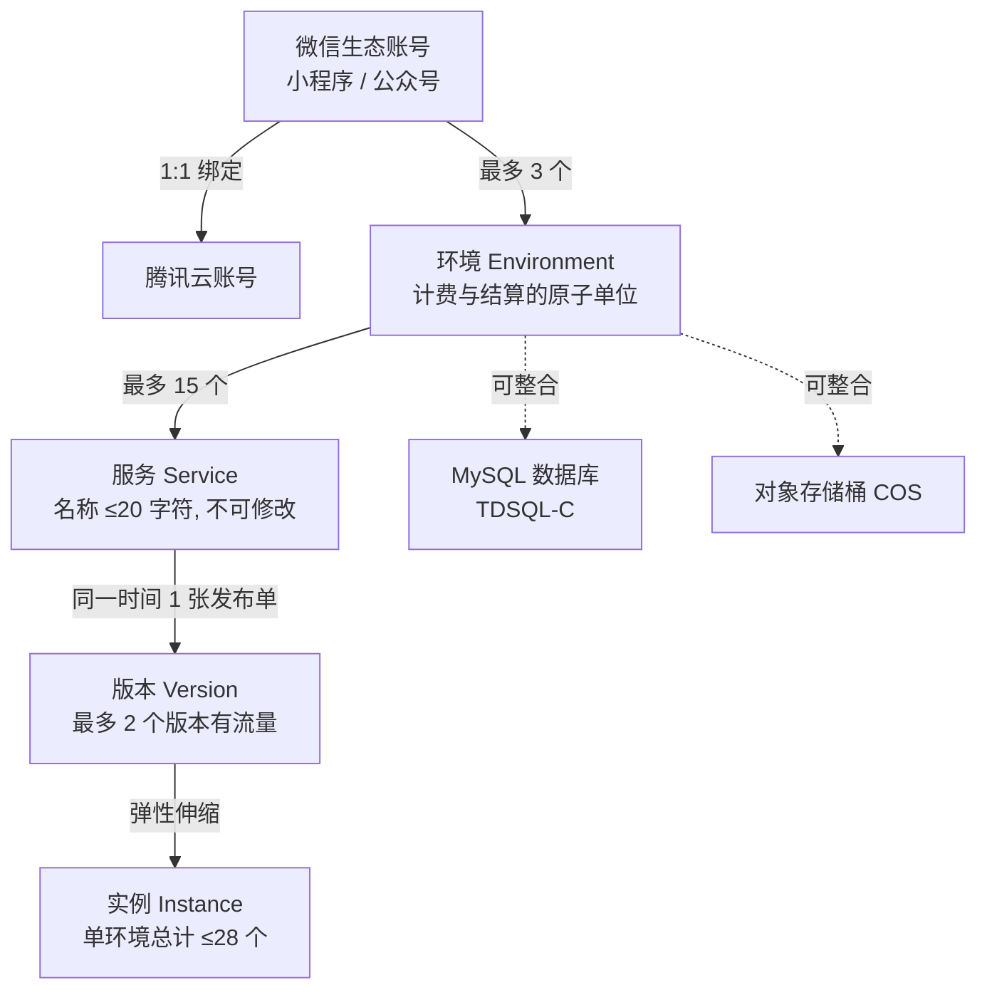

# 微信云托管的平台定位与资源模型

微信云托管是微信团队提供的、以云原生为基础的免运维高可用服务上云解决方案，文档称无需服务器、1 分钟即可部署小程序/公众号服务端（F-001）。其底层使用 Docker 与 Kubernetes 做容器编排，K8s 的运维配置由平台完全接手（F-002）；底层容器能力来自腾讯云托管，并整合了腾讯云 TDSQL-C、COS 等云资源（F-003）。

## 与相邻体系的边界

三套名字相近的体系极易混淆，本教程先把边界钉死：

| 体系 | 关系 | 关键事实 |
|---|---|---|
| 微信云托管 | 本教程主体 | 控制台独立，在微信开发者工具的云开发控制台与腾讯云控制台均看不到（F-008） |
| 微信云开发（含云托管） | 独立体系 | 其云托管能力已停止功能更新，仅支持存量业务继续运行（F-009） |
| 腾讯云托管 | 底层容器能力来源 | 微信云托管的容器能力来自腾讯云托管（F-003） |

开通的前置条件是必须先有微信小程序/公众号（F-010），且未认证的公众号不支持开通（F-047）。一个「小程序/公众号」账号最多创建 3 个环境（F-022），每个微信生态账号一对一绑定一个腾讯云账号（F-048）。

## 四级资源模型

微信云托管的资源分层是理解后续所有配额、计费与发布语义的基础：

- **环境**：最大单位，包含一整套资源（容器、数据库等），各环境相互独立、资源隔离，计费与资源包结算完全独立（F-011）。
- **服务**：名称只能包含数字、小写字母和 `-`，以小写字母开头，最多 20 个字符且不支持修改（F-018）；每个环境最多创建 15 个服务（F-019）。
- **版本**：一个服务同一时间点只能存在 1 张发布单（F-023）；一个服务下最多 2 个版本有流量（灰度过程中），其余版本可存在但无流量接入（F-024）。
- **实例**：单个环境下所有服务总实例数最大 28 个，不可特殊申请（F-020）；单环境下所有服务 QPS 最大 500，超出可提交工单特殊申请（F-021）。

## 运行边界与配额

| 维度 | 边界 | 事实 |
|---|---|---|
| 容器最小规格 | 0.25 核 0.5G | F-013 |
| 规格搭配规则 | 0.25 核/0.5GB … 16 核/32GB | F-029 |
| 监听端口 | 1~61000 整数且不能为 9100；默认 80，找不到即部署失败 | F-025 |
| 协议 | 仅 HTTP，不支持 tcp/udp/mqtt | F-070 |
| 扩缩容条件 | CPU 使用率、内存使用率两种，默认 60%，每次扩缩容后冷却 15 秒 | F-028 |
| 突发扩容 | 20s 内快速扩容 | F-014 |
| VPC | 2022 年 7 月后创建的环境无独立 VPC 概念，仅支持腾讯云上海地域 VPC | F-012、F-052 |
| 资源互联 | 仅支持授权 1 个 VPC，带宽峰值最大 5 Gbps，不支持跨地域 | F-052 |

一个容易踩空的点是端口：**端口号由业务项目自行设定，系统无法自动获取**，必须在新建版本时于控制台填写（F-026）；一个服务只能设置一个端口，该端口不暴露给调用方，公网域名收到的请求由统一网关转发到对应端口（F-027）。

## 洞察

### 洞察 A：资源隔离在环境层，而不是在服务层

- **陈述**：环境是资源隔离、计费结算与资源包归属的共同原子单位；服务的隔离只体现在镜像仓库与流量路由层面。
- **证据**：F-011（环境相互独立、资源隔离、计费与资源包结算完全独立）、F-129（资源包以环境为维度，一个资源包只能给一个环境使用）、F-146（资源包为环境级别购买，不支持转移到其他环境）。
- **反常识**：直觉上「按服务隔离」更符合微服务的直觉，但微信云托管的隔离单元是环境。服务级别的隔离只有镜像仓库（F-035：每个服务一个镜像仓库，互相隔离）。
- **行动**：在规划阶段先划分环境（开发/测试/生产），再在环境内划分服务；资源包按环境采购时，确认该环境是否会成为长期主环境，避免多环境共用导致资源包闲置。

### 洞察 B：容量上限是硬编码的「不可申请」清单，与「可申请」清单必须分开看

- **陈述**：平台同时存在三类配额——不可变资源模型约束、可提工单突破、彻底不支持。
- **证据**：不可变：F-018（服务名规则）、F-019（15 服务/环境）、F-020（28 实例/环境，文档明示不可特殊申请）、F-025（端口范围与保留 9100）、F-027（单端口）、F-070（仅 HTTP）；可申请：F-021（QPS 500，超出提工单）；彻底不支持：F-163（不支持 tcp/udp/mqtt、不支持公网 IP 访问、不支持 Docker Compose、不支持 WAF、不支持一个服务多端口、不支持部署数据库/Redis 等有状态服务）。
- **反常识**：文档在介绍「优点」时强调自动扩缩容与弹性，却在同一体系内把实例总数钉在 28 这个不随业务增长的数字上。「弹性」在单个服务内部成立，在环境总量上不成立。
- **行动**：把 F-163 的「不支持清单」作为架构评审的一票否决项先行检查——多端口服务、TCP 长连接协议、需要在容器内跑 Redis 的方案在云托管上必须先改造，而不是上线后碰壁。

### 洞察 C：省心平台的可用性代价是「静默销毁」

- **陈述**：闲置环境与欠费环境都会被平台自动处置，且处置窗口与恢复能力由平台单方定义。
- **证据**：F-044（30 天无请求即冻结，冻结超过 180 天自动销毁且不支持恢复）、F-045（欠费超过 7 天所有环境删除且无法恢复，环境删除后资源释放不可恢复）、F-153（欠费 12 小时内正常使用，>12 小时 <7 天停服但存储类继续扣费，>7 天资源销毁无法找回）、F-009（云开发中的云托管已停止功能更新）。
- **反常识**：这类平台的宣传口径是「免运维、高可用」，但「免运维」的另一面是用户无法阻止环境被回收；文档同时确认可用性超过 99.99%（厂商自述，F-017），两个数字描述的是不同层面——单请求可用性 vs 环境生命周期存续。
- **行动**：对有业务价值的环境配置资源到期/欠费告警与余额告警（F-043、F-162），并把「环境是否需要常驻」当作架构决策：需要常驻的任务型环境应把最小副本数设为大于 0（F-177 的场景正说明此点）。

## 相关概念

- [发布单、灰度与回滚](01-release-and-rollback.md)
- [调用链路与身份透传](02-call-and-identity.md)
- [微信生态集成：开放接口、支付、推送与存储](03-wechat-ecosystem.md)
- [计费模型与成本核算](04-billing-and-cost.md)
- [安全边界与迁移陷阱](05-security-and-migration.md)
- [可迁移模式：平台约束下的交付与成本治理](06-transferable-patterns.md)
