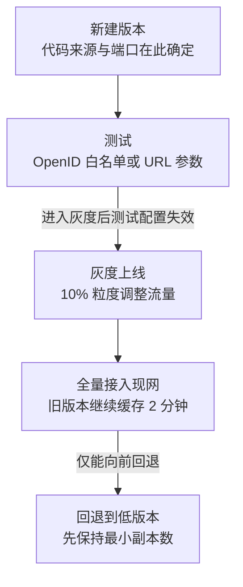

# 发布单、灰度与回滚

微信云托管的部署发布采用**发布单**形式，流程包含新建版本、测试、灰度上线 3 个子流程（F-053）。一个服务同一时间点只能存在 1 张发布单，如需发布其他版本需先取消发布或**结单**（F-023）——「结单」指把当前发布单流程走完并关闭，使服务回到「无进行中发布单」的状态。发布单不是控制台的一个可选页面，而是这个平台唯一的发布语义载体：版本、灰度、回滚、流水线、CLI 部署都挂在它上面。

## 发布单的三个子流程

| 子流程 | 关键约束 | 事实 |
|---|---|---|
| 新建版本 | 端口号由业务项目自行设定，系统无法自动获取，必须在新建版本时于控制台填写 | F-026 |
| 新建版本 | 监听端口必须为 1~61000 之间的整数且不能为 9100；默认 80 端口，找不到则部署失败 | F-025 |
| 新建版本 | 一个服务只能设置一个端口，端口在「服务设置」中定义、部署时决定，不暴露给调用方 | F-027 |
| 测试 | 测试方式有 OpenID 白名单和 URL 参数两种 | F-056 |
| 灰度上线 | 按 10% 粒度加减流量比例，只支持最多 2 个版本有流量，支持将灰度流量比例回调 | F-057、F-024 |
| 灰度上线 | 进入灰度上线步骤后测试阶段的测试配置失效且不可再回到上一步骤 | F-059 |

一个容易被忽略的单向性：一旦在发布单中更新了测试配置，当前流程就不可返回上一步再重新选择版本（F-059）。也就是说「先测错版本、再回退重选」在发布单内不是一条合法路径。

## 首发代码的 5 种方式

| 方式 | 说明 | 事实 |
|---|---|---|
| 绑定 GitHub 仓库 | 首次发布选择代码的方式之一 | F-054 |
| 绑定 GitLab 仓库 | 首次发布选择代码的方式之一 | F-054 |
| 绑定 Gitee 仓库 | 首次发布选择代码的方式之一 | F-054 |
| 手动上传代码包 | 支持代码文件夹、代码 zip 压缩包两种方式，大小不能超过 2 MiB | F-055 |
| 拉取镜像 | 首次发布选择代码的方式之一 | F-054 |

2 MiB 是**手动上传代码包**的上限（F-055），它与「上传镜像」（F-035 的每服务一个镜像仓库、镜像仓库支持存储 100 个镜像）构成两条不同体量的发布路径：源码直传适合小体量业务镜像化部署，镜像拉取适合已有 CI 产物的团队。

## 测试阶段的两种方式

| 测试方式 | 约束 | 事实 |
|---|---|---|
| OpenID 白名单 | 与 URL 参数方式并列的两种测试方式之一 | F-056 |
| URL 参数 | 至少配置 1 个 key 和 value 条件，value 支持 Glob 表达式 | F-056 |

URL 参数测试的价值在于用**请求特征**而非**用户身份**圈定测试人群：value 支持 Glob 表达式，意味着可以按路径、参数前缀、用户标识前缀等模式匹配请求，把内部账号或特定流量批次单独导入待发布版本。

## 灰度与流量路由

灰度的两个动作是「加流量」和「回调流量比例」，粒度为 10%（F-057）；同一个服务在灰度过程中最多 2 个版本有流量，超出 2 个的其他版本可以存在但没有流量接入（F-024、F-057）。

流量路由规则的语义是**首次进入随机分配 + 后续粘滞**：

- 用户首次进入时按照流量比例随机进入某一个有流量的版本；
- 非首次进入时该用户将一直进入到首次进入的版本中（F-058）。

版本切换存在空窗期：流量切换出现空白一般持续 1 分钟自动恢复；官方推荐的灰度做法是先 50%，然后隔 3-5 分钟结束灰度（F-066）。

## 版本状态、缓存期与回滚

| 维度 | 事实 |
|---|---|
| 版本状态 | 版本分线上、线下两种状态；线下版本会无视配置信息，在下线半小时内缩容到 0，并一直保持直到再次被推到线上（F-060） |
| 新旧版本交替 | 新版本发布成功后旧版本还会缓存 2 分钟，这段时间内控制台会看到新旧版本同时都有实例，且部分请求还会走到旧版本（F-061） |
| 回退方向 | 回退操作只能向前回退，即高版本回退到低版本，不可反向回退（F-062） |
| 回退动作 | 回退时先把目标版本的实例数保持到版本创建时的最小副本数，再接入现网（F-062） |
| 版本内配置 | 版本创建时「服务设置 - 基础信息」里的规格、副本数、扩缩容条件、环境变量信息会锁定在版本中，不可以再次更改；除线上版本不可删除外，其余版本均可删除（F-063） |

> **勘误说明（E-003）**：官方文档不同页面口径不一致——正文称版本下线后「半小时内缩容到 0」，同页举例又称「缓存 2 分钟后缩容为 0」。本处采信「2 分钟缓存期 + 半小时缩容」的并列口径：二者分别对应缓存与缩容两个阶段，并非同一时刻的两个互斥值（F-060、F-061）。

> **勘误说明（E-001）**：官方文档不同页面口径不一致——`basic/noun.html` 称实例副本数上限最大 5，`guide/service/pipeline.html` 与 `Billing/faq.html` 称最大 50。本处采信 50：每个版本的实例数上限为 50 个，超过上限不会再继续扩容（F-149）。

## 副本数、缩容与实例上限

| 维度 | 事实 |
|---|---|
| 最小副本数为 0 | 服务在 30min 内无流量后台会将实例副本数缩容为 0（F-065） |
| 部署后的首实例 | 服务部署发布时都会先产生 1 个容器实例，部署成功后等待半小时再缩容至 0（F-065） |
| 缩容前提 | 版本创建时锁定的副本数即扩缩容的判定基准，线上/线下状态变化不改变已锁定配置（F-063） |
| 版本实例上限 | 每个版本的实例数上限为 50 个，超过上限不会再继续扩容（F-149） |
| 内网域名 | 文档描述的机制是：服务开启内网访问后分配一个内网域名，开启内网方式时将自动触发一次部署发布；服务间内网调用的端口为服务部署发布时填写的端口，其他端口不可使用（F-067）。**注意时点**：官方另一页记载该能力「已主动下掉，后续会通过服务升级方式回归」（F-165），当前处于下线中（勘误 E-007），实际可用性以控制台为准 |

> **勘误说明（E-002）**：官方文档不同页面口径不一致——`basic/noun.html` 与 `guide/service/pipeline.html` 称缩容到 0 的判定时长为 30min，`basic/scene.html` 称 1 小时。本处采信 30min：两处文档一致，且与计费文档 F-151「连续半小时没有任何访问时会触发缩容到 0」互相印证（F-065）。

「开启内网访问会自动触发一次部署发布」（F-067）是一条容易被忽略的副作用：它会生成一个新版本，而版本内配置是锁定的（F-063），因此开关型配置变更可能以「重建版本」而非「改配置」的形式生效。

## 流水线与 CLI 部署

| 维度 | 事实 | 依据 |
|---|---|---|
| 流水线代码源 | 目前支持 GitHub、GitLab、码云 Gitee 三种代码源 | F-064 |
| 流水线端口 | 端口目前仅支持配置一个端口 | F-064 |
| 推送触发 | 推送触发只能全量发布现网 | F-064 |
| 私人仓库 | 业务自己搭建的私人仓库因涉及需要填写账密暂不支持 | F-064 |
| 分支策略建议 | 开发/测试环境建议绑定 dev 或 test 分支并可开启推送触发；预发/生产环境绑定 master/main 分支且一般不建议开启推送触发，建议采用手动触发流水线 + 灰度发布 | F-091 |
| CLI 部署命令 | `wxcloud run:deploy [OPTIONS] [PATH]` | F-068 |
| CLI 关键参数 | `--releaseType=FULL\|GRAY`、`--containerPort`、`--dockerfile`、`--targetDir`、`--libraryImage`、`--envParams`、`--override`、`--noConfirm`、`--detach` | F-068 |
| CLI 接入现网 | CLI 发布版本后直接 100% 接入现网 | F-068 |
| CLI 安装 | `npm install -g @wxcloud/cli` | F-069 |
| CLI 登录 | 登录命令为 `wxcloud login`，参数为 `-a, --appId=appId` 和 `-k, --privateKey=privateKey`；CLI 密钥需在「微信云托管控制台-设置-CLI 密钥」生成，生成时需要账号管理员扫码 | F-069 |

CLI 虽然提供 `--releaseType=GRAY` 参数，但文档明确其「发布版本后直接 100% 接入现网」（F-068）——灰度比例的精细调节仍然依赖控制台的发布单界面。

## 洞察

### 洞察 A：灰度是「按用户首次进入锁定」而非「按比例持续随机」

- **陈述**：流量比例只决定**新进入用户**的初始分布，已进入用户会被粘滞在首次进入的版本上，因此回调比例并不等于把已铺开的流量撤回。
- **证据**：F-058（首次进入按比例随机进入某个版本，非首次进入一直进入首次进入的版本）、F-057（按 10% 粒度加减比例，支持将灰度流量比例回调）、F-057/F-024（最多 2 个版本有流量）。
- **反常识**：直觉上把灰度比例从 50% 调回 0 就等于「清空灰度」，但按粘滞语义，已被分配到新版本的用户不会因为比例下调而回流——下调只影响后续新进入的用户。
- **行动**：把灰度比例下调当作「停止放量」而不是「回收流量」；灰度期评估指标要区分「新增用户」与「存量用户」两个口径，并在需要真正回收时改用回退（只能向前回退到低版本，F-062）而不是拖动比例条。

### 洞察 B：发布单是单向状态机，「回滚」在语义上等同于「再发布一次低版本」

- **陈述**：流程不可逆与配置锁定共同决定了一件事——回退不是撤销一次发布，而是把一个低版本重新推上线，该版本携带的是它自己创建时的配置快照。
- **证据**：F-059（更新测试配置后当前流程不可返回上一步）、F-062（回退只能向前回退，高版本回退到低版本；先保持最小副本数再接入现网）、F-063（版本创建时锁定规格、副本数、扩缩容条件、环境变量）、F-053（发布单含新建版本、测试、灰度上线三个子流程）。
- **反常识**：直觉上「回滚 = 恢复到上一套配置」，但平台禁止反向回退，且被回退到的低版本里的环境变量、规格、副本数是历史快照，不会跟随当前「服务设置」变化——想靠改服务设置来影响旧版本是无效动作。
- **行动**：把回滚演练成一次独立的发布动作而不是「撤销」：在 CI/发布脚本中固定「回滚 = 选定低版本 → 恢复其最小副本数 → 接入现网」的顺序，并提前确认目标低版本的环境变量与数据库连通性配置仍然有效。

### 洞察 C：平台用时间窗而非开关来缓冲变更，观测必须按「双版本」口径

- **陈述**：新版本上线、旧版本下线、流量切换、闲置缩容这四件事在平台侧都不是瞬时完成的，而是各自挂载了明确的时间窗，观察期内的指标与实例数天然是「两个版本叠加」的状态。
- **证据**：F-061（旧版本缓存 2 分钟，期间新旧版本同时有实例、部分请求仍走旧版本）、F-066（版本切换空窗期出现空白一般持续 1 分钟自动恢复）、F-065（部署成功后等待半小时再缩容至 0；30min 无流量缩容为 0）、F-060（线下版本在下线半小时内缩容到 0 并保持到再次被推上线）、F-062（回退时先把目标版本实例数保持到最小副本数）。
- **反常识**：直觉上「发布完成」应当是一次状态跃迁，但平台把它拆成缓存期、缩容期、空窗期三段；因此发布后 2 分钟内的错误率曲线不能直接归因到新版本，同一时刻控制台里存在两个版本的实例也不是配置错误。
- **行动**：发布后留出至少 2 分钟的观察窗再判定「新版本健康」；告警与容量评估要按双版本实例数计算；对有长耗时异步任务的服务，额外确认 30 分钟缩容窗口不会回收任务容器。

### 洞察 D：自动化链路只提供「全量」与「手工」两档，灰度无法被 CI 自动接管

- **陈述**：平台把「持续集成」和「渐进发布」拆成了两套互不重叠的机制——推送触发只支持全量发布现网，灰度必须回到控制台发布单里人工调节。
- **证据**：F-064（推送触发只能全量发布现网；私人仓库暂不支持）、F-091（生产环境一般不建议开启推送触发，建议手动触发流水线 + 灰度发布）、F-068（CLI 发布版本后直接 100% 接入现网）、F-055（手动上传代码包大小不能超过 2 MiB）。
- **反常识**：直觉上「绑定 GitHub 仓库 + 推送」= 小步灰度自动化，实际上自动链路根本没有灰度档位；而 CLI 的存在进一步强化了「一键全量」而非「一键灰度」的倾向，2 MiB 上限也决定了源码直传不适合作大工程的日常发布路径。
- **行动**：生产环境采用「流水线手动触发 → 构建镜像 → 控制台发布单灰度」三段式（F-091），把推送触发留给开发/测试环境；对需要自动化的团队，优先把 CI 产物做成镜像而不是走代码包上传。

## 相关概念

- [微信云托管的平台定位与资源模型](00-platform-model.md)
- [调用链路与身份透传](02-call-and-identity.md)
- [微信生态集成：开放接口、支付、推送与存储](03-wechat-ecosystem.md)——开放接口服务的版本级开关会影响发布与回滚策略
- [计费模型与成本核算](04-billing-and-cost.md)——实例数决定账单，灰度与缩容策略直接决定容器开销
- [安全边界与迁移陷阱](05-security-and-migration.md)——异步任务保活与版本下线缩容属于同一条发布链
- [可迁移模式：平台约束下的交付与成本治理](06-transferable-patterns.md)——灰度发布模式的原始事实来源
