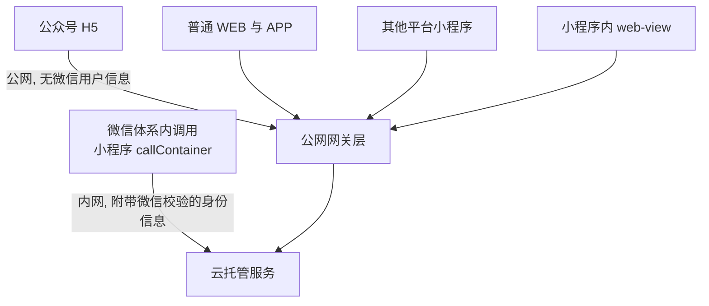

# 调用链路与身份透传

云托管服务的调用分为「微信体系内调用」和「公网调用」两种形态，目前仅支持 HTTP 协议，不支持 tcp/udp/mqtt 等其他协议（F-070）。这两条链路不只是入口不同——它们决定了后端**能不能拿到用户身份**、**要不要自建鉴权**、**能否享受防护**，是整套接入方案里最上游的一次分叉。



## 两条链路的分界

| 维度 | 微信体系内调用 | 公网调用 |
|---|---|---|
| 入口 | 微信生态客户端（小程序、公众号） | 普通 WEB 网页、APP、其他平台小程序后端 |
| 网络路径 | 自动经过微信接入层（内网） | 经过微信云托管公网网关层，所有用户共用该网关层，按域名转发到对应服务 |
| 身份信息 | 附带微信校验的权威用户信息 | 不包含任何微信用户信息 |
| 鉴权责任 | 平台代为完成调用方身份校验 | 开发者需要自己搭建用户登录鉴权等用户体系 |
| 其它约束 | 仅限被该微信云托管环境授权的小程序/公众号使用 | 不支持通过公网 IP 访问服务；默认公网域名仅能支持接口测试使用，小程序后台无法配置使用 |

对应的编号事实为：形态划分（F-070）、微信接入层与权威用户信息（F-004）、公网网关层与按域名转发（F-005）、公网调用无用户信息且需自建鉴权（F-082）、默认公网域名仅支持接口测试（F-007）、callContainer 需环境授权（F-071）、其他平台小程序只能走公网（F-093）。

## callContainer 的准入条件

- `callContainer` 方法**仅限被该微信云托管环境授权的小程序/公众号使用**，仅凭环境 id 和服务名无法调用对应服务（F-071）。
- 需在「小程序管理后台」-「设置」-「功能设置」-「基础库最低版本设置」中把值设定为 **2.23.0 及以上**，否则无法正常使用 `callContainer` 方法（F-072）。
- 使用前需在小程序 app.js 中执行 `wx.cloud.init()`，全局执行一次即可；**init 过程是异步的，需要等待 init 完成才可以发起调用**（F-074）。

标准调用形态（F-073）。以下代码块为**官方文档给出的调用示例原文**（逐字引用 F-073），非本知识包改写：

```javascript
wx.cloud.callContainer({
  config: { env: '填入云环境ID' },
  path: '/xxx',
  method: 'POST',
  header: { 'X-WX-SERVICE': 'xxx' }
})
```

其中 `X-WX-SERVICE` 填服务名称（F-073）。

## callContainer 的参数约束

| 参数 | 约束 | 事实 |
|---|---|---|
| `config.env` | 必填 | F-075 |
| `path` | 必填 | F-075 |
| `header` | 必填；**不能设置 Referer**；content-type 默认为 application/json | F-075 |
| `timeout` | 单位毫秒，最大值不能超过 **15 秒**，否则无效 | F-075 |
| `method` | 合法值 OPTIONS、GET、HEAD、POST、PUT、DELETE、TRACE、CONNECT | F-076 |
| `dataType` | 合法值 json（默认）与 other | F-076 |
| `responseType` | 合法值 text（默认）与 arraybuffer | F-076 |

> **勘误说明（E-004）**：官方文档不同页面口径不一致——`development/call/index.html` 称请求最大超时 60 秒，`development/call/mini.html` 与 `faq.html` 称 timeout 最大值不能超过 15 秒。本处采信 **15 秒**（参数级约束更具体，F-075）。

## 容器内收到的身份 header

容器内收到的请求 header 包含 9 个微信相关字段（F-077）：

| header | 含义 |
|---|---|
| `X-WX-OPENID` | 调用方 openid |
| `X-WX-APPID` | 调用方 appid |
| `X-WX-UNIONID` | 调用方 unionid |
| `X-WX-FROM-OPENID` | 来源方 openid |
| `X-WX-FROM-APPID` | 来源方 appid |
| `X-WX-FROM-UNIONID` | 来源方 unionid |
| `X-WX-ENV` | 云托管环境 ID |
| `X-WX-SOURCE` | 调用来源标识 |
| `X-Original-Forwarded-For` | 原始客户端 IP |

配套规则：

- 小程序发起 callContainer 调用时，服务请求 header 中会自动带有 openid、unionid、IP 地址、可信来源等用户信息，**无需再通过 `wx.login` 登录置换**（F-079）。
- header 大小写不敏感，但**部分框架会将原始 header 转为小写、无划线驼峰或下划线形式**，业务开发前需先打印测试 header 信息（F-078）。
- 判断调用来源是否为微信生态端，可判断 `X-WX-SOURCE` 头部是否存在（F-078）。
- 公众号处于**未登录模式**时，`callContainer` 方法中**不包含**微信用户信息（F-080）。
- 小程序中使用 web-view 时，web-view 部分**只能走公网调用**，不支持 call container 内网调用（F-081）。
- 若业务不需要用户身份信息，可在 header 中添加 `X-WX-EXCLUDE-CREDENTIALS: unionid, cloudbase-access-token, openid`；附带信息会占用大概 **10ms-50ms** 时间（F-087）。

## 公众号 H5 登录与跨端

公众号 H5 登录鉴权流程目前**只有已微信认证的服务号**可完成，需引入 `jweixin-1.6.0.js`、`cloud.js`（1.3.0）、`mplogin.min.js`（1.3.1）三个 JS 文件（F-083）。

`mplogin` 的参数与返回码（F-084、F-085）：

| 项 | 取值 |
|---|---|
| `scope` | 必填，取值 `snsapi_userinfo`、`snsapi_base` |
| `region` | 可选 `ap-guangzhou`、`ap-beijing`，不填默认为 `ap-shanghai` |
| `traceUser` | 默认 true，非上海地域请设置成 false |
| `ret` = -1 | 参数错误 |
| `ret` = 0 | 成功 |
| `ret` = 1 | 当前页面或 redirect 页面非 https 协议 |
| `ret` = 2 | 系统判定有风险阻止登录 |
| `ret` = 3 | 未引入微信 WEBSDK 或环境未授权此账号 |

跨端方案提供 `@wxcloud/cloud-sdk`，安装命令 `npm install @wxcloud/cloud-sdk --save`；**downloadFile、uploadFile 暂不支持适配**；公众号登录相关的 API 在微信客户端之外调用无法正常完成相应逻辑（F-086）。

## 容器内环境变量与资源复用

| 环境变量 | 含义 | 事实 |
|---|---|---|
| `CBR_ENV_ID` | 当前环境 ID | F-089 |
| `MYSQL_USERNAME` | 数据库用户名，仅在模板部署自动开通数据库时产生 | F-089 |
| `MYSQL_PASSWORD` | 数据库密码，仅在模板部署自动开通数据库时产生 | F-089 |
| `MYSQL_ADDRESS` | 数据库地址，仅在模板部署自动开通数据库时产生 | F-089 |

一套代码对应多个环境时，项目内部可通过环境变量 `CBR_ENV_ID` 感知当前项目在哪个环境运行，并维护 env 到配置的映射表（F-090）。

资源复用场景下需构造 `new wx.cloud.Cloud({ resourceAppid: 'WXAAA', resourceEnv: 'prod_001' })` 并 `await c1.init()`，`resourceAppid` 填环境所属的账号 appid（F-092）。

## 通用大小限制

| 项 | 限制 | 事实 |
|---|---|---|
| 请求大小 | 100KiB（文本 100KiB，二进制 20MiB） | F-088 |
| 返回包大小 | 1000KiB | F-088 |
| 错误码 -606001 | 请求包大小超过 100KB | F-088 |
| 错误码 -606002 | 响应包大小超过 1MB | F-088 |

> **勘误说明（E-005）**：官方文档不同页面口径不一致——`development/call/index.html` 写作 100KiB（文本）/ 20MiB（二进制），`development/call/h5.txt` 与 `faq.html` 写作 100K / 100KB。本处采信 **100KiB 文本 + 20MiB 二进制**（F-088）。

## 洞察

### 洞察 A：身份透传是「链路属性」而不是「应用逻辑」，因此鉴权成本在选链路时就已确定

- **陈述**：微信链路把用户身份作为网络层属性注入到 header，后端无需任何登录置换代码；公网链路则完全不带用户信息，鉴权体系必须由业务自建——两者不是同一套代码的两种配置，而是两套成本结构。
- **证据**：F-004（微信接入层内网并附带微信校验的权威用户信息）、F-079（自动带有 openid、unionid、IP 地址、可信来源，无需 `wx.login` 置换）、F-082（公网调用不包含任何微信用户信息，需自己搭建用户登录鉴权）、F-080（公众号未登录模式下不含用户信息）、F-094（微信链路效果相当于 WAF 和 DDoS 高防叠加，在云托管服务中都是标准配置，无需支付费用，厂商自述）。
- **反常识**：直觉上「接入微信生态 = 引入一个 SDK 就能拿到用户身份」，实际是**先选链路、再谈身份**：同一套后端在两条链路上拿到的身份信息完全不同，公众号未登录模式更是连微信用户信息都没有，此时若仍按「一定有 openid」写代码，逻辑会在公网入口上直接失真。
- **行动**：把链路选择写进架构决策表而非上线前配置项——凡是需要用户身份、刷单防护或免鉴权能力的入口一律走微信链路；后端统一从 header 读取身份并用 `X-WX-SOURCE` 是否存在做分支，对公网入口另行实现自有登录态。

### 洞察 B：header 名称会被框架改写，「读取 header」本身是一个需要前置验证的技术动作

- **陈述**：HTTP 层面 header 大小写不敏感，但框架层会把原始 header 规范化为小写、无划线驼峰或下划线形式，因此正确的取值代码必须基于实际打印结果而非文档中的原始拼写。
- **证据**：F-078（header 大小写不敏感，部分框架会将原始 header 转为小写、无划线驼峰或下划线形式，业务开发前需先打印测试 header 信息；判断调用来源可判断 `X-WX-SOURCE` 是否存在）、F-077（容器内收到的 9 个 header 清单）、F-079（自动携带 openid、unionid、IP、可信来源）。
- **反常识**：直觉上「header 名大小写不敏感，所以照文档写就行」，但那只是 HTTP 协议层的保证；文档明确要求先打印测试 header，说明大小写不敏感并不保护你免受框架改名的影响——照抄 `X-WX-OPENID` 在某些框架下会取不到值。
- **行动**：在服务端加一个一次性探针接口，打印真实到达的 header 键名与取值，再据此固化读取逻辑；判别「是否来自微信生态」用 `X-WX-SOURCE` 的存在性，而不是逐字段比对（避免因缺字段误判）。

### 洞察 C：15 秒超时与 100KiB/1000KiB 限制共同排除了「同步长任务」这一形态

- **陈述**：callContainer 的超时上限与报文大小上限叠加，意味着任何超过秒级或超过兆级的处理都不能在一次调用内完成，必须拆成「提交 + 回查/推送」的异步形态。
- **证据**：F-075（timeout 单位毫秒，最大值不能超过 15 秒，否则无效）、F-088（请求 100KiB 文本 / 20MiB 二进制，响应 1000KiB，错误码 -606001/-606002）、F-094（微信链路的防护与免付费特性，厂商自述）。
- **反常识**：直觉上可以用「接口立即返回、后台继续处理」的方式绕过超时，但响应体 1000KiB 的上限同样卡住了「把结果一次性带回去」的做法；超时上限在文档不同页面还给出过 60 秒的口径，若采信宽口径写代码，真实限制会在运行期以「参数无效」的形式暴露出来。
- **行动**：把接口设计成「幂等提交 + 状态回查」两段式，长任务结果落数据库/对象存储后以标识回查；对超大响应明确设计分页或引用式返回，并在客户端对 -606001/-606002 做可读错误提示。

### 洞察 D：跨端 SDK 提供的是「能力减法」而非「差异抹平」

- **陈述**：跨端 SDK 覆盖了常规调用，但文件上传下载与公众号登录相关能力在跨端场景中明确不可用，跨端的代价是把部分功能降级而不是等价的。
- **证据**：F-086（提供 `@wxcloud/cloud-sdk`；downloadFile、uploadFile 暂不支持适配；公众号登录相关 API 在微信客户端之外调用无法正常完成相应逻辑）、F-093（其他平台小程序后端和网站一同被视为「其他客户端」，只可通过公网链路访问，无法享受微信链路及生态优势）、F-081（小程序中 web-view 部分只能走公网调用）。
- **反常识**：直觉上「跨端 SDK = 抹平端差异」，但实际是微信生态能力在跨端被主动裁剪；尤其「其他平台小程序与网站同属其他客户端」这一归类，意味着它们既拿不到微信身份，也享受不到微信链路的防护（DDoS 防护必须关闭公网访问才生效，F-157、F-159）。
- **行动**：在设计阶段标注每个能力依赖哪条链路，把文件上传下载、公众号登录、身份透传列为「链路绑定能力」，为跨端入口准备公网域名 + 业务自有鉴权的降级路径，而不是假设一套代码通吃。

## 相关概念

- [微信云托管的平台定位与资源模型](00-platform-model.md)
- [发布单、灰度与回滚](01-release-and-rollback.md)
- [微信生态集成：开放接口、支付、推送与存储](03-wechat-ecosystem.md)——开放接口服务在容器内的转发与 header 改写行为
- [计费模型与成本核算](04-billing-and-cost.md)——只走 callContainer 访问不产生公网流量用量
- [安全边界与迁移陷阱](05-security-and-migration.md)——关闭公网访问是获得 DDoS 防护的前提条件
- [可迁移模式：平台约束下的交付与成本治理](06-transferable-patterns.md)——`callContainer` 授权边界所支撑的模式
