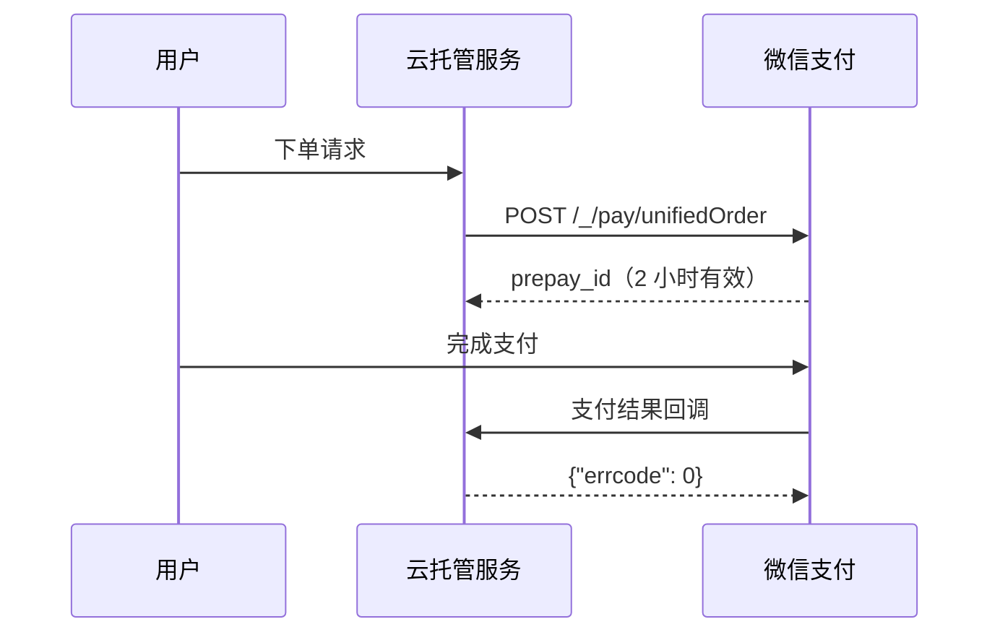

# 微信生态集成：开放接口、支付、推送与存储

在云托管上做微信生态集成，不是「调一个 SDK」，而是把四条互不共享鉴权模型的链路分别接进来：**开放接口服务**（把 `api.weixin.qq.com` 的调用旁加载进容器）、**微信支付**（平台已封装的 JSON 接口）、**消息推送**（微信后台回调到容器指定 path）、**对象存储**（小程序端 / 服务端 / COS-SDK 三种姿态）。四条链路各有独立的准入条件、失败模式与回滚代价，其中最反直觉的一条是：支付回调失败时你丢不到消息，只会收到同一笔通知的反复投递。

## 开放接口服务：把微信 API 中转进容器

「开放接口服务」以**旁加载**形式部署到服务中，中转 `api.weixin.qq.com` 的请求并自动处理 token 和鉴权问题（F-095）。它不是一段需要你自己写的 SDK，而是一个会被平台注入到镜像/版本里的运行时层——这决定了它的所有约束都是「镜像级」和「版本级」的。

| 维度 | 约束 | 事实 |
|---|---|---|
| 部署形态 | 旁加载到服务，中转 `api.weixin.qq.com` 并自动处理 token 与鉴权 | F-095 |
| 包体上限 | 请求包体最大 32 MiB，回包最大 32 MiB | F-095 |
| 超时 | 云调用最大超时时间 30s | F-095 |
| Header 改写 | 容器内云调用会增加 Header `x-openapi-seqid`，并修改 `x-forwarded-for` 标记请求来源 | F-096 |
| 不透传 Header | `connection`、`proxy-connection`、`keep-alive`、`proxy-authenticate`、`proxy-authorization`、`te*`、`trailer`、`transfer-encoding`、`upgrade`、`expect` | F-096 |
| 镜像依赖 | 依赖 shell，镜像内无 sh/bash 时无法正常部署容器（如 scratch 作为基础镜像时） | F-097 |
| 网络可达性 | 不允许外网直接访问，请求解析到 `169.254.0.x` | F-097 |
| 生效方式 | 开启前已存在的版本需在开启后**重新构建版本**才生效；实例扩缩容遵循版本创建时的开关状态 | F-098 |
| 资源复用 | 开放接口调用需在地址后加 `from_appid` 参数；不携带时归属为环境所属的「小程序/公众号」 | F-099 |
| Token 挂载 | 旧版云调用中 `access_token` 推送间隔 10 分钟、有效期 30 分钟、挂载路径 `/.tencentcloudbase/wx/cloudbase_access_token`；2022 年 7 月后创建的环境均不再支持旧版云调用 | F-100 |
| 白名单 | `cloudbase_access_token` 需在云托管平台配置接口白名单，`access_token` 不需要；配置以环境为维度，不同环境有不同的 token 和不同的配置 | F-101 |

## 微信支付：JSON 化的封装与长达两天的重试窗口

云托管封装微信支付后，商户号填入 `sub_mch_id` 字段，小程序/公众号 AppID 填入 `sub_appid` 字段，**免填写** `mch_id`、`AppID`、`sign`、`sign_type`，且接口入参和返回值都为 JSON 而不是 XML（F-102）。这既省事也埋坑：迁移旧的微信支付代码时，字段名和报文格式都要改一遍，而不是简单换个域名。

| 环节 | 约束 | 事实 |
|---|---|---|
| 字段映射 | 商户号填 `sub_mch_id`，AppID 填 `sub_appid`，免填 `mch_id`/`AppID`/`sign`/`sign_type` | F-102 |
| 报文格式 | 入参与返回值均为 JSON 而非 XML | F-102 |
| 回调应答 | 必须返回 `{ "errcode": 0 }` 的对象，否则接下来两天内会持续收到回调，直到返回成功为止 | F-103 |
| 接口路径 | 统一为 `POST http://api.weixin.qq.com/_/pay/接口名称` | F-104 |
| 需要 OpenID | 统一下单 `/_/pay/unifiedOrder`、申请退款 `/_/pay/refund` | F-104 |
| 不需要 OpenID | 查询订单 `/_/pay/queryorder`、关闭订单 `/_/pay/closeorder`、下载对账单 `/_/pay/downloadbill` | F-104 |
| 使用范围 | 只支持小程序使用，关系是「商户号—小程序」；jsapi 和 API 退款权限需到微信支付商户平台「我的授权产品」确认授权 | F-105 |
| 统一下单必填 | `sub_mch_id`、`body`（String(128)）、`out_trade_no`（String(32)）、`total_fee`（Int，单位分）、`spbill_create_ip`（String(64)）、`trade_type`（小程序取值 JSAPI） | F-106 |
| prepay_id | 有效期 2 小时 | F-106 |
| 关单 | 订单生成后不能马上调用关单接口，最短调用时间间隔 5 分钟 | F-107 |
| 对账单 | 微信在次日 9 点启动生成前一天的对账单，建议 10 点后再获取；只能下载三个月以内的账单；涉及金额的字段单位为「元」 | F-108 |
| 退款限制 | 交易时间超过一年的订单无法提交退款；每个支付订单的部分退款次数不能超过 50 次；请求频率限制 150qps 且错误或无效请求频率限制 6qps；申请退款总金额不能超过订单金额 | F-109 |
| 退款查询 | 一个订单部分退款超过 10 笔后默认返回前 10 笔和 `total_refund_count`，可传 `offset` 继续查询；`offset` 超过 `total_refund_count` 时返回报错 `PARAM_ERROR` | F-110 |
| 分账接口 | 共 8 个：`/_/pay/profitsharingaddreceiver`、`/_/pay/profitsharingremovereceiver`、`/_/pay/profitsharing`、`/_/pay/multiprofitsharing`、`/_/pay/profitsharingfinish`、`/_/pay/profitsharingquery`、`/_/pay/profitsharingreturn`、`/_/pay/profitsharingreturnquery` | F-111 |
| 分账限频 | 单次分账单个服务商 300QPS、单个交易收款商户 30QPS，超限报错 `FREQUENCY_LIMITED`；`receivers` 不超过 50 个 JSON 对象；同一笔订单最多能发起 20 次多次分账请求 | F-112 |
| 回调语义 | 只有用户支付成功时才会有回调，未支付或支付失败需用接口主动查询；容器服务必须返回 `{ errcode, errmsg }`，`errcode` 为 0 表示正常，异常时支付回调会持续重试最多两天 | F-113 |
| 重试节奏 | 15s/15s/30s/3m/10m/20m/30m/30m/30m/60m/3h/3h/3h/6h/6h，总计 24h4m；同样的通知可能多次发送，商户系统必须能正确处理重复通知；`sign_type` 目前支持 HMAC-SHA256 和 MD5，默认为 MD5 | F-114 |

> **勘误采信（E-008 · 部分退款次数上限）**：官方文档不同页面口径不一致——退款申请页写「不超过 50 次」，退款查询页写「超过 20 次请使用退款单号查询」。本处采信「二者为不同约束（发起上限 50 次 vs 查询接口建议阈值 20 次），非直接冲突，按各自页面表述呈现」：发起侧按 50 次上限设计（F-109），查询侧按 20 次之后的单号查询路径准备（F-110 的 `offset` 机制即服务于此）。

## 消息推送：path 配置与后台探测

消息推送在「微信云托管控制台-设置-全局设置-消息推送」中配置，需填写环境 ID、服务名称、path，**只需配置 1 个服务即可接收所有类型消息**（F-115）。配置时微信后台会发起一次检测请求，请求体 action 为 `CheckContainerPath`，开发者回复 success 或回复空即可完成测试；路径返回的 Status 需要为 200，否则路径配置检查失败（F-116）。

| 环节 | 要求 | 事实 |
|---|---|---|
| 配置位置 | 微信云托管控制台-设置-全局设置-消息推送 | F-115 |
| 必填项 | 环境 ID、服务名称、path | F-115 |
| 覆盖范围 | 只需配置 1 个服务即可接收所有类型消息 | F-115 |
| 检测请求 | 微信后台发起检测请求，请求体 action 为 `CheckContainerPath` | F-116 |
| 检测应答 | 回复 success 或回复空即可完成测试 | F-116 |
| 状态码 | 路径返回的 Status 需要为 200，否则路径配置检查失败 | F-116 |

## 对象存储：四个接口与三种访问姿态

对象存储 API 操作共 4 个接口：上传文件、下载文件、删除文件、获取临时链接地址；`cloudID` 由 `cloud://`、微信云托管环境 ID、存储桶 ID、文件路径 四部分构成（F-118）。

| 访问姿态 | 关键约束 | 事实 |
|---|---|---|
| 小程序端 | 需基础库版本 2.13.2 及以上；上传至同一路径是覆盖写；路径格式为根路径直接填文件名、文件夹例子 `test/文件名`，不要 `/` 开头 | F-120 |
| 小程序端临时链接 | `wx.cloud.getTempFileURL({ fileList: [{ fileID, maxAge }] })` 一次最多取 50 个；公有读的文件获取的链接不会过期，私有文件获取的链接默认 24 小时有效期（`maxAge` 默认 86400，单位秒） | F-121 |
| 服务端三接口 | `getUploadTcbFileLink`（`POST https://api.weixin.qq.com/tcb/uploadfile`）、`getDownloadTcbFileLink`（`POST https://api.weixin.qq.com/tcb/batchdownloadfile`）、`deleteTcbCloudFile`（`POST https://api.weixin.qq.com/tcb/batchdeletefile`）；三者均应在服务器端调用、不可在前端直接调用、均不支持云调用，所属权限集 id 为 49 | F-122 |
| COS-SDK 三步 | ① 用开放接口服务获取临时密钥 `http://api.weixin.qq.com/_/cos/getauth` ② 用临时密钥初始化 COS-SDK ③ 用 COS-SDK 做增删改查；访问存储桶需指定 Bucket 与 Region（默认 `ap-shanghai`） | F-123 |
| 服务端上传元数据 | 通过 `POST http://api.weixin.qq.com/_/cos/metaid/encode` 获取 `x_cos_meta_field_strs`，上传时在 Headers 中增加 `x-cos-meta-fileid`；文件无元数据时小程序端无法访问 | F-124 |
| 存储桶属性 | 底层 COS 存储桶默认私有读写且没有暴露控制台界面，控制台文件路径以 `tcb.qcloud.la` 结尾 | F-125 |
| 目录语义 | 对象存储本身没有文件夹和目录的概念，控制台展示的文件夹是以 `/` 结尾的空对象；COS API 仅支持删除单个文件，删除整个目录需先用 GET Bucket (List Objects) 获取指定前缀下的所有文件，再用 DELETE Object 逐个删除 | F-119 |
| 公众号 H5 | 不支持未登录模式操作对象存储；公众号 H5 被动回复只支持公众号，小程序需使用主动回复接口 `http://api.weixin.qq.com/cgi-bin/message/custom/send`，并需将 `/cgi-bin/message/custom/send` 加入配置白名单 | F-117 |

## WebSocket 与长连接

WebSocket 服务目前只支持 wss 方式连接；云托管底层会有健康检查尝试连接，正常 WebSocket 连接请求带 `Connection: Upgrade`、`Upgrade: websocket` 两个 header，可据此过滤（F-126）。小程序 WebSocket 需基础库版本最低 2.21.1，H5 WebSocket 需要 WEB-SDK 版本最低 3.4.0；在 iOS 高性能+ 模式下 `connectContainer` 暂时无法携带微信身份，服务端读取不到 `x-wx-openid`（F-127）。

## 洞察

### 洞察 A：开放接口服务是「版本级运行时」，不是「一个配置开关」

- **陈述**：开放接口服务以旁加载形式注入服务，必须在开启后重新构建版本才会生效，且镜像内必须存在 shell，这两点共同决定了它属于版本与镜像的固有属性，而非运行期可热插拔的能力。
- **证据**：F-095（旁加载形式部署、中转 `api.weixin.qq.com`、自动处理 token 与鉴权）、F-097（依赖 shell，scratch 基础镜像无法正常部署；不允许外网直接访问，请求解析到 `169.254.0.x`）、F-098（开启前已存在的版本需重新构建版本才生效，实例扩缩容遵循版本创建时的开关状态）。
- **反常识**：直觉上「在控制台打开一个开关，服务立刻就能调微信 API」——实际上不重新构建版本则老版本实例上根本不存在该运行时，而新扩容出来的实例又会沿用版本创建时的开关状态，于是会出现「同一服务不同实例能力不一致」的窗口。
- **行动**：开启开放接口服务时，把「重新构建并发布一个版本」写成发布流程里的强制步骤；基础镜像统一基于含 sh/bash 的镜像（不要用 scratch），并在 CI 中把「存在 shell」作为镜像检查项；对 `169.254.0.x` 的解析结果做连通性自检，而不是探测 `api.weixin.qq.com` 的公网可达性。

### 洞察 B：支付回调的失败模式是「重复投递」，不是「丢失」

- **陈述**：支付结果回调的正确性风险不在于收不到，而在于同一条通知会被反复投递长达两天，商户系统的幂等性是硬需求。
- **证据**：F-103（必须返回 `{ "errcode": 0 }` 的对象，否则接下来两天内会持续收到回调，直到返回成功为止）、F-113（支付结果回调只有用户支付成功时才会有，未支付或支付失败需使用接口主动查询；异常时支付回调会持续重试最多两天）、F-114（重试频率 15s/15s/30s/3m/10m/20m/30m/30m/30m/60m/3h/3h/3h/6h/6h，总计 24h4m；同样的通知可能多次发送，商户系统必须能正确处理重复通知）。
- **反常识**：直觉上「回调没收到 = 支付结果丢了」——实际相反：失败时你会被回调轰炸；而且**未支付或支付失败根本不会有回调**，必须主动调接口查询，把「查不到回调」当成失败信号会误判。
- **行动**：用 `out_trade_no`（String(32)）作为幂等键，订单状态机只允许单向跃迁且重复请求返回同一结果；把 `{"errcode": 0}` 的应答放在业务逻辑**之前**的最短路径上，即使后续处理失败也要先应答成功再异步补偿；同时为「长时间未收到回调」的订单配置主动查询兜底任务。

### 洞察 C：对象存储的「文件夹」是幻觉，路径即 key，覆盖写是默认语义

- **陈述**：把对象存储当文件系统用会导致三类错误——以为存在目录、以为同路径上传是新增、以为服务端上传的文件小程序端一定能读到。
- **证据**：F-119（对象存储本身没有文件夹和目录的概念，控制台展示的文件夹是以 `/` 结尾的空对象；COS API 仅支持删除单个文件，删目录需 List Objects 后逐个 DELETE）、F-120（上传至同一路径是覆盖写，路径不要 `/` 开头）、F-124（服务端上传需加 `x-cos-meta-fileid` 元数据，文件无元数据时小程序端无法访问）、F-121（私有文件临时链接默认 24 小时有效期，`maxAge` 默认 86400 秒）。
- **反常识**：控制台里能看见「文件夹」并能进去，会让人以为存储桶有目录结构；实际上那是平台造出来的空对象，删目录在 COS 层面根本不存在这个操作，只能逐文件删除。
- **行动**：路径命名规范在业务侧自建「目录」（如 `avatars/2026/10/xxx.png`）并由代码拼接，不以 `/` 开头；为所有需要小程序端读取的服务端上传路径强制注入 `x-cos-meta-fileid`；删除逻辑一律走「前缀列举 + 逐个删除」，并对临时链接的 24 小时有效期做客户端兜底刷新。

### 洞察 D：平台的探针与客户端的请求走同一条链路，必须在应用层主动区分

- **陈述**：消息推送的后台检测请求、WebSocket 的底层健康检查连接，都与真实业务请求共享同一条入口路径，如果不显式过滤，业务状态会被探针污染。
- **证据**：F-116（配置消息推送时微信后台会发起检测请求，请求体 action 为 `CheckContainerPath`，开发者回复 success 或回复空即可完成测试；路径返回的 Status 需要为 200）、F-126（云托管底层会有健康检查尝试连接，正常 WebSocket 连接请求带 `Connection: Upgrade`、`Upgrade: websocket` 两个 header，可据此过滤）、F-117（公众号 H5 场景的云托管不支持未登录模式操作对象存储）。
- **反常识**：直觉上「健康检查是基础设施的事，业务代码不用管」——但检测请求要求返回 success 或空、且 Status 必须为 200，这意味着入口处理器必须先识别并短路，再进入业务逻辑；否则一个严格校验入参的业务接口会直接把平台探测判成失败。
- **行动**：在推送回调入口先读 action 字段，`CheckContainerPath` 直接返回 success；WebSocket 入口按 `Upgrade`/`Connection` 两个 header 过滤健康检查；未登录态（公众号 H5）的存储操作提前拦截并给出明确错误，而不是让请求穿透到存储层。

## 相关概念

- [微信云托管的平台定位与资源模型](00-platform-model.md)
- [计费模型与成本核算](04-billing-and-cost.md)

同系列中，[发布单、灰度与回滚](01-release-and-rollback.md)、[调用链路与身份透传](02-call-and-identity.md)、[安全边界与迁移陷阱](05-security-and-migration.md)、[可迁移模式](06-transferable-patterns.md) 是本文的前置与后续约束：本文涉及的开放接口版本级开关会影响发布与回滚策略，支付与存储的幂等设计则是安全与迁移章节的前置条件。
