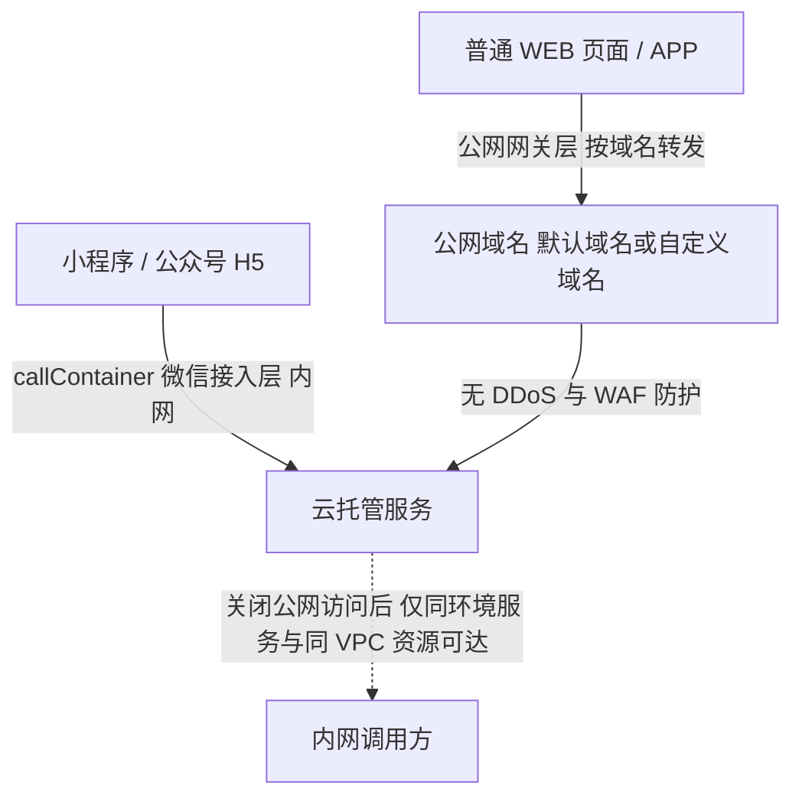

# 安全边界与迁移陷阱

微信云托管是微信团队提供的以云原生为基础的免运维、高可用服务上云解决方案（F-001）。「免运维」在安全与迁移两个维度上的真实含义是双向的：平台接管了实例生命周期、流量入口与运行时编排，但也把一部分控制权收归自己——公网域名不提供安全防护能力（F-158）、平台侧无法确认用户是否遭遇恶意刷单或爬虫（F-161）、闲置与欠费环境会被静默处置（F-044、F-045）。

本章先界定攻击面与能力边界，再逐项给出迁移路径上的改造动作，最后以「平台不承担的那部分风险」收口——平台对第三方代码包明确不承担任何责任，使用者需自行承担风险并确保符合适用法律法规和相关许可协议规定（F-169）。

## 攻击面：平台在哪里保护你，又在哪里不保护你

微信云托管的入站链路有两条，防护能力完全不同：

- **微信链路**：`callContainer` 仅限被该微信云托管环境授权的小程序/公众号使用，仅凭环境 id 和服务名无法调用对应服务（F-071）；使用 `callContainer` 方式时只有真实的微信小程序/公众号用户才能发起请求（F-161）。平台称该链路的微信通道效果相当于 WAF 和 DDoS 高防叠加，在云托管服务中这些都是标准配置、无需支付任何费用（厂商自述，F-094）。
- **公网链路**：微信云托管对公网域名不具备安全防护能力，包括默认公网域名和自定义域名（F-158）；默认公网域名性能有限制，仅能支持接口测试使用，小程序后台也无法配置使用默认公网域名（F-007）。
- **责任归属**：必须禁止服务公网访问，才可获得 DDoS 防护能力；使用公网访问方式遭到攻击或损失不在微信云托管责任范围之内（F-157）。

因此，官方给出应对 DDoS/刷单/爬虫的安全配置由三条同时满足的动作构成，文档写明这三条**缺一不可**（F-159）：

| # | 动作 | 落点 | 事实 |
|---|---|---|---|
| 1 | 采用 `callcontainer` 方式调用后端接口 | 小程序或公众号 H5 | F-159 |
| 2 | 关闭「公网访问」开关 | 「服务设置」 | F-159 |
| 3 | 「基础库最低版本设置」设定为 2.23.0 及以上 | 小程序后台 | F-159、F-072 |

第 3 条不是可选项：基础库低于 2.23.0 时无法正常使用 `callContainer` 方法（F-072），第 1 条直接失效，防护链条随之断掉。

### 关闭公网访问之后，谁还能访问

不开启公网访问时，服务只能被同一环境下的其他服务调用，或同一 VPC 网络（内网互联）下的其他资源调用，公网其他资源将无法访问；该限制只针对外向内访问，不限制服务内向外发送网络请求（F-168）。这条限制的形状很重要——它保护的是「谁能进来」，不限制「能往哪出」，因此服务访问外部 API 的出向流量不受影响。

出口固定 IP 是与之配套的增值服务：以包年包月付费模式计费、先付后用、每个环境独立计费，价格为 49 元/（月*环境），不可用作域名备案，到期未续费该固定 IP 将被回收不可用（F-144）。

> **勘误 E-006**：出口固定 IP 是否提供，`Billing/price.html` 给出 49 元/（月*环境）的价格，而 `scene/deploy/otherres.html` 称「目前还未提供付费的固定 IP 服务」。官方文档不同页面口径不一致，本处采信 **price 页**——otherres 页自述只适用于 2022 年 7 月之前创建的环境，属过时文档。

## 平台明确不支持的能力

以下清单是迁移评审的一票否决项来源（F-163）。

下表逐条对应 F-163 列出的 7 项「暂不支持的场景」，行数与 F-163 的条目数一一对齐（协议一项在原文中为两句，故拆为「调用协议」与「传输协议」两行）：

| # | 不支持项 | 官方表述 | 迁移含义 |
|---|---|---|---|
| 1 | 调用协议 | 仅支持 HTTP 协议通过域名调用服务 | 非 HTTP 的调用形态需先改造（F-163） |
| 2 | 传输协议 | 不支持 tcp/udp/mqtt 等协议 | 长连接、MQTT、UDP 类服务无法原样迁移（F-070） |
| 3 | 公网 IP | 不支持通过公网 IP 访问服务 | 只能走域名调用（F-082）；接入自定义域名需已备案（F-006） |
| 4 | 编排格式 | 不支持部署 Docker Compose | 多容器编排必须拆成多个服务（F-034） |
| 5 | 防护层 | 不支持接入 WAF | 自建防护能力只能落在业务侧（F-163） |
| 6 | 端口 | 不支持一个服务开启多个监听端口 | 多端口应用必须拆分（F-027、F-180） |
| 7 | 有状态服务 | 不支持用来部署数据库/Redis 等有状态服务 | 状态必须外置到云服务（F-164） |

还有一条是运行时形态的硬约束：微信云托管服务是计算型的，扩缩过程中数据无法持久化保存；服务挂载硬盘目前还不支持，多实例共享暂时只能使用数据库、存储等媒介沟通；Redis 暂未支持，可以在腾讯云或其他云厂商购买（F-164）。实例暂未支持挂载硬盘，需要在容器化改造时将数据库、存储等迁移到对象存储和云数据库（F-181）。换句话说，「本地目录」在云托管上不是存储方案，扩缩容的副作用是数据消失。

## 攻击成本的发现延迟

防护配置到位之后，风险并没有消失，而是换了一种形态：**费用与欠费信号的显现被推迟到次日结算，行为异常则只能靠告警当天发现**。

- 微信云托管费用当前为按天结算，遭受攻击导致用量异常要到第二天早晨结算时才会产生高额费用并可能触发欠费通知，文档称后续将优化为按小时结算（F-160）。
- 刷单和爬虫难以通过系统监控指标发现，云托管从平台层面也无法确认用户是否遭遇恶意刷单或爬虫（F-161）。

也就是说，攻击者获得的窗口不是「直到被拦截」，而是「直到次日结算」——**费用侧的信号在此期间被延后**；但这不等于当天毫无可见性：官方给出的「调用次数 + 平均实例个数」告警可在当天发现行为异常（F-162）。只有 `callContainer` 方式能让攻击流量只来自真实微信用户（F-161）。

官方给出的告警建议是：在「告警设置」中选择指标「调用次数」+「平均实例个数」，参考服务正常运行时的值扩大 2～5 倍设置告警，并在腾讯云侧设置余额告警能力（F-162）。这个配置有两个要点：其一，两个指标是组合而非二选一——调用次数捕捉流量异常，平均实例个数捕捉扩缩容带来的资源放大；其二，余额告警在腾讯云侧而非云托管控制台内，因为账号欠费冻结属于账号级事件（见「静默销毁风险」相关讨论，F-045、F-153）。

## 服务间寻址：内网域名缺席期的退行方案

微信云托管一开始有内网域名，但因安全性方面有隐患已主动下掉，后续会通过服务升级方式回归该功能；在此期间同一环境下服务间访问可通过容器 IP 或版本虚拟 IP 实现（F-165）。

> **勘误 E-007**：服务间内网访问状态，`scene/deploy/innet.html` 写作「已主动下掉，后续通过服务升级回归」，`scene/change/check.html` 写作「暂时下线，有进展会修改」。官方文档两页措辞不一致，本处采信二者**一致的状态结论**——**下线中**，仅措辞不同。

两条替代寻址路径各有代价：

| 方案 | 机制 | 代价 |
|---|---|---|
| 容器 IP | 直接使用容器 IP 寻址 | 容器存活时 IP 不变，但自动弹性扩缩容或版本更替会导致容器被回收，无法在其他服务中写固定 IP 地址（F-167） |
| 版本虚拟 IP | 通过所有服务容器中环境变量注入，形如 `SERVER_001_SERVICE_HOST`、`SERVER_001_SERVICE_PORT`、`SERVER_001_PORT_80_TCP_PROTO` | 该 IP 映射同一个版本下的所有容器实例，多个会轮询（F-166） |

虚拟 IP 的轮询语义值得单独强调：它把「多实例」这件事显式暴露给了业务侧——同一个 `SERVER_001_SERVICE_HOST` 后面是多个会被轮询到的实例，任何依赖会话亲和或单机状态的假设都会失效。这与 F-164「多实例共享只能通过数据库、存储等媒介」是同一条约束的两面。

## 从云开发迁移到云托管

云开发与云托管是两套独立体系（F-008），云开发中的云托管能力已停止功能更新，仅支持存量业务继续运行（F-009）。从云开发整体搬迁到云托管，改造量集中在以下几处：

| 迁移对象 | 现状与改法 | 事实 |
|---|---|---|
| `wx-server-sdk` | 迁移后基本失效 | F-170 |
| 获取用户身份 | 云函数通过 `cloud.getWXContext()` 获取 openid 等信息，在云托管中直接从请求的 `req.headers` 中读取 | F-170 |
| `wx.cloud.CloudID` | 在云托管中不做自动解析，需自行通过 API 完成信息置换 | F-170 |
| 云开发数据库 | 属于 mongo 协议的 flexdb 数据库，云托管没有与其对应的数据库类型 | F-171 |
| CMS 管理系统 | 完全迁移难度巨大，文档建议放弃迁移，改用其他数据库基础在云托管支持范围中的内容管理系统 | F-172 |
| 数据库连接数 | 云函数的一次执行对应一次请求，云开发业务无需考虑连接数问题，放在云托管中就需要考虑 | F-173 |

flexdb 的三条出路分别是：保留云开发数据库形态并使用 `cloudbase-node-sdk` 操作、迁移到云托管 mysql 数据库、或在腾讯云购买 mongo 数据库（F-171）。CMS 的处置则示范了另一种迁移决策——**承认不可迁移并放弃**，用平台支持范围内的内容管理系统替代（F-172）。

### 迁移检查清单

官方给出的检查清单共三条（F-180）：

1. 微信云托管目前不支持同一个服务多个端口，项目若暴露多个端口需拆分成多个子服务；
2. 迁移时须确认项目中数据库连接地址是线上可访问的外网地址或内网地址，而不是 `localhost:3306`；
3. 项目暴露的端口要和控制台配置的端口保持一致。

这三条之外还有两条与部署链路强相关的前置项：手动新建服务并部署时，必须在「服务设置」中补全环境变量 `MYSQL_ADDRESS`、`MYSQL_PASSWORD`、`MYSQL_USERNAME`，否则会引发无法连接数据库并导致部署失败；控制台部署模板成功后这三个环境变量会消失，二次部署前需先补全（F-189）。流水线侧也有约束：目前支持 GitHub、GitLab、码云 Gitee 三种代码源，端口仅支持配置一个端口，推送触发只能全量发布现网，业务自己搭建的私人仓库因涉及需要填写账密暂不支持（F-064）。

入门路径上，微信云托管提供「无门槛部署」和「自定义部署」两种方式，无门槛部署整个步骤会在 3-5 分钟完成（F-190）——但它只是部署快，不代表存量系统搬得进来。

## Django migration 的三种触发方式取舍

Django 的 migration 同步分两步：`python manage.py makemigrations` 生成 migrations 文件对比新旧 Model 找出差异，`python manage.py migrate` 根据 migrations 执行 SQL 并依据 `django_migrations` 表只执行没有执行过的步骤（F-174）。真正需要决策的是「在哪一步触发」，官方给出三种：

| 触发方式 | 机制 | 取舍 |
|---|---|---|
| Dockerfile `RUN` 中执行 | 构建期执行 | 构建环境不在数据库 VPC 内网中，只能使用外网地址；文档不建议这种用法，migration 操作非常多时会增加构建耗时（F-175） |
| Dockerfile `CMD` / `ENTRYPOINT` 中集成 | 容器启动时执行 | 多个实例同时创建出来需要注意竞争处理（F-176） |
| 通过 webshell 进入实例执行 | 人工介入 | webshell 进入的实例都处于同一数据库 VPC 内网环境（F-176） |

其中 **webshell** 指云托管控制台提供的网页版终端入口，可直接进入运行中的实例执行命令。

三条路径的共同点是：**migration 必然要在某个时刻与数据库握手**，而这个时刻的位置决定了它是否落在 VPC 内网内、是否会被多实例并发执行。构建期执行在 VPC 之外且拖慢构建；启动期执行则把并发竞争交给业务处理；webshell 执行最可控，但需要人工介入且要求实例处于内网环境。

## 异步任务与「最小实例 0」的冲突

异步任务是云托管上最容易静默失败的一类负载：

- 服务下版本的实例最小副本数为 0 且当前服务连续半小时没有任何访问时会触发缩容到 0，不产生任何容器相关用量和费用（F-151）；实例副本数最小值设为 0 时，服务在 30min 内无流量后台会将实例副本数缩容为 0，服务部署发布时都会先产生 1 个容器实例，部署成功后等待半小时再缩容至 0（F-065）。
- 异步任务场景下最小实例为 0 时触发一个时长 2 小时的异步任务，若期间没有任何访问请求，半小时就直接缩容到 0，需保证实例不会回收、在半小时内触发更新的实例直到异步任务执行完毕（F-177）。
- 真实做法示例：每天凌晨开始的数据迁移任务时长约 3 小时，使用云函数定时触发器在凌晨前先把迁移服务拉起来（冷启动 1 分钟），过程中每 15 分钟发起请求防止容器缩容，5 点半结束请求；服务规格需设置内存/CPU 条件大于 95% 以降低突刺导致扩容的概率（F-178）。
- 官方常识中的一条硬约束：代码中请不要在请求处理程序范围之外启动后台线程或例程，并确保在传送响应之前完成所有异步操作；用户无法控制实例服务的重启、新增、销毁，这些权限都由云托管集群自己控制（F-179）。

> **勘误 E-002**：缩容到 0 的判定时长在 `basic/noun.html` 与 `guide/service/pipeline.html` 写作 30min，而在 `basic/scene.html` 写作 1 小时。官方文档不同页面口径不一致，本处采信 **30min**（两处文档一致，且与计费文档 F-151 一致）。

> **勘误 E-001**：单个版本的实例数上限，`basic/noun.html` 写作最大 5，而 `guide/service/pipeline.html` 与 `Billing/faq.html` 写作最大 50（F-149）。官方文档不同页面口径不一致，本处采信 **50**（更具体且被计费文档复述，noun 页为旧值）。做扩缩容容量规划时以 50 为**单版本**上限估算，并同时受更紧的**单环境总实例数上限 28 个**约束（F-020，不可特殊申请）——同一环境下多服务共享这 28 个额度，单个服务实际可用额度通常低于 50。

另一条相关的容量约束是：定时扩容的实例副本数不能设置小于最小实例副本数且不可设置为 0（F-031）——定时扩缩容不能用来给异步任务保活。

## 容器化改造与构建侧陷阱

- **运行时形态**：微信云托管的 k8s 底层使用的是 docker，需要在提供的镜像启动时运行一个守护进程（docker daemon），而 podman 不需要，因此 podman 上能运行的程序迁移到云托管可能启动不起来（F-182）。
- **构建缓存规则**：Docker 构建缓存对 ADD 和 COPY 指令会检查镜像中文件内容并为每个文件计算校验标识，校验标识通常不考虑文件的最后修改时间和最后访问时间；缓存无效后所有后续命令都会重新构建（F-183）。
- **依赖层写法**：先 COPY `./package*.json` 再执行 `npm install` 最后 COPY `. .` 的写法，在不变更 `package*.json` 时打包时间基本都在 1 秒左右（F-184）。
- **加速源**：线上构建的 Docker 镜像源已经是腾讯加速源，不需要自己设置 `registry-mirrors`；Dockerfile 内可自行指定 alpine（`mirrors.tencent.com`）、NPM（`mirrors.tencent.com/npm/`）、Python（`mirrors.cloud.tencent.com/pypi/simple`）加速源（F-185）。
- **构建模板**：构建方案文档收录 6 类模板——Nginx+HTML 分发、Nginx+Node 分发、PHP 中 SG11 扩展安装、jetty 应用、Nginx+java-openjdk 分发、Nginx+Node 简易 WebSocket（F-186）；官方模板仓库位于 `https://github.com/WeixinCloud/` 命名空间，包含 springboot、express、django、thinkphp-nginx、thinkphp-apache、laravel、flask、koa、dotnet、golang 等框架与语言模板（F-188）。
- **构建失败排查**：构建阶段无报错日志、空白，大概率是构建超时（> 10 分钟）；微信云托管不支持 Docker Compose（F-034）。

### 定时触发的 Dockerfile 改造

服务内定时触发的 Dockerfile 改造目标为 3 个：安装 cron（需要触发业务 url 则安装 curl）、创建 crontab 执行命令（`task.txt`）、将项目启动命令和 cron 启动命令合并成脚本并把容器启动命令改成执行脚本；示例使用 `RUN crontab task.txt` 与 `ENTRYPOINT ["sh", "start.sh"]`（F-187）。这与 F-179「不要在请求处理程序范围之外启动后台线程」并不矛盾——cron 是容器主进程的一部分，而请求处理器外的常驻线程不是。

## 第三方代码包与责任划分

在微信云托管上使用第三方代码包时，平台不对第三方代码包承担任何责任，使用者需自行承担风险并确保符合适用法律法规和相关许可协议规定（F-169）。这条与 F-157（公网访问遭攻击不担责）、F-163（不支持 WAF）共同构成平台的免责结构：**平台只对自己提供的链路能力负责，防护、资源合规与第三方依赖的风险由使用方承担。**

## 洞察

### 洞察 A：防护是三段链条，而不是一个开关

- **陈述**：要获得 DDoS 防护，必须同时满足「用 callContainer 调用」「关闭公网访问」「基础库 ≥ 2.23.0」三条，任何一条缺失，防护即失效——它不是可独立开关的能力。
- **证据**：F-159（文档写明三条缺一不可）、F-157（必须禁止公网访问才可获得 DDoS 防护）、F-158（对公网域名不具备安全防护能力，含默认域名与自定义域名）、F-072（基础库低于 2.23.0 无法正常使用 `callContainer`）、F-071（`callContainer` 仅限被授权的小程序/公众号使用）。
- **反常识**：直觉上「把服务挂到公网域名上，配好 CDN/WAF 就行」，但平台明确不支持接入 WAF（F-163），且默认公网域名仅支持接口测试使用（F-007）——公网入口在这套体系里是测试通道，不是生产通道。
- **行动**：把三条写进上线检查表并逐条打勾；基础库版本作为客户端侧的发布约束纳入灰度范围，因为它是静默失效项——配置没改、代码没变，防护却已消失。

### 洞察 B：攻击成本的发现延迟由计费周期决定

- **陈述**：平台侧无法识别刷单与爬虫，而费用按天结算，因此**费用与欠费信号**要到次日结算时才显现；行为异常当天仍可由告警发现，但必须自己配告警。
- **证据**：F-161（刷单和爬虫难以通过系统监控指标发现，平台层面也无法确认）、F-160（按天结算，异常要到第二天早晨结算时才产生高额费用并可能触发欠费通知）、F-162（告警用「调用次数 + 平均实例个数」，按正常值 2～5 倍设置，并在腾讯云侧设置余额告警）、F-153（欠费大于 12 小时小于 7 天所有环境停服）。
- **反常识**：平台自称 callContainer 链路的效果相当于 WAF 和 DDoS 高防叠加、且为标准配置不额外收费（F-094，厂商自述），但「WAF 效果」防的是流量型攻击，防不了「伪装成正常用户的高频请求」——F-161 明说平台无法确认是否恶意。
- **行动**：告警必须同时覆盖「用量」和「余额」两条线（F-162）：用量告警负责当天发现行为异常，余额告警负责兜住次日结算前的费用敞口；并把「次日结算」纳入事故响应时间线——当日无法用账单止损，只能靠告警提前发现并主动关闭公网访问。

### 洞察 C：不可迁移性比不可用性更难发现

- **陈述**：平台不支持的多端口、Compose 编排、有状态服务、挂载硬盘等能力，会在迁移时被「先跑起来」的假象掩盖，直到扩缩容、版本更替或依赖编排时才暴露。
- **证据**：F-163（7 条不支持项，本章「平台明确不支持的能力」表逐条对齐）、F-027 与 F-180（单端口、端口须与控制台一致）、F-034（不支持 Docker Compose）、F-164 与 F-181（计算型、扩缩过程数据无法持久化、不支持挂载硬盘、Redis 暂未支持）、F-182（依赖 docker daemon 的程序在 podman 上可跑、在云托管可能起不来）。
- **反常识**：迁移评审最容易被放行的是「能启动」，而最难被发现的是「启动后偶发失败」——容器 IP 会被回收（F-167）、多实例虚拟 IP 会轮询（F-166）、本地目录会随扩缩容消失（F-164），这些都不是启动期错误。
- **行动**：迁移验收不看「能否部署成功」，而看「F-163 的 7 条不支持项是否逐条给出处置结论 + 状态是否已外置 + 多实例语义是否已在业务侧适配」。

### 洞察 D：内网寻址能力缺席期，寻址责任回到业务侧

- **陈述**：内网域名下线后，服务间寻址退化为容器 IP 与版本虚拟 IP 两条路径，前者不稳定，后者把多实例轮询语义暴露给业务。
- **证据**：F-165（内网域名因安全性隐患已主动下掉，期间可用容器 IP 或版本虚拟 IP）、F-166（虚拟 IP 以 `SERVER_001_SERVICE_HOST` 等环境变量注入，映射同版本所有实例，多个会轮询）、F-167（容器 IP 会因弹性扩缩容或版本更替被回收，无法写固定 IP）、F-168（关闭公网访问后仅同环境服务与同 VPC 资源可达，且只限制外向内）。
- **反常识**：平台关闭内网域名的原因是「安全性方面有隐患」（F-165）——一个以简化调用为卖点的平台，反而把服务间寻址中最稳定的那一段拿掉了；这提示「内网域名」在安全模型上从来不是默认安全项。
- **行动**：服务间调用优先用虚拟 IP 环境变量而非硬编码 IP，并按「多实例轮询」设计调用侧逻辑（会话亲和、超时、重试都不能假设单实例）；跨服务状态一律走数据库或存储（F-164）。

## 相关概念

- [微信云托管的平台定位与资源模型](00-platform-model.md)
- 发布单、灰度与回滚（01-release-and-rollback.md）——本章的异步任务保活与版本下线缩容语义属于同一条发布链
- 调用链路与身份透传（02-call-and-identity.md）——`callContainer` 的授权范围与身份 header 细节
- 微信生态集成：开放接口、支付、推送与存储（03-wechat-ecosystem.md）——开放接口服务的旁加载部署约束
- 计费模型与成本核算（04-billing-and-cost.md）——按天结算、欠费停服与资源包抵扣顺序
- [可迁移模式：平台约束下的交付与成本治理](06-transferable-patterns.md)
