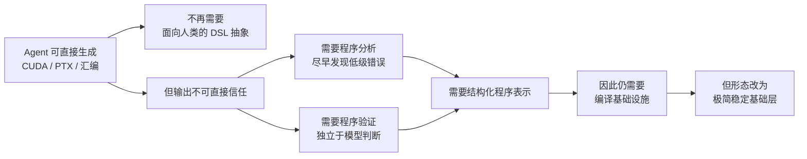

# 问题背景与项目定位

> 文中 `[F-xxx]` 为编号事实，逐条来源见 [facts.md](../references/facts.md)；核验记录见 [sources.md](../references/sources.md)。

## 1. 起点：一个不舒服的问题

陈天奇在文章中给出两个并列的观察 [F-019][F-020]：

- **一边**：Agent 已经能端到端开发高性能 GPU 算子。文中点名 KernelAgent、CUDA Agent、Cursor 的多 Agent 系统、CAKE、TIRx Harness、KDAgent、EAT 七项工作，认为它们展示了自动化 GPU 内核开发的显著进展。
- **另一边**：这带来一个反问——「我们是否在把自己淘汰掉？」文中引用 DeepSeek 工程师刘胜宇的《我不得不把才华埋葬在昨天》，以及 Stanford HazyResearch 的博客 *Retire the Abstractions*，后者质疑连 CUDA DSL 是否还必要。

由此逼出核心问题：

> **当编写程序的主力不再是人类，我们是否还需要编译器？**

作者的回答是：**需要，但必须以不同的形态出现** [F-016]。

## 2. 论证链：从「不需要编译」到「仍需要基础设施」

这条论证链值得完整复述，因为它是整个项目的合法性来源：

三个关键判断：

1. **「不再需要编译器去编译任何东西」不等于「不再需要编译基础设施」** [F-017]。即使代码生成全部交给 Agent，正确性也不能依赖模型自述或测试抽样。
2. **程序分析是 Agent 的「计算器」**。Agent 可以对文本做推理，但结构化表示能让它更快、更便宜地检查内存访问、线程同步、数值属性。
3. **验证需要精确定义的语义**。官方博客还提到一种更彻底的形态：用 Lean 等形式化工具把 IR 语义形式化，再对正确性证明做机器检查 [F-018]。

> 这一步是「第一性原理」式推理：先抽掉「编译器=代码生成器」这一默认假设，再问剩下什么是不可替代的。答案是**表示、分析与验证**，而不是**变换与启发式**。

## 3. 项目定位

`apache/tvm-tirx` 的仓库描述是 *Open ML Compiler Foundation for the Agentic Era* [F-001]，README 开篇给出同一判断的更强版本：

> We believe that, in the future, **all GPU kernels will be developed, optimized, and verified by AI agents.** [F-002]

TIRx 对自己的定义是 **minimal, stable, and extensible DSL and compiler foundation**，目标是让 Agent 能：写与优化 kernel、开发自己的分析、并最终验证正确性 [F-003]。

官方 README 列出五项特征 [F-004]：

| # | 特征 | 含义 |
|---|------|------|
| 1 | Minimal, stable core IR | 小而稳定的核心 AST 节点集合，面向常见需求与扩展 |
| 2 | Predictable utilities | TVM-FFI 桥接生成、符号整数分析、结构遍历与映射、CUDA/host LLVM 的最小代码生成 |
| 3 | Dynamic extension by design | 新类型与算子无需重编译单体即可加入；扩展可放独立仓库并动态加载 |
| 4 | First-class cross-language support | Python、C++、Rust；可快速原型后把性能关键部分移到 Rust/C++ |
| 5 | Built on stable toolchains | 复用成熟编译器后端，而不是在自有流水线里重造一切 |

## 4. 两代 TIRx：必须先分清的同名概念

这是学习本主题最容易踩的坑（顺带记一下读音：TIRx 读作 “tier-ex” [F-094]）。公开材料里至少有两代交付物 [F-097]（「第一代 / 第二代」是本包的分析标签，非官方命名）：

| 维度 | 第一代：TVM 内嵌 TIRx（2026-06） | 第二代：独立 `apache/tvm-tirx`（2026-11） |
|------|----------------------------------|-------------------------------------------|
| 包 | `apache-tvm` 0.25.0 [F-095] | `apache-tvm-tirx` 0.1.0b1 [F-005] |
| 文档 | `tvm.apache.org/docs/tirx/` [F-096] | `tvm.apache.org/tirx/` [F-096] |
| 编程入口 | `@T.jit` / `@T.prim_func` [F-068] | `@T.function` [F-008] |
| 核心抽象 | execution scope + storage-first layout + tile primitive dispatch [F-074][F-075][F-076] | 三层极简 IR + 动态扩展 + 三语言 [F-010][F-004] |
| 性能证据 | 54 配置 B200 基准 [F-081]~[F-086] | 暂无公开基准 [F-040] |
| 定位 | 硬件原生 kernel DSL 与编译器 [F-066] | Agent 时代的极简编译基础层 [F-002] |

第二代是社区在 TVM-FFI 之后对核心做「拆分 + 面向 Agent 重新设计」的产物 [F-021]。两代共享设计判断，但**代码基与 API 不同**——把第一代的 `Tx.*`、`@T.prim_func` 用法直接套到 `tvm_tirx` 上会失败 [F-097]。

需要注意两代的**动机差异**：第一代的核心问题是「前沿硬件变化快于编译器内建能力，边界该画在哪」[F-066][F-072]；第二代才把「Agent 成为主要开发者后，编译器是否还需要」作为中心论点 [F-016]。这不是矛盾，而是同一低边界设计在不同阶段的两种表述。

> 本知识包以第二代 `apache/tvm-tirx` 为主线；第一代内容用于解释设计来源与性能证据，并在 [08-two-generations](08-two-generations.md) 集中对照。
>
> 另注：本库已有的 [Apache TVM 知识包](../../apache-tvm/index.md) 记录了 TVM 主仓 `tvm::tirx` 的 SBlock/PrimFunc IR 层，属于第一代 TVM 内嵌实现的源码侧材料；其与 0.25.0 DSL 的逐版本对应关系本次未逐文件核验 [F-098]。

## 5. 项目成熟度与阅读心态

必须提前明确的事实 [F-005][F-006][F-007][F-095]：

- **第一代**已于 2026-06 随 `apache-tvm` 0.25.0 发布，配套 kernel library、benchmark 与课程，属于可安装使用状态；
- **第二代**独立仓库创建于 **2026-10-13**，截至核验日仅有约一个月公开历史；
- 第二代 PyPI 最新版本是 **`0.1.0b1`**，即 beta；
- 官方博客把第二代的 Rust 支持标为 **work in progress**；
- 中文专栏文章对 Rust 成熟度的表述强于官方英文博客（详见 [sources.md](../references/sources.md) 的冲突记录）。

因此正确的阅读心态是：**学习其设计判断与架构取舍，而不是把第二代 beta 当作已验证的生产依赖**。第一代的 54 配置基准证明了「低边界 DSL 能达到 SOTA 邻域」，但不能外推到第二代 [F-099]。这套判断（分析与验证是刚需、基础层要极简稳定、扩展要动态、语言要按模块选择）即使项目本身变化，也仍然可迁移。

> **源码核对补充（2026-11-09）**：本包已用本地检出 commit `cdc7a377`（2026-11-08）核对仓库结构、后端矩阵、lowering 顺序与构建方式 [F-100]。核对后修正了三处文档-only 认知：后端不止 CUDA/LLVM、`compile` 并非零 pass、Rust 工程链路比「WIP」二字更完整。详见 [11](11-source-repo-tour.md)、[12](12-backend-matrix.md)、[13](13-compiler-pipeline.md)。

## 6. 一句话总结

TIRx 不是「又一个更快的编译器」，而是把编译器拆成两层：**下层提供不可绕过的最小语义与工具（稳定、可验证），上层交给 Agent 快速迭代（灵活、可丢弃）**。理解了这条分层原则，就理解了整个项目。
