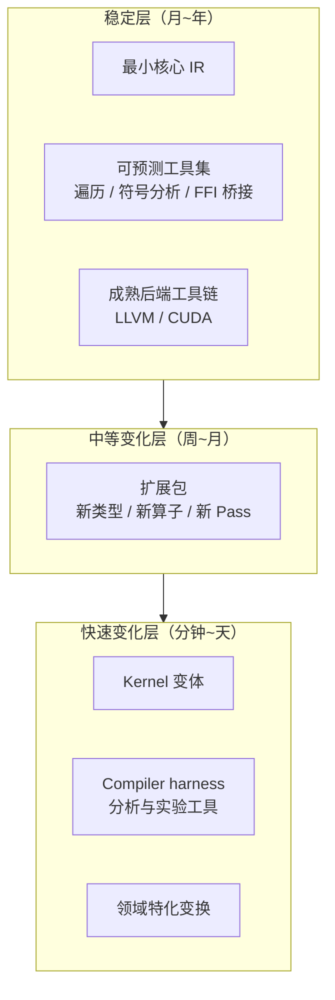
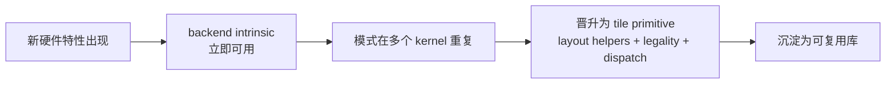

# 五条设计原则

> 文中 `[F-xxx]` 为编号事实，来源见 [facts.md](../references/facts.md)。

## 0. 总原则：按稳定性分层，而不是按功能分层

传统编译器按「前端 / 优化 / 后端」功能切分；TIRx 的核心组织维度是**稳定性与变化速率** [F-024]：

作者的原话是：kernel 可以在几分钟内生成并被丢弃，而更底层则受益于稳定性和更近的人类监督 [F-024]。因此**基础层只负责「老实」的部分**：一旦需求确定，不需要大量启发式调整的模块。

## 1. Minimal, stable core IR

**原则**：只保留一组小而稳定的核心 AST 节点，覆盖常见需求，并预留扩展点 [F-004]。

**为什么**：如果 Agent 每次探索都要重新发明 IR，token 会被重复消耗在基础设施上；而如果核心节点集合过大会频繁变动，下游扩展就会不断断裂。

**具体做法**：
- 核心节点分三层命名空间：`ir`（通用）、`ir.prim`（标量/向量原语）、`tirx`（张量程序特有）[F-010]；
- 新需求优先通过**新算子/新类型**表达，而不是改核心节点 [F-017]；
- IR 对象不可变，变换产生新树并共享未变部分 [F-011]。

**反模式**：把调度策略、硬件特化、图级优化都塞进核心 IR——核心会随每个新硬件发行版而变化。

**判定问句**：*这个新节点是「所有后端都需要的最小语义」，还是「某个后端的便利抽象」？* 后者应做成扩展。

## 2. Predictable utilities

**原则**：为常见需求提供**行为可预测**的工具，而不是隐藏启发式 [F-004]。

工具清单 [F-004][F-013][F-023]：

| 工具 | 作用 | 可预测性体现 |
|------|------|--------------|
| TVM-FFI 桥接生成 | 生成符合 TVM-FFI ABI 的 host 代码与张量检查 | 错误信息明确，如 `expected A.shape[0] to be divisible by 2` |
| 符号整数分析 | 化简与证明整数索引/边界关系 | 支持符号约束上下文与 Z3 证明 |
| 结构遍历与映射 | `structural_map` 等遍历/改写/比较 | 对动态 TVM-FFI 对象工作，节点扩充后仍可用 |
| 最小代码生成 | CUDA 与 host LLVM | `compile` 不额外施加启发式优化，直接交给 LLVM [F-022] |

**反模式**：把「自动调优」「自动融合」这类带有搜索与启发式的逻辑放进基础层——结果不可预测，Agent 难以复现与验证。

**判定问句**：*同样的输入，是否总能得到同样的输出与同样的错误信息？*

## 3. Dynamic extension by design

**原则**：类型与算子可在**不重编译单体**的前提下动态加入；扩展可以住在独立仓库，通过动态加载与基础层互操作 [F-004][F-014]。

**为什么**：Agent 的迭代速度受限于构建时间。改一行、重编译整个编译器、跑测试的循环会把 Agent 的速度优势吃掉 [F-023]。

**具体做法**：
- 类型与算子注册走**按字符串键索引的运行时表** [F-015]；
- 扩展以 `pip install` 的下游包形式存在，直接依赖基础层，无需重新打包核心 [F-015]；
- 示例：CUDA 的 `device_entry` region op、`T.ptx.*` 算子族主要用 Python 注册，无需改核心库 [F-014]。

**反模式**：用 Rust enum 或静态分派的 visitor 把全部节点类型固化在编译期——新增类型必须改核心并全量重编译（见 [04](04-dynamic-extension.md) 对 visitor pattern 的分析）。

**判定问句**：*新增一个算子，需要重新构建基础层吗？*

## 4. First-class cross-language support

**原则**：Python、C++、Rust 都是一等公民，语言选择是**模块级局部决策**，不是全局架构决策 [F-004][F-012]。

**为什么** [F-012]：
- 实验性分析用 Python 最快，能直接复用 NumPy/PyTorch 生态；
- 高频执行的 Pass 用 C++/Rust 更合适；
- 让 Agent 用单语言重写整个系统会浪费大量 token，且可维护性与人类掌控度更差。

**具体做法**：以 TVM-FFI 为统一 ABI，三种语言共享同一套对象表示；Python 原型可直接被 C++/Rust 模块调用，反之亦然 [F-012][F-029]。

**反模式**：「核心必须用一种语言写，其他语言只做 wrapper」——这把语言选择变成了全局约束。

**判定问句**：*这个模块换语言，是因为它需要，还是因为架构只允许一种语言？*

## 5. Built on stable toolchains

**原则**：基础层只做最小 ML 编译层，把成熟后端能解决的事交给成熟后端 [F-004][F-025]。

**具体做法**：
- CPU 目标 `"llvm"`，GPU 目标 `"cuda"`，复用既有工具链 [F-008]；
- `tvm_tirx.compile` 不叠加额外启发式，直接把程序交给 LLVM 生成 CPU 代码 [F-022]；
- 导出物是标准 TVM-FFI 模块，可被 C++、Rust、JAX 等加载 [F-028]。

**反模式**：在自有流水线里重写指令选择、寄存器分配、PTX 生成——这些恰是成熟工具链最稳定的部分。

**判定问句**：*这件事是 ML 编译特有的，还是通用编译器后端已经解决得更好？*

## 6. 第一代的三个设计决定（2026-06）

第二代的五条原则并非凭空出现；第一代已经给出三个同向决定 [F-072]：

| 决定 | 内容 | 与第二代原则的对应 |
|------|------|-------------------|
| Orchestration 留在源码 | 流水线结构、同步、warp role、内存放置、后端 intrinsic 直接写在程序里 | 「最小核心」「低而显式的边界」 |
| 反复出现的操作成为 tile primitive | execution scope / layout / dispatch 让常见操作可复用、可分析、可移植 | 「可预测工具」 |
| 新硬件先 intrinsic，后 primitive | 新特性先以薄封装立即使用，模式稳定后晋升为 layout-aware 的 tile primitive | 「动态扩展」「成熟工具链」 |

第三条尤其值得注意：它是一个**演化节奏**，不是一条静态规则。

这个节奏的好处是：核心抽象保持小，新增 intrinsic 不会破坏已有功能；而一旦模式稳定，就能被更多 kernel 复用 [F-072]。第二代把同一思想推广到类型/算子/Pass 的动态注册 [F-015]。

第一代还给出了自己的生态位：它位于 TileLang 之下，只提供最小基础，把 layout 推断与 thread binding 留给上层；官方同时表示正与 TileLang 社区合作，把 TIRx 作为新的最小基础（中文文章写作「取代原 TensorIR」）[F-073]。

## 7. 五条原则之间的张力

这五条不是并列的清单，而是互相约束：

- 「最小核心」与「动态扩展」互为条件：核心越小，越需要强的扩展机制；
- 「可预测工具」与「成熟工具链」共同定义了基础层的**能力上限**：它不追求最强优化，而追求可解释、可验证；
- 「三语言」只有在统一 ABI 下才成立，否则会退化成三套不兼容的实现。

一句话：**基础层用稳定性换信任，上层用灵活性换速度。**

## 8. 自检清单

- [ ] 新功能是否可以先作为扩展实现，而不是改核心？
- [ ] 该模块的语言选择是否由局部需求决定？
- [ ] 新增算子是否需要重新构建基础层？
- [ ] 输出与错误信息是否可复现、可被 Agent 稳定解析？
- [ ] 是否把启发式优化误放进了「稳定层」？
