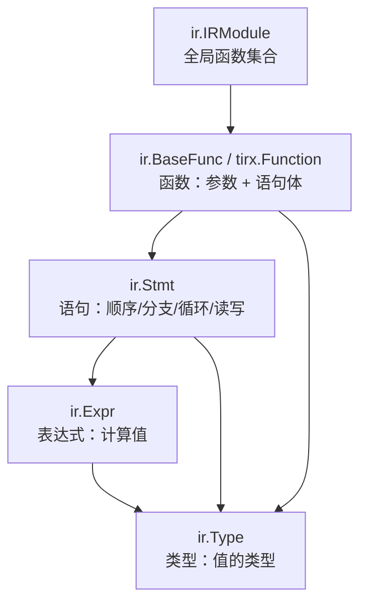

# IR 对象模型

> 文中 `[F-xxx]` 为编号事实，来源见 [facts.md](../references/facts.md)。
>
> ⚠️ **代际提示**：本篇描述**第二代** `apache/tvm-tirx` 的 IR 对象模型（`@T.function`、`ir`/`ir.prim`/`tirx`）。第一代是另一套硬件原生 DSL/IR，见 [08](08-two-generations.md) 与 [09](09-layout-and-dispatch.md)。

## 1. 设计目标：不仅暴露输入输出，还暴露每个中间阶段

TIRx 的一个主要设计目标是：让开发者与 Agent **能访问编译的每个阶段**，而不只是输入与输出 [F-009]。这决定了它的 IR 不是内部私有结构，而是对外稳定、可检查、可构造的一等对象。

程序被表示为一棵 **IR 节点树**，节点包括函数、语句、值等 [F-009]。它类似 Python 源码的抽象语法树（AST），但更结构化、带类型。



## 2. 五个核心概念

官方文档给出的最小心智模型 [F-009]：

| 概念 | 类 | 例子 |
|------|----|------|
| 类型 | `ir.Type` | 标量类型 `T.float32`、张量类型 `T.Tensor((n,), T.float32)` |
| 表达式 | `ir.Expr` | `A[i] + 1`、对已注册算子的调用 `T.cuda.thread_idx("x")` |
| 语句 | `ir.Stmt` | `if` 分支、写入 `B[i] = A[i] + 1` |
| 函数 | `ir.BaseFunc` | 把语句体与参数包起来的 `add_one` |
| 模块 | `ir.IRModule` | 把具名函数组织成完整程序 |

一个最小程序：

```python
from tvm_tirx.script import tirx as T

n = T.dynamic("n")

@T.function
def add_one(A: T.Tensor((n,), T.float32), B: T.Tensor((n,), T.float32)):
    for i in range(n):
        B[i] = A[i] + 1
```

这段写法有三点值得注意：

1. `T.dynamic("n")` 声明符号维度，使同一程序适用于任意长度 [F-008]；
2. `@T.function` 把一个普通 Python 函数标记为 TIRx 程序；
3. **它就是 IR 构建过程本身**——函数返回的不是 Python 可调用对象，而是一棵 IR 树。

## 3. 三层命名空间：通用、原语、张量

IR 节点被刻意设计成通用件，新变体可以建在它们之上。命名空间直接表明职责 [F-010]：

| 命名空间 | 放什么 | 典型节点 |
|----------|--------|----------|
| `ir` | 所有变体共享的通用节点 | `ir.Expr`、`ir.Type`、`ir.Stmt`、`ir.IRModule`、`ir.Call`、`ir.Op` |
| `ir.prim`（打印为 `prim`） | 标量/向量原语表达式，类型为 `ir.PrimType` | `prim.Add`、`prim.Mul`、`prim.Cast`、`prim.Select`、`prim.Ramp`、`prim.Broadcast` |
| `tirx` | 张量程序特有的类型与操作 | `tirx.Function`、`tirx.TensorType`、`tirx.TensorMapType` |

这个分层是扩展性的基础：**下游项目可以像 `tirx` 建在 `ir` 上那样，再建自己的命名空间**，注册新算子、定义新类型、增加自己的 TVMScript 命名空间，而继续复用 TIRx 的工具 [F-010]。

### 关键节点速览（节选）

```text
ffi.Object                       TVM-FFI 基对象
├── ir.Expr                      表达式
│   ├── ir.Constant             常量（IntImm / FloatImm / StringImm / DataTypeImm）
│   ├── ir.Var                  局部变量
│   ├── ir.GlobalVar            全局函数引用
│   ├── ir.Call                 调用
│   ├── ir.Op                   已注册算子
│   ├── ir.TensorLoad           张量元素读
│   ├── ir.TensorRegion         张量区域
│   ├── ir.BaseFunc             函数定义
│   │   └── tirx.Function       张量程序函数
│   └── prim.*                  原语运算（Add/Sub/Mul/Div/…/Shuffle）
├── ir.Type                      类型
│   ├── ir.PrimType             标量/向量 dtype
│   ├── ir.PtrType              指针
│   ├── ir.TensorRegionType     张量区域值
│   ├── tirx.TensorType         张量类型
│   └── tirx.TensorMapType      TMA 张量映射类型
├── ir.Stmt                      语句
│   ├── ir.SeqStmt              语句序列
│   ├── ir.Bind                 变量定义
│   ├── ir.TensorStore          张量元素写
│   ├── ir.RegionStmt           算子定义的词法区域
│   ├── ir.If / ir.For / ir.While
│   └── ir.Return / ir.Break / ir.Continue
└── ir.IRModule                  全局函数定义
```

> 完整层级以官方 IR 指南为准；上表只列本教程会用到的节点 [F-010]。

## 4. 不可变性：分析与变换的分界

IR 对象是**不可变的**：分析只读树；变换构造一棵新树，并共享未修改的部分 [F-011]。

这带来三个工程后果：

- **分析可以安全并发**：读操作不会互相破坏；
- **变换可回滚**：原程序始终可用，便于对比与验证；
- **结构共享降低拷贝成本**：只有被改动的路径需要新节点。

一个直接例子是把动态维度 `n` 特化为 `128`：原 `add_one` 不变，得到一个新的专用程序 [F-064]（详见 [structural-specialization 示例](../examples/structural-specialization.md)）。

## 5. 用 `format_tree` 看程序

`ir.format_tree` 把 IR 对象及其字段显示为文本树 [F-063]。以上面的 `add_one` 为例：

```python
import tvm_tirx

print(tvm_tirx.ir.format_tree(add_one))
```

输出（节选）：

```text
Function
├── params[0]: A = Var(ty=TensorType(shape=[n], dtype=float32))
├── params[1]: B = Var(ty=TensorType(shape=[n], dtype=float32))
└── body: SeqStmt
    └── seq[0]: For(begin=IntImm(value=0), end=n)
        ├── var: i = Var(ty=int32)
        └── body: SeqStmt
            └── seq[0]: TensorStore(dest=B, indices=[i])
                └── value: Add
                    ├── a: TensorLoad(source=A, indices=[i])
                    └── b: FloatImm(value=1.0)
```

若要看某个子表达式，可以沿字段直接走：

```python
A, B = add_one.params          # 参数是 Var
n = A.ty.shape[0]              # 符号长度 n，也是 Var
loop = add_one.body[0]         # for i in range(n)
print(loop.body[0].value)      # A[i] + T.float32(1.0)
```

`format_tree` 还支持按字段展开（`expand`）、折叠（`fold`）与隐藏，用于控制显示粒度 [F-063]。

## 6. 打印与解析：TVMScript

TIRx 用 TVMScript 作为 IR 的文本表示——一种基于 Python 的记法 [F-009]。它同时承担三种角色：

- **书写**：`@T.function` 的函数体就是 TVMScript；
- **阅读**：每个编译阶段都能打印回脚本语法，便于 Agent 检查中间程序 [F-026]；
- **交换**：文本形式可被版本控制、diff、作为 Agent 的上下文。

这与「IR 是唯一真相、文本是视图」的设计一致：文本不是源文件解析出来的副产品，而是 IR 的另一种呈现。

## 7. 常见误解

| 误解 | 事实 |
|------|------|
| 「TIRx 就是 TVM 的 TIR 改名」 | 独立项目是重新设计的基础层，命名空间与节点集合都不同（见 [00](00-overview.md)） |
| 「IR 树可以原地修改」 | IR 不可变；变换产生新树并共享未变部分 [F-011] |
| 「`@T.function` 返回 Python 函数」 | 返回 IR 函数对象，可通过字段访问、可被 `format_tree` 展示 |
| 「表达式类型是运行时推断的」 | 类型是 IR 的一等对象（`ir.Type`），可显式查询与构造 |
