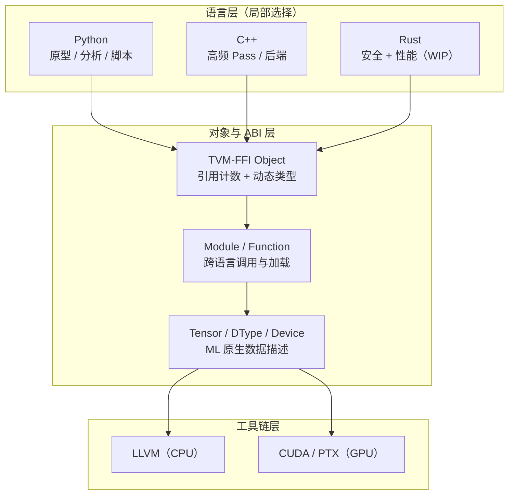
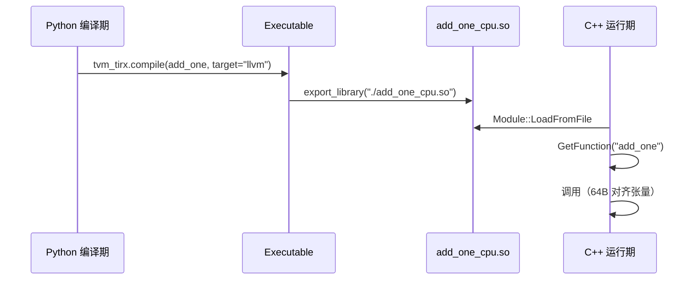

# TVM-FFI 跨语言基座

> 文中 `[F-xxx]` 为编号事实，来源见 [facts.md](../references/facts.md)。TVM-FFI 本身的概念谱系见 [TVM-FFI 接口与 ABI 辨析](../../../comm/tvm-ffi/index.md)。
>
> ⚠️ **代际提示**：两代都以 TVM-FFI 为跨语言基座，但第一代的编程入口是 `@T.jit` / `@T.prim_func` 与 `Tx.*` [F-068][F-074]；本篇的 `@T.function` 与对象层级属于第二代 [F-010]。

## 1. 问题：为什么不能让三种语言各自为政

如果 Python、C++、Rust 各有自己的 IR 对象，就会出现三套真相：

- 同一个 `TensorType` 在三种语言里字段布局不同，跨语言传递要序列化/反序列化；
- 扩展只对一种语言有效，另一种语言要重写；
- 调试时无法确认「你看到的 IR」和「我看到的 IR」是同一个对象。

TIRx 的解法是把**对象表示下沉到 ABI 层**：每个 AST 节点都是 TVM-FFI 支撑的跨语言对象，Python、C++、Rust 访问的是同一份数据 [F-029]。



## 2. 历史脉络：TVM-FFI 是第一步，TIRx 是第二步

作者在文中把路线讲得很清楚 [F-021]：

1. **去年**：介绍 TVM-FFI，展望一个开放、通用、稳定的 ABI/FFI 标准对 Agent 时代的作用；
2. **TVM-FFI 发布后**：持续模块化 TVM 核心；
3. **一年后**：拆分并面向 Agent 重新设计，形成 `tvm-tirx`。

所以二者不是并列项目，而是**地基与上层建筑**：TVM-FFI 解决「跨语言对象如何互通」，TIRx 解决「编译基础层应该提供哪些对象与工具」。

## 3. 对象系统：一切 AST 节点都是 FFI 对象

IR 层级中的根是 `ffi.Object`，所有表达式、类型、语句、模块都继承它 [F-010]。这带来几个直接能力：

| 能力 | 含义 | 对 Agent 的价值 |
|------|------|----------------|
| 动态类型识别 | 不依赖 C++ RTTI，使用自有 type_index | 新类型可在运行时注册，不破坏旧二进制 |
| 引用计数 | 对象可跨语言共享生命周期 | 跨语言传对象不需要深拷贝 |
| 字符串键注册 | 类型与算子按字符串键查表 | 扩展包可在运行时挂载 [F-015] |
| 结构遍历统一 | `structural_map` 等对任意 FFI 对象工作 | 节点集合扩充后工具仍可用 [F-013] |

最后一条尤其关键：工具不是针对「当前已知节点类型」写死的，而是面向动态对象。这避免了「每加一个节点就要改一遍遍历器」的连锁维护。

## 4. 三种语言的分工

官方给出的分工不是「主语言 + wrapper」，而是**模块级自由选择** [F-012]：

| 语言 | 适合的模块 | 原因 |
|------|-----------|------|
| Python | 原型、实验性分析、脚本编排、PTX 算子注册 | 迭代快，可直接用 NumPy/PyTorch 生态 [F-012][F-014] |
| C++ | 高频执行的 Pass、后端代码生成、性能关键路径 | 运行效率与既有编译器生态 |
| Rust | 需要内存安全 + 性能的扩展（WIP） | 官方定位为适合 Agent 探索新类型/算子/Pass [F-027] |

一个常被忽略的点：**语言选择是局部的**。同一个编译器里，Python 写的分析可以调用 Rust 写的 Pass，Rust 扩展又可以回调 Python 注册的算子，因为三者共享同一套对象与调用约定 [F-012]。

源码层面的 Rust 支持比「WIP」二字更具体 [F-104][F-128]：

- `rust/tvm-tirx` 是独立 crate，IR 对象定义由 `tvm-ffi-stubgen` 从 `libtvm_tirx_compiler` 的反射生成；
- 生成的对象是 `#[repr(C)]`，字段偏移与 C++ 对象一致，并在编译期检查 size/alignment；
- 编辑安装可产出 `libtvm_tirx_rust`，`import tvm_tirx` 时加载并注册其静态初始化块中的算子/类型；
- 但官方博客仍把 Rust 标为 work in progress [F-006]，所以「工程链路存在」不等于「成熟度承诺」。

## 5. 编译产物：Executable 就是一个 TVM-FFI 模块

`tvm_tirx.compile` 返回 `Executable`，它持有编译后的模块；调用 `export_library` 会把模块写成共享库 [F-028]。

关键事实：

- 导出的库是**标准 TVM-FFI 模块**，任何支持 TVM-FFI 的语言/框架都能加载，例如 C++、Rust、JAX [F-028]；
- 运行**不需要编译器**，只需要极小的运行时库：`libtvm_runtime.so` 与 `libtvm_runtime_cuda.so`，各自小于 1 MB [F-028]；
- C++ 侧通过 `ffi::Module::LoadFromFile` 加载，再 `GetFunction("add_one")` 取函数 [F-028]；
- TIRx kernel 要求张量数据 **64 字节对齐**，C++ 示例使用运行时张量分配器来满足该要求 [F-028]。



这条链路的意义是：**编译期与运行期彻底解耦**。编译可以发生在有完整工具链的机器上，运行可以发生在只带 <1 MB 运行时的设备或另一种语言的服务里。

## 6. 构建与集成

C++ 集成不要求手写一堆链接参数，官方提供配置工具 [F-028]：

```bash
g++ -O2 load_cpp.cc \
  $(tvm-tirx-config --cxxflags --ldflags --libs runtime) \
  -Wl,-rpath,$(tvm-tirx-config --libdir) \
  -Wl,-rpath,$(tvm-ffi-config --libdir) \
  -o load_cpp
```

CMake 侧则通过 `python -m tvm_tirx.config --cmakedir` 与 `python -m tvm_ffi.config --cmakedir` 找到包，再链接 `tvm_runtime::shared` 与 `tvm_ffi::shared` [F-028]。

## 7. 边界与风险

| 风险 | 说明 | 缓解 |
|------|------|------|
| Rust 成熟度 | 官方博客明确标为 work in progress [F-006]；中文文章措辞更强（见 [sources.md](../references/sources.md)） | 以官方 README/文档为准，Rust 用于试验而非关键路径 |
| ABI 版本耦合 | 扩展、运行时、编译器需使用兼容的 TVM-FFI 版本 | 固定版本组合，导出库随应用一起发布 |
| 跨语言调试 | 断点与调用栈跨语言时不直观 | 优先在 Python 侧复现，再用 `format_tree` 对齐 IR |
| 对齐约束 | kernel 要求 64B 对齐 [F-028] | 使用运行时分配器或自行保证对齐 |

## 8. 小结

TVM-FFI 让「语言」退化为局部实现细节，让「对象与语义」成为跨语言共享的真相。对 Agent 而言，这意味着它可以在最合适的语言里工作，而不必为架构约束付出重写成本——这正是 TIRx 能把「三语言」列为设计原则的前提。
