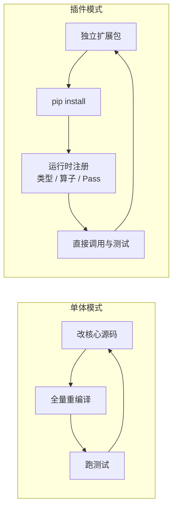

# 动态扩展：一切皆插件

> 文中 `[F-xxx]` 为编号事实，来源见 [facts.md](../references/facts.md)。
>
> ⚠️ **代际提示**：本篇的运行时注册/独立扩展包机制属于**第二代** [F-015]；第一代的扩展节奏是「新硬件先 intrinsic、模式稳定后晋升 tile primitive」[F-072]，见 [01](01-design-principles.md) 第 6 节。

## 1. 动机：构建时间吃掉了 Agent 的速度优势

设想 Agent 要新增一个算子。传统流程是：

```text
改代码 → 重编译整个编译器（分钟级）→ 跑测试 → 失败 → 再来一遍
```

Agent 写代码很快，但**重编译与测试在开发循环中的占比反而上升** [F-023]。构建缓存只能缓解，不能消除。

TIRx 的应对是：把扩展从「改核心 + 重编译」变成「装一个包 + 动态注册」[F-014][F-015]。



## 2. 扩展的三个入口

### 2.1 新类型（Type）

下游可以定义新的 TVM-FFI 对象，**继承原有类型节点**并携带额外信息 [F-014]。

官方例子：为支持 CUDA 的 TMA（Tensor Memory Accelerator）张量映射，引入了 `tirx.TensorMapType` [F-014]。新类型可以依赖其他类型与表达式，因此在编译各阶段都能保留这些信息；典型做法是后续把它 lower 成已有类型，或为新类型增加专门的后端代码生成 [F-014]。

### 2.2 新算子（Op）

算子有两种使用形态 [F-014]：

| 形态 | IR 节点 | 语义 | 例子 |
|------|---------|------|------|
| 调用 | `ir.Call` | 类似 intrinsic 调用 | `T.ptx.add.rn.f32(...)` |
| 区域 | `ir.RegionStmt` | 定义带额外语义的词法区域 | `T.device_entry(launch=...)` 表示 kernel 启动 |

TIRx 的最小 CUDA/PTX 支持就是这么搭起来的：`device_entry` 是 region op，PTX 加法等被表示为对应 op 的 `Call` 节点 [F-014]。

### 2.3 新 Pass

扩展包可以定义自己的遍历/变换逻辑，并在 Python/Rust/C++ 任一侧实现。官方扩展指南的完整示例定义了一个复数类型、四个算子、以及一个把它们 lower 成标量算术的 Pass [F-027]。

## 3. 机制：字符串键的运行时表

类型与算子注册都支持通过**按字符串键索引的运行时表**做动态扩展 [F-015]。这带来两个直接效果：

1. 扩展作为下游包存在，依赖基础层即可，**无需重新编译或重新打包原项目** [F-015]；
2. 不同模块可以按不同速率演进：基础层持续加固，Agent 在上层独立迭代 [F-015]。

> 这也是「一切皆插件」的真正含义：插件不是「可选的附加功能」，而是**默认的演进方式**。

## 4. 为什么传统 visitor pattern 不够用

这是一个容易被跳过、但决定架构成败的技术点。

经典 visitor 模式（以及 LLVM/MLIR 的静态分派、Rust 的 `enum` 匹配）有一个隐含前提：**编译期必须知道所有可能的节点类型** [F-031]。

```rust
// 静态枚举：新增一个变体，所有 match 都要改，且核心必须重编译
enum Expr {
    Add(Box<Expr>, Box<Expr>),
    Mul(Box<Expr>, Box<Expr>),
    // 新增 Cast 需要修改这里并重编译
}
```

当节点类型可以在运行时增加时，这个前提就崩了：

- 核心无法预知下游定义的类型；
- 每个扩展都要回改核心的分派逻辑；
- 递归访问、改写、符号表达式约束传播等通用能力会被复制到每个扩展里。

TIRx 的做法是：用基于 TVM-FFI 的**结构化 API** 提供递归访问、改写与约束传递，使这些能力对动态新增类型继续有效 [F-031][F-013]。换句话说，**把「节点集合」从编译期常量变成运行时数据**。

## 5. 语言选择：Python 先试，Rust 再快

官方扩展指南给出明确建议 [F-027]：

| 阶段 | 语言 | 理由 |
|------|------|------|
| 试想法 | Python | 无需构建，改完即跑，适合验证扩展语义 |
| 上规模 | Rust | 快且内存安全，适合 Agent 探索新类型/算子/Pass |
| 已有 C++ 资产 | C++ | 复用既有编译器代码与性能路径 |

两种实现可以安装**同名同 API 的包**（示例中都是 `my_ext`），因此上层程序无需感知底层是 Python 还是 Rust [F-027]。

## 6. 扩展的最小骨架

下面只展示结构，完整可运行版本见官方文档与 [extension-skeleton 示例](../examples/extension-skeleton.md)。

**Python 侧（官方文档中的类型注册片段）：**

```python
import tvm_ffi
from tvm_tirx import ir
from tvm_ffi import py_class

@py_class("my_ext.ComplexType")
class ComplexType(ir.Type):
    """实部与虚部共享同一标量类型的复数。"""
    dtype: ir.PrimType

tvm_ffi.get_global_func("ir.expose_type")("my_ext.ComplexType")
```

**Rust 侧（结构示意）：**

```rust
#[rs_object(type_key = "my_ext.ComplexType", final, immutable)]
pub struct ComplexTypeObj {
    base_: TypeObj,
    pub dtype: PrimType,
}

#[derive(Clone, tvm_ffi::derive::ObjectRef)]
#[object_ref(parent = Type)]
pub struct ComplexType {
    data_: tvm_ffi::ObjectArc<ComplexTypeObj>,
}
```

> 算子与 Pass 的注册 API 随版本演进，请以官方扩展指南为准 [F-027]；上面的 Python 片段取自该指南的类型定义部分。

## 7. 设计权衡与反模式

| 权衡 | 收益 | 代价 | 缓解 |
|------|------|------|------|
| 动态注册 | 不重编译、迭代快 | 注册冲突、加载顺序问题 | 命名空间前缀（如 `my_ext.`）与显式版本约束 |
| 插件生态 | 多团队并行演进 | 质量参差、调试困难 | 基础层只保留稳定件；扩展自带测试 |
| 多语言扩展 | 按需选语言 | 跨语言调用开销、工具链复杂 | 高频路径用 C++/Rust，控制面用 Python |
| 类型扩展 | 表达领域语义 | 下游需自行 lower/代码生成 | 优先 lower 到已有类型 |

**反模式清单：**

- 把「所有扩展」都做成核心的一部分——回到单体模式；
- 每个扩展各写一套遍历器——重复实现，行为不一致；
- 用 Python 实现高频 Pass，再用「优化」补——先选错语言，再花更多成本补救；
- 扩展直接依赖核心内部私有结构——核心小改动就断裂。

## 8. 小结

动态扩展不是「插件系统」这种附加功能，而是 TIRx 应对 Agent 迭代速度的**结构性回答**：核心只保留稳定语义，变化的部分以插件形式在独立仓里快速试错。理解了 visitor pattern 的静态前提为何失效，就能理解为什么必须把节点集合做成运行时数据。
