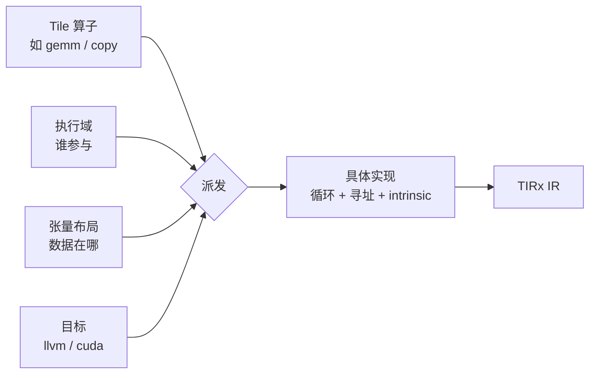

# 编程模型

> 文中 `[F-xxx]` 为编号事实，来源见 [facts.md](../references/facts.md)。
>
> ⚠️ **代际提示**：本篇主线用第二代 `apache-tvm-tirx`（`@T.function`）的写法；第一代（2026-06，`apache-tvm` 0.25.0）使用 `@T.jit` / `@T.prim_func` 与 `Tx.*` / `Tx.wg.*` 命名空间 [F-068][F-074]。两代不可混用 [F-097]。

## 1. 核心问题：把边界画在哪里

Kernel DSL 的设计，本质是选择「程序员与机器之间的边界」 [F-032]：

| 边界高度 | 编译器负责 | 程序员负责 | 适用场景 |
|----------|-----------|-----------|----------|
| 高（tile/张量抽象） | 线程分配、内存搬运、布局、指令选择 | 声明计算意图 | 成熟硬件上的成熟 kernel 模式 |
| 低（TIRx 选择） | 最小语义与工具 | 流水线、同步、角色分配、内存放置、后端 intrinsic | 新指令/新内存空间/新协作模式；Agent 生成 |

TIRx 明确选择**更低、更显式**的边界 [F-032]，理由有两条：

1. **前沿硬件先于编译器**。新指令、新内存空间、新协作模式往往在编译器有足够内建机制之前就出现了；
2. **Agent 偏好直接可预测的行为**。代码应贴近硬件实际做什么，而不是贴近编译器在背后做的决定 [F-032]。

## 2. 程序长什么样

TIRx 程序读起来像一个**结构化的 native kernel**：循环、分支、张量、同步、流水线状态、后端 intrinsic、硬件角色都直接写出来 [F-033]。

以 `add_one` 的 CUDA 版本为例：

```python
from tvm_tirx.script import tirx as T

n = T.dynamic("n")

@T.function
def add_one(A: T.Tensor((n,), T.float32), B: T.Tensor((n,), T.float32)):
    T.device_entry(launch=T.cuda.LaunchConfig(grid=T.ceildiv(n, 256), block=256))
    i = T.cuda.block_idx("x") * 256 + T.cuda.thread_idx("x")
    if i < n:
        B[i] = A[i] + 1
```

这段程序里有四个层次，全部显式可见：

- `T.device_entry(launch=...)`：kernel 启动配置（grid/block）；
- `T.cuda.block_idx` / `T.cuda.thread_idx`：硬件角色；
- `if i < n`：越界保护，程序员自己写；
- `B[i] = A[i] + 1`：数据搬运与计算。

对比 CPU 版本，同一个函数只把启动与索引部分换成普通 `for` 循环 [F-008]。**同一份 IR 体系同时容纳两种执行模型**，这是「低边界 + 可组合」的直接体现。

> 第一代的对应写法是 `@T.prim_func` + `Tx.*`：例如 `Tx.wg.*` 表示 warpgroup 粒度，未限定的 `Tx.*` 表示 thread 粒度 [F-068][F-074]。具体语法见 [09-layout-and-dispatch](09-layout-and-dispatch.md)。

## 3. 三层可选便利层

在原生原语之上，TIRx 提供一个**可选的**便利层，用来表达反复出现的 tile 级结构。它由三个构造组成 [F-034]：

| 构造 | 回答的问题 | 说明 | 第一代的具体形态 |
|------|-----------|------|------------------|
| **执行域（Execution scope）** | 哪些线程参与这个操作，在什么层级？ | 单线程、warp、线程块等；普通控制流负责把硬件角色引入区域 | `Tx.*`（thread）、`Tx.wg.*`（warpgroup）、`T.ptx.elect_sync()` 谓词 [F-074] |
| **张量布局（Tensor layout）** | 逻辑张量如何映射到物理存储与线程？ | 位于哪块内存、元素如何分布到线程与每线程存储 | storage-first；D（Shard）/ R（Replica）/ O（Offset）+ 具名硬件轴 [F-075][F-077] |
| **Tile 算子派发（Tile operation dispatch）** | 这个 tile 操作用哪个实现？ | 依据算子、执行域、操作数布局与目标选择实现 | TMA / `ldmatrix` / `tcgen05.ld` / WGMMA / tcgen05 / systolic-array [F-076] |

三者关系：



关键点：**这层是可选的，任何位置都可以回落到原生原语** [F-034]。这避免了「为了用便利层而被锁死」的问题——新硬件特性可以先作为 backend intrinsic 直接用，等模式稳定后再沉淀为 tile 算子。

## 4. 编程指南覆盖的能力面

官方编程指南的目录本身就是一份能力地图 [F-035]：

| 主题 | 内容 |
|------|------|
| CUDA Functions and Launches | 定义与启动 kernel |
| Control Flow | 条件、循环、线程提前退出 |
| Types, Tensors, and Memory | 元素类型、张量、内存空间 |
| Metaprogramming | 被捕获值参数化、可复用代码片段、编译期特化 |
| CUDA and PTX Interfaces | 同步、warp shuffle、PTX 指令、CUDA C++ device 函数 |
| Data Layout | 张量元素到线程与内存的映射 |
| Tile Operations | tile 算子与指令指南 |
| Compiling and Inspecting | 编译选项与生成代码检查 |
| Profiling with IKET | 用 IKET 做 kernel 性能剖析 [F-036] |

## 5. 元编程：让 kernel 可参数化

元编程指南覆盖三类需求 [F-035]：

1. **被捕获值参数化**：把 Python 侧常量/配置带进 IR；
2. **可复用代码片段**：把重复的硬件级操作抽成可调用单元；
3. **编译期特化**：为特定形状/类型生成专用版本。

这与「动态维度 → 结构特化」是同一套思路的两个方向：`T.dynamic("n")` 保留通用性，`structural_map` 把 `n` 替换为常量则获得专用性（见 [structural-specialization](../examples/structural-specialization.md)）。

## 6. 与高层 DSL 的取舍

| 维度 | 高层 DSL | TIRx 低边界 |
|------|---------|-------------|
| 代码量 | 少 | 多（同步、索引、布局显式） |
| 可预测性 | 取决于编译器决策 | 高（贴近硬件） |
| 新硬件适配速度 | 慢（等编译器支持） | 快（先当 intrinsic 用） |
| 可移植性 | 高 | 低（绑定具体后端） |
| 适合谁写 | 人类快速表达 | Agent 精细控制 + 人类审查 |

TIRx 并没有否定高层 DSL，而是把「高层便利」降级为可选层。这个取舍的代价是**更多显式代码**，收益是**更少的隐式决策**——而隐式决策正是 Agent 难以推理和验证的部分。

## 7. 自检清单

- [ ] 这段程序的同步/角色/内存放置是否显式可见？
- [ ] 是否用了便利层但说不清它生成了什么？
- [ ] 新硬件特性是否可以先作为 intrinsic 落地，而不是等核心支持？
- [ ] 越界、对齐（如 64B）等约束是否由程序显式保证？
- [ ] 是否为了「代码短」牺牲了可验证性？
