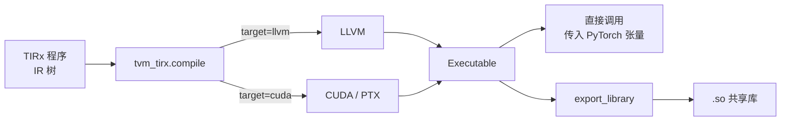
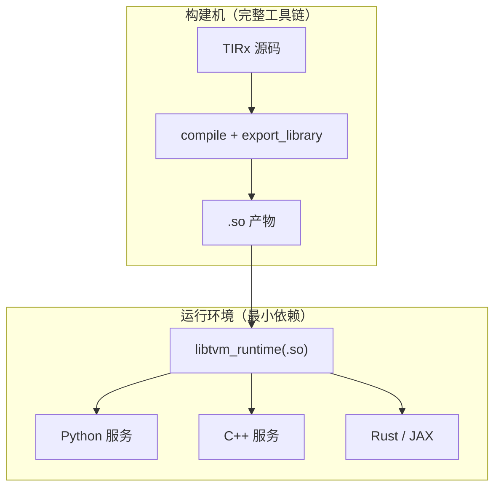

# 编译与部署

> 文中 `[F-xxx]` 为编号事实，来源见 [facts.md](../references/facts.md)。
>
> ⚠️ **代际提示**：本篇以第二代 `apache-tvm-tirx` 的 `compile`/`Executable` 为主线；第一代的 lowering 路径不同，见本篇第 1 节末尾对照。

## 1. 编译做了什么

`tvm_tirx.compile(program, target=...)` 的语义需要精确表述 [F-022][F-110]：

- **不做搜索式/代价模型式调优**（没有 autotuning、auto-schedule、layout 搜索）；
- **仍执行一条固定顺序的确定性 lowering 流水线**（dispatch → layout 降低 → 化简 → 展平 → 向量化 → 展开 → CSE → 内存校验 → allreduce）；
- CPU 走 LLVM，GPU 走 CUDA（默认 NVRTC）。

这与「编译器 = 优化黑盒」的直觉相反。它的设计取舍是：**基础层负责正确、可预测的降级，优化留给上层 harness 或后端本身**。对 Agent 而言，这意味着「同样的输入 → 同样的 pass 序列」，便于定位问题。完整 pass 顺序见 [13-compiler-pipeline](13-compiler-pipeline.md)。

> **第一代对照**：第一代的 lowering 路径是「解析 → 硬件原生 IR + 未解析 tile primitive calls → 逐调用 dispatch → native IR → CUDA C++/PTX」，自动 warp specialization、layout 推断、流水线搜索等均为可选层 [F-080]。两代都遵循「重型优化不阻断主路径」的原则，但第一代强调 dispatch，第二代强调直接交给 LLVM。详见 [09](09-layout-and-dispatch.md) 与 [08](08-two-generations.md)。



## 2. 环境前置

官方 Quick Start 给出的最低要求 [F-007]：

| 依赖 | 要求 | 说明 |
|------|------|------|
| Python | 3.10 或更新 | PyPI `requires-python >= 3.10` |
| PyTorch | 用于创建与校验张量 | 编译产物可直接接收 PyTorch 张量 |
| CUDA | CUDA 13 或更新（仅 CUDA 示例） | 需要 `[cuda]` 额外依赖 |
| TIRx | `pip install --upgrade --force-reinstall apache-tvm-tirx` | 官方安装命令 |

CUDA 版安装：

```bash
pip install --upgrade --force-reinstall "apache-tvm-tirx[cuda]"
```

## 3. 编译与调用

```python
import torch
import tvm_tirx

add_one_compiled = tvm_tirx.compile(add_one, target="llvm")

a = torch.arange(10, dtype=torch.float32)
b = torch.empty_like(a)
add_one_compiled(a, b)
torch.testing.assert_close(b, a + 1)
```

要点：

- 编译结果**像函数一样调用**，直接传 PyTorch 张量 [F-008]；
- CUDA 版本把 `target` 换成 `"cuda"`，输入张量放在 `device="cuda"`；
- 返回值是 `Executable`，持有编译后的模块 [F-028]；
- `Executable` 还提供 `jit()`：当模块包含尚未编译链接的 C/static library 时，把它编译链接成可加载模块；运行时只读模式下调用 `export_library` 会抛错 [F-111]。

## 4. 导出与跨语言加载

### 4.1 导出

```python
add_one_compiled.export_library("./add_one_cpu.so")
```

导出的库是**标准 TVM-FFI 模块** [F-028]，因此：

- 任何支持 TVM-FFI 的语言/框架都能加载（C++、Rust、JAX 等）；
- 运行只需要极小运行时：`libtvm_runtime.so`（CPU）或 `libtvm_runtime_cuda.so`（CUDA），各自 **小于 1 MB** [F-028]；
- 运行不需要编译器本体。

### 4.2 Python 侧重新加载

```python
import tvm_ffi
import tvm_tirx  # noqa: F401  加载运行时库

loaded = tvm_ffi.load_module("./add_one_cpu.so")
loaded.add_one(a, b)
```

### 4.3 C++ 侧加载

```cpp
#include <tvm/ffi/extra/module.h>
#include <tvm/ffi/tvm_ffi.h>
#include <tvm/runtime/tensor.h>

ffi::Module mod = ffi::Module::LoadFromFile("./add_one_cpu.so");
ffi::Function add_one = mod->GetFunction("add_one").value();
add_one(a, b);
```

注意 TIRx kernel 要求输入张量 **64 字节对齐**，C++ 示例通过运行时张量分配器 `tvm::runtime::Empty` 来满足 [F-028]。

## 5. 编译期与运行期解耦



这条链路的工程价值：

- **语言无关**：编译产物不绑定 Python；
- **体积可控**：运行时 <1 MB，适合边缘/嵌入式；
- **可缓存**：同一 `.so` 可在多进程、多机器复用。

## 6. 常见错误与排查

| 现象 | 原因 | 处理 |
|------|------|------|
| `ValueError: CUDA compilation requires an explicit backend_config arch or Target arch when no CUDA device is available` | 机器有 GPU 但找不到 `libcudart.so.13` | 安装 CUDA 13 版 PyTorch（自带该库），或安装 CUDA 13 toolkit 并把 `lib64` 加入 `LD_LIBRARY_PATH` [F-037] |
| 形状不匹配报错 | TIRx 生成的 host 代码包含张量检查 | 读取错误信息中的约束，如 `expected A.shape[0] to be divisible by 2` [F-023] |
| C++ 侧崩溃或结果异常 | 张量未按 64B 对齐 | 用运行时分配器创建张量，或自行保证对齐 [F-028] |
| 加载 `.so` 失败 | 运行时库未加载/版本不匹配 | 先 `import tvm_tirx` 加载运行时；固定 TVM-FFI 版本组合 |

## 7. 一个容易忽略的设计信号

`compile` 不叠加启发式，而 host 代码又生成**明确的张量检查**——这两件事共同说明：TIRx 把「优化」和「正确性」分开了。

- 正确性：由 IR 语义、生成代码中的检查、以及可选的验证工具保证；
- 优化：交给 LLVM/CUDA 后端，或交给上层的 Agent harness。

这正是 [01-design-principles](01-design-principles.md) 中「可预测工具」与「成熟工具链」两条原则在编译路径上的落地。
