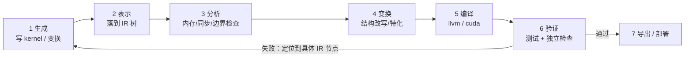

# Agent 工作流与工程边界

> 文中 `[F-xxx]` 为编号事实，来源见 [facts.md](../references/facts.md)。

## 1. Agent 的真实工作流

把 TIRx 放回 Agent 的开发循环，会得到这样一条链路：

TIRx 在其中的位置不是「替代第 1 步」，而是**为第 2-6 步提供共享底座**：

- 第 2 步：任何生成结果都要能表示为 IR，才能被后续工具处理；
- 第 3 步：结构化表示让分析算法（而非模型推理）尽早发现错误 [F-017]；
- 第 4 步：不可变 IR + 结构遍历让变换可回滚、可比较 [F-011][F-064]；
- 第 6 步：正确性不能依赖 Agent 自述，需要独立检查 [F-017]。

## 2. 为什么「验证」是刚需而不是可选

官方博客的论证（转述）[F-018]：不能简单相信 Agent 的判断，也不能只依赖测试；仍需要程序的形式化表示与精确定义的语义，例如用 Lean 形式化的 IR，来机器检查正确性证明。

同时，博客也承认工程现实：不可能对每个候选都做完整形式化验证，所以需要**高效的 checkers**，在早期捕获内存访问、同步、模式等问题 [F-018]。

这形成一个分层验证策略：

| 层级 | 手段 | 成本 | 覆盖 |
|------|------|------|------|
| L1 | 生成代码中的张量/形状检查 | 极低 | 接口契约 |
| L2 | 结构化分析（边界、别名、同步） | 低 | 常见错误 |
| L3 | 单元测试 / 数值对拍 | 中 | 行为正确性 |
| L4 | 形式化验证（如 Lean） | 高 | 语义正确性 |

TIRx 的定位是让 L1-L3 更容易做，并为 L4 提供可形式化的语义基础。

## 3. 维护分层：快速创新 vs 长期稳定

作者对维护的判断值得单独记下 [F-024]：

- kernel 可以在几分钟内生成并丢弃；
- 更底层则受益于稳定性与更近的人类监督；
- 因此项目应按**稳定性与变化速率**分层，而不是按功能分层。

这直接推导出两个角色分工：

| 层 | 谁维护 | 变化速率 | 质量要求 |
|----|--------|----------|----------|
| 基础层（IR/工具/ABI） | 社区 + 人类监督 | 慢 | 高，需长期兼容 |
| 扩展层（类型/算子/Pass） | 团队/Agent | 中 | 中，需测试 |
| Harness 层（分析/实验） | Agent | 快 | 可丢弃，重结果 |

> 「Agent 生成一切」不等于「一切都不需要维护」。真正变化的是**维护的对象从代码变成分层契约**。

## 4. Agent 搜索的 L1–L4 与密集反馈

第一代官方博客把 agentic kernel optimization 放进结构化搜索的谱系 [F-089][F-090]：

| 层级 | Agent 做什么 | 现状 |
|------|--------------|------|
| L1 | 局部调优已经优化好的专家 kernel | 多数 kernel-agent 系统在此 |
| L2 | 从人类定义的结构化搜索空间采样候选，再做局部调优 | TIRx 主要支持的中段 |
| L3 | 根据人类提供的 meta-rules 生成或修改搜索空间 | 前沿探索 |
| L4 | 从硬件文档、primitive 实验与编译器反馈中 bootstrap 搜索空间 | 长期目标 |

为什么结构化程序对 Agent 重要：如果唯一的 reward 来自「编译 → 运行 → 检查正确性 → 上硬件 benchmark」，信号既稀疏又昂贵 [F-091]。结构化的 TIRx 程序能在过程中提供更密集的反馈：

- 程序是否 well formed；
- 同步模式是否合法；
- 内存访问是否 race-free；
- 数值模拟是否匹配预期计算；
- 资源/性能模型是否指向值得继续的方向。

这与第二代「分析与验证是刚需」的判断一致 [F-017]，但第一代把它具体化为**可操作的搜索信号**：Agent 不必等最终 benchmark 才知道方向对不对。

### 4.1 Megakernel：TIRx 作为可组合的 task IR

第一代官方博客还给出一个更远的方向 [F-087]：

- 未来的算子库可能不只暴露「从 host 启动的 opaque kernel」，而是暴露 device-side tile tasks（GEMM tile、attention tile、reduction tile、communication chunk、epilogue tile 等）；
- 上层 megakernel compiler 通过 in-kernel 调度把这些 task 拼成 persistent kernel；
- 这要求 task 既保留 task 内的最优实现细节（流水线、同步、warp role、tensor memory、intrinsic、layout），又保留足够的 IR 结构（输入输出、内存、layout、同步、执行归属），以便被重新分配 smem、重命名 barrier、重排 warp role、交织流水线；
- TIRx 本身不是完整 megakernel compiler；task graph、依赖跟踪、in-kernel 调度与运行时策略属于上层系统。

官方给出的实例是 Event Tensor（MLSys ’26，arXiv 2604.13327），并计划在后续 release 推进集成 [F-088]。

> 对 Agent 的含义：如果 task 是 IR 而不是不透明二进制，Agent 就能在 task 级别重组与验证，而不必从零重写整个 kernel。这与「结构化表示 → 可分析 → 可验证」是同一条主线。

## 5. 不可外推的结论（重要）

以下主张在源文中出现，但**不能直接当作已证实事实**：

| 主张 | 状态 | 原因 |
|------|------|------|
| 「Agent 开发 kernel 的水平超越人类基本是必然」 | ⚠️ 作者判断 | 属于趋势预测，无量化证据 [F-038] |
| 「今年是 Agent 元年」 | ⚠️ 修辞 | 行业叙事，不是可核验事实 [F-038] |
| 「世界上第一个比较完美支持 Rust 和 C++ 直接混编 ML 编译器」 | ❌ 无法证实 | 无法穷举验证「第一个」；且官方博客把 Rust 标为 WIP [F-006][F-039] |
| 文中点名的七项 Agent 工作「都在自动化 GPU 内核开发」 | ⚠️ 未逐项核验 | 本次只核验了项目本体，未逐篇核验这七项工作 [F-019] |
| 「TIRx 能显著提升 Agent 开发效率」 | ❌ 无对照数据 | 第一代有 kernel 性能基准，但没有「Agent + TIRx vs Agent 单独」的对照实验 [F-040][F-099] |
| 「第一代 1517/5930 TFLOPS 就是第二代的能力」 | ❌ 张冠李戴 | 基准测于 `apache-tvm` 0.25.0，不是 `apache-tvm-tirx` 0.1.0b1 [F-099] |

## 6. 采用前检查清单

如果你在评估「是否把 tvm-tirx 引入项目」，按以下顺序核对：

- [ ] **阶段**：能否接受 `0.1.0b1` 的 beta API 波动？ [F-005]
- [ ] **语言**：主要路径是 Python 还是 Rust？Rust 目前是 WIP [F-006]
- [ ] **目标**：只需要部署推理，还是需要 Agent 生成/分析 kernel？前者可先看 [Apache TVM](../../apache-tvm/index.md) 或 ONNX 路线
- [ ] **验证**：团队是否已有数值对拍与边界检查？TIRx 提供工具，但不替你决定验证标准
- [ ] **对齐约束**：调用路径能否保证 64B 对齐？ [F-028]
- [ ] **版本锁定**：TVM-FFI、tvm-tirx、扩展包是否固定为兼容组合？
- [ ] **退出成本**：导出物是标准 TVM-FFI 模块，迁移到其他 TVM-FFI 运行时是否可接受？ [F-028]

## 7. 反面视角（对抗审查摘要）

完整审查见 [insights.md](../references/insights.md)，这里只列最尖锐的三条：

1. **「Agent 自己写脚本分析就够了」**：对小规模、一次性 kernel 可能成立；当需要跨项目复用分析、跨语言共享表示、长期维护时，自建脚本会重复造轮子。但 TIRx 需要证明自己的分析工具确实比「Agent + 现成 linter」更高效——目前没有公开对照数据。
2. **「MLIR 已经是标准，为什么还要 TIRx」**：MLIR 提供通用基础设施，但 TIRx 的差异化在于极简核心、动态类型/算子注册、以及面向 Agent 的三语言低边界。是否足够形成生态，需要时间验证。
3. **「Rust 是卖点还是负担」**：三语言是吸引力，也是维护成本。官方把 Rust 标为 WIP，说明短期内它更像「探索方向」而非「稳定承诺」。

## 8. 值得跟踪的信号

| 信号 | 为什么重要 |
|------|-----------|
| PyPI 从 `0.1.0b*` 进入 `0.1.0` / `1.0` | 标志 API 稳定承诺 |
| Rust 从 WIP 变为正式支持 | 决定三语言卖点是否兑现 |
| 出现第三方扩展包生态 | 验证「一切皆插件」是否真的可用 |
| 发布与基线编译器的对照基准 | 验证「Agent + TIRx」的效率主张 |
| 文档补齐形式化/验证章节 | 验证「验证是刚需」的落地程度 |

## 9. 一句话结论

TIRx 最值得学习的不是某个 API，而是它把「什么是稳定的、什么是易变的」讲清楚了：**稳定层提供语义与验证，易变层交给 Agent 快速试错**。这套分层判断在项目成败之外仍然成立。
