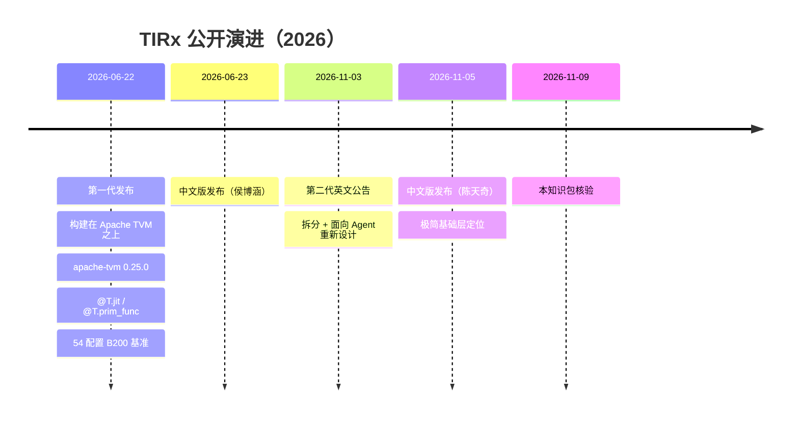

# 两代 TIRx

> 文中 `[F-xxx]` 为编号事实，来源见 [facts.md](../references/facts.md)。
>
> 「第一代 / 第二代」是**本包为区分交付物而使用的分析标签**，不是官方命名。官方分别称其为「构建在 Apache TVM 之上的 TIRx」与「面向 Agent 时代重新设计的 TIRx 基础层」。

## 1. 为什么必须区分两代

「TIRx」在不同时间点指向不同交付物。把 6 月的性能数据或代码示例直接套到 11 月的独立包上，会得到错误的结论：

- 包名不同：`apache-tvm` 0.25.0 vs `apache-tvm-tirx` 0.1.0b1 [F-095]；
- 文档路径不同：`/docs/tirx/` vs `/tirx/` [F-096]；
- 编程入口不同：`@T.jit` / `@T.prim_func` vs `@T.function` [F-068][F-008]；
- 命名空间不同：`Tx.*` / `Tx.wg.*` vs `tvm_tirx.script.tirx` [F-074][F-010]；
- 性能证据不同：54 配置基准测于第一代，不能外推到第二代 beta [F-099]。

## 2. 时间线

## 3. 对照表

| 维度 | 第一代（2026-06） | 第二代（2026-11） |
|------|-------------------|-------------------|
| 定位 | 构建在 Apache TVM 之上的硬件原生 kernel DSL 与编译器 [F-066] | Agent 时代的极简 ML 编译基础层 [F-002] |
| 交付形态 | `apache-tvm` wheel 内的 TIRx [F-071][F-095] | 独立仓库 `apache/tvm-tirx` + `apache-tvm-tirx` wheel [F-001][F-005] |
| 文档 | `tvm.apache.org/docs/tirx/overview.html` [F-096] | `tvm.apache.org/tirx/` [F-096] |
| 编程入口 | `@T.jit` / `@T.prim_func` [F-068] | `@T.function` [F-008] |
| 粒度命名空间 | `Tx.*`（thread）、`Tx.wg.*`（warpgroup）[F-074] | `ir` / `ir.prim` / `tirx` 三层 [F-010] |
| 核心抽象 | execution scope + storage-first layout + tile primitive dispatch [F-074][F-075][F-076] | 最小核心 IR + 可预测工具 + 动态扩展 + 三语言 [F-004] |
| 扩展方式 | 新硬件先 intrinsic，后 tile primitive [F-072] | 运行时注册表 + 独立扩展包 [F-015] |
| Agent 支持 | L1–L4 搜索层级 + 密集反馈 [F-089][F-091] | 动态扩展 + 三语言 + 分析/验证刚需 [F-017] |
| 性能证据 | 54 配置 B200 基准 [F-081]~[F-086] | 未提供公开基准 [F-040] |
| 成熟度 | 已发布 0.25.0，配套课程与 kernel library [F-069][F-070] | 0.1.0b1 beta，Rust WIP [F-005][F-006] |

## 4. 两代之间的连续性

虽然 API 变了，设计判断高度连续：

1. **边界放低**：第一代就明确「orchestration 留在硬件原生源码」[F-072]；第二代继续强调低而显式的边界 [F-032]。
2. **核心保持小**：第一代说「未来硬件应扩展后端库，而不是扩展核心语言」[F-072]；第二代把它落成五条设计原则 [F-004]。
3. **三语言与 FFI**：第一代已通过 TVM FFI 向 Python/C++/Rust 暴露 IR [F-089]；第二代把它作为地基 [F-029]。
4. **Agent 是目标用户**：第一代已把 agent-generated kernels 列为三类用户之一 [F-067]；第二代把 Agent 提到中心位置 [F-003]。

差异主要在**工程形态**：第一代是 TVM 内嵌的一条 DSL/编译路径；第二代把可复用的稳定部分拆出来，做成可被上层 harness 动态组合的基础层。

第一代官方致谢也说明了思想来源：构建在 TVM 基础设施之上，设计受 NumPy、CuTe、Triton、ThunderKittens、TileLang 影响 [F-092]。这解释了为什么它的 layout 与 CuTe 的对比、与 TileLang 的分层关系会被反复讨论。

## 5. 阅读与引用规则

| 你要引用的内容 | 应该用哪一代 | 注意 |
|----------------|--------------|------|
| 54 配置性能、GEMM/FA4 数字 | 第一代（2026-06） | 不能声称是 `tvm-tirx` 0.1.0b1 的成绩 [F-099] |
| `@T.function`、`ir.format_tree`、`structural_map` | 第二代（2026-11） | 与第一代 API 不兼容 [F-097] |
| layout D/R/O、`Tx.wg.*`、dispatch 规则 | 第一代（2026-06） | 第二代的 tile 便利层可能重新设计，需以当前文档为准 |
| Agent 搜索 L1–L4、密集反馈 | 第一代 | 第二代尚未在文档中系统展开 |
| 动态注册、扩展包、Rust WIP | 第二代 | 第一代没有这套机制 |

## 6. 如何判断你读到的是哪一代

三个快速判据：

1. **安装命令**：`pip install apache-tvm==0.25.0` → 第一代；`pip install apache-tvm-tirx` → 第二代 [F-071][F-047]。
2. **装饰器**：`@T.jit` / `@T.prim_func` → 第一代；`@T.function` → 第二代。
3. **文档 URL**：`/docs/tirx/` → 第一代；`/tirx/` → 第二代。

> 这三条判据来自源码/文档表面特征，属于 [C] 级核验观察；若官方后续统一命名，以官方文档为准 [F-097]。

## 7. 一句话总结

第一代回答「**如何用一套低边界 DSL 写出接近 cuBLAS/DeepGEMM 的 kernel**」；第二代回答「**当 Agent 成为主要开发者时，编译基础层应该长什么样**」。前者给出性能证据，后者给出架构判断——两者不能互相替代。
