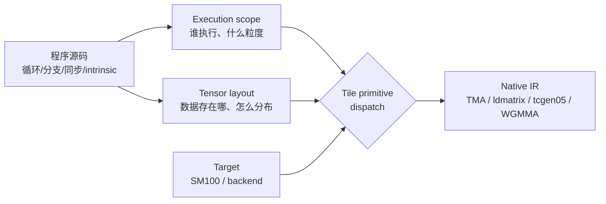
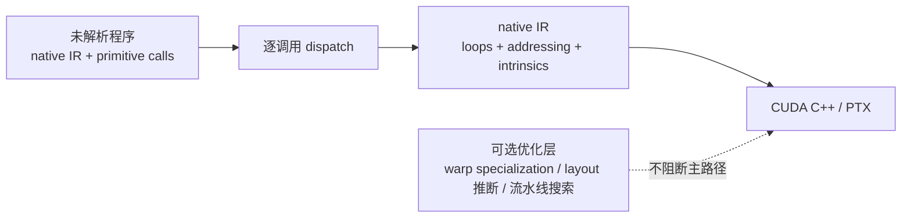

# 存储优先的 Layout 与 Tile 原语派发

> 文中 `[F-xxx]` 为编号事实，来源见 [facts.md](../references/facts.md)。本篇描述**第一代 TIRx（2026-06，`apache-tvm` 0.25.0）**的编程模型；第二代 API 不同，见 [08-two-generations](08-two-generations.md)。

## 1. 三个构造

第一代 TIRx 的编程模型由三个部件承载 [F-072][F-074][F-075][F-076]：



| 构造 | 回答的问题 | 关键机制 |
|------|-----------|----------|
| Execution scope | 谁执行这个操作，粒度多大？ | 控制流 + 原语命名空间 + 谓词 |
| Tensor layout | 逻辑张量存在哪，元素怎么分布？ | storage-first 声明，D/R/O 三成分，具名硬件轴 |
| Tile primitive dispatch | 这次调用降成哪条指令？ | 依据 operand layouts、scope、target 或 `dispatch=` |

## 2. Execution scope：命名空间即粒度

官方给出的规则很直接 [F-074]：

| 写法 | 粒度 | 说明 |
|------|------|------|
| `Tx.*` | thread | 未加限定的调用默认线程级 |
| `Tx.wg.*` | warpgroup | 显式提升到 warpgroup 级 |
| `T.ptx.elect_sync()` 等谓词 | 收窄到单个 issuing thread | 在 thread 级调用外加保护 |

一个 GEMM epilogue 里可以同时出现 `Tx.wg.*`（跨 warpgroup 搬运/转换 tile）和 thread 级的 `Tx.copy_async`（在 issuing-thread 谓词保护下做 TMA store）[F-074]。**粒度不是全局设置，而是每次调用的局部属性**。

## 3. Tensor layout：存储契约，不是循环变换工具

### 3.1 它描述什么

TIRx 的 layout 是 **storage-first** 的：先声明 tile 存在哪种物理资源里，再声明元素如何分布 [F-075]：

- global memory
- shared memory
- registers
- tensor memory（Blackwell）
- accelerator SRAM

这个声明会附着在 tile 上；调用 tile primitive 时，编译器读取它来选择实现 [F-075]。

### 3.2 D / R / O 三成分

layout 把逻辑坐标映射到具名硬件轴，并在传统 shape-stride 上增加三类结构 [F-077]：

| 成分 | 名称 | 作用 |
|------|------|------|
| **D** | Shard | 一组 iterator，每个在某轴上有 extent 和 stride；把逻辑索引切分到多个物理轴，产生 base 坐标 |
| **R** | Replica | 一组复制 iterator，枚举与逻辑索引无关的硬件偏移；加到 D 的结果上得到副本/广播 |
| **O** | Offset | 每个轴一个固定整数偏移；把数据放到指定基址或预留独占资源 |

具名硬件轴包括 `laneid`、`warpid`、`tid_in_wg`、`Col`、`Lane`、`P`、`F`、`pid` 等 [F-077]。使用具名轴而不是通用 `(t, m)`，让 layout 自带完整语义，不依赖上下文解释 [F-077]。

### 3.3 元素 57 的完整走查

官方示例：一个逻辑 tile 分布在 lanes 与 warps 上，在另一个 warpgroup 上有 replica，并在 warp 轴带 offset [F-079]。给定形状 `(8, 16)` 与逻辑坐标 `(i, j) = (3, 9)`：

**第一步：展平**

```text
L(i, j) = L(i * 16 + j)
L(3, 9) = L(57)
```

**第二步：反展平到具名轴**

```text
L(57) = L(i, floor(j / 8), floor(j / 2) % 4, j % 2)
```

**第三步：按轴计算坐标**

```text
warp: floor(j / 8) + 5 + 4r,  r ∈ [0, 2)
lane: 4i + floor(j / 2) % 4
reg : j % 2
```

代入 `(3, 9)`：

```text
warp = floor(9/8) + 5 + 4r = 1 + 5 + 4r = 6 + 4r
lane = 4*3 + floor(9/2) % 4 = 12 + 4 % 4 = 12
reg  = 9 % 2 = 1
```

**第四步：得到 base 与 replica owners**

```text
base location: 6@warpid, 12@laneid, 1@m
r = 0 → warpid = 6
r = 1 → warpid = 10
owners（×2）: { warpid=6, laneid=12 }, { warpid=10, laneid=12 }
```

这与官方给出的结果一致 [F-079]。走查的意义：**layout 是可计算的坐标映射，不是一句「数据怎么放」的描述**。

### 3.4 四个设计取舍

| # | 选择 | 含义 | 对比 |
|---|------|------|------|
| 1 | 存储契约，不是工作划分接口 | 用户只声明存储；线程划分、循环、寻址由 dispatch 生成 | CuTe 用 layout 代数推导 tile work 如何分给线程 [F-078] |
| 2 | 逻辑坐标 → 物理坐标 | 显式 replica/offset；避免物理→逻辑映射在 strided 情况下无定义 | 反向映射的替代方案 |
| 3 | 支持一般形状 | 非 2 的幂形状（多 stage buffer、tensor memory、scale-factor tile）按一等公民处理 | 仅支持 2 的幂的简化实现 |
| 4 | 具名硬件轴 | 轴本身带语义，layout 自包含、与编程模型解耦 | 通用 `(t, m)` 需靠约定恢复语义 |

## 4. 第二代的实际 API（源码核对）

前面的 D/R/O 走查来自第一代文档 [F-079]。第二代 `tvm_tirx` 的公开 API 形态不同，源码与文档给出的最小例子是 [F-109][F-124]：

```python
from tvm_tirx.tirx.layout import TileLayout, S, R
from tvm_tirx.backend.cuda.axis import laneid, warpid

fragment_layout = TileLayout(S[(32, 4) : (1 @ laneid, 1)])
position = fragment_layout.apply(3, 2, shape=(32, 4))
print(position["laneid"], position["m"])   # 3 2
```

把它挂到张量上：

```python
@T.function
def add_one_layout(A: T.Tensor((32, 4), T.float32), B: T.Tensor((32, 4), T.float32)):
    T.device_entry(launch=T.cuda.LaunchConfig(grid=1, block=32))
    lane = T.cuda.lane_id()
    fragment = T.alloc_local((32, 4), T.float32, layout=fragment_layout)
    lane_values = fragment.view(4, layout="default")
    for j in T.unroll(4):
        lane_values[j] = A[lane, j] + 1
    for j in T.unroll(4):
        B[lane, j] = lane_values[j]
```

差异点：

| 维度 | 第一代（2026-06） | 第二代（2026-11，源码） |
|------|-------------------|--------------------------|
| 构造 | 文档中的 D/R/O 描述 + 公式 | `TileLayout(S[...])`、`R`、`ComposeLayout`、`Axis` [F-109] |
| 查询 | 文档示例给 base/owners | `apply(...)` 返回 `{axis: value}` [F-124] |
| 挂载 | 由 dispatch 读取声明 | `T.alloc_local(..., layout=...)` 显式挂载 [F-124] |
| 视图 | 未展开 | `fragment.view(4, layout="default")` [F-124] |

> 因此 [layout-mapping 示例](../examples/layout-mapping.md) 的手算部分只用于理解「逻辑坐标 → 具名轴」的思想，不能当作第二代 API 用法。

## 5. Tile primitive dispatch：一次调用如何变成指令

dispatch 的输入是 **operand layouts + execution scope + target**，也可以显式给 `dispatch=` 提示 [F-076]。输出是 native IR：循环、地址计算、内存空间操作、同步、intrinsic 调用 [F-080]。

| 数据移动 / 计算 | 选中实现 | 触发条件（示例） |
|----------------|----------|------------------|
| global → shared | TMA | 布局与目标支持 TMA |
| shared → register | `ldmatrix` | 一定条件下 |
| tensor memory → register | `tcgen05.ld` | Blackwell tensor memory |
| 矩阵乘 | WGMMA / `tcgen05` / systolic-array | 依目标与操作数布局 |

dispatch 之后，程序已经是 native kernel IR，可以直接翻译成 CUDA C++ / PTX [F-080]。



## 6. 为什么把重型优化移出关键路径

官方明确把自动 warp specialization、跨算子 layout 推断、自动 tensor 分配、软流水搜索、cost-model 调优列为**可选层**，而不是必经编译阶段 [F-080]。原因：

- 这些技术与特定 kernel family、硬件世代强绑定；
- 一旦成为必经阶段，每个新 kernel pattern 或新硬件特性都要先改 pass 才能被使用；
- 直接 lowering 路径保证「新程序能先跑起来」，优化再逐步叠加。

这与第二代「不叠加启发式、直接交给 LLVM」是同一判断的不同实现 [F-022]。

## 7. 常见误解

| 误解 | 事实 |
|------|------|
| 「layout 可以用来做 loop transformation」 | TIRx 的 layout 只描述存储；变换逻辑在 dispatch 内部 [F-078] |
| 「layout 只支持 2 的幂形状」 | 从设计上支持一般形状 [F-077] |
| 「dispatch 是全局 pass」 | 它是逐 primitive 调用的局部解析 [F-080] |
| 「`Tx.*` 和 `Tx.wg.*` 只是命名风格」 | 它们决定执行粒度 [F-074] |
| 「这套 API 可以直接用在 tvm-tirx 0.1.0b1」 | 两代 API 不兼容，需按第二代文档重写 [F-097] |

## 8. 自检清单

- [ ] 每个 tile 的存储位置是否显式声明？
- [ ] 是否用 `Tx.wg.*` 表达了需要跨 warpgroup 的操作，而不是隐式假设？
- [ ] issuing-thread 谓词是否加在需要单线程执行的调用上？
- [ ] 是否把 layout 误当成循环变换工具？
- [ ] 新增硬件特性是否先以 intrinsic 落地，而不是改核心？
