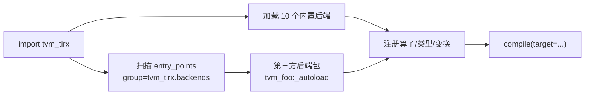

# 后端矩阵

> 文中 `[F-xxx]` 为编号事实，来源见 [facts.md](../references/facts.md)。
> **快照**：commit `cdc7a377`（2026-11-08）[F-100]。

## 1. 先纠正一个常见误读

官网 README 的五项特征里只写了「minimal code generation for CUDA and host LLVM」[F-004]，容易让人以为只有两个后端。源码实际注册了 **10 个内置后端**，另加 LLVM 作为核心 codegen [F-112][F-118]：

```python
_BUILTIN_BACKENDS = (
    "cuda", "metal", "rocm", "trn", "opencl",
    "vulkan", "webgpu", "hexagon", "adreno", "rust",
)
```

> 注意：这是「已注册的 Python 后端钩子」，不等于「全部经过同等测试并可用于生产」。CI 的 EXTRA 分支只构建备选 GPU 后端而不跑测试 [F-108]。

## 2. 后端矩阵

| 后端 | 目录/命名空间 | 目标（按名称） | 构建开关 | 备注 |
|------|--------------|----------------|----------|------|
| CUDA | `backend/cuda`、`src/backend/cuda` | NVIDIA GPU；PTX/NVRTC | `TVM_TIRX_USE_CUDA`（AUTO） | 文档最完整：launch、TMA、WGMMA、tcgen05、IKET [F-119] |
| LLVM | `src/codegen/llvm` | CPU（x86_64/AArch64/ARM） | `TVM_TIRX_USE_LLVM`（ON） | 核心 codegen，不在 `_BUILTIN_BACKENDS` 列表 [F-118] |
| Metal | `backend/metal` | Apple GPU | `TVM_TIRX_USE_METAL`（OFF） | 有 Python 参考文档页 [F-119] |
| ROCm | `backend/rocm` | AMD GPU | `TVM_TIRX_USE_ROCM`（OFF） | 有 Python 参考文档页 [F-119] |
| OpenCL | `backend/opencl`、`src/backend/opencl` | OpenCL 设备 | `TVM_TIRX_USE_OPENCL`（OFF） | 含 Qualcomm 扩展开关 [F-118] |
| Vulkan | `backend/vulkan` | Vulkan / SPIR-V | `TVM_TIRX_USE_VULKAN`（OFF） | 含 SPIR-V 工具链开关 [F-118] |
| WebGPU | `backend/webgpu` | WebGPU | 随构建配置 | 有 Python 参考文档页 [F-119] |
| Hexagon | `backend/hexagon` | Qualcomm Hexagon | 随构建配置 | 含 linker 参考页 [F-119] |
| Adreno | `backend/adreno` | Qualcomm Adreno GPU | 随构建配置 | 有 Python 参考文档页 [F-119] |
| TRN | `backend/trn` | 目录名 `trn`，具体目标以源码为准 | 随构建配置 | 含 pipeline/private tensor alloc 等变换 [F-119] |
| Rust | `rust/tvm-tirx`、`backend/rust` | Rust 扩展/算子 | `TVM_TIRX_USE_RUST`（AUTO） | 既是语言绑定也是后端钩子 [F-104][F-112] |

> 表中「目标」一列只写可由目录名/文档名确认的归属；`trn` 等未在本次核验中读到目标定义的，明确标注「以源码为准」，不做猜测。

## 3. 插件加载：真正落地的「everything is a plugin」

`_autoload_backends.py` 做两件事 [F-112]：

1. **加载 10 个内置后端钩子**（`load(name)`）；
2. **扫描外部入口点**：`importlib.metadata.entry_points(group="tvm_tirx.backends")`，调用每个 entry point 的 `_autoload()`。

外部扩展只需在自己的 `pyproject.toml` 声明：

```toml
[project.entry-points."tvm_tirx.backends"]
tvm_foo = "tvm_foo:_autoload"
```

`import tvm_tirx` 时自动加载；可用 `TVM_TIRX_DEVICE_BACKEND_AUTOLOAD=0` 关闭 [F-112]。这是第二代「动态扩展」原则在**后端层**的具体实现，而不只是类型/算子层。



## 4. 运行时与编译器的目标划分

CMake 把产物拆成三类 [F-120]：

| 目标 | 类型 | 作用 |
|------|------|------|
| `tvm_runtime` | shared | 核心运行时；设备运行时链接到它 [F-120] |
| `tvm_runtime_static` | static | 静态运行时 [F-120] |
| `tvm_tirx_compiler` | shared | 编译器库（IR、分析、变换、codegen） [F-120] |

设备运行时按开关追加到 `TVM_RUNTIME_BACKEND_LIBS`；LLVM 后端单独作为 `TVM_LLVM_BACKEND_LIB` [F-120]。这解释了为什么「运行不需要编译器」：导出的 `.so` 只需要 `tvm_runtime`，不需要 `tvm_tirx_compiler` [F-028]。

wheel 的 CMake 安装组件为 `tvm_tirx` 与 `tvm_tirx_llvm_backend` [F-117]；Python 包本身包含全部后端钩子，但其他后端的原生库是否进包取决于构建开关与组件配置。

## 5. 后端覆盖的现实边界

| 维度 | 事实 | 含义 |
|------|------|------|
| 构建覆盖 | CUDA、Metal、ROCm、Vulkan、OpenCL、Hexagon、Adreno、TRN、WebGPU、Rust 均有目录/钩子 | 「有代码路径」 |
| 测试覆盖 | Python 测试分 `not gpu` 与 `gpu`；CI 的 EXTRA 分支构建备选 GPU 后端但不跑测试 [F-108] | 「有代码路径」≠「已验证」 |
| 文档覆盖 | 参考页覆盖 cuda/metal/opencl/rocm/vulkan/webgpu/hexagon/adreno/trn [F-119] | 文档齐全度不等于成熟度 |
| 官方定位 | README 只强调 CUDA + host LLVM；博客把 Rust 标 WIP [F-004][F-006] | 对外承诺保守 |

因此正确的表述是：**TIRx 的架构支持多后端，但官方对外承诺与测试重点集中在 CUDA/LLVM，其他后端按「已注册、按需构建」理解**。

## 6. 选型建议

- **只要 CPU/GPU 主线**：CUDA + LLVM，文档与示例最完整；
- **要验证插件机制**：读 `_autoload_backends.py` 与 `examples/extension_guides`，比读十篇后端文档更快；
- **要用非 CUDA 后端**：先确认该后端的构建开关、SDK 依赖与测试标记，不要以「目录存在」为可用依据；
- **要扩展新后端**：用 `tvm_tirx.backends` entry point 做外部包，避免改核心 [F-112]。
