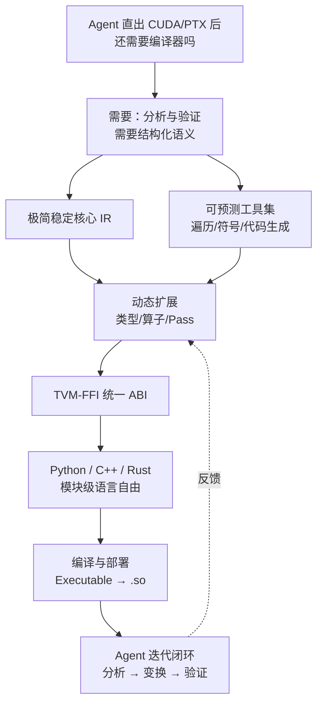

# 概念索引

概念层按「为什么 → 是什么 → 怎么建 → 怎么用 → 边界在哪」组织，建议顺序阅读；也可按下方问题直接跳转。

| 序 | 文档 | 回答的问题 |
|----|------|-----------|
| 00 | [overview](00-overview.md) | Agent 能直出 CUDA 了，为什么还要编译基础层？两个 TIRx 有什么区别？ |
| 01 | [design-principles](01-design-principles.md) | 这个基础层遵循哪五条设计原则？每条原则对应什么反模式？ |
| 02 | [ir-object-model](02-ir-object-model.md) | 程序如何被表示为不可变 IR 树？`ir` / `ir.prim` / `tirx` 三层各放什么？ |
| 03 | [tvm-ffi-cross-language](03-tvm-ffi-cross-language.md) | 为什么 Python、C++、Rust 能共享同一套对象？ABI 起什么作用？ |
| 04 | [dynamic-extension](04-dynamic-extension.md) | 「一切皆插件」如何做到不重编译核心？visitor pattern 为何不够用？ |
| 05 | [programming-model](05-programming-model.md) | TIRx 编程模型为何选择低而显式的边界？三层便利层是什么？ |
| 06 | [compile-and-deploy](06-compile-and-deploy.md) | 编译做了什么、没做什么？如何导出并在别的语言里加载？ |
| 07 | [agent-workflow-boundary](07-agent-workflow-boundary.md) | Agent 工作流如何嵌入？哪些声明不能外推？风险在哪里？ |
| 08 | [two-generations](08-two-generations.md) | 2026-06 第一代与 2026-11 第二代有什么区别？引用时如何避免张冠李戴？ |
| 09 | [layout-and-dispatch](09-layout-and-dispatch.md) | storage-first layout 的 D/R/O 是什么？一次 tile primitive 调用如何变成 TMA/WGMMA？ |
| 10 | [performance-benchmarks](10-performance-benchmarks.md) | 54 配置 B200 基准说明了什么、不能说明什么？ |
| 11 | [source-repo-tour](11-source-repo-tour.md) | 源码仓怎么组织？怎么构建、测试、lint？ |
| 12 | [backend-matrix](12-backend-matrix.md) | 到底有多少后端？「已注册」与「已验证」差在哪？ |
| 13 | [compiler-pipeline](13-compiler-pipeline.md) | `compile` 到底跑了哪些 pass？「无启发式」准确含义是什么？ |

## 概念地图



## 关键术语速查

| 术语 | 一句话解释 | 详见 |
|------|-----------|------|
| TIRx（独立项目） | `apache/tvm-tirx`，极简 ML 编译基础层；IR 命名空间为 `ir` / `ir.prim` / `tirx` | [00](00-overview.md) |
| TIRx（TVM 主仓） | `tvm::tirx`，TVM 内的张量 IR 与 SBlock 调度体系 | [00](00-overview.md) |
| TVM-FFI | 跨语言对象/函数/模块的稳定 ABI 与运行时 | [03](03-tvm-ffi-cross-language.md) |
| TVMScript | 用 Python 语法书写 IR 的嵌入式 DSL（本项目中别名 `T`） | [02](02-ir-object-model.md) |
| Region op | 定义带额外语义的词法区域（如 kernel launch）的算子形态 | [04](04-dynamic-extension.md) |
| Executable | `tvm_tirx.compile` 的返回物，可调用、可导出共享库 | [06](06-compile-and-deploy.md) |
| Tile operation dispatch | 依据布局、执行域与目标选择 tile 实现 | [09](09-layout-and-dispatch.md) |
| D / R / O | layout 的 Shard / Replica / Offset 三成分 | [09](09-layout-and-dispatch.md) |

```{toctree}
:hidden:
:maxdepth: 7

00-overview
01-design-principles
02-ir-object-model
03-tvm-ffi-cross-language
04-dynamic-extension
05-programming-model
06-compile-and-deploy
07-agent-workflow-boundary
08-two-generations
09-layout-and-dispatch
10-performance-benchmarks
11-source-repo-tour
12-backend-matrix
13-compiler-pipeline
```
