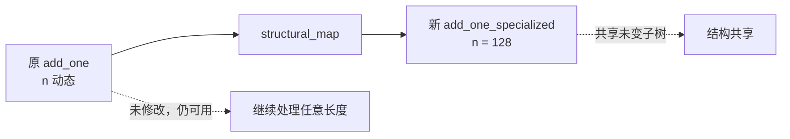

# 结构特化：把动态维度 n 变成 128

> 文中 `[F-xxx]` 为编号事实，来源见 [facts.md](../references/facts.md)。示例来自官方 Quick Start 与博客技术细节 [F-020]。

## 1. 目标

`add_one` 用 `T.dynamic("n")` 声明了动态长度，因此一份程序适用任意长度。现在我们要生成一个**只适用于 128 个元素**的专用版本，同时保持原程序不变。

## 2. 取到符号变量

```python
import tvm_ffi
import tvm_tirx
from tvm_tirx.script import tirx as T

# 参数 A 的类型是 TensorType，shape[0] 就是符号 n
n = add_one.params[0].ty.shape[0]
```

`n` 是一个 `ir.Var` 对象，不是 Python 整数 [F-019]。

## 3. 用 structural_map 改写

```python
add_one_specialized = tvm_ffi.structural_map(
    add_one,
    (tvm_tirx.ir.Var, lambda v: T.int32(128) if v.same_as(n) else v),
)

add_one_specialized.show()
```

`tvm_ffi.structural_map` 会遍历程序的每个元素，对每个 `ir.Var` 调用传入的函数，并用返回值替换原节点 [F-020]。

打印结果：

```python
@T.function
def add_one(A: T.Tensor((128,), T.float32), B: T.Tensor((128,), T.float32)):
    for i in range(128):
        B[i] = A[i] + T.float32(1.0)
```

三处变化同时发生：

- 参数类型里的 `n` → `128`；
- 循环上界 `n` → `128`；
- 常量 `1` 被规范化为 `T.float32(1.0)`（类型匹配）。

## 4. 为什么原程序没有被改坏

IR 对象不可变：变换构造一棵新树，并共享未修改的部分 [F-011]。



验证一下：

```python
print(add_one.params[0].ty.shape[0])              # n，仍是符号
print(add_one_specialized.params[0].ty.shape[0])  # 128
```

## 5. 这个范式能推广到什么

`structural_map` 不止能替换变量。任何「按结构逐节点改写」的需求都可以套用：

| 改写目标 | 匹配的节点类型 | 用途 |
|----------|---------------|------|
| 符号维度 → 常量 | `ir.Var` | 形状特化、固定 batch |
| 常量折叠 | `ir.Constant` / `prim.*` | 简化表达式 |
| 算子替换 | `ir.Call` / `ir.Op` | 用等价实现替换后端不支持的操作 |
| 类型替换 | `ir.Type` | 精度/布局转换 |
| 插入检查 | `ir.Stmt` | 在关键位置加入断言 |

这解释了为什么 TIRx 把「结构遍历与映射」列为基础层的可预测工具之一 [F-004]。

## 6. 实践建议

- **用 `same_as` 精确匹配**：不要按名字字符串比较，变量身份才是可靠的；
- **保持类型一致**：把 `n` 换成 `T.int32(128)`，而不是 Python `int`；
- **改写后做等价性验证**：对特化版本跑与通用版本相同的输入，数值对拍；
- **保留原程序**：不可变意味着你可以随时回退或对比，不要覆盖原对象。

## 7. 延伸阅读

- IR 结构与字段访问：[02-ir-object-model](../concepts/02-ir-object-model.md)
- 元编程与编译期特化：[05-programming-model](../concepts/05-programming-model.md)
- 符号整数分析与约束：[01-design-principles](../concepts/01-design-principles.md)
