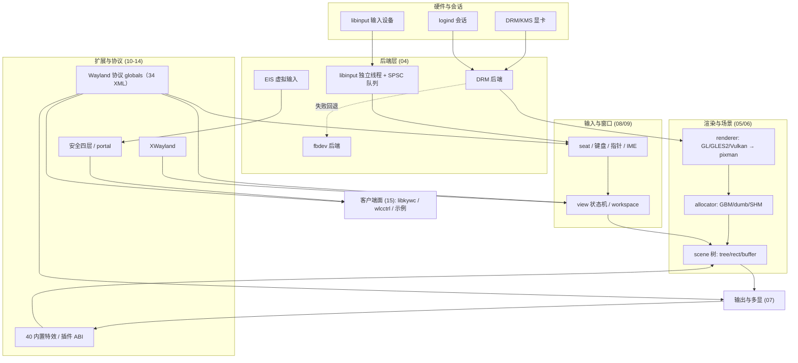

> **本篇在数据流中的位置**：本篇是整条主线（硬件/会话→后端→渲染→场景→输出↔输入→视图/工作区→特效/插件→协议→客户端）之前的第 0 站，给出项目定位、规模口径、分层地图与 16+3 篇学习路径。无需前置阅读，但建议先具备 C 语言与 Linux 图形栈的基本概念。

## 项目定位：openKylin 的默认 Wayland 合成器

kylin-wayland-compositor 是一个基于 wlroots 编写的 Wayland 合成器（Wayland compositor）。项目文档口径为：「基于wlroots编写的wayland合成器」，且「作为默认显示服务器随openKylin系统发布」（F-R1-151，README.md:3-5）。也就是说，在 openKylin 图形会话中，它承担的是传统 X11 世界里 X 服务器 + 窗口管理器合体的角色：接管 DRM/KMS 显卡与输入设备、合成各客户端的画面、把最终帧送上海报屏幕，并向客户端提供 Wayland 协议接口。

项目有两个常用名字，指的是同一套代码：

- **kylin-wayland-compositor**：meson 工程名与源码包名（F-R1-001，meson.build:2）；
- **kywc / kylin-wlcom**：README 给出的简称（README.md:3），其中主可执行文件名固定为 `kylin-wlcom`，由编译宏 `TARGET_NAME` 注入（F-R1-004，meson.build:315-325）。本教程正文沿用 kywc 作为代码侧简称，`kylin-wlcom` 作为命令/路径名。

本教程所有代码事实均锚定固定提交 `4df656222427f3cd0101e41d828fb64805e66c15`（分支 openKylin/huanghe），固定快照四要素见 [源码信源登记](/references/source-code-map.md)。

## 许可：GPL-1.0-or-later 与四份协议文本

meson 工程声明许可为 GPL-1.0-or-later，仅用 C 语言、C11 标准（F-R1-001，meson.build:1-11）；源码头部署名 KylinSoft Co., Ltd.，统一使用 SPDX 双行声明（F-R1-005）。仓库 `LICENSES/` 目录收录四份协议全文（F-R1-007）：

| 协议文本 | 典型用途 |
|---|---|
| GPL-1.0-or-later.txt | 工程主许可，绝大多数自有源码 |
| LGPL-2.1-or-later.txt | 来源于其他开源项目的文件（见 NOTICE） |
| MIT-CMU.txt | wlroots/sway 样式来源文件 |
| MulanPSL-2.0.txt | 木兰宽松许可证第 2 版（如 security.xml 的 SPDX 头，F-R5-052） |

NOTICE 声明了 redshift、wlroots、sway 三个第三方来源，但其列出的个别历史文件在当前快照树中已不存在（D-R1-05），这属于法律文本与代码树的漂移，本教程只如实呈现，不替上游裁决。

## 八条功能特点（项目文档口径归纳）

README 列出 8 项功能特点（F-R1-151，README.md:12-26），归纳为八个面向：

1. **依赖轻**：不使用 Qt、GTK 等图形开发框架，合成器本体直接构建在 wlroots/libwayland 之上；
2. **协议按需设计**：应用与合成器之间的协议按需要实现，支持矩阵见 docs/PROTOCOLS.md，私有协议族为 kywc/ukui（详见 [12 协议全景](/concepts/12-protocols.md)）；
3. **窗口特效**：内置常用窗口动效，40 个特效 `.c` 静态编入主二进制（详见 [10 特效框架](/concepts/10-effects-framework.md)）；
4. **中文输入**：完整支持 input-method v2 与 text-input v1/v2/v3（README 第 4 条原文，F-R1-151）；
5. **快捷键与手势**：键盘全局快捷键、触摸板与触摸屏手势；
6. **输入设备**：鼠标、键盘、触摸板、触摸屏、数位板（tablet）；
7. **多语言国际化**：主翻译域 LINGUAS 启用 16 种语言，`.mo` 在构建期内嵌为 C 数组（F-R1-157）；
8. **多后端**：支持 X11/Wayland 嵌套运行，以及 DRM 与 fbdev 原生显示后端（详见 [04 后端层](/concepts/04-backends.md)）。

## 规模数字（带口径）

以下数字来自固定快照的脚本实测，口径不同含义不同，引用时须连同口径一起使用：

| 指标 | 值 | 口径 |
|---|---|---|
| 全仓 C/H 文件 | 465 个 | 递归统计 `*.c/*.h`，无 build/ 检出（F-R1 总览，洞察裁决口径） |
| 全仓 C/H 物理行数 | 165280 行 | python 对 465 个文件按物理行计数（字节 LF 数 165276 + 4 个末尾无换行文件各补 1）；R 阶段 PowerShell `Measure-Object -Line` 口径 138417 经 V 阶段证实系统性少计（如 src/view/view.c 实际 3022 行被计为 2578），已勘误 |
| `src/` 规模 | 283 个 C/H | 15 个子系统目录 281 个 + 根目录 main.c、server.c 2 个 |
| `protocols/*.xml` | 34 个 XML / 77 个 interface | 另有第 35 个 XML 在 src/plugin/security/security.xml，不经 protocols/meson.build（F-R5-001、F-R5-052） |
| 内置特效 | 40 个 `.c` | 36 个无条件编译 + 4 个条件编译（screenshot/watermark/slide/ukui_effect） |
| meson 选项 | 44 个 | 37 boolean（默认 true 35、false 2）+ 3 feature + 4 string（F-R1-018~020） |
| 特效 shader | 14 个（7 对 vert/frag） | src/effect/shaders/；DRM blit 另有 4 个、scene 另有 4 个 |
| 翻译 | 27 个 `.po` / LINGUAS 16 语言 | 11 个 `.po` 不参与构建（D-R1-06）；portal/po 为独立域 |
| libkywc 公开 API | 67 个 `kywc_*` 函数 | 与 libkywc.h 67 条声明一一对账（F-R5-007） |

15 个 src 子系统目录为：backend、config、effect、input、output、painter、plugin、render、scene、security、theme、util、view、widget、xwayland（其中 xwayland 由 meson 选项条件门控，F-R1-015、F-R1-030）。完整目录地图见 [源码信源登记](/references/source-code-map.md)。

> ⚠️ 上游差异：F-R1-030 文字称「13 个固定子目录」，但其列举的目录名实为 14 个；连同条件编译的 xwayland，磁盘上共 15 个子系统目录。本教程以洞察文档的实测裁决数 15 为准（283 = 281 + main.c + server.c）。

## 分层架构简图

下图在洞察知识地图基础上重绘的简版，只保留本教程主线；完整地图见 [架构洞察](/references/insights.md)。

主线读法：硬件与 logind 会话经**后端层**接入；DRM 后端产出的输出交给**渲染层**（renderer + allocator + drm_syncobj 同步），画进自研的 **scene 场景树**，再由**输出管理**编排上屏；输入设备走独立 libinput 线程投递给主循环的 seat，经快捷键/手势分流后驱动 **view/workspace**；特效与插件作用于场景树；所有跨进程能力最终以 **Wayland 协议 global** 的形式暴露给客户端，X11 应用经 XWayland 适配，外部进程则通过 libkywc 等客户端面消费。

## 教程学习路径（16 + 3 篇）

概念篇 16 篇按数据流排序，建议顺序阅读；示例篇 3 篇为动手向，可在相应概念篇之后独立阅读。

| 篇 | 文件 | 一句话内容 |
|---|---|---|
| 00 | [00-overview.md](/concepts/00-overview.md) | 本篇：定位、规模、分层地图与阅读路径 |
| 01 | [01-build-run.md](/concepts/01-build-run.md) | 依赖、44 个 meson 选项、CLI、环境变量、JSON 配置与 systemd 会话单元 |
| 02 | [02-wayland-wlroots-basics.md](/concepts/02-wayland-wlroots-basics.md) | Wayland 合成器模型、unstable API 与协议代码生成机制 |
| 03 | [03-startup-architecture.md](/concepts/03-startup-architecture.md) | main 启动序列、struct server 与 manager 分层 |
| 04 | [04-backends.md](/concepts/04-backends.md) | DRM/fbdev/session/libinput/EIS 与后端自动选择 |
| 05 | [05-rendering.md](/concepts/05-rendering.md) | renderer 自动选择、allocator/GBM、drm_syncobj 与渲染 pass |
| 06 | [06-scene-graph.md](/concepts/06-scene-graph.md) | 自研 scene 三节点树、23 种角色（22 个有调试名）、surface 与装饰节点 |
| 07 | [07-output-management.md](/concepts/07-output-management.md) | 输出枚举、模式切换、多显布局与热插拔 |
| 08 | [08-input.md](/concepts/08-input.md) | seat、键盘组/xkb、输入法、指针/触摸/平板/手势、binding |
| 09 | [09-view-workspace.md](/concepts/09-view-workspace.md) | view 状态机、layer、workspace、widget 与数据设备 |
| 10 | [10-effects-framework.md](/concepts/10-effects-framework.md) | animator、40 个内置特效分组与特效 shader |
| 11 | [11-plugin-system.md](/concepts/11-plugin-system.md) | 插件 ABI 1.0、加载器、interface 钩子与构建边界 |
| 12 | [12-protocols.md](/concepts/12-protocols.md) | 34 个 XML 全表、global 注册两类、PROTOCOLS.md 对账 |
| 13 | [13-xwayland.md](/concepts/13-xwayland.md) | Xwayland 子进程、xwm、selection 与惰性启动 |
| 14 | [14-security-portal.md](/concepts/14-security-portal.md) | 安全四层、xdg-desktop-portal-wlcom、EI/EIS 远程桌面 |
| 15 | [15-libkywc-clients.md](/concepts/15-libkywc-clients.md) | libkywc 67 API、wlcctrl/wldialog/magnifier 与示例程序 |
| 例 1 | [examples/01-effect-plugin-walkthrough.md](/examples/01-effect-plugin-walkthrough.md) | 跟写一个特效/插件的完整走读 |
| 例 2 | [examples/02-wlu-utilities-walkthrough.md](/examples/02-wlu-utilities-walkthrough.md) | wlu 工具集与输出管理/虚拟桌面客户端走读 |
| 例 3 | [examples/03-libkywc-qml-thumbnail.md](/examples/03-libkywc-qml-thumbnail.md) | 用 libkywc 在 Qt/QML 中取缩略图 |

## 读前知识要求

- **C 语言**：能读懂结构体、函数指针表（interface/vtable）、位掩码与链表宏；代码风格为 4 空格缩进、Linux 花括号、列宽 100（F-R1-155）。
- **Linux 图形栈基础**：知道 DRM/KMS、GBM、EGL/OpenGL、libinput、evdev 各自的大致位置即可，具体到 kywc 的用法会在 04/05 篇展开。
- **Wayland 概念**：不要求事先掌握，[02 Wayland 与 wlroots 基础](/concepts/02-wayland-wlroots-basics.md) 会补齐合成器模型、协议 XML 与 scanner 机制。

## 证据边界与静态学习声明

本教程是**静态源码学习**产物：全部结论来自对固定提交源码与随附文档的阅读，未在本机执行 meson 构建、未运行 kylin-wlcom、未做运行时验证。因此：

- README、docs/ENV.md、docs/PROTOCOLS.md、man page 的内容一律表述为「项目文档口径」；当文档与代码冲突时，以代码为准并以「⚠️ 上游差异」块显式标注（汇总见 [项目文档登记](/references/project-docs.md)）。
- 版本号存在双源：meson 工程版本 1.3.0，而 Debian changelog 顶端为 1.3.1-ok36（D-R1-01）；Debian 构建时 `KYWC_VERSION` 会被 dpkg-parsechangelog 输出覆盖（F-R1-002）。
- docs/KNOWN_ISSUES.md 仅记录 1 条已知问题（ukui 应用双标题栏，F-R1-154），不代表全部运行时风险。
- 运行/打包行为（systemd 会话、Debian 包安装效果）均为代码与打包文件的静态推断，真实行为以 openKylin 发行环境为准。

## 相关概念

- 后继：[01 构建、运行与打包](/concepts/01-build-run.md) — 把项目在本地构建起来需要的依赖、选项与命令
- 概念底座：[02 Wayland 与 wlroots 基础](/concepts/02-wayland-wlroots-basics.md) — 读懂后续 12 篇所需的协议与 API 模型
- 启动主线：[03 启动序列与 server 总体架构](/concepts/03-startup-architecture.md) — 从 main() 到事件循环的函数级走读
- 信源：[源码信源登记与固定快照](/references/source-code-map.md)、[项目文档登记](/references/project-docs.md)、[架构洞察与知识地图](/references/insights.md)
