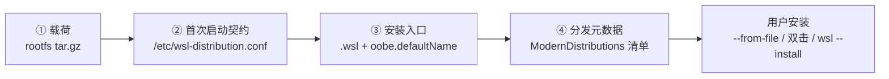

# 00 全景：从 Linux 根文件系统到可安装的 WSL 发行版

本教程把「一个可运行的 Linux 根文件系统」加工成「Windows 用户能安装、能双击、能被 `wsl --install` 识别的 WSL 发行版」。官方指南只有一页，但涉及四层契约；本束把每一层拆成可执行步骤、可核对事实与可落地检查表。

> **证据边界**：全部步骤来自 Microsoft Learn 中英文官方页面（页面标注最后更新 2025-10-04），未在本机从零构建并发布一个发行版。命令与字段按原文转录；源页面代码块的换行丢失处按语义重建并标注（见 [核验报告](../references/verification.md)）。本机已安装 WSL 3.0.4.0，满足「2.4.4 及以上」的版本前提，但不构成对全部步骤的实跑验证。

## 一、先建立正确心智模型

官方定义把发行版拆成两部分：根文件系统 tar 与清单条目（F-003）。但只要目标是「别人能装」，实际交付是四层：



- **载荷**：全部发行版文件，不含内核、initramfs、`/etc/resolv.conf`（F-009、F-076、F-079）。
- **首次启动契约**：OOBE 命令、默认 UID、默认名称、快捷方式、终端模板（F-019）。
- **安装入口**：把 `.tar` 改名为 `.wsl`；双击安装额外要求 `oobe.defaultName`（F-043、F-045）。
- **分发元数据**：清单中的 flavor、版本、默认项、双架构 URL 与 SHA256（F-050~F-057）。

## 二、适用与不适用

| 场景 | 是否适用 | 建议路径 |
|---|---|---|
| 发行版维护者要发布自己的 Linux 发行版 | ✅ | 本教程全流程 |
| 企业要把内部标准环境分发给员工 | ✅ | 本教程 + [07 清单与本地测试](07-manifest-local-test.md) + [08 企业分发](08-enterprise-and-publishing.md) |
| 只想把现成发行版导入本机自己用 | ❌ | 用 `wsl --import`，见官方「导入任意 Linux 发行版」文档 |
| 想制作 Docker 镜像 | ❌ | 用容器工具链；本教程只在需要时引用容器导出 rootfs 的入口（F-014） |
| 需要 GUI 桌面发行版定制 | ⚠️ 部分适用 | 本教程只覆盖 WSL 安装与启动契约，不涉及桌面组件 |

## 三、前置条件

1. **WSL 版本 ≥ 2.4.4**（F-004）。版本查询：`wsl --version`。
2. **一个可打包的 Linux 根文件系统**：可来自现有发行版、离线 rootfs、或导出容器（F-014）。
3. **Windows 侧管理员权限**：仅企业清单覆盖与本地测试需要（F-066）；直接 `--from-file` 安装通常不需要改 HKLM。
4. **基础工具**：Linux 侧 `tar`、`gzip`；Windows 侧 PowerShell（本地测试脚本）。

## 四、术语表

| 术语 | 含义 | 出处 |
|---|---|---|
| rootfs | 发行版根文件系统，tar 的主体内容 | F-009 |
| `.wsl` | Windows 上标识 WSL 发行版的 tar 文件扩展名 | F-007、F-043 |
| OOBE | 开箱体验（out of box experience），首次打开交互式 shell 时运行的配置钩子 | F-020、F-028 |
| `oobe.defaultUid` | 发行版启动时的默认 UID，示例与建议值均为 1000 | F-021、F-074 |
| `oobe.defaultName` | 发行版注册的默认名称；双击安装的必要条件 | F-022、F-045 |
| flavor | 清单中的一个发行版系列；同名下可挂多个版本 | F-053、F-054 |
| manifest | 控制 `wsl --install <distro>` 可选列表的 JSON 清单 | F-048、F-050 |
| `DistributionListUrl` | 覆盖官方清单 URL 的 HKLM 注册表值 | F-062 |

## 五、五步最短路径

以下命令按官方页面顺序给出。每步的完整说明与坑位见对应章节。

**步骤 1：准备 rootfs 并放入两份配置**

```bash
# 在目标 rootfs 内
sudo install -m 0644 /dev/null /etc/wsl-distribution.conf
sudo install -m 0644 /dev/null /etc/wsl.conf
# 再按 02、04 章写入内容
```

**步骤 2：打包为 tar.gz**

```bash
cd /path/to/rootfs
tar --numeric-owner --absolute-names -c * | gzip --best > ../install.tar.gz
```

**步骤 3：改名为 `.wsl`**

```powershell
Rename-Item .\install.tar.gz my-distro.wsl
```

**步骤 4：本地安装验证**

```powershell
wsl --install --from-file .\my-distro.wsl
# 或在资源管理器中双击 .wsl（要求 oobe.defaultName 已设置）
```

**步骤 5：按受众选择分发方式**

| 受众 | 做法 | 详见 |
|---|---|---|
| 任意用户，直接给文件 | 分发 `.wsl`，用户 `--from-file` 或双击 | [06](06-wsl-file-install.md) |
| 企业/团队内 | 注册表指向内部清单，可选 `file://` 本地测试 | [07](07-manifest-local-test.md)、[08](08-enterprise-and-publishing.md) |
| 所有 WSL 用户 | 满足成员资格后向 microsoft/WSL 提 PR | [08](08-enterprise-and-publishing.md) |

## 六、阅读路线

- **第一次做发行版**：00 → 01 → 02 → 03 → 04 → 05 → 06 → 09
- **只关心企业内分发**：00 → 01 → 02 → 07 → 08 → 09
- **排障导向**：先看 [09 建议与检查清单](09-recommendations-checklist.md) 的失败模式表，再回到对应章节
- **想理解设计取舍**：读 [洞察与模式](../references/insights.md) 的五条四元组洞察

## 七、一条最重要的提醒

官方指南的技术动作很少，真正的门槛是**契约完整性**：OOBE 失败会否决整个发行版（F-020），缺 `defaultName` 会让双击安装失效（F-045），清单缺项会让 `wsl --install <distro>` 不可达（F-048）。把交付拆成「载荷 / 首次启动 / 安装入口 / 分发元数据」四段逐段验收，比记住任何单条命令都重要。
