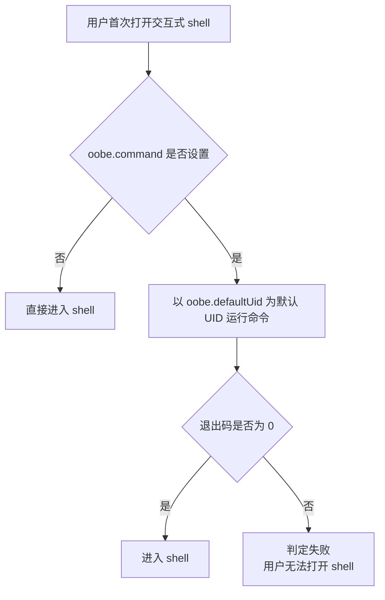

# 02 编写 /etc/wsl-distribution.conf

`/etc/wsl-distribution.conf` 是**发行版维护者的契约**：它决定用户第一次启动时发生什么、开始菜单里长什么样、Windows Terminal 里生成什么配置。它由维护者创建（F-016），不应承载用户的日常偏好。

## 一、完整示例

官方示例（F-019）：

```ini
# /etc/wsl-distribution.conf

[oobe]
command = /etc/oobe.sh
defaultUid = 1000
defaultName = my-distro

[shortcut]
enabled = true
icon = /usr/lib/wsl/my-icon.ico

[windowsterminal]
enabled = true
profileTemplate = /usr/lib/wsl/terminal-profile.json
```

三个节分别对应：首次启动体验、开始菜单快捷方式、Windows Terminal 配置生成。

## 二、字段总表

| 键 | 类型 | 默认值 | 作用 | 依据 |
|---|---|---|---|---|
| `oobe.command` | 字符串 | 无 | 首次打开交互式 shell 时运行；返回非零即失败，用户无法打开 shell | F-020 |
| `oobe.defaultUid` | 整数 | 无 | 发行版启动时的默认 UID；配合脚本创建用户 | F-021 |
| `oobe.defaultName` | 字符串 | 无 | 发行版注册的默认名称；可被 `wsl --install <distro> --name <name>` 覆盖 | F-022 |
| `shortcut.icon` | 字符串 | WSL 默认图标 | 开始菜单快捷方式图标；`.ico` 格式，最大 10MB | F-023 |
| `shortcut.enabled` | 布尔 | true | 安装时是否创建开始菜单快捷方式 | F-024 |
| `windowsterminal.profileTemplate` | 字符串 | 无 | 生成终端配置文件的 JSON 模板路径 | F-025 |
| `windowsterminal.enabled` | 布尔 | true | 安装时是否创建终端配置文件；未设模板则生成默认配置 | F-026 |

**源页面瑕疵与统一口径（S-01、S-05）**

| 源页面问题 | 官方原文表现 | 本教程统一口径 |
|---|---|---|
| 重复条目（S-01） | 配置表把 `windowsterminal.profileTemplate` 列了两次，默认值分别写「无」与「终端模板文件的路径」（F-027、D-01） | 采用「默认未设置」：不写该键时，只要 `windowsterminal.enabled = true`，WSL 仍会生成默认配置（F-026） |
| 键名大小写（S-05） | 示例写 `ProfileTemplate`，配置表写 `profileTemplate`（F-019、F-025） | 全篇统一为小写 `profileTemplate`，上文示例已按此规范化；官方未声明是否大小写不敏感，首次落地后请在自家发行版复核一次 |

## 三、`[oobe]`：首次启动契约

OOBE = 开箱体验（out of box experience，F-028）。三个键的关系：



- `command` 是单点否决：非零即失败（F-020）。脚本写法与幂等要求见 [03 OOBE](03-oobe.md)。
- `defaultUid` 与脚本创建的 UID 应一致；官方建议两者都设为 1000（F-021、F-074）。
- `defaultName` 不只是显示名：双击 `.wsl` 安装依赖它（F-045）。即使你只打算用 `--from-file`，也建议设置。

**最小可用配置**：

```ini
[oobe]
defaultUid = 1000
defaultName = my-distro
```

这表示不跑 OOBE 脚本、以 UID 1000 启动、注册名为 `my-distro`。是否仍需要 OOBE 取决于你的 rootfs 是否已内置该 UID 的用户。

## 四、`[shortcut]`：开始菜单入口

```ini
[shortcut]
enabled = true
icon = /usr/lib/wsl/my-icon.ico
```

- 图标必须是 `.ico`，最大 10MB（F-023）。PNG/SVG 不合规。
- `enabled` 默认 true（F-024）；关闭后不创建快捷方式，但发行版仍可通过命令行启动。
- 官方建议同时设置 `oobe.defaultName` 与 `shortcut.icon`（F-075）。

## 五、`[windowsterminal]`：终端配置模板

```ini
[windowsterminal]
enabled = true
profileTemplate = /usr/lib/wsl/terminal-profile.json
```

- 不设 `profileTemplate` 时，只要 `enabled` 为 true，WSL 仍会生成默认终端配置（F-026）。
- 模板 JSON 的写法见 [05 Windows Terminal 配置](05-terminal-profile.md)。
- 模板路径必须在 rootfs 内且安装后可读；官方示例放在 `/usr/lib/wsl/` 下（F-019）。

## 六、权限与归属

两份配置都应归 `root:root`，权限 `0644`（F-073）：

```bash
sudo chown root:root /etc/wsl-distribution.conf /etc/wsl.conf
sudo chmod 0644 /etc/wsl-distribution.conf /etc/wsl.conf
ls -l /etc/wsl-distribution.conf /etc/wsl.conf
```

## 七、常见错误

| 现象 | 可能原因 | 修复 |
|---|---|---|
| 双击 `.wsl` 无反应或安装失败 | 缺少 `oobe.defaultName`（F-045） | 补上并重新打包 |
| 装好后进不去 shell | `oobe.command` 返回非零（F-020） | 在本地用同一脚本手动跑一遍，修正后重打 |
| 开始菜单没有图标 | `icon` 不是 `.ico` 或超过 10MB（F-023） | 转换格式并压缩 |
| 终端配置没生成 | `windowsterminal.enabled = false` 或模板路径不可读（F-026） | 检查键值与路径 |
| 配置改了却不生效 | 改的是已安装实例内的文件，不是打包前 rootfs | 修改 rootfs 后重新打包安装 |

## 八、小结

- 三节七键，逐一对应「首次启动 / 开始菜单 / 终端配置」。
- `defaultName` 是双击安装的硬前提，`defaultUid` 与 OOBE 脚本必须对齐到 1000。
- 配置表存在重复行与大小写不一致，落地时以配置表键名为主并实测一次。

下一步：[03 编写 OOBE 脚本](03-oobe.md)，把「首次启动要做什么」写成可重试、可回滚的代码。
