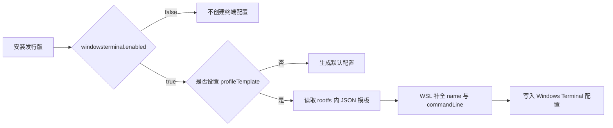

# 05 生成 Windows Terminal 配置文件

安装发行版时，WSL 会自动生成一份 Windows Terminal 配置文件（F-033）。如果希望它带上你的品牌配色、字体与渲染设置，就在 `/etc/wsl-distribution.conf` 中指定模板（F-034）。

## 一、机制



- `enabled` 默认 true（F-026）；设为 false 则不创建。
- 未设置 `profileTemplate` 时，仍会生成默认配置（F-026）。
- 设置模板后，WSL 读取该 JSON，并自动补上配置文件 `name` 与 `commandLine`（F-037）。

## 二、配置入口

```ini
# /etc/wsl-distribution.conf
[windowsterminal]
enabled = true
profileTemplate = /usr/lib/wsl/terminal-profile.json
```

模板路径必须在 rootfs 内；官方示例把文件放在 `/usr/lib/wsl/` 下（F-019）。

## 三、模板 JSON 结构

模板遵循 Windows Terminal 的 JSON 片段格式（F-035），示例（F-036）：

```json
{
  "profiles": [
    {
      "antialiasingMode": "aliased",
      "fontWeight": "bold",
      "colorScheme": "Postmodern Tango Light"
    }
  ],
  "schemes": [
    {
      "name": "Postmodern Tango Light",
      "black": "#0C0C0C",
      "red": "#C50F1F",
      "green": "#13A10E",
      "yellow": "#C19C00",
      "blue": "#0037DA",
      "purple": "#881798",
      "cyan": "#3A96DD",
      "white": "#CCCCCC",
      "brightBlack": "#767676",
      "brightRed": "#E74856",
      "brightGreen": "#16C60C",
      "brightYellow": "#F9F1A5",
      "brightBlue": "#3B78FF",
      "brightPurple": "#B4009E",
      "brightCyan": "#61D6D6",
      "brightWhite": "#F2F2F2"
    }
  ]
}
```

结构分两块：

| 块 | 作用 | 关键点 |
|---|---|---|
| `profiles[]` | 定义这个发行版在终端中的外观 | 示例只覆盖 `antialiasingMode`、`fontWeight`、`colorScheme` |
| `schemes[]` | 定义可供引用的配色方案 | `profiles[].colorScheme` 必须与某个 `schemes[].name` 对应 |

## 四、不需要写的字段

模板**不需要**指定配置文件 `name` 与 `commandLine`（F-037）。WSL 生成终端配置时会自动添加这些字段——它们需要由安装上下文决定，手写反而容易与发行版注册名不一致。

## 五、字段速查

| 字段 | 示例值 | 说明 |
|---|---|---|
| `antialiasingMode` | `aliased` | 抗锯齿模式；官方示例取 `aliased` |
| `fontWeight` | `bold` | 字体粗细；官方示例取 `bold` |
| `colorScheme` | `Postmodern Tango Light` | 引用 `schemes[].name` |
| `schemes[].name` | `Postmodern Tango Light` | 方案名，需与引用一致 |
| 16 个颜色键 | `black` … `brightWhite` | 前 8 个基础色 + 8 个亮色 |

> 官方示例只演示上述字段，未列出 Terminal 的全部可配置项；完整 JSON 结构以 Terminal 的 JSON 片段文档为准（F-035）。

## 六、验证

1. 在 rootfs 内确认文件存在且可读：

   ```bash
   ls -l /usr/lib/wsl/terminal-profile.json
   python3 -m json.tool /usr/lib/wsl/terminal-profile.json > /dev/null && echo "JSON OK"
   ```

2. 重新打包并安装。
3. 打开 Windows Terminal，检查是否出现以发行版命名的新配置文件，配色是否为模板中的方案。

> 步骤 1 的校验命令为本库建议；官方页面未给出终端配置的验证步骤。

## 七、常见错误

| 现象 | 可能原因 | 修复 |
|---|---|---|
| 没有生成终端配置 | `windowsterminal.enabled = false`（F-026） | 改为 true |
| 生成了默认外观而非自定义 | `profileTemplate` 未设置或路径不可读（F-025、F-026） | 检查键名、大小写与路径 |
| 配色不生效 | `colorScheme` 与 `schemes[].name` 不一致 | 两处改成完全相同的字符串 |
| 手写 `name` 导致重复/错名 | 模板不应指定 `name` 与 `commandLine`（F-037） | 删除这两个字段 |
| 安装时读取模板失败 | 模板不在 rootfs 内或权限不可读 | 放入 rootfs 并设为可读 |

## 八、小结

- 终端配置由 WSL 自动生成（F-033），模板只负责外观（F-034、F-036）。
- 不要写 `name` 与 `commandLine`（F-037）。
- `colorScheme` 必须命中 `schemes[].name`，否则外观回退。

下一步：[06 创建 .wsl 并安装](06-wsl-file-install.md)。
