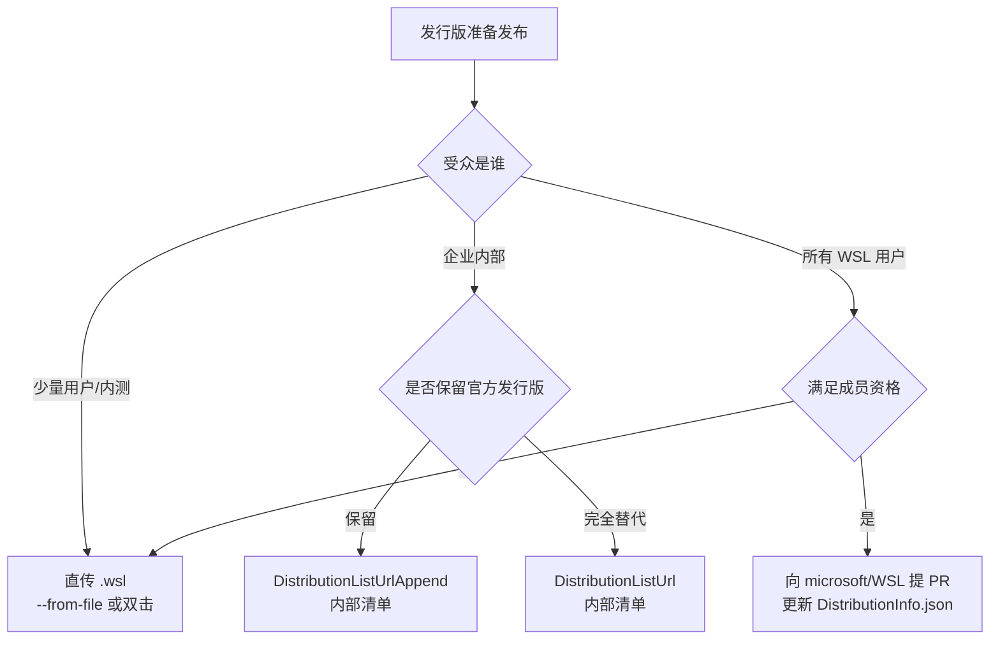

# 08 三档分发与企业/公开上架

发行版做完后，按受众选分发通道。官方给出三档：直接给 `.wsl` 文件、企业注册表清单、公开 `wsl --install` 列表（F-049、F-061、F-058）。三档的控制权与门槛依次递增。

## 一、三档对比

| 档位 | 发现方式 | 用户操作 | 门槛 | 适用 |
|---|---|---|---|---|
| 直传文件 | 无（用户拿到文件） | `--from-file` 或双击 | 最低 | 内测、小范围交付 |
| 企业清单 | 内部清单 URL | `wsl --list --online` → `wsl --install` | 需管理员写 HKLM | 公司/团队标准环境 |
| 官方上架 | 官方清单 | 同上 | 成员资格 + PR 审核 | 面向所有 WSL 用户 |

## 二、档位选择决策树

## 三、直传 `.wsl`

- 用户命令：`wsl --install --from-file <fileLocation>`（F-049）。
- 用户也可双击 `.wsl`，前提是 `oobe.defaultName` 已设置（F-045）。
- 分发渠道由你决定（官网、内网盘、制品库）；官方不做托管（F-049）。

**最小交付清单**：

- [ ] `my-distro.wsl`
- [ ] SHA256 摘要（供用户校验）
- [ ] 版本号与变更说明
- [ ] 安装命令与首次启动说明
- [ ] 已知问题与回滚方式

## 四、企业内分发

### 4.1 两种注册表策略

| 策略 | 注册表值 | 效果 |
|---|---|---|
| 追加 | `DistributionListUrlAppend` | 官方清单 + 内部发行版（F-063） |
| 覆盖 | `DistributionListUrl` | 仅内部清单（F-062） |

两者都是 `REG_SZ`、URL 格式（F-064）。写入 HKLM 需要管理员权限（F-066 的脚本要求可作参照）。

### 4.2 内部清单托管

- 清单必须是可访问的 URL（F-064）。企业环境建议用 HTTPS 制品库/对象存储。
- 本地测试可用 `file://`，从 WSL 2.4.4 起支持，格式 `file:///C:/path/to/file`（F-065）。
- 清单中的 `Url` 与 `Sha256` 必须成对正确（F-052、F-057）；建议每次构建自动重算并写入清单。

### 4.3 企业治理建议（本库建议，非官方原文）

| 维度 | 做法 |
|---|---|
| 版本治理 | flavor 保留历史版本，`Default` 指向当前稳定版；旧版本保留至少一个回退周期 |
| 变更管理 | 每次清单变更记录版本、SHA256、发布日期、变更原因 |
| 权限 | 注册表写入与清单托管分离权限；清单变更走审批 |
| 回退 | 保留「删除 `DistributionListUrl` 恢复官方清单」的运维手册（F-072） |
| 安全 | 官方页面只提供 SHA256 字段，未说明签名机制；企业内部应在制品库侧做签名/病毒扫描（本库补充） |
| 支持 | 明确支持的 WSL 最低版本（本指南整体要求 2.4.4+，F-004） |

## 五、公开上架 `wsl --install`

### 5.1 前置：成员资格

发行版要进入 `wsl --list --online`，必须满足分发邮件列表的成员资格条件（F-058），该条件用于确保列出的发行版遵循必要安全标准（F-059）。

### 5.2 提交 PR

满足条件后，向 `https://github.com/microsoft/WSL` 提交 PR，更新 `distributions/DistributionInfo.json`，由 WSL 团队审查（F-060）。

**PR 前自检**：

- [ ] 发行版已按 [09 检查清单](09-recommendations-checklist.md) 完成去宿主化与 systemd 处理
- [ ] 两条架构的 `Url` 可公开下载，`Sha256` 与文件一致
- [ ] `Name`、`FriendlyName`、`Default` 语义清晰
- [ ] 有版本策略：新版本如何替换 `Default`、旧版本保留多久
- [ ] 有安全响应渠道与漏洞披露方式
- [ ] 已确认成员资格条件（F-058）

### 5.3 官方未覆盖的空白

官方页面未说明以下事项（本库登记为缺口，不做推断）：

| 缺口 | 影响 | 建议 |
|---|---|---|
| 清单是否支持签名/证书校验 | 只能依赖 SHA256 完整性，无法证明发布者身份 | 官方文档补充前，企业侧自建签名与来源校验 |
| PR 审核时限与拒绝标准 | 上架周期不可预期 | 与 WSL 团队沟通后再规划发布窗口 |
| 版本下架/撤销流程 | 出问题时的撤回路径不明确 | 保留自有分发通道作为兜底 |
| 遥测与使用数据 | 无法得知安装量 | 需要时在 OOBE 之外自行设计（注意隐私合规） |

## 六、发布检查清单（三档通用）

- [ ] `.wsl` 安装通过（`--from-file`）
- [ ] 双击安装通过（`defaultName` 已设置）
- [ ] 清单可解析，摘要匹配
- [ ] 注册名、快捷方式、终端配置符合预期
- [ ] OOBE 三条失败路径已测试
- [ ] 发行版内无宿主耦合文件
- [ ] 版本号、变更说明、回滚方式已随包提供

## 七、小结

- 三档分发：直传文件（最低门槛）、企业清单（管理员 + 内部托管）、官方上架（成员资格 + PR）。
- 企业优先 `DistributionListUrlAppend`，测试用 `file://`，回退靠删除注册表值（F-063、F-065、F-072）。
- 官方未覆盖签名、审核时限、下架与遥测，需在发布方案中自行补齐。

最后读：[09 官方建议与发布检查清单](09-recommendations-checklist.md)。
