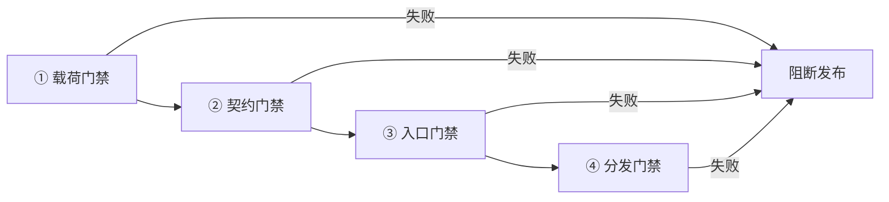

# 09 官方建议、发布门禁与故障排查

本文把官方「WSL 自定义 Linux 分发建议」拆成可勾选的门禁，并给出故障排查入口。官方建议分两组：配置文件建议与 systemd 建议（F-073~F-081）。

## 一、官方配置建议（7 条原文，拆为 8 项检查）

| # | 建议 | 依据 | 落地检查 |
|---|---|---|---|
| 1 | 同时包含 `/etc/wsl.conf` 与 `/etc/wsl-distribution.conf` | F-073 | `test -f` 两个文件 |
| 2 | 两份文件归 `root:root`，权限 `0644` | F-073 | `stat -c '%U:%G %a'` |
| 3 | 若 OOBE 创建新用户，`uid` 与 `oobe.defaultUid` 都为 1000 | F-074 | 比对脚本常量与 conf |
| 4 | 同时设置 `oobe.defaultName` 与 `shortcut.icon` | F-075 | 解析 conf 两键 |
| 5 | 不包含 `/etc/resolv.conf` | F-076 | `test ! -e` |
| 6 | `/etc/passwd` 有 UID 0 的 root | F-077 | `awk -F: '$3==0'` |
| 7 | `/etc/shadow` 无密码哈希 | F-078 | 检查第二字段 |
| 8 | 归档不含内核或 initramfs | F-079 | `tar -tzf` 过滤 |

> 官方原文共 7 条配置建议（F-073~F-079），上表把第 1 条拆成「文件存在」与「权限」两行、并单列内核项，便于逐项勾选。

## 二、systemd 建议（9 个单元）

启用 systemd 时，禁用或屏蔽以下单元（F-080），同时适用于 system 与 user 单元（F-081）：

- [ ] `systemd-resolved.service`
- [ ] `systemd-networkd.service`
- [ ] `NetworkManager.service`
- [ ] `systemd-tmpfiles-setup.service`
- [ ] `systemd-tmpfiles-clean.service`
- [ ] `systemd-tmpfiles-clean.timer`
- [ ] `systemd-tmpfiles-setup-dev-early.service`
- [ ] `systemd-tmpfiles-setup-dev.service`
- [ ] `tmp.mount`

落地命令与验证见 [04 wsl.conf 与 systemd](04-wsl-conf-systemd.md#五在-rootfs-内屏蔽)。

## 三、四段式发布门禁

| 段 | 检查内容 | 通过条件 | 依据 |
|---|---|---|---|
| ① 载荷 | tar 顶层、去宿主化、压缩格式 | 顶层为 rootfs；无内核/initramfs/resolv.conf；gzip | F-011~F-013、F-076、F-079 |
| ② 契约 | 两份 conf、OOBE、systemd | 文件存在且 0644；OOBE 幂等；9 单元已屏蔽 | F-015~F-026、F-073~F-081 |
| ③ 入口 | `.wsl` 扩展名、`defaultName` | 改名完成；`defaultName` 非空 | F-043、F-045 |
| ④ 分发 | 清单、摘要、URL | JSON 可解析；SHA256 匹配；URL 可达 | F-050~F-057、F-065 |

## 四、20 项发布前检查

**载荷**

- [ ] 1. `tar -tzf` 顶层为 `bin/`、`etc/`、`usr/` 等，而非多套一层目录（F-012）
- [ ] 2. 压缩格式为 gzip（F-013）
- [ ] 3. 打包使用了 `--numeric-owner --absolute-names`（F-011）
- [ ] 4. 归档中无 `vmlinuz*`、`initrd*`、`initramfs*`（F-079）
- [ ] 5. 归档中无 `etc/resolv.conf`（F-076）

**契约**

- [ ] 6. `/etc/wsl-distribution.conf` 存在且 `root:root 0644`（F-073）
- [ ] 7. `/etc/wsl.conf` 存在且 `root:root 0644`（F-073）
- [ ] 8. `oobe.defaultName` 已设置（F-022、F-045）
- [ ] 9. `oobe.defaultUid` 与 OOBE 脚本 UID 均为 1000（F-074）
- [ ] 10. `shortcut.icon` 为 `.ico` 且 ≤10MB（F-023、F-075）
- [ ] 11. `windowsterminal` 配置符合预期，`colorScheme` 命中方案名（F-025、F-036）
- [ ] 12. `/etc/passwd` 有 UID 0 的 root（F-077）
- [ ] 13. `/etc/shadow` 无密码哈希（F-078）
- [ ] 14. systemd 默认开关已明确，9 个单元已屏蔽（F-039、F-080）

**入口与安装**

- [ ] 15. 文件扩展名为 `.wsl`（F-043）
- [ ] 16. `wsl --install --from-file` 安装成功（F-049）
- [ ] 17. 双击安装成功（F-045）
- [ ] 18. 首次启动能进入 shell，用户/组正确（F-020、F-029）

**分发**

- [ ] 19. 清单根键为 `ModernDistributions`，flavor 有且仅有一个 `Default: true`（F-051、F-055）
- [ ] 20. 双架构 URL 与 SHA256 均正确、可达（F-052、F-057）

## 五、失败模式速查

| 症状 | 第一现场 | 对应章节 |
|---|---|---|
| 装好后进不去 shell | `oobe.command` 退出码（F-020） | [03](03-oobe.md) |
| 双击 `.wsl` 无反应 | `oobe.defaultName`（F-045） | [02](02-wsl-distribution-conf.md)、[06](06-wsl-file-install.md) |
| 安装后网络异常 | rootfs 内是否带入 `resolv.conf`（F-076） | [01](01-rootfs-tar.md) |
| 旧版 WSL 装不上 | 压缩格式是否 gzip（F-013） | [01](01-rootfs-tar.md) |
| systemd 服务异常 | 9 个问题单元是否屏蔽（F-080） | [04](04-wsl-conf-systemd.md) |
| 终端配色没生效 | `colorScheme` 与 `schemes[].name` 是否一致（F-036） | [05](05-terminal-profile.md) |
| `wsl --list --online` 看不到 | 注册表值/清单 URL（F-061~F-065） | [07](07-manifest-local-test.md) |
| 安装报摘要错误 | `Sha256` 与文件是否一致（F-068） | [07](07-manifest-local-test.md) |
| 官方发行版消失 | 是否用了覆盖而非追加（F-062、F-063） | [07](07-manifest-local-test.md) |

## 六、证据边界与未验证项

| 项 | 状态 | 说明 |
|---|---|---|
| 官方命令与字段 | 已双源核对 | 中英文页面逐条对照，差异登记于 [facts](../references/facts.md) 的 D-01~D-04 |
| OOBE 脚本 | 语义重建 | 源页面代码块换行丢失，按 Bash 语法重建，未逐字复制（F-032、D-03） |
| 本机完整构建 | 未执行 | 本次未从零打包并发布发行版 |
| 版本前提 | 本机满足 | 本机 WSL 3.0.4.0（2026-11-06 实测）高于 2.4.4（F-004），但不等于全流程验证 |
| 注册表覆盖 | 未实测 | 需管理员权限，未在本机写入 HKLM |
| 终端模板键名 | 口径已统一 | 官方示例 `ProfileTemplate` 与表 `profileTemplate` 不一致（S-05），本教程统一用小写；大小写兼容性未实测（见 [02](02-wsl-distribution-conf.md)） |

## 七、结语

这份官方指南的篇幅很小，但它把「发行版交付」拆成了四个必须同时成立的契约：载荷可移植、首次启动可完成、安装入口可发现、分发元数据可校验。把这四段做成门禁，比记住任何一条命令更能保证下一次发布不出错。
