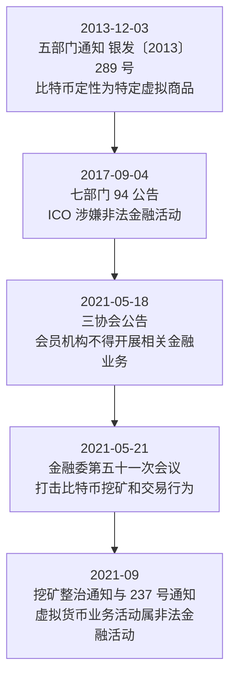

# 风险与合规红线

## 为什么要按法域读

同一项工具在不同法域可以获得完全不同的法律地位（洞察 I-5、I-6）。香港、欧盟、美国通过发牌与立法把特定活动纳入监管框架，允许合规主体开展；中国境内则把虚拟货币相关业务活动定性为**非法金融活动**，没有境内牌照路径（F-090）。因此采用口径只有一条：**两者必须在同一段落中并列呈现并标注法域**，既不得以「境外合法/鼓励」推导「境内可行」，也不得以「境内禁止」描述境外制度（勘误 1、勘误 5）。

## 一、中国境内监管链条：逐条登记

| 文件名 | 文号 | 发布机构 | 日期 | 关键定性 |
|---|---|---|---|---|
| 《关于防范比特币风险的通知》 | 银发〔2013〕289 号 | 中国人民银行、工业和信息化部、银监会、证监会、保监会（五部门） | 2013-12-03 | 明确比特币是**特定的虚拟商品**，不能且不应作为货币在市场上流通使用；现阶段各金融机构和支付机构**不得开展与比特币相关的业务**（F-080） |
| 《关于防范代币发行融资风险的公告》（俗称「94 公告」） | 未见公开文号 | 中国人民银行、中央网信办、工业和信息化部、工商总局、银监会、证监会、保监会（七部门） | 2017-09-04 | 认定代币发行融资（**ICO**）**涉嫌从事非法金融活动**；任何组织和个人不得非法从事代币发行融资活动，各类代币发行融资活动应当**立即停止**，已完成者应作出清退等安排（F-081） |
| 《关于防范虚拟货币交易炒作风险的公告》 | 协会公告（无监管文号） | 中国互联网金融协会、中国银行业协会、中国支付清算协会 | 2021-05-18 | 要求会员机构**不得开展虚拟货币相关金融业务**并提示消费者风险（F-085） |
| 国务院金融稳定发展委员会第五十一次会议 | 会议新闻稿 | 国务院金融稳定发展委员会 | 2021-05-21 | 明确提出「**打击比特币挖矿和交易行为**，坚决防范个体风险向社会领域传递」（F-086） |
| 央行约谈部分金融机构及支付机构 | 约谈（媒体转引） | 中国人民银行 | 2021-06 | 要求**全面排查、切断虚拟货币相关支付链路**（F-087） |
| 《关于整治虚拟货币「挖矿」活动的通知》 | 发改运行〔2021〕1283 号 | 国家发展改革委等 11 部门 | 落款 2021-09-03；发布 2021-09-24 | 加强「挖矿」活动**上下游全产业链监管**、**严禁新增**「挖矿」项目，综合采取电价、补贴、授信等约束措施推动**存量项目有序退出**（F-084） |
| 《关于进一步防范和处置虚拟货币交易炒作风险的通知》 | 银发〔2021〕237 号 | 人民银行等十部门 | 成文与实施 2021-09-15；2021-09-24 起公开发布 | 「虚拟货币不具有与法定货币等同的法律地位，**虚拟货币相关业务活动属于非法金融活动**」（F-082）；并明确**境外虚拟货币交易所通过互联网向我国境内居民提供服务同样属于非法金融活动**，构建多维度、多层次风险防范和处置体系，严厉打击涉虚拟货币犯罪（含洗钱、非法经营、诈骗等）（F-083） |

**日期标注纪律**：银发〔2021〕237 号的两个日期均正确——成文/实施 2021-09-15，公开发布 2021-09-24，不可写成「2013 年或 2021 年二者取一」（勘误 6、勘误 7）。

## 二、时间线与链条读法

中国境内虚拟货币监管文件的时间线为：**2013-12-03 五部门通知 → 2017-09-04 七部门公告 → 2021-05-18 三协会公告 → 2021-05-21 金融委会议 → 2021-09-03 落款/2021-09-24 发布的挖矿整治通知与 2021-09-15 成文的 237 号通知**——构成从「**业务禁令**」到「**非法金融活动定性**」的完整链条（F-089）。

读这条链条的关键是分清**禁令的层级在变化**：2013 年是「金融机构与支付机构不得开展相关业务」的业务禁令，2017 年把代币发行融资定性为「涉嫌非法金融活动」，2021 年则把虚拟货币相关业务活动整体定性为「非法金融活动」——并把境外交易所向境内居民提供服务一并覆盖（F-082、F-083）。

## 三、四方监管口径对照表

| 主题 | 中国境内 | 香港 | 欧盟 | 美国 |
|---|---|---|---|---|
| 加密资产法律定性 | 虚拟货币是「特定的虚拟商品」，不具法偿性，相关业务活动属**非法金融活动**（F-005、F-082） | 走发牌与合规框架（SFC / HKMA 分工）（勘误 1） | MiCA 分为 ART / EMT / 其他加密资产，分类牌照监管（F-066） | 无统一定性，按既有证券/商品法律分别认定（勘误 1） |
| 交易所/服务商准入 | 禁止境内交易与相关业务；**境外交易所向境内提供服务亦属非法**（F-082、F-083） | 须持牌（勘误 1） | 须获 MiCA 授权（F-066） | 按州/联邦分业（勘误 1） |
| 稳定币 | **无专门法规**，按虚拟货币非法金融活动处置（F-090） | 《稳定币条例》**发牌制**，2025-08-01 生效（F-063） | EMT / ART 规则自 2024-06-30 适用（F-066） | GENIUS Act 2025-07-18 签署成法（F-065） |
| 挖矿 | 全产业链整治、**严禁新增**（F-084） | 未专门禁止（勘误 1） | 未统一禁止（勘误 1） | 未禁止（部分州有限制与激励）（勘误 1） |
| NFT | 遏制金融化证券化；禁集中交易/持续挂牌/标准化合约（**行业倡议，非法规**）（F-074、F-075） | 视是否构成证券纳入虚拟资产框架（勘误 1） | 一般纳入 MiCA 或既有金融法规（勘误 1） | 按是否构成证券认定（勘误 1） |
| RWA / 代币化 | **未开放**境内代币化交易（勘误 1） | 官方鼓励（政策宣言 2.0、Ensemble）（F-076） | MiCA + DLT 试点制度（勘误 1） | 证券法框架下探索（勘误 1） |
| CBDC | 数字人民币（e-CNY）：M0 定位、双层运营、可控匿名（F-067、F-068、F-069） | 数码港元研究 + Ensemble（F-076） | 数字欧元处于**准备阶段**（勘误 1） | **无零售 CBDC**（勘误 1） |

**使用纪律**：任何一格结论都不可脱离该法域单独引用；本表不构成合规意见，具体适用应以官方最新口径与专业意见为准。

## 四、非法金融活动识别要点

中国境内口径下，以下活动均落在监管红线内，须逐项识别：

1. **虚拟货币相关业务活动**——包括交易、兑换、做市、中介等（整体定性为非法金融活动，F-082）；
2. **代币发行融资（ICO）**——涉嫌非法金融活动，应立即停止，已完成者应清退（F-081）；
3. **境外交易所向境内居民提供服务**——通过互联网向我国境内居民提供服务，同样属于非法金融活动（F-083）；
4. **虚拟货币「挖矿」**——上下游全产业链整治、严禁新增（F-084）；
5. **支付链路**——要求全面排查、切断虚拟货币相关支付链路（F-087）；
6. **涉虚拟货币犯罪**——严厉打击洗钱、非法经营、诈骗等（F-083）；
7. **以「元宇宙」名义非法集资**——已有风险提示（媒体转引，F-088）。

## 五、数据侧合规基础法律

数据侧的基础法律框架包含（见 [facts.md 信源登记表](/facts.md)）：

- 《中华人民共和国数据安全法》（2021-06-10 通过，S20）；
- 《中华人民共和国网络安全法》（2016-11-07 通过，S21）；
- 《个人信息出境标准合同办法》（网信办令第 13 号，2023-02-22，S22）。

个人信息的收集与使用还须遵守「数据二十条」确定的授权规则：个人信息数据按**个人授权范围**采集使用，不得采取「一揽子授权」、强制同意等方式过度收集个人信息（F-016）。数据确权的三类授权机制见 [02 数据确权与三权分置](/concepts/02-data-rights.md)。

**边界说明**：①本轮事实清单未登记《中华人民共和国个人信息保护法》的独立条款事实，故本篇不予引述其条文与日期，个人信息处理规则请以官方原文为准；②《数据出境安全评估办法》的施行日期本轮**未确证**，本篇**不写具体日期**（见 [facts.md 信源保真声明](/facts.md)）。

## 六、免责边界与阅读纪律

- **本内容不构成投资建议、法律意见或合规意见**，也不推荐任何产品、平台或币种，不预测价格。
- **不对合规结论作担保**：法规与监管政策持续更新，本束内容以 2026-10 可核实的公开口径为准，`stale_after` 设为 2027-09-30；具体行为应咨询持牌专业机构并以官方最新口径为准。
- **法域并列不可省**：任何跨境比较都必须标注法域（勘误 1、勘误 5）。
- **来源性质须标注**：单源与转引材料（如 F-087、F-088）在引用时注明来源性质，不当作官方原文使用。
- **不得反向推导**：不得据境外牌照制度推导境内存在可行路径，也不得据境内定性描述境外制度。

## 相关文档

- 上一篇：[08 RWA 与 DeFi](/concepts/08-rwa-and-defi.md)
- 概念索引：[concepts/index.md](/concepts/index.md)
- 事实出处：[facts.md](/facts.md)；结构性判断：[insights.md](/insights.md)
- 信源索引：[references/01-sources-and-authorities.md](/references/01-sources-and-authorities.md)
