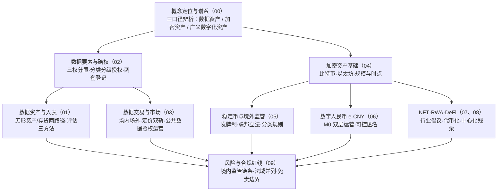

# 结构洞察（Insights）

> 本文件在 R 阶段采集的 90 条事实（[facts.md](facts.md)）基础上冻结 6 条洞察，供正文消费；**正文只引用本文件结论，不再新造判断**。每条为四元组：现象 / 根因 / 影响 / 建议，并标注所消费的事实编号。
> 洞察只做结构性判断：不评价任何币种或平台的优劣与投资价值，不推荐任何产品，不预测价格。

## I-1 「数字资产」一词同时承担三种口径，混用会让讨论错位

- **现象**：公开材料中「数字资产」至少指三类东西——数据资产（会计与产权口径，F-001、F-002）、加密资产（金融与技术口径，F-003、F-004）、广义数字化资产（数字内容与账号权益等）；三者在确认条件、监管适用与风险结构上互不通用，但经常被同一篇文章并列讨论。
- **根因**：三类对象的术语各自演化于不同制度语境——会计口径来自数据要素入表制度（F-022），金融口径来自虚拟资产反洗钱与市场监管（F-003），技术口径来自分布式账本与数字内容生态（F-048、F-073）；三套语境都借用「资产」一词，却没有共同的外延边界。
- **影响**：混用会导致两种典型错位——把加密资产的价格波动风险套到「数据资产入表」这类会计议题上；或者反过来，用会计上的「资产确认」去暗示加密代币具有受保护的法律地位。两种错位都会让读者对「什么受法律保护、什么受监管禁止」产生误判。
- **建议**：凡出现「数字资产」，**先按其语境归位**：涉及企业数据与入表 → 数据资产口径；涉及代币与交易场所 → 加密资产口径并标注法域；涉及内容与权益 → 广义口径。本包 [00 概念定位与谱系](concepts/00-positioning-and-lineage.md) 给出三口径对照表。
- **消费事实**：F-001、F-002、F-003、F-004、F-022、F-048、F-073

## I-2 数据的「三权分置」是政策创设，不是既有法律权利

- **现象**：「数据二十条」以「建立数据资源持有权、数据加工使用权、数据产品经营权等分置的产权运行机制」给出三权分置的官方表述（F-012），并配套公共、企业、个人三类数据的分类分级确权授权（F-014、F-015、F-016）；而《民法典》第 127 条只作引致规定「法律对数据、网络虚拟财产的保护有规定的，依照其规定」，并未直接为数据设定民事权利（F-017）。同时，面向数据的登记存在两套并行制度——数据产权登记与数据知识产权登记（F-021、F-046、F-047）。
- **根因**：数据具有可复制、非排他、多主体共生等特性，传统物权的「一物一权」框架无法直接套用；立法周期长于产业需要，政策因此先行，以「淡化所有权、强调使用权」的方式先把使用与流通规则立起来（F-013）。
- **影响**：①权利属性的法律定性尚未完成，因此登记证书、登记凭证的效力主要在于「可证明的合规事实」而非「排他性权利证书」；②两套登记制度并行，企业若不加辨析容易把不同体系的凭证当作同一类权利证明。
- **建议**：把登记理解为**确权路径之一**而非权利终局；引用登记数据时注明所属体系（数据产权登记 / 数据知识产权登记）与登记机构；对「我的数据被谁拿去用了」这类问题，回到三类数据的授权规则（F-014、F-015、F-016）而非寻找单一所有权人。
- **消费事实**：F-012、F-013、F-014、F-015、F-016、F-017、F-021、F-046、F-047

## I-3 会计准则说「可入表」，常被读成「资产增值」

- **现象**：财政部《企业数据资源相关会计处理暂行规定》只规范确认、计量、列示与披露条件——无形资产与存货两条路径、外购成本构成、研究/开发阶段划分、在既有报表项目下增设「其中：数据资源」子项（F-022 至 F-029）；而市场上讨论的热度集中在入表家数与金额（F-034），且 2024 年一季报曾出现 7 家上市公司更正清空数据资产数额（F-035）。
- **根因**：会计确认与价值创造是两套逻辑——确认回答「这笔支出能不能作为资产列示」，价值创造回答「这项数据能不能带来更多经济利益」；前者的门槛是确认条件，后者取决于市场与业务，会计准则不提供估值承诺（F-033）。
- **影响**：把「可入表」读成「增值」会导向两个误判——把入表金额当作企业数据价值的衡量，以及把「未入表」当作「没有数据资产」；反过来，早期更正清空现象也说明确认条件本身容易被宽松解读。
- **建议**：讨论数据资产时**三句话分层**：能不能确认（会计条件）／确认了多少钱（账面价值）／值多少钱（评估方法，需另行评估且方法有假设，F-031）；本包 [01 数据资产与入表](concepts/01-data-asset-capitalization.md) 按此三层组织。
- **消费事实**：F-022、F-023、F-024、F-025、F-026、F-027、F-028、F-029、F-031、F-033、F-034、F-035

## I-4 数据交易市场呈现「场外主导 + 测算口径」的双重不确定性

- **现象**：国家数据局测算 2024 年全国数据市场交易规模超 1600 亿元、其中**场内**交易预计超 300 亿元（F-042）——场外规模约为场内的四倍以上；同时四大交易所的定位与成立时点各异（F-036 至 F-039），定价依赖「报价—估价—议价」路径且属研究性口径（F-045）；公共数据则按「原始数据不出域、数据可用不可见」原则供给（F-044）。
- **根因**：数据是非标、可复制且价值高度依赖场景的标的，难以形成统一报价机制；因此监管选择「场内场外相结合」的双轨结构（F-040）与公共数据政府指导定价、企业与个人数据市场自主定价的定价双轨（F-041）。
- **影响**：①「数据交易规模」这类数字是测算值而非审计值，且由场外交易主导，可比性与可核查性都弱；②场内平台的价值更多体现在合规确权与登记服务（F-047），而不必然体现在交易额上。
- **建议**：引用数据交易规模时标注「官方测算/预计值」；观察市场成熟度优先看制度指标（登记机构数量、凭证发放、定价规则）而非总量数字；不要把交易规模与「入表金额」混用（两者一为交易口径、一为会计口径）。
- **消费事实**：F-036、F-037、F-038、F-039、F-040、F-041、F-042、F-044、F-045、F-047

## I-5 稳定币是「类货币属性」与「监管套利空间」的复合体

- **现象**：稳定币以锚定资产维持稳定价值（F-007）、按储备构成分为法币抵押/加密资产抵押/算法三类（F-057）；市场高度集中——约 99% 以美元计价、约 90% 市值集中于两家发行人（F-058），USDT 与 USDC 合计占行业资产 80% 以上且储备构成差异显著（F-060、F-061）；风险事件实证包括 2023-03 SVB 危机中 USDC 的挤兑压力（F-062）与 2022-05 UST/LUNA 崩盘（F-055）。
- **根因**：稳定币由私人实体发行，却试图承担支付与价值储藏功能——锚定承诺把「货币属性」外部化到储备资产上，而储备资产的托管、透明度与赎回条件由发行人自行安排，形成「享有货币便利、不承担央行约束」的结构性激励。
- **影响**：这解释了各国的监管分歧——香港以发牌制纳入监管（F-063、F-064），美国以联邦立法规范「支付稳定币」（F-065），欧盟以 EMT/ART 分类规则适用（F-066），而中国境内将其归入虚拟货币非法金融活动处置（F-090）；同一工具在不同法域获得完全不同的法律地位。
- **建议**：讨论稳定币时**先问三件事**——谁发行、储备是什么、赎回条件如何；再问第四个问题：**在哪个法域**。本包 [05 稳定币与境外监管](concepts/05-stablecoins.md) 按此四问组织，并在 [09 风险与合规红线](concepts/09-risks-and-redlines.md) 并列境内口径。
- **消费事实**：F-007、F-055、F-057、F-058、F-060、F-061、F-062、F-063、F-064、F-065、F-066、F-090

## I-6 代币化与 NFT 的制度红利与风险同源，结论由法域决定

- **现象**：同一项代币化技术在境外被官方鼓励——香港《数字资产发展政策宣言 2.0》提出扩大代币化产品供给、激励 RWA 与金融资产代币化（F-076），新加坡 MAS 通过 Project Guardian 支持代币化商业化（F-077）；而在中国境内，NFT 相关活动受三协会倡议约束、禁止集中与持续挂牌交易（F-074、F-075），RWA 代币化交易未开放（F-079）；FATF 亦指出许多 DeFi 安排自称去中心化而实务中仍普遍存在中心化要素，因而落入虚拟资产监管范围（F-078）。
- **根因**：代币化的制度价值来自「同一资产在不同法域获得不同可交易性」，其风险也来自同一处——跨境可转让性使资产绕开单一法域的准入与投资者保护规则；因此监管取向取决于该法域希望资产更可流通还是更可控。
- **影响**：①不能从「境外合法/鼓励」推导「境内可行」，也不能从「境内禁止」描述境外制度（见 [facts.md 勘误 5](facts.md)）；②「去中心化因此无需监管」的说法在 FATF 口径下不成立（F-078）。
- **建议**：读任何代币化案例时**加一个法域标签**，并区分「技术可行性」「境外监管可行性」「境内合规可行性」三层——本包 [08 RWA 与 DeFi](concepts/08-rwa-and-defi.md) 与 [09 风险与合规红线](concepts/09-risks-and-redlines.md) 分别承担前两层与第三层。
- **消费事实**：F-074、F-075、F-076、F-077、F-078、F-079

## 知识地图

## 阅读落点

- 想搞清「数字资产到底指什么」：I-1 → [00 概念定位与谱系](concepts/00-positioning-and-lineage.md)
- 想搞清「数据怎么变成资产」：I-2、I-3 → [01 数据资产与入表](concepts/01-data-asset-capitalization.md)、[02 数据确权](concepts/02-data-rights.md)
- 想搞清「数据交易规模可信吗」：I-4 → [03 数据交易与市场](concepts/03-data-marketplaces.md)
- 想搞清「境内到底能不能碰」：I-5、I-6 → [09 风险与合规红线](concepts/09-risks-and-redlines.md)
