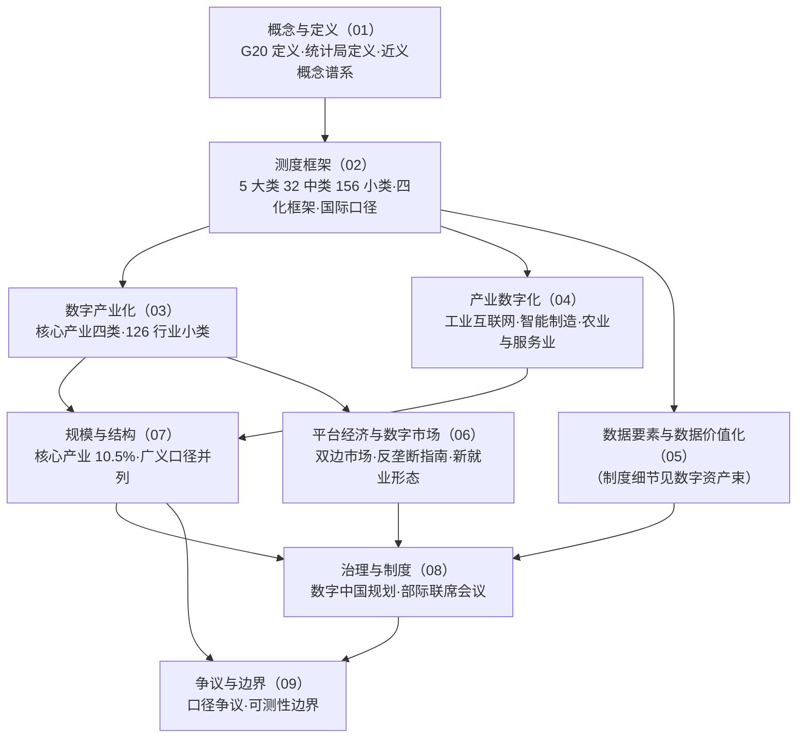

# 结构洞察（Insights）

> 本文件在 R 阶段采集的 82 条事实（[facts.md](facts.md)）基础上冻结 6 条洞察，供正文消费；**正文只引用本文件结论，不再新造判断**。每条洞察为四元组：现象 / 根因 / 影响 / 建议，并标注所消费的事实编号。
> 洞察只做结构性判断，不做政策评价；涉及口径的判断均以「并列留痕 + 标注口径」为落点。

## I-1 同一指标的多重口径，是数字经济数据阅读的第一风险

- **现象**：同一个「2024 年数字经济核心产业占 GDP 比重」，可查到 10.5%（国家统计局）、10.4%（国家知识产权局报告）、「10% 左右」（国家数据局报告）三种表述（F-035、F-072、F-073）；同一个「中国数字经济规模」，可查到 59.2 万亿元、占 GDP 43.8%（信通院测算，F-065）与国家数据局的 39.6 万亿元数字产业收入（F-071）等不同量级数字。
- **根因**：数字经济的测算主体多元（官方统计机构 / 官方报告概述 / 研究机构 / 行业协会），各自核算框架与统计边界不同；中国信通院更在报告中主动声明其数据「不代表政府官方数据口径」（F-022），即数据生产方自己承认口径与官方不等价。
- **影响**：跨来源直接比较、换算或平均会产生系统性误读——把「核心产业占比」与「广义数字经济占比」相加、把测算值当官方值引用，都会得出错误结论；读者若只记住一个「占比数字」，几乎必然记错。
- **建议**：引用任何数字经济规模或占比数字时，**三件套必须齐全**——发布机构 + 口径名称 + 统计时点；本知识包统一以国家统计局官方发布值作为量化基准（F-033、F-035），测算值一律标注「机构估算值」。口径分歧见 [facts.md 口径冲突与勘误](facts.md)。
- **消费事实**：F-022、F-033、F-035、F-065、F-071、F-072、F-073

## I-2 「数字经济」处在一个近义概念谱系中，没有公认的唯一边界

- **现象**：与数字经济并列使用的概念至少有信息经济、网络经济、知识经济、比特经济、智能经济、后工业经济、新经济（F-011）；这些概念的提出时间、提出者与所指范围各不相同（F-009 至 F-013），且部分概念的溯源本身存在多种二手说法（F-012、F-013）。
- **根因**：概念随技术形态演进被反复重新定义——信息经济源于 1960 年代知识产业核算，知识经济由 OECD 在 1996 年系统化成文，数字经济在 2016 年由 G20 形成国际政策共识，智能经济随人工智能上升为国家战略而重新进入政策语汇（F-010、F-014、F-013）；而每条定义都服务于当时要解决的统计或政策问题。
- **影响**：讨论中「数字经济」常被当作「一切新经济」的同义语使用，导致概念外延无限扩张——一旦外延扩张，任何统计口径都无法覆盖，争论焦点就从「数字经济增长了多少」漂移为「什么算数字经济」。
- **建议**：阅读与写作时**先锚定一个可操作的口径**：需要统计对话就锚定国家统计局分类（F-016、F-017），需要政策对话就锚定 G20 定义与「数字中国」文件体系（F-001、F-081），需要概念史对话才引入近义概念谱系；同一篇文章内不混用锚点。
- **消费事实**：F-001、F-009 至 F-017、F-081（含 F-016、F-017）

## I-3 统计分类既已建制化，也必然滞后于业态

- **现象**：国家统计局已用「国家统计局令第 33 号」这一部门规章形式确立了数字经济分类（F-014），把数字经济产业划定为 5 大类、32 中类、156 小类，核心产业核算对应 126 个国民经济行业小类（F-016、F-019）——建制化程度很高；但分类所依托的底稿是《国民经济行业分类》（GB/T 4754-2017），业态变化快于行业分类修订（F-015）。
- **根因**：行业分类体系是统计可比较性的前提，其稳定性要求与新兴业态的快速涌现天然冲突；分类一旦定稿，新增业态只能先落到既有小类之下，或等下一轮修订。
- **影响**：新兴业态（如新形态数据服务、平台内新职业、难以归入既有小类的融合业态）在官方统计中可能被拆分到多个小类或被近似归类，导致「按分类读出来的结构」与产业体感存在偏差；读者若把分类小类当作产业现实的精确切片，会低估结构变化。
- **建议**：把分类当作**可比较的坐标系**而非现实快照；对结构性数字的解读优先看趋势与量级，对新兴业态的判断以官方后续更新与专门报告为准（F-082 已注明核算方法文件尚未公开全文）。
- **消费事实**：F-014、F-015、F-016、F-019、F-029 至 F-032、F-082

## I-4 「数字经济核心产业」与「数字经济」是两个层级，常被当作同一件事比较

- **现象**：国家统计局公布的是**核心产业**增加值（2024 年 140891 亿元、占 GDP 10.5%，F-035），同时另有更宽口径的**数字经济增加值**占 GDP 33.1%（F-070）；信通院广义口径给出 43.8%（F-065）。三个数字相差数倍，却常被并列引用为「中国数字经济占 GDP 比重」。
- **根因**：官方文件中「数字经济」一词同时承担两种含义——狭义上等于数字产业化（01—04 大类），广义上含产业数字化（第 05 大类）乃至治理与数据价值化环节（F-017、F-020）；两级的分子分母不同，占比自然不同。
- **影响**：把 10.5% 与 43.8% 当作「矛盾数据」争论，或者用 43.8% 去论证「数字经济已是经济主体」、用 10.5% 去论证「数字经济仍很小」，都是层级错用；正确读法是「核心产业约一成、含融合部分则数倍于此」。
- **建议**：引用时**显式写出层级标签**——「数字经济核心产业增加值占 GDP 比重」或「（广义）数字经济规模占 GDP 比重」，并把层级定义随数字一同呈现；本包在 [07 规模与结构数据](concepts/07-scale-and-structure.md) 给出三口径对照表。
- **消费事实**：F-016、F-017、F-020、F-033、F-035、F-065、F-070

## I-5 平台经济的双边外部性，使传统反垄断与统计工具都不够用

- **现象**：官方对平台的定义已写入「双边或者多边主体」这一结构性特征（F-057），监管规则也针对「二选一」「大数据杀熟」等行为细化标准（F-058）；理论侧假说由双边市场文献奠定（F-060、F-061）；而平台经济吸纳的就业规模以「新就业形态劳动者」这一新统计类别出现，达 8400 万人（F-062）。
- **根因**：平台两侧用户互相决定对方效用（间接网络外部性），价格结构可以非中性——一侧补贴、另一侧收费仍可盈利（F-061）；这把「市场份额—价格—成本」的传统分析链条打断，也使「一个平台的规模有多大」难以用单一产值衡量。
- **影响**：用传统市场界定方法评估平台，容易得出与直觉相反的结论；用传统就业统计（雇主—雇员）衡量平台劳动，会系统性低估实际参与者规模；政策判断因此更依赖行为规制（F-058）而非结构指标。
- **建议**：读平台相关数字时**先问三个问题**——这个数字测的是哪一侧用户？是交易额还是收入？含不含平台内独立从业者？本包 [06 平台经济与数字市场结构](concepts/06-platform-economy.md) 按此三问组织材料。
- **消费事实**：F-056、F-057、F-058、F-059、F-060、F-061、F-062

## I-6 产业数字化占八成以上，但官方可精确测量的部分只覆盖数字产业化

- **现象**：信通院口径下 2023 年产业数字化占数字经济的 81.3%（F-067），即数字经济的体量主要来自传统产业融合；而国家统计局可精确核算、可公开发布的只有核心产业（数字产业化）那一成（F-033、F-035），产业数字化部分以「数字化效率提升业」单列而不进入核心产业增加值。
- **根因**：数字产业化的产出是**独立的行业**（126 个行业小类），有清晰的行业归属与增加值核算路径（F-019）；产业数字化的产出是**融合渗透的增量**，理论上会与传统产业原有产出重复计入，核算难度高且易高估。
- **影响**：这造成了「结构上最重要的一半最不可测」的倒挂——政策目标与讨论热度集中在产业数字化转型，而可核查的公开数字集中在数字产业化；引用产业数字化规模时，其口径依赖单一研究机构框架（F-064、F-065、F-067）。
- **建议**：把产业数字化数字一律标注为「机构估算值」并与官方核心产业值分区呈现；在对产业数字化的投入做判断时，优先使用可分项的官方指标（如工业互联网平台与标识体系 F-043、F-044、智能制造示范工厂 F-047、跨境电商 F-053），而非总量估计。
- **消费事实**：F-019、F-033、F-035、F-043、F-044、F-047、F-053、F-064、F-067

## 知识地图

## 阅读落点

- 想搞清「一个数字该怎么读」：I-1 + I-4 → [02 测度框架](concepts/02-measurement-framework.md)、[07 规模与结构数据](concepts/07-scale-and-structure.md)
- 想搞清「概念为什么这么多」：I-2 → [01 概念谱系](concepts/01-conceptual-lineage.md)
- 想搞清「结构在哪里」：I-6 → [03 数字产业化](concepts/03-digital-industrialization.md)、[04 产业数字化](concepts/04-industrial-digitalization.md)
- 想搞清「平台该怎么分析」：I-5 → [06 平台经济](concepts/06-platform-economy.md)
