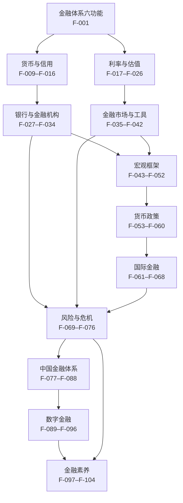

# 金融经济架构洞察

> 本文件是「判断层」，与 `facts.md` 的「事实层」分开。每条洞察给出：现象、根因、影响、建议，并标注所依据的 F 编号。洞察是分析框架，不是投资建议或政策主张。

## 洞察一：金融的功能是跨时空配置资源，但金融资产的膨胀可以脱离实体

**现象**：金融资产规模与金融部门利润长期快于实体产出增长；股市、房价上涨常被误读为「国家变富」（F-008、F-072）。

**根因**：金融体系的核心功能是支付清算、跨时空配置、风险管理、信息生产、激励约束与储蓄动员（F-001）。这些功能本身服务实体（F-002）；但当交易、杠杆与资产价格自我循环时，金融活动可以脱离最终借款人与生产者，形成「金融化」。

**影响**：资金在体系内空转，推高资产价格与不平等；实体投资被挤占；系统性风险积累。金融深化的指标（M2/GDP、信贷/GDP）只衡量规模，不衡量配置效率（F-005），容易被误读为「越大越好」。

**建议**：判断金融是否「服务实体」，看三个问题：资金最终去了哪里？是否形成了生产性资本？风险是否被透明定价？对个人，区分「资产涨价」与「收入/产出增长」；对政策，关注资金流向与宏观审慎，而不只是规模指标。

## 洞察二：货币是信用，银行创造货币；宽货币不等于宽信用

**现象**：央行降准、降息后，M2 未必同步扩张，企业仍感觉「借不到钱」；M2 增速高时，通胀与房价未必同步上涨（F-014、F-015、F-016）。

**根因**：基础货币由央行创造（F-013），但广义货币由银行体系通过贷款创造（F-015）。货币乘数受现金漏损、准备金率、超额准备金与信贷需求共同影响（F-014）。银行惜贷、企业不借钱、存款定期化，都会让乘数下降。

**影响**：只盯基础货币或政策利率，会误判金融条件；「宽货币」可能停留在银行准备金层面，无法转化为实体信贷。M2 与社融的背离（F-079），进一步说明货币与信用不是同一件事。

**建议**：同时看「价」（政策利率、LPR、贷款利率）、「量」（基础货币、M2、社融、信贷结构）与「风险」（信用利差、违约率）。对个人，理解「降息」不等于「贷款更容易」；对政策，价格工具与数量工具、宏观审慎需要配合。

## 洞察三：利率是资产价格的引力，久期是利率风险的度量

**现象**：央行加息，长期债券基金跌得比短债基金多；降息时，长久期资产涨得更猛（F-021、F-023、F-025）。

**根因**：资产价格是未来现金流的现值，折现率上升则现值下降（F-019、F-021）。久期衡量现金流回收的加权平均时间，也衡量价格对利率的敏感度；期限越长、票息越低，久期越大（F-023）。政策利率通过银行间市场传导至长端与信贷利率（F-025）。

**影响**：利率变化通过「久期」放大到资产价格；养老金、保险、银行等长久期负债机构对利率尤其敏感。负实际利率还会侵蚀储蓄者购买力（F-026）。

**建议**：判断利率风险，先看久期，不看到期时间；配置长久期资产，要能承受相应的价格波动；不要把「保本」与「无利率风险」混为一谈。

## 洞察四：银行的核心脆弱性是期限错配与高杠杆，监管是内生的

**现象**：资产质量良好的银行也可能因挤兑倒下；5% 的资产损失可能吃掉大部分资本；危机时流动性瞬间消失（F-029、F-070、F-073）。

**根因**：银行用短期存款支持长期贷款（期限转换），用少量资本支持大量资产（高杠杆）。部分准备金制度下，存款人随时可提款，贷款却不易变现。Diamond-Dybvig 模型证明挤兑可以是自我实现的均衡（F-029、F-073）。

**影响**：单家银行失败可通过资产负债表、共同暴露、挤兑与抛售传染为系统性风险（F-075）。因此需要存款保险（F-030）、最后贷款人（F-031）、资本监管（F-032）、宏观审慎（F-076）与处置机制（F-034）。

**建议**：评估银行，不只看利润与不良率，还要看资本充足率、流动性覆盖率、负债结构、同业依赖与资产透明度。监管的目标不是消灭风险，而是让风险可吸收、可处置。

## 洞察五：宏观政策短期管需求，长期靠供给；乘数与 QE 都不是万能

**现象**：财政刺激在不同时期效果差异很大；QE 在有些国家避免了通缩，在另一些国家推高了资产价格；降息未必带来投资（F-049、F-058）。

**根因**：短期产出由总需求决定，长期由潜在产出与技术增长决定（F-048、F-051）。财政乘数取决于资源闲置、货币政策配合、开放度与家庭行为（F-049）；QE 通过资产价格与预期传导，效果受银行体系、债务与风险偏好约束（F-058）。

**影响**：把短期工具当长期增长引擎，会积累债务与资产泡沫；把长期结构问题当短期需求问题，会反复「推绳子」。菲利普斯曲线只有短期权衡，长期垂直（F-052）。

**建议**：区分「周期问题」与「结构问题」：周期问题用需求管理，结构问题用改革、教育、研发、竞争政策。对个人，不要用宏观预测替代资产配置；对政策，保留政策空间，避免过度依赖单一工具。

## 洞察六：数字金融降低边际成本，但不消除风险；金融素养的核心是制度设计

**现象**：移动支付与数字信贷提升了普惠，但也带来数据集中、算法歧视、过度负债；加密资产与 DeFi 创造了新市场，也带来欺诈、挤兑与监管套利（F-090、F-094、F-095）。

**根因**：数字技术降低了服务边际成本、扩大了覆盖，但金融的基本风险（信用、流动性、系统性）没有消失，只是换了形态；监管按「功能」而非「技术」才有效（F-096）。个人层面，损失厌恶、处置效应与过度自信是稳定的行为偏差（F-097–F-100）。

**影响**：技术可能放大顺周期性（模型同质化、快速挤兑），也可能扩大不平等（数字鸿沟、算法歧视）。金融素养不足的消费者，更容易被高收益承诺与复杂产品误导（F-101）。

**建议**：监管坚持「相同业务、相同风险、相同规则」，用牌照、资本、披露、消费者保护与跨境合作覆盖新形态；个人用「知识 + 行为 + 态度」提升金融素养（F-101），用制度（预算、应急金、自动定投、冷静期）对抗行为偏差，用核验（牌照、底层资产、资金流向）对抗骗局。

## 知识地图

## 使用说明

- 这 6 条洞察是「跨篇连接器」：读到具体概念时，可以回到这里看它在整体中的位置。
- 每条洞察都引用事实编号；若事实更新，洞察需要重新评估。
- 洞察中的「建议」是分析性建议，不构成投资、法律或政策建议。
