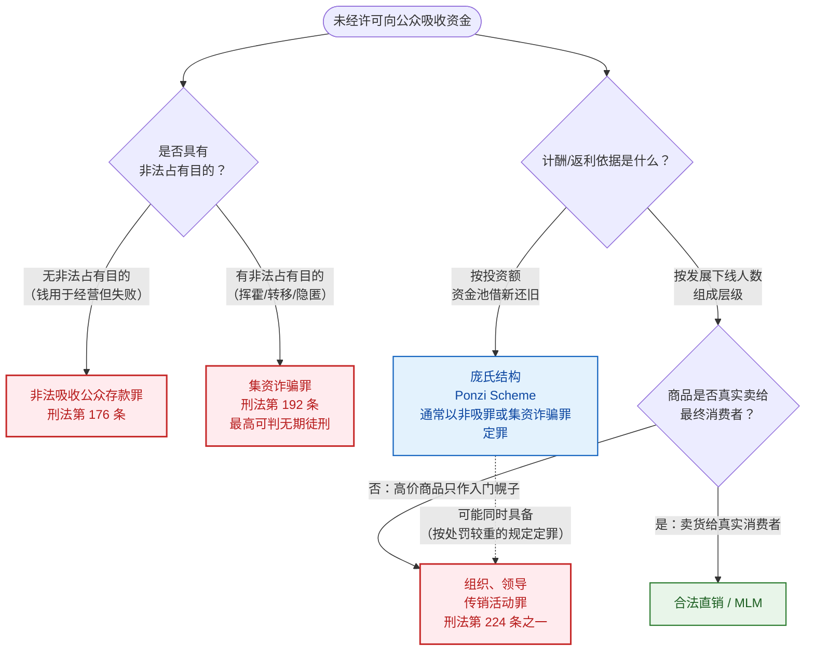
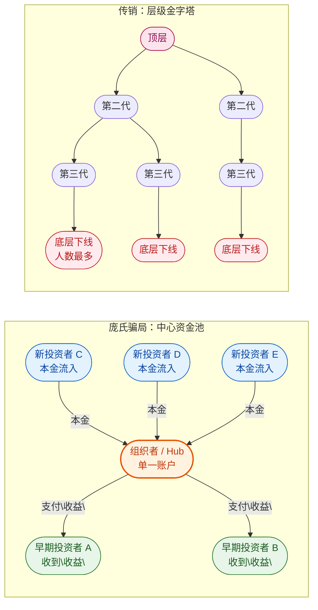

# 与传销、非法集资、老鼠仓的边界

## 是什么

日常口语里，凡是"骗老头老太太钱"的都被叫成"庞氏骗局"或"传销"。但在中国法律与美国证券法体系下，这是几个**边界清晰、罪名不同**的概念。分清它们有两个实际用处：(1) 看懂法院判决为什么这么定；(2) 当你或家人陷进去时，知道该向哪个部门报案、走哪条救济路径。

## 一、概念谱系：一张图理清

读图要点：
- **纵向分支**按"有没有非法占有目的"切分——这是区分非吸罪与集资诈骗罪的关键；
- **横向分支**按"计酬依据"切分——这是区分庞氏与传销的关键；
- **虚线箭头**表示两罪竞合时的处理规则（2022 年司法解释第 13 条）：从一重罪处罚。

## 二、四个核心概念对照

| 概念 | 核心特征 | 中国法律对应 | 美国对应 |
|------|----------|--------------|----------|
| **庞氏骗局（Ponzi Scheme）** | 用新投资者本金支付旧投资者回报；无真实经营 | 通常以**非法吸收公众存款罪**或**集资诈骗罪**定罪（视主观故意与资金用途） | SEC 注册反欺诈条款 §10(b)、RICO 等 |
| **金字塔计划 / 传销（Pyramid Scheme）** | 加入者必须缴费/买货获得资格，收入主要来自**发展下线**而非卖货 | **组织、领导传销活动罪**（刑法 224 条之一）；30 人以上且三级以上层级即入刑 |  FTC Pyramid Scheme 执法；各州反金字塔法 |
| **非法集资（广义）** | 未经许可、承诺还本付息、向不特定对象吸金——是一个"口袋概念" | 《防范和处置非法集资条例》行政定性；刑事上拆为非吸罪与集资诈骗罪 | 无直接对应；美国靠证券法注册要求反制 |
| **老鼠仓** | 金融机构从业人员利用未公开信息抢跑交易获利 | 刑法 180 条之一"利用未公开信息交易罪" | SEC Rule 10b-5  insider trading |

## 三、中国法下的关键区别：非吸 vs 集资诈骗

这是中国读者最容易混淆的一对罪名。根据最高法《关于审理非法集资刑事案件具体应用法律若干问题的解释》（F-056）：

### 1. 非法吸收公众存款罪（刑法第 176 条）

**同时满足四个条件**即构成（F-057）：
1. 未经有关部门依法许可，或借用合法经营形式吸收资金；
2. 通过网络、媒体、推介会、传单、手机信息等途径向社会公开宣传；
3. 承诺在一定期限内以货币、实物、股权等方式还本付息或给付回报；
4. 向社会公众（不特定对象）吸收资金。

**主观上没有"非法占有目的"**——钱确实去做了生意/项目，但生意失败、付不出钱。这是它与集资诈骗的核心区别。

### 2. 集资诈骗罪（刑法第 192 条）

在上述四个条件之上，**额外具有"非法占有目的"**。司法解释列举了可以认定为"非法占有"的情形（F-058）：
- 集资后不用于生产经营活动，或用于生产经营活动与筹集资金规模明显不成比例；
- 肆意挥霍集资款；
- 携带集资款逃匿；
- 将集资款用于违法犯罪活动；
- 抽逃、转移资金、隐匿财产；
- 隐匿、销毁账目，或假破产、假倒闭；
- 拒不交代资金去向。

**e租宝丁宁被判集资诈骗罪（无期），而不是非吸罪**，正是因为判决认定他把大量集资款用于个人挥霍、向境外转移、行贿——属于"非法占有目的"（F-059）。

## 四、庞氏 vs 传销：最容易混的一对

| 维度 | 庞氏骗局 | 传销（金字塔计划） |
|------|----------|--------------------|
| 收入来源 | 新投资者的本金 | 下线人员缴纳的"入门费/货款" |
| 计酬依据 | 你投了多少钱 | 你发展了多少下线、下线又发展了多少人 |
| 商品/服务 | 通常**没有**真实商品（或商品只是幌子） | 往往**有**商品，但商品价格虚高，本质是入门费 |
| 加入动机 | "我要赚投资收益" | "我要当代理、拉团队、建管道" |
| 典型话术 | "保本高收益""稳赚不赔" | "裂变""躺赚""团队计酬""管道收入" |
| 法律罪名 | 非吸罪/集资诈骗罪 | 组织、领导传销活动罪 |

两种结构的资金流向差异，一张图看清：

**视觉差异**：庞氏是**星型结构**——所有钱流向一个中心 hub，再由 hub 分发给早期投资者；传销是**树状结构**——钱沿层级自下而上分润，每一层都从下一层抽成。

**两者经常交织**：最高法 2022 年修改司法解释时专门增加第 13 条（F-060）：

> 通过传销手段向社会公众非法吸收资金，构成非法吸收公众存款罪或者集资诈骗罪，同时又构成组织、领导传销活动罪的，依照处罚较重的规定定罪处罚。

也就是说，一个案子如果同时具备"借新还旧"和"拉人头层级返利"两个特征，法院会按处罚更重的那个罪名判。钱宝网、善心汇这类案子就是这种混合形态。

## 五、合法直销 / MLM 与传销的边界

根据《禁止传销条例》与两高一部意见（F-061），区分合法多层次直销与非法传销的关键：

- **合法直销**：收入主要来自把产品卖给最终消费者，而不是来自发展下线；
- **非法传销**：
  1. 要求参加者缴纳费用或购买商品/服务获得加入资格；
  2. 按一定顺序组成层级；
  3. 直接或间接以发展人员数量作为计酬或返利依据；
  4. 引诱、胁迫参加者继续发展他人。

最高检在"消费全返"文章里特别指出（F-062）：**"消费全返""购物全返""0 元购"等模式，如果本质是设立资金池、借新还旧、用后消费者的钱返前消费者，就具备庞氏结构，存在刑事风险**——不管它披的是电商、共享经济还是新零售的外衣。

## 六、美国法下的对应

- **SEC 视角**：庞氏骗局通常违反《1933 年证券法》注册要求与《1934 年证券交易法》反欺诈条款 §10(b) 与 Rule 10b-5；
- **FTC 视角**：金字塔计划主要由联邦贸易委员会按 FTC Act §5（不公平或欺骗性商业行为）执法；
- **两者经常交叉**：Madoff 案同时被 SEC 民事起诉与联邦司法部刑事起诉；
- 与中国不同，美国没有"非法集资"这个独立行政罪名，但通过"投资必须注册或符合豁免"这一前置要求，达到了类似效果。

## 怎么做

1. **不要用"是不是传销"作为唯一判断**：一个项目可能不是传销（不拉人头），但仍然是庞氏骗局（用新钱付旧收益）。
2. **受害者报案时**：警方会按资金实质定性，你不需要自己给它定罪。你只需要如实提交合同、转账记录、宣传材料、聊天记录。
3. **看亲戚朋友拉你入伙时**：他让你"先投一笔试试"，是庞氏；他让你"先买一套产品办个会员，然后拉朋友进来你能提成"，是传销；两个都要你做，是混合。

## 常见坑与边界

- **"我们这是直销，有牌照"**：在中国，持牌直销企业也必须在批准的产品区域内开展业务；超范围、跨区域、团队计酬，一样会被定性为传销。
- **"我们卖的是真实产品，所以不是庞氏"**：商品真实不代表资金结构合法。如果商品价格远高于市场、主要收入来自拉人头，那就是传销外衣下的庞氏。
- **"我只是业务员/代理，不是老板"**：司法实践中，在传销组织中起到发起、策划、操纵作用，或承担管理、协调、宣传、培训等职责的人员，都可能被追究刑事责任。普通下线一般不追究，但要退缴违法所得。

## 相关概念

- [00 什么是庞氏骗局](00-what-is-ponzi.md)——回到定义三要素。
- [03 经典案例](03-classic-cases.md)——e租宝、善林为什么定集资诈骗。
- [06 法律规制与受害者救济](06-legal-regulation.md)——出事之后怎么办。
- 事实出处与信源：[facts.md](../facts.md)。
