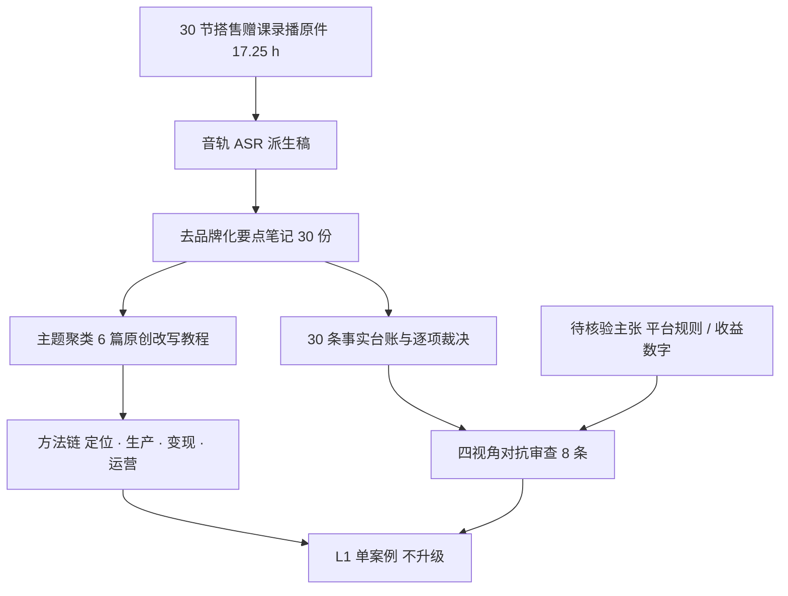

# AI 辅助内容运营：从账号定位到变现结构的可核验教程

> **状态：flagged · 路线：chaptered-summary（深度摘要 + 原创改写）。** 本包的 30 节素材来自同一次已购课会话下、与[短故事创作与投稿变现](../short-story-writing-system/index.md)搭售的**另一产品线赠课**。它与短故事包共用会话通道，但**主题、方法与结论互不印证**：本包只回答「这批赠课讲了哪些方法」，不证明方法有效，也不给任何招生承诺背书（F-025）。讲义、课件画面文字、官方字幕、作业与批改**均未取得**；课堂内容唯一通道是录播音轨的 ASR 派生稿，逐字文本不入库（F-005、F-024）。本包不是课程转录、不是平台操作手册、不是变现建议。

这批材料最容易被误读的地方，不是某个工具怎么用，而是**把口播里的平台规则当成现行规则**。课堂里被归给「官方」的账号权重、限流与审核机制，在本次采集中没有任何官方文本可核对，因此一律登记为**待核验主张**（F-021、F-023）；收益、涨粉、转化率与时长节省比例同样只作「出现但不采信」登记（F-022）。读任何一篇教程前，先读[来源清单](references/source-manifest.md)与[课堂覆盖与证据分层](references/lecture-coverage.md)。

## 按用途选择路径

| 路径 | 要回答的问题 | 本包能提供什么 |
|---|---|---|
| [账号定位方法链](concepts/01-positioning-and-persona.md) | 没定方向时，按什么顺序把赛道收窄？ | 自我盘点→赛道收窄→人设要素→主页承接→对标校验 |
| [平台机制与冷启动](concepts/02-platform-mechanics.md) | 不同分发机制下，内容形态要改什么？ | 按机制分类、结构约束、最小验证与节奏调整 |
| [选题到脚本生产](concepts/03-topic-and-script-pipeline.md) | 批量生产时，人必须守在哪几个判断点？ | 选题来源、标题候选、输入框架、由粗到细、人工把关 |
| [视觉素材与成片](concepts/04-visual-production.md) | 生成素材进成片前要核对什么？ | 分镜与关键帧、素材来源与授权、一致性、成片收口 |
| [变现结构与投放](concepts/05-monetization-and-ads.md) | 什么前提不具备就不该投？ | 三段闭环、四类形态、前提盘点、最小验证与止损 |
| [运营与异常诊断](concepts/06-operations-and-diagnosis.md) | 数据掉了先查哪里？ | 受众分层、环节定位、三级诊断顺序、单变量迭代 |

> **表格 ≠ 课堂原表。** 本包所有表格均为依据口述内容重新组织的**原创改述**，不是课堂讲义中的表格，也不是平台后台字段说明。

## 一条主线



## 证据怎样使用

F-001～F-030 共 30 条，是本包**唯一** F 台账，见[课程事实与主张登记](references/course-facts.md)；与同组短故事包的 F 编号**各自独立、不互通**（F-020）。分层：F-001～F-009 采集通道与覆盖，F-010～F-019 六篇教程的方法链登记，F-020～F-030 分账、边界与模式。事实表只回答「录播里讲了什么」「本包怎么处理」，**不认证任何方法的有效性、任何平台规则的当前状态、任何收益承诺**。逐项裁决见[核验与勘误](references/verification.md)，四视角攻击见[对抗审查](references/adversarial-review.md)。

三条负向事实要先记住：讲义、课件画面文字、官方字幕、作业与批改全部缺席（F-024）；平台规则类说法无官方文本可对，均为待核验主张（F-021、F-023）；ASR 派生稿有同音字与专名误识，不是逐字稿，课堂举例的具体名称未逐项复核（F-004、F-005）。因此本包对「某平台当前规则是什么」「按这套做能涨多少」保持空白，不用常识补写。

## 文档清单

本包共 16 篇 Markdown：6 篇教程、6 篇参考正文（来源清单、事实登记、覆盖与证据分层、核验与勘误、对抗审查、知识地图）、3 篇索引与 1 篇更新日志。不建 `examples/`：课堂未给出可复现的版本、输入输出与验收结果，可复现性两问皆否，理由见[知识地图](references/knowledge-map.md)。

## 主题关联

- [短故事创作与投稿变现](../short-story-writing-system/index.md)：**同一会话通道、不同产品线**。该包处理课程本体 10 节（7 节录播 + 3 场直播），本包处理搭售赠课 30 节；两包 F 编号独立、结论不互证、不拼因果链。
- [内容创作三原则](../content-creation-three-rules/index.md)：同为付费课程单源材料按 `chaptered-summary` 转化，演示「只有原则」的处理方式。
- [壁纸作品引流课程材料转化](../kuaishou-wallpaper-publish-traffic/index.md)：同组课程材料转化簇，演示「有口播全流程」；其平台能力仅部分核验，与本包「规则待核验」的边界同类。

## 更新边界

2026-12-09 为复核期限，不是自动巡检任务。触发复核的条件：出现可对课堂方法做独立效果核验的材料、取得讲义或课件画面文字、平台官方规则页改版、会话权限变化、或搭售赠课节数变化。触发后新增 F 编号并补裁决，**不改写既有行**；下一轮从 **F-031** 顺延（F-030）。完整幂等规则见[来源清单](references/source-manifest.md)。

```{toctree}
:hidden:
:maxdepth: 2

concepts/index
references/index
log
```
