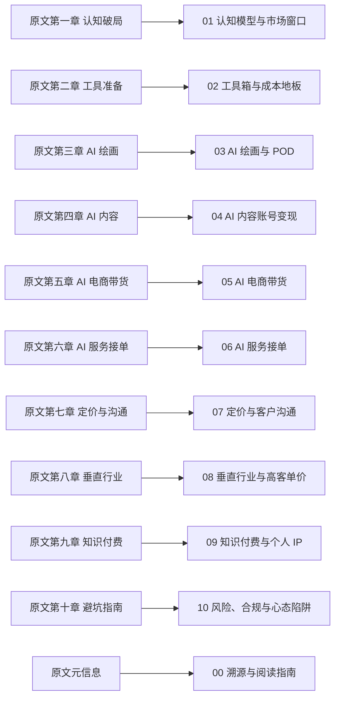

# 原文溯源与阅读指南

> 本束是商业分析/实操方法论类知识包，**不是源码教程，也没有可复现的 `examples/`**。原文没有版本号、输入输出对照与实测记录，按「操作可复现性两问」不建立示例目录。核验边界见[核验报告](/references/verification.md)。

## 原文元信息

| 项 | 值 | 编号 |
|---|---|---|
| 标题 | 《零基础AI实操赚钱项目教程（完整版）》 | F-001 |
| 公众号署名 | 干货534（账号原始 ID `gh_5858ad16662b`） | F-001 |
| 发布时间 | 2026-10-08 19:48:41（页面时间戳 1791460121） | F-002 |
| 页面摘要 | 「2026年普通人用AI赚钱的最好机会」 | F-003 |
| 正文规模 | 十章；本地提取纯文本 35,518 字符、1,789 行 | F-004、F-005 |
| 原文定位 | 自述「实操手册」，声明读者无需技术背景、无需写代码，只需会用智能手机、会打字 | F-006 |

## 十章结构与本束对应

原文是一篇连续手册，本束按「认知 → 工具 → 项目 → 交易 → 升级 → 边界」重排为 11 篇。逐章对应关系：

| 原文章 | 覆盖 F 编号 | 本束篇目 |
|---|---|---|
| 元信息 | F-001～F-006 | [原文溯源与阅读指南](00-article-provenance-and-reading-guide.md) |
| 第一章 认知破局 | F-007～F-024 | [认知模型与市场窗口](01-mental-models-and-market-window.md) |
| 第二章 工具准备 | F-025～F-032 | [工具箱与成本地板](02-toolbox-and-cost-floor.md) |
| 第三章 AI 绘画设计变现 | F-033～F-039 | [AI 绘画与 POD 变现](03-ai-art-and-pod.md) |
| 第四章 AI 内容创作变现 | F-040～F-045 | [AI 内容账号变现](04-ai-content-account.md) |
| 第五章 AI 电商带货 | F-046～F-051 | [AI 电商带货](05-ai-commerce-video.md) |
| 第六章 AI 服务接单 | F-052～F-057 | [AI 服务接单](06-ai-service-orders.md) |
| 第七章 定价策略与客户沟通 | F-058～F-064 | [定价与客户沟通](07-pricing-and-client-communication.md) |
| 第八章 AI+垂直行业高客单价 | F-065～F-068 | [垂直行业与高客单价](08-vertical-industry-high-ticket.md) |
| 第九章 知识付费与个人 IP | F-069～F-075 | [知识付费与个人 IP](09-knowledge-products-and-personal-ip.md) |
| 第十章 避坑指南 | F-076～F-082 | [风险、合规与心态陷阱](10-risks-compliance-and-mindset-traps.md) |
| P0 核验补充 | F-083～F-092 | 分散嵌入各篇，并在 [10 风险、合规与心态陷阱](10-risks-compliance-and-mindset-traps.md) 集中声明 |

## 三类读法

原文混着三种可信度不同的内容，本束对每条具体声明都做了标注约定：

1. **可核验事实**——平台门槛、工具定价、监管义务。凡与官方口径冲突者，本束呈现官方口径并标注源文差异（如 F-046 对 F-083、F-078 对 F-085）。
2. **作者观点与建议**——认知框架、选品原则、定价心法、行为建议（如 F-013、F-047、F-058、F-063）。这类内容内部自洽，但无可证伪的外部事实支撑，引用时应保留「作者观点 / 作者建议」标注。
3. **案例与算例**——第三方博主案例转述（F-033、F-075）与作者的算术示意（F-023、F-044、F-068、F-070）。它们是**量级示意，不是收益预期、转化率或市场统计**。

## 阅读顺序建议

- **想快速判断可行性**：先读 [01 认知模型与市场窗口](01-mental-models-and-market-window.md) 确认三种模式是否匹配自身资源，再读 [10 风险、合规与心态陷阱](10-risks-compliance-and-mindset-traps.md) 排除不可做的部分。
- **想立刻接单**：读 [02 工具箱与成本地板](02-toolbox-and-cost-floor.md) → [06 AI 服务接单](06-ai-service-orders.md) → [07 定价与客户沟通](07-pricing-and-client-communication.md)，这条链路是最短闭环。
- **想做内容号**：读 [04 AI 内容账号变现](04-ai-content-account.md) → [09 知识付费与个人 IP](09-knowledge-products-and-personal-ip.md)。
- **关注合规风险**：[05 AI 电商带货](05-ai-commerce-video.md) 与 [10 风险、合规与心态陷阱](10-risks-compliance-and-mindset-traps.md) 的「已知边界」段落是必读项，原文在这两处有实质缺口。

## 已知边界

- 原文全文无脚注、无参考文献、无外部链接；F-007～F-082 全部为**单源内容**，第三方博主案例与市场观察均不具备可审计的核验链条。
- 平台规则与工具定价会持续变动。本束的核验快照时点为 2026-10-22，`stale_after` 设为 2026-12-31。
- 本束的结论不构成收益承诺，也不替代平台官方规则与监管条文。
