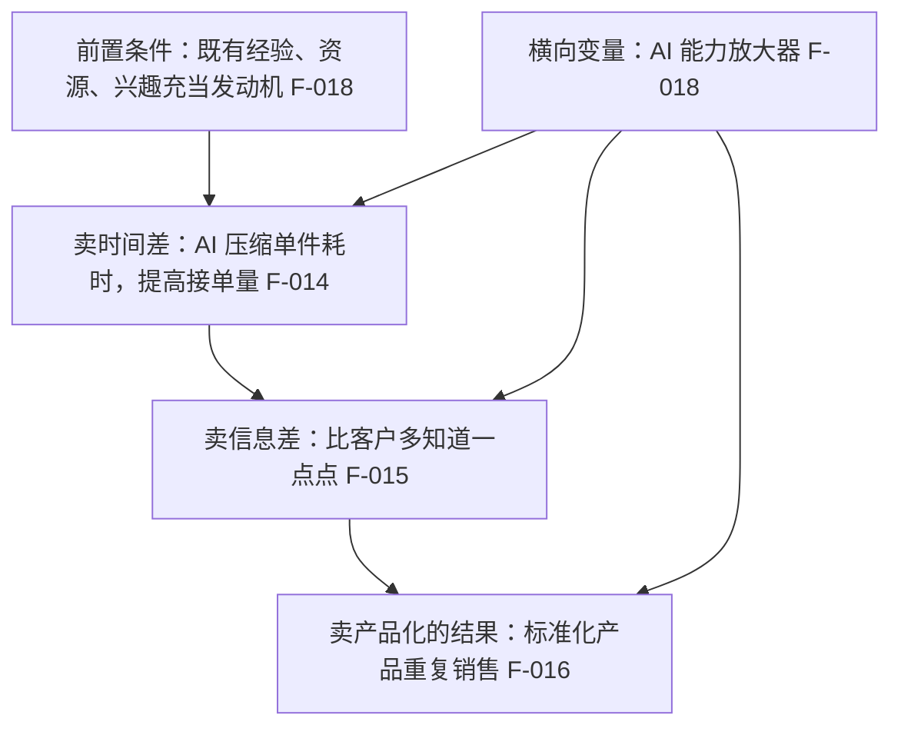

# 认知模型与市场窗口：三种赚钱模式

> 原文第一章的框架属作者认知层，没有可证伪的量化声明（除 F-009 的 90% 量级示意）。本章保留原文口径并标注为作者观点/作者建议。

## 三种赚钱模式

原文把个人用 AI 赚钱拆成三种模式（F-013），并分别给出定义：

| 模式 | 原文定义 | 原文给出的做法 | 编号 |
|---|---|---|---|
| 卖时间差 | 用 AI 压缩单件交付耗时，提高单位时间的接单量 | 同一时间交付更多单 | F-014 |
| 卖信息差 | 客户对 AI 能力的认知仍停留在「聊天机器人」阶段，经营者只需比客户多知道一点点 | 交付质量差于预期服务 | F-015 |
| 卖产品化的结果 | 把 AI 能做的事做成标准化产品重复销售 | 需先积累经验与案例再进入 | F-016 |

原文称第三种天花板最高（F-016），并把它放在九月的「卖产品的杠杆」算例中放大（见 [09 知识付费与个人 IP](09-knowledge-products-and-personal-ip.md)）。

## AI+X 与「放大器而非发动机」

原文提出两条并列的定位判断：

- **AI+X（F-017）**：核心竞争力来自把 AI 与细分领域经验结合。原文的对照是——电商运营者结合 AI 之后，与纯 AI 熟练者形成差异。
- **放大器而非发动机（F-018）**：个人既有的经验、资源、兴趣充当发动机，AI 提供约十倍放大。

这条判断是原文后续所有项目路径的隐含前提：**通用技能只能压低单价，垂直积累才抬高单价**。原文据此建议零行业经验者先从写文案、做图片、剪视频等通用技能入行（F-019），先赚到第一笔钱（F-020）。

## 变现模式升级阶梯

原文的模式划分可以整理为一条阶梯，越往上对前置积累的要求越高：

阶梯的实际含义是三件事同时变化：

| 维度 | 卖时间差 | 卖信息差 | 卖产品化的结果 |
|---|---|---|---|
| 交付物形态 | 一次性服务 | 一次性服务 | 可重复售卖的固定形态 |
| 收入上限 | 受限于本人可投入时间 | 受限于获客能力 | 受限于需求规模与信任度 |
| 原文给出的入门路径 | 第一月只选一个最简单项目，先赚到第一笔钱，哪怕只有五十块（F-020） | 通用技能入行（F-019） | 先积累经验与案例再进入（F-016） |

## 副业的正确姿势

原文用一整节给出节奏约束，与上面的模型配套：

- 先当副业做，每天抽一两个小时，不辞职、不投入全部身家（F-021）。
- 副业收入连续三四个月超过工资后再考虑全职（F-022）。
- 一上来就说月入十万、躺赚百万的，不是骗子就是卖课的（F-024）。

三条都是行为约束型建议，不涉及外部事实核验。

## 收入节奏示例的正确读法

原文给出一组收入节奏数字（F-023）：第一个月几百块、第二个月一两千、第三个月三五千，做得好的能过万。

这组数字**不是收益预期**，它更像是把「卖时间差」与「卖产品化的结果」两条曲线的量级差画出来的一个示意。它没有样本、没有统计口径、没有出处分（原文无脚注与外部链接）。引用时应读作「作者给出的量级示意」，不能当作可达成的收入预测。

同样性质的还有 F-009 的「门槛下降 90% 以上」与 F-011 的「一条产品视频成本几块钱 API 费用、收客户五百一千」——都是作者的量级描述。

## 迁移提示

这套模型可以脱离「AI」这一具体工具复用：任何降低单件交付成本的技术，都会把竞争维度从「谁能做」推向「谁更快」与「谁更懂行业」。真正决定定价的是第二条——行业知识的不可替代性。

对应到同组其他知识包：[monetization-direction](../../monetization-direction/index.md) 提供了「自我盘点 → 候选生成 → 需求验证 → 决策启动」的方向发现四步法，适合在选具体项目之前使用；[auto-money-system](../../auto-money-system/index.md) 则从自动化系统角度处理同一问题的另一面。
