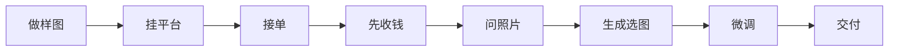

# AI 绘画与 POD 变现

> 本篇覆盖原文第三章。流程步骤具可操作性，报价区间属**作者参考值**，不是行业均价，也不构成定价基准。

## 头像定制：三步外循环 + 五步内循环

原文把头像定制拆成外循环与内循环（F-035），这是全文中结构最清晰的一条流程：

要点在于**顺序**：原文把「先收钱」放在「问照片」之前（F-035），这与 [07 定价与客户沟通](07-pricing-and-client-communication.md) 中的「先收 50% 定金」（F-063）是同一条原则在具体场景中的落地——先锁需求与付款，再投入生成成本。

## 三档报价与升级路径

原文给出的价目表（F-036）：

| 品类 | 新人价 | 有口碑后 | 复杂需求 |
|---|---|---|---|
| 单人头像 | 19.9-29.9 元 | 49-69 元 | 199 元起 |
| 情侣头像 | 39.9-59.9 元 | 99-129 元 | — |
| 宠物头像 | 29.9-49.9 元 | — | — |

原文同时给出闲鱼头像定制的市场区间为 9.9 元至 99 元（F-034）。新人价落在该区间下沿，有口碑价落在上沿——**这个对照说明新人定价区间并非凭空设定**，但它是作者的一次观察，不是持续监测的价格数据。

进阶路径是售卖提示词模板，标价 19.9 元（F-039），对应 [09 知识付费与个人 IP](09-knowledge-products-and-personal-ip.md) 的产品阶梯第一级。

## 电商图的价目结构

| 品类 | 报价区间 | 编号 |
|---|---|---|
| 主图 | 50-200 元 | F-037 |
| 海报 | 100-300 元 | F-037 |
| 封面 | 80-150 元 | F-037 |
| 复杂活动海报 | 300-500 元 | F-037 |

价目随「复杂度」而非「尺寸」上移——这与 [07 定价与客户沟通](07-pricing-and-client-communication.md) 的「卖结果不卖时间」（F-058）一致：复杂海报卖的是构图与信息层级，不是出图时长。

## POD：铺量收入模型

原文列举四个 POD 平台——Printful、Printify、Redbubble、TeePublic（F-038），描述其铺量收入区间为几十美元到几千美元。

这个区间的跨度（几十倍）本身说明：**POD 的收入由铺货量与出单率共同决定，而不是由单件设计决定**。原文没有拆解这个变量，属于作者的方向性描述。

POD 与前面几条路径的关键差异在于它**没有交付环节**——设计做好后上架，出单走平台履约。因此它不适用接单五步（F-053）与交付七步（F-064），而适用内容账号的持续产出路径（见 [04 AI 内容账号变现](04-ai-content-account.md)）。

## 案例的证据强度

原文引用小红书账号「@AI画师小鹿」的头像定制报价 68 元一张，称其每天接 5-10 单、月收入约 1.5 万元（F-033）。

这是**第三方博主案例转述**，原文无出处、无统计口径、无时间窗，无法核验。按单源口径处理，不能作为「做头像月入 1.5 万」的依据。同一处理适用于 F-075 的课程案例（见 [09 知识付费与个人 IP](09-knowledge-products-and-personal-ip.md)）。

## 已知边界

- 全部报价为作者给出的参考区间（F-034、F-036、F-037），非行业均价，不可作为定价基准。
- 「每天接 5-10 单」与「月收入约 1.5 万元」为第三方转述（F-033），单源且不可审计。
- AI 生成图的商用授权条件见 [10 风险、合规与心态陷阱](10-risks-compliance-and-mindset-traps.md)，原文在此处与官方条款相反（F-078 对 F-085）。
