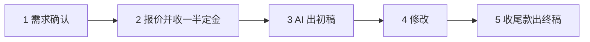

# AI 服务接单

> 本篇覆盖原文第六章。流程与定价表属作者方法论与参考价；**平台清单中闲鱼一项原文遗漏了经营登记义务**，本篇补入。

## 五类服务

原文列举的 AI 服务范围（F-052）：

| 类别 | 具体形态 | 定价区间 | 编号 |
|---|---|---|---|
| 文案脚本 | 种草文案、软文、普通软文、深度干货、包月 | 30-50 / 100-300 / 200-500 / 500-1000 元；包月 20 篇 800-1500 元 | F-055 |
| PPT | 学生答辩、职场汇报、商务融资 | 50-100 / 100-300 / 500-2000 元 | F-056 |
| 简历求职 | 修改、代写、全套 | 50-100 / 100-300 / 500-1000 元 | F-056 |
| 翻译润色 | 电商翻译、专业翻译 | 50-100 元/条 / 200-500 元每千字符 | F-056 |
| AI 代运营与企业服务 | 基础版 1999 元/月、进阶版 3999 元/月 | 12 图文+4 视频 / 20 图文+8 视频+复盘 | F-057 |

这五类的共同点是**交付物可验收**：稿子、PPT、简历、译文、运营产出，客户都能判断好坏。这使 AI 服务不同于「卖时间差」的说法——定价锚点在结果上。

## 接单五步

原文给出的流程（F-053）：

这条链的关键设计在第 2 步：**在投入生成成本之前先收款**。它把「客户不认账」与「客户赖账」两种风险前移到需求确认阶段。这与 [03 AI 绘画与 POD 变现](03-ai-art-and-pod.md) 的「先收钱再问照片」（F-035）、[07 定价与客户沟通](07-pricing-and-client-communication.md) 的「先收 50% 定金」（F-063）是同一条原则的三次出现。

## 接单平台清单（含合规缺口）

原文列举的渠道（F-054）：国内为闲鱼、淘宝、拼多多、猪八戒、一品威客、豆瓣社群；海外为 Fiverr、Upwork、PeoplePerHour。

**闲鱼一项存在合规缺口。** 原文把闲鱼列为常规接单渠道，未提示经营性卖家的登记义务。闲鱼对经营性卖家的判定条件为同时满足五项（F-088，⚠️ 第三方媒体报道口径）：

1. 售卖物品大于 30 件且品类小于 3 类
2. 同型号款式反复售出超 5 次
3. 年交易笔数超 104 笔
4. 月成交数超 3 笔
5. 年销售额超 10 万元

被认定为经营性卖家者需完成依法登记并提供营业执照与经营地址（F-088）。

法律依据锚点是《网络交易监督管理办法》第八条（F-092）：个人从事网络交易活动**年交易额累计不超过 10 万元**的，依《电子商务法》第十条不需要登记；超过该额度应依法办理市场主体登记。

这条边界的实践含义：**偶尔接几单的副业状态通常在免登记范围内；把接单做成常态化业务时，登记义务会被触发**。原文的税务口径（F-080：个人小金额接单问题不大，月入几万时建议注册个体工商户）方向与此一致，但两者的判定标准不同——税务看月收入，登记义务看年交易额累计与五项行为指标。

## 第一单的获取方法

原文给出三条（F-057）：低价冲量、从身边朋友起步、多平台铺量。

这三条的共同点是**降低首次成交的信任成本**，而不是提升单笔利润。它与 [08 垂直行业与高客单价](08-vertical-industry-high-ticket.md) 中「先接小单验证」（F-067）构成一条完整的推进序列。

## 已知边界

- 全部价目为作者参考值（F-055、F-056、F-057），非行业均价。
- 闲鱼五项判定条件为第三方媒体报道口径，未取得平台官方规则原文 ⚠️；但《网络交易监督管理办法》第八条的 10 万元边界已核验官方发布 ✅。
- 接单涉及个人信息处理时，读者须自行评估隐私与保密责任，原文未涉及该维度。
