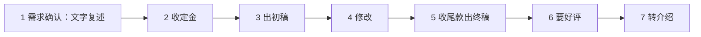
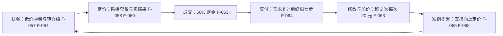

# 定价与客户沟通

> 本篇覆盖原文第七章。这是全文中最完整的一套交易方法论，属作者经验总结，无外部事实核验链条，但内部自洽且可直接落地。

## 定价的第一原则：卖结果不卖时间

原文提出定价原则是「卖结果不卖时间」（F-058），并配一条实操建议：新手定价低于市场均价 30%-50%（F-059）。

两者是一对配套动作：**卖结果**决定了报价的锚点在客户获得的价值上；**低于均价**是进入市场时的敲门砖。原文同时用价格战现象作为反向论证：今天报价 100、明天 80、后天 50（F-065）——通用服务无法维持价格，原因正是它在按时间与竞争定价，而非按结果定价。

## 阶梯套餐

原文给出的三档套餐（F-060）：

| 档位 | 单价 | 包含内容 | 修改次数 |
|---|---|---|---|
| 基础 | 99 元/篇 | 800 字 | 2 次 |
| 进阶 | 199 元/篇 | 1500 字 + 标题优化 + 3 组标签 | 3 次 |
| 包月 | 1299 元/月 | 10 篇 | — |

阶梯的作用不只是提价，而是**把「选哪个」变成客户自己的决策**。三档之间的差价（100 元）小于单次修改加价（20 元 × 若干次），使升级成为客户可感知的划算选择。

## 加价三技

| 技法 | 原文表述 | 作用对象 | 编号 |
|---|---|---|---|
| 增值服务 | 增加额外交付项 | 客户的获得感 | F-061 |
| 展示改前改后对比 | 呈现前后差异 | 客户对价值的认知 | F-061 |
| 制造稀缺感 | 限时或限量 | 决策紧迫性 | F-061 |

三条都作用于**客户端的价值感知**，而非提升实际交付质量。这是原文对「定价」这一动作的核心理解：报价只是价格，价值判断才是价格。

## 砍价三应对

| 应对 | 原文表述 | 编号 |
|---|---|---|
| 价值对冲 | 强调交付物价值以抵消价格异议 | F-062 |
| 降级不降价 | 减少交付内容但不减价 | F-062 |
| 换等价条件 | 介绍两人打九折等替代方案 | F-062 |

「降级不降价」是三条中最有约束力的一条——它要求事先就把交付内容切分成可分档的模块，否则临场降级会直接损失毛利。

## 两条硬约束

- **修改超出 2 次后每次加收 20 元**（F-063）。
- **先收 50% 定金**（F-063）。

配合 F-059 的新手定价，两者共同限定了单笔订单的**风险敞口**：亏损被限制在定金额度内。

## 标准交付七步

原文给出的交付流程（F-064）：

第 1 步的「文字复述」是一个容易被忽略但作用很大的动作：**把口头需求转成文字并让客户确认，等于把验收标准前置到开工之前**。

第 7 步「转介绍」把交付流程接回了获客流程，与 [06 AI 服务接单](06-ai-service-orders.md) 中「低价冲量、从身边朋友起步」的获客思路构成闭环。

## 交付与定价闭环

把定价与交付合起来看，原文实际描述的是一个带反馈的闭环：

闭环的关键在 `CASE → ACQ`：案例积累让下一单能报更高价格，而案例来自交付过程本身。这也是 [08 垂直行业与高客单价](08-vertical-industry-high-ticket.md) 中「打造标杆案例」（F-067）的前置依赖。

## 已知边界

- 本篇全部内容为作者经验总结与建议，无外部核验链条，属方法论参考而非行业基准。
- 「市场均价」在原文中未定义统计口径，F-059 的 30%-50% 是作者经验值。
- 转介绍与好评环节涉及平台规则与客户隐私处理，实际执行须评估各平台规定。
