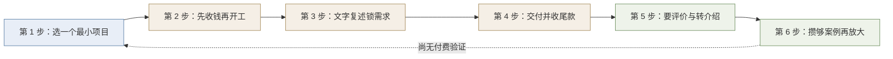

# 先验证再放大

> **模式层级**：**L1 可迁移模式（单案例待验证）**。本篇不是原文的章节复述，而是**把散落在十章中的六处同构主张抽成一条可执行规程**——下次做任何「以个人能力对外交付并变现」的事，按此执行。
> **实证基础**：本文全部主张来自同一篇文章（F-001～F-082），未跨独立信源复现，故标 L1；核验快照时点 2026-10-22。

## 一、模式定义

| 项 | 内容 |
|---|---|
| **模式名** | **先验证再放大** |
| **一句话** | **先用一个最小可交付闭环验证「有人愿意付钱」，再谈提价、放大与产品化**；顺序颠倒者会把时间、钱与信心投在没有付费意愿的方向上。 |
| **解决什么问题** | 零基础入门者面对「AI 能赚钱」的判断题，最常见的失败不是能力不足，而是**跳过验证直接放大**——先买工具、先做矩阵号、先囤素材、先投流，期望规模化之后自然会有人买单。本模式给出「先证需求、再谈规模」的最小动作序列。 |
| **不解决什么** | 不判断某个具体方向是否值得做（那是 [monetization-direction](../../monetization-direction/index.md) 的方向发现四步法）；不判断具体报价该定多少（报价区间属作者参考值，见 [07 定价与客户沟通](07-pricing-and-client-communication.md)）；不替代平台准入与合规核验（见 [10 风险、合规与心态陷阱](10-risks-compliance-and-mindset-traps.md)）。 |

## 二、触发场景

### 适用于

- **个人技能对外变现**：文案、设计、剪辑、配音、翻译、编程等可交付型服务（F-014 卖时间差、F-016 卖产品化的结果）
- **内容账号起步**：尚无粉丝基础、准备投入时间做矩阵号或账号运营（F-041 标准化生产四步）
- **电商带货起步**：尚未开通橱窗、准备先囤货或先投流再卖货（F-046、F-048）
- **知识产品冷启动**：想做课程或社群、尚未积累用户（F-074 先有用户再做产品）
- **任何「先投入还是先验证」有争议的场景**：买工具、囤素材、报课、投广告

### 不适用于

- **已有稳定客源与复购的成熟业务**——此时验证成本高于收益，应直接谈规模与产品化
- **一次性、不可重复的偶发需求**（如临时帮忙修一次电脑）——没有可放大的闭环可言
- **强监管且准入成本高的领域**（医疗、金融、教育培训资质）——**合规前置**，须先满足准入再谈验证；本模式不替代 [10](10-risks-compliance-and-mindset-traps.md) 中的 AIGC 标识与经营登记义务
- **纯学术研究或创作探索**——不以变现为目标，无「有人付钱」这一验证命题
- **他人已公开验证过的成熟模板**（如平台官方教程）——直接照做，无需再付一次验证成本

> **判别开关**：问一句「**我现在做的事，有没有可能在没有任何人付钱的情况下持续做下去？**」——会 → 先走本模式验证；不会 → 直接放大。

## 三、核心六步

### 第 1 步：选一个最小项目

原文的建议是「第一个月只选一个最简单的项目，先赚到第一笔钱，哪怕只有五十块」（F-020）。选择标准不是「哪个最赚钱」，而是「哪个最快能跑完一个完整闭环」。

### 第 2 步：先收钱再开工

头像定制流程把「先收钱」放在「问照片、生成选图」之前（F-035）；定价章节要求「先收 50% 定金」（F-063）。这一步的作用不是收钱，而是**把「愿不愿意付」这个信号前移到任何生产动作之前**。

### 第 3 步：文字复述锁需求

交付七步的第 1 步是「需求确认：文字复述」（F-064）。把口头需求转成文字并让客户确认，等于**在开工前把验收标准确定下来**，避免交付后按各自理解扯皮。

### 第 4 步：交付并收尾款

交付七步依次为需求确认、收定金、出初稿、修改、收尾款出终稿、要好评、转介绍（F-064）。修改超出 2 次后每次加收 20 元（F-063），是这条闭环的风险阀门。

### 第 5 步：要评价与转介绍

交付七步的第 6、7 步是要好评与转介绍（F-064）。这一步把交付接回获客——第一单的获取方法正是「从身边朋友起步、用低价冲量」（F-057）。

### 第 6 步：攒够案例再放大

原文的三条升维路径都以案例为前置：「卖产品化的结果」需要先积累经验与案例再进入（F-016）；找方向三法中含「先接小单验证」（F-067）；做知识产品要先招 10-20 名内测用户（F-074）；从 1 做到 10 的第一步是「打造标杆案例」（F-067）。

## 四、反模式（5 条，均来自本案例实证）

| # | 反模式 | 本案例表现 | 后果 | 正确做法 |
|---|-------|-----------|------|---------|
| 1 | **先投入后验证** | 原文开篇即主张「用 AI 赚钱本质是赚信息差的钱」，并类比淘宝店、公众号、短视频的窗口期（F-012） | 窗口期叙事容易让人**先囤工具、先做矩阵号、先投流**，在没有付费验证的情况下持续投入 | 从 F-020 的「先赚到第一笔钱，哪怕五十块」起步 |
| 2 | **先交付后收钱** | 原文明确要求先收钱再开工（F-035）与先收 50% 定金（F-063），但读者常按「先做出东西再谈钱」的直觉执行 | 免费样稿做完，客户的付费意愿并未被验证，亏损的是全部工时 | 把「收定金」设为开工的前置门，未收款不动工 |
| 3 | **无案例即产品化** | 原文说「卖产品化的结果」天花板最高（F-016），但该模式的前置是「先积累经验与案例」 | 跳过案例直接做课程、做订阅、做标准化产品，无人付费即已投入全部制作成本 | 按 F-074 先招 10-20 名内测用户，或按 F-067 先接小单 |
| 4 | **靠通用技能定价** | 原文描述通用服务的价格战：今天报价 100、明天 80、后天 50（F-065） | 通用能力只能压低单价，收入被竞争锁死 | 按 F-017、F-018 把既有经验与行业积累作为发动机，AI 只做放大器 |
| 5 | **用收益数字替代验证** | 原文同时给出「第一个月几百块、第三个月三五千」（F-023）这类量级示意，并批评「一上来就说月入十万、躺赚百万的」（F-024） | 读者把作者示意当预期，据此决定投入规模——正是「未验证即放大」 | 收益类数字一律读作量级示意（F-023、F-009、F-011），决策依据只用自己已完成的付费单数 |

> **反模式对等**：5 条反模式每一条都能回溯到 [article-source.md](../references/article-source.md) 的具体 F 编号，不是通用说教。

## 五、检验标准（做完怎么知道做对了）

| # | 检查项 | 通过标准 | 本案例实测 |
|---|-------|---------|-----------|
| 1 | 最小闭环存在 | 有一次「有人付了钱 → 交付完成 → 收到评价」的完整记录，哪怕金额只有 50 元（F-020） | ✅ 原文给出完整路径（F-035、F-064） |
| 2 | 收款前置 | 未收定金不进入生产动作 | ✅ F-035、F-063 双重约束 |
| 3 | 需求书面化 | 每单开工前有客户确认过的文字需求 | ✅ F-064 第 1 步 |
| 4 | 风险敞口有界 | 单笔亏损被限定在定金额度内（50%） | ✅ F-063 |
| 5 | 兜底条款存在 | 修改次数有约定上限，超出有加价规则 | ✅ F-063（超 2 次每次 20 元） |
| 6 | 案例可累积 | 每单结束后留下可展示的成果 | ✅ F-016、F-067 前置依赖 |
| 7 | 放大有门槛 | 放大动作（矩阵号、囤货、做课）以「已有付费验证」为前置 | ✅ F-074、F-067 |
| 8 | 收益口径不混用 | 决策依据只用自己已完成的付费单数，不用原文示意 | ✅ F-023、F-009、F-011 已逐项降级 |

## 六、跨场景迁移示例

**场景迁移 1：某自由职业者首次做付费简历改写**

- 第 1 步：最小项目 = 「3 份简历，99 元」（不是「全套求职服务」）
- 第 2 步：先收 50% 定金再动笔（对应 F-063）
- 第 3 步：让客户书面回复「目标岗位 + 期望修改方向」
- 第 6 步：攒够 10 份改写案例后，再升级为「包月求职辅导」

**场景迁移 2：某小餐馆想用 AI 做营销内容**

- 第 1 步：最小项目 = 先给一道菜出 3 张图，发到店里的社媒，看有没有人问
- 第 2 步：先收钱——哪怕 100 元试做一桌菜图
- 第 6 步：跑通「有人付钱」再考虑做套餐图、找代运营

> **两例的共同结构**：验证信号是「**付费**」，不是「点赞」「关注」「觉得不错」。免费反馈无法区分「好奇」与「愿意付钱」，后者才是放大的依据。

## 七、成熟度与局限

| 项 | 说明 |
|---|---|
| **成熟度** | **L1（单案例待验证）**——六处同构主张（F-016、F-020、F-035、F-063、F-064、F-067、F-074）同源于一篇文章，尚未在独立信源上复现 |
| **样本量** | 单一信源（1 篇公开博文）。已在 2 个非 AI 变现场景做迁移推演，**未在真实项目复现** |
| **未覆盖** | ① 多人协作/团队接单时的验证流程差异 ② B2B 长周期项目的验证周期与本模式「小单」假设的冲突 ③ 平台规则变化时验证成本的变化 |
| **下一步** | 在第二篇独立来源的变现方法文章上复现，把本模式从 L1 升到 L2（跨案例验证后固化为可复用 SOP） |

> **模式登记位置**：本模式为本 bundle 内部产出，**未**写入 `docs/retrospective/patterns/methodology-patterns/` 方法论模式库——按 SpecWeave 治理规则，跨案例验证（L2）后才具备入库资格。
