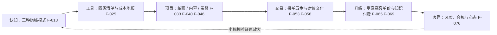

# 零基础AI实操赚钱项目教程（完整版）

> **状态：flagged**。本文是公开微信公众号文章的结构化学习稿，**不构成收益承诺**。原文全部 F-001～F-082 为单源内容，其收益类数字、报价区间与案例不可作为预期或基准；本束的核验快照时点为 2026-10-22。

这是 **AI 变现实操方法论知识包，不是源码教程，也没有可复现的 `examples/`**。按「操作可复现性两问」判定：原文给出了可照做的流程（头像三步与五步交付链 F-035、内容标准化四步 F-041、带货脚本公式 F-048、接单五步 F-053、交付七步 F-064），**但全文无工具版本号、无输入输出对照、无实测记录**，案例多为第三方转述，故第二问为「否」，不建立示例目录。

## 一张图读完全书结构



## 核心结论速览

1. **变现分三层**：卖时间差、卖信息差、卖产品化的结果（F-013～F-016）；通用技能定下限，垂直积累定上限（F-017、F-018）。
2. **风险前移是全文最一致的方法论**：先收钱再开工（F-035）、先收 50% 定金（F-063）、需求文字复述（F-064）、先用小单验证（F-067、F-074）。「小规模验证 → 放大」贯穿全部章节。
3. **卖结果不卖时间**（F-058）解释了通用服务为何陷入价格战（F-065）：报价锚点应落在客户获得的价值上。
4. **原文有三处必须修正**：橱窗门槛为三档而非单一 1000 粉（F-046 对 F-083）、Midjourney 商用权属与官方条款相反（F-078 对 F-085）、原文完全遗漏 AIGC 标识义务（F-084）与经营登记义务（F-088、F-092）。

## 核心概念

- [原文溯源与阅读指南](concepts/00-article-provenance-and-reading-guide.md)
- [认知模型与市场窗口：三种赚钱模式](concepts/01-mental-models-and-market-window.md)
- [工具箱与成本地板](concepts/02-toolbox-and-cost-floor.md)
- [AI 绘画与 POD 变现](concepts/03-ai-art-and-pod.md)
- [AI 内容账号变现](concepts/04-ai-content-account.md)
- [AI 电商带货](concepts/05-ai-commerce-video.md)
- [AI 服务接单](concepts/06-ai-service-orders.md)
- [定价与客户沟通](concepts/07-pricing-and-client-communication.md)
- [垂直行业与高客单价](concepts/08-vertical-industry-high-ticket.md)
- [知识付费与个人 IP](concepts/09-knowledge-products-and-personal-ip.md)
- [风险、合规与心态陷阱](concepts/10-risks-compliance-and-mindset-traps.md)
- [先验证再放大（可迁移模式）](concepts/11-verify-before-scale-pattern.md)

## 主题关联

- [AI 变现指南](../ai-monetization/index.md)：更宽的商业模式与实施框架；本束聚焦零基础实操路径与报价交付 SOP。
- [自动赚钱系统](../auto-money-system/index.md)：从自动化系统架构角度处理同一问题；本束从个人接单与内容经营角度切入。
- [个人变现方向发现方法论](../monetization-direction/index.md)：提供「自我盘点 → 候选生成 → 需求验证 → 决策启动」四步法，适合在选具体项目之前使用。
- [海外平台夜间副业](../overseas-freelance-night-work/index.md)：出海平台的费率、资格与验证框架；本束的 Fiverr / Upwork / PeoplePerHour 清单可与之对照。

## 已知边界

- **单源声明**：原文无脚注、无参考文献、无外部链接，F-001～F-082 全部为单源；第三方博主案例（F-033、F-075）与作者转述的市场观察（F-009、F-011）不具备可审计的核验链条。
- **不可作为收益预期**：F-009（门槛下降 90% 以上）、F-023、F-044、F-068、F-070 为作者量级示意与算术示例；F-036～F-066 的价目与 F-071 的产品阶梯为作者参考值，非行业均价。
- **原文缺失的硬约束（已在本束补入）**：《人工智能生成合成内容标识办法》第十条的主动声明义务，自 2025-09-01 起施行（F-084）；经营性卖家的市场主体登记义务与《网络交易监督管理办法》第八条「年交易额累计不超过 10 万元」的免登记边界（F-088、F-092）。
- **原文与官方相反的一条**：Midjourney 商用版权风险表述（F-078）与官方条款（F-085）实质相反，已重写。
- **快照时点**：平台规则与工具定价快照为 2026-10-22；`stale_after` 设为 2026-12-31，请以官方最新发布为准。

## 信源与核验

- [原文事实清单](references/article-source.md)：F-001 至 F-092 连续编号。
- [核验报告](references/verification.md)：P0 勘误四清单与 10 条核验信源。

```{toctree}
:hidden:
:maxdepth: 2

concepts/index
references/index
log
```
