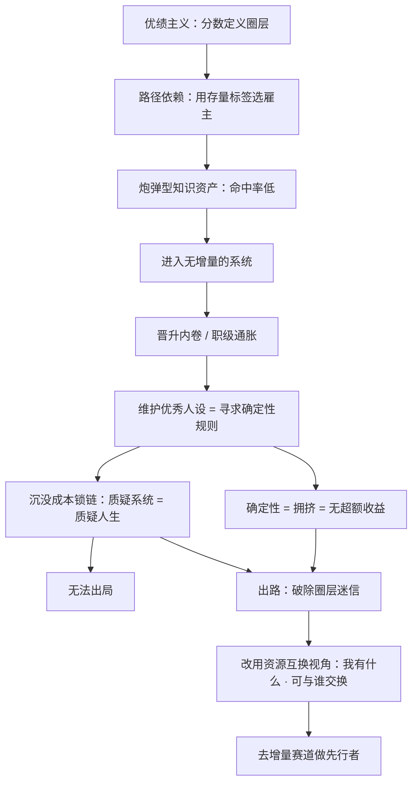

# 优绩主义、圈层迷信与资源互换：为什么人会选错系统

> 本篇回答的是[判据篇](00-pontzi-increment-judgement.md) 留下的问题：**知道该问"有没有增量"之后，人为什么仍然会选错系统、为什么明知无增量也不肯走？**
> 素材来自主文的圈层批判（F-037~F-046、F-059、F-060）与两篇子页面：S3《沦为牛马的名校毕业中产们》（知识资产的命中率）与 S4《一夜返贫的名校毕业中产们》（优秀人设与确定性规则）。
> **前置声明**：本篇的因果链是**编辑性重组**——原文三篇文章互不引用、论证各自分散，是编者把它们接成一条链的。文中凡属编者推断处均已标注。

## 一、因果链总览

| 环节 | 机制 | 来源 | 编号 |
|---|---|---|---|
| ① 学生时代 | 优绩主义把圈层定义为分数带，同圈层由分数筛选而成 | 主文 | F-016~F-021 |
| ② 路径依赖 | 选公司时把"选名气/排名/规模"当作"选大学"，即按分数线选雇主 | 主文 | F-022 |
| ③ 知识资产错配 | 寒窗 16 年储备的是"炮弹"——命中率极低的通用知识，能命中市场需求的不足 5% | S3 | F-095、F-096 |
| ④ 确定性陷阱 | 确定性规则（考试范围、KPI）让人能维持"优秀人设"；而确定性意味着谁都赚不到大钱 | S4 | F-120、F-121、F-122 |
| ⑤ 沉没成本锁死 | 归因错误（不够努力）+ 系统自动辩护使人无法出走 | 主文 | F-032~F-036 |
| ⑥ 替代答案 | 真实圈层 = 资源互换结构；决策依据应是"我有什么、可与谁交换" | 主文 | F-042、F-044、F-047、F-059、F-060 |

> 这条链的可检验内核是：**优绩主义是"选错系统"的起点，而确定性规则是"走不出系统"的机制。** 原文只分别写了①与④，②③⑤⑥分布在三篇文章中——把它们连起来是本篇的编辑工作，原文未做此论证。

## 二、① 优绩主义如何定义圈层

| 编号 | 原文主张 | 类型 |
|---|---|---|
| F-016 | 提问者"向下走"的根源是学生时代被长期灌输的优绩主义 | 作者观点 |
| F-017 | 中考全市前 10% 可考省重点，高中前 5%~10% 可考 985/211 | 原文数据主张（**有误，见 E-01**） |
| F-018 | 学生的圈层由考试分数决定，因为日常交往的同学考试水平必须相近 | 作者论证 |
| F-019 | 优绩主义在学生时代没问题，因为中考高考主要在同龄层展开 | 作者观点 |
| F-020 | "90 年的和 95 年的，考入 985 的难度差不多" | 原文数据主张（**须带限定，见 E-01**） |
| F-021 | 一旦把优绩主义视角代入毕业后的社会，就会出大问题 | 作者观点 |

**核验后的修正（必读）**：

- **E-01（硬错误）**：原文把 985 与 211 合并为"前 5%~10%"一个分数带。实际 985 录取率约 **1.9%**（对应位次约前 2%）、211 约 **5.2%**（约前 5%），两类院校分数带不同。**正文须写明是两类院校合并，原句不可直接引用。**
- **F-020（须带限定）**：录取难度随年份波动，不存在"两个年份难度差不多"的稳定关系，不能作单调趋势陈述使用。

值得注意的是 F-019 这一句本身是**有洞见的**：作者指出优绩主义之所以在学生时代成立，是因为同年龄层筛选使得"分数=能力=圈层"三者同向。这恰好解释了为什么它一旦跨到职场就会失效——**筛选维度从"同年龄同水平"变成了"同行业同岗位"，分数不再能代表同层级位置**。

## 三、② 路径依赖：把"选大学"规则错搬到"选雇主"

| 编号 | 原文主张 | 类型 |
|---|---|---|
| F-022 | 因路径依赖，毕业生选公司在同工资水平上选名气、排名、规模，如同高考按分数线选大学 | 作者论证 |
| F-023 | 公司这种组织，本质是庞氏结构，与高考录取完全不同 | 作者观点（**类比，见 E-13**） |
| F-024 | 庞氏结构中获利的关键是源源不断的后来者 | 作者观点 |

F-022 是整条链的枢纽：它说明**人并没有在一个错误系统里做了错误决策，而是把一套在另一语境下正确的规则搬过来用了**。这正是[判据篇](00-pontzi-increment-judgement.md) 里 Q1（增量）之所以容易被跳过的原因——招聘广告里给出的排序键（名气、排名、规模）恰好全部是**存量指标**，而增量是流量指标，二者在信号上无法互换。

> **编者补充（原文未写）**：F-022 到 F-023 之间缺一个论证——"高考按分数线排序"与"雇主按名气排序"其实共享同一个结构（**用可见的存量标签替代不可见的增长潜力**），而高考的特殊性在于它的排序键与兑现机制**同源**（分数高的学校确实提供更好的教学资源）。当雇主的名气与个体的成长兑现**不同源**时，规则就失效了。这个补充属编者推断，不是作者主张。

## 四、③ 知识资产的命中率：炮弹与导弹

S3 是本篇的方法学前传，它把"选错系统"的责任从环境推回个人：**进入系统之前，携带的弹药类型就已经决定了上限**。

| 编号 | 原文主张 | 类型 |
|---|---|---|
| F-092 | 导弹发明前战争胜负由炮弹数量决定，因为命中率极低，需大幅提升数量才能确保命中 | 作者论证（类比） |
| F-093 | 英德日德兰海战炮弹命中率仅 2%~3%；二战日美海战日舰炮弹命中率 2.81% | 原文数据主张（**教科书数据，未标出处，见核验第 17 项**） |
| F-094 | 1982 年马岛战争飞鱼导弹实战命中率 88%，决胜因素从堆炮弹数量变为精确制导能力 | 原文数据主张（同上） |
| F-095 | 名校毕业学子寒窗 16 年后被称为一张白纸，因为这 16 年储备的知识都是炮弹，能命中市场需求的可能不到 5% | 作者观点 |
| F-096 | 数学四点共圆、物理阿基米德、化学硫化氢气味等知识，去大厂做研发或面向市场创业都无法变现 | 原文例证 |
| F-097 | 大量储备低命中率炮弹的原因是高考；一旦进入 985 名校，高考不再是约束，应立即按目标转变人生框架 | 作者观点 |
| F-098 | 若只想赚钱，应把战略调整到精确制导、只学与赚钱有关的知识，通过市场反馈持续构建精准命中需求的导弹知识体系 | 作者建议 |
| F-099 | 刘强东与王庆根相差 2 岁、同一时代；刘强东大学起持续在市场上接项目做项目，大三已能买得起大哥大，大四饭店生意虽失败但积累了市场一线经验 | 原文例证（**个案，不可核验**） |
| F-100 | 更多名校生因中学路径依赖被动跟着课程安排与硕博体系走，而这些是与市场严重脱节的炮弹知识 | 作者观点 |
| F-101 | 真正有用的赚钱知识都不公开不流通，需要深入市场一线才能拿到；理科博士所学可能比张雪峰掌握的更难，但变现效率相差几十上百倍，因为后者命中的是考生家长需要的知识 | 作者观点 |
| F-102 | 大多数名校生意识不到这一点，直到毕业多年后遭遇 40 多岁中年危机才发现来不及；牛马的结局从一开始就已注定，只是结果很久才显现 | 作者观点 |
| F-103 | 孙悟空大闹天宫的本事学自菩提祖师，祖师先后让他学道字门、流字门、静字门、动字门，他只问"可得长生么"，不能长生就不学 | 原文引述 |
| F-104 | 每个弟子都是祖师教什么就学什么，也不敢问能不能赚钱；学了一堆炮弹知识只获得硕博名头，却把最富创造力的 10 年搭了进去 | 作者观点 |
| F-105 | 真正有价值的赚钱知识不会在公开领域免费流通，只能以自己为主，根据试错和市场反馈一点点构建自己的导弹知识体系；方法论不重要，重要的是开始意识到这一点 | 作者建议 |
| F-106 | 家长问上海交大某专业与清华某专业怎么选、本科西安交大与同济怎么选，作者认为不重要，重要的是学校的知识脱节、排名毫无意义 | 作者观点 |

**核验后的处置**：

- **核验第 17 项**：F-093/F-094 的命中率数字属**教科书常见数据**，但原文未标注具体书目，无法回溯核验。正文引用须降级为"作者引用的教科书数据"，**不得写成已核验事实**。
- **F-095 的"不到 5%"**：属作者估算，无统计口径，**不可作定量结论**；可保留的定性内核是"通用知识与变现需求之间存在显著命中率差"。
- **F-099、F-103**：前者是**个案**（无法核验，且叙述带明显倾向）；后者是**《西游记》情节**（文学文本，非史实）。两者都只能作为修辞支撑，不能作为证据。
- **F-101 的"几十上百倍"**：无出处，标单源。

**这篇最有价值的一句是 F-097**：它把"何时该换框架"锚定在一个可观测事件上——**约束条件消失的那一刻**。当高考从约束变成过去式，继续沿用"为考试而积累"的策略就不再有回报。这与[判据篇](00-pontzi-increment-judgement.md) 的 Q1 同构：**先识别约束条件，再决定是否切换框架**。

## 五、④ 优秀人设与确定性规则（S4 的核心）

S4 补上了[判据篇](00-pontzi-increment-judgement.md)第五节沉没成本锁链的**对侧机制**：不是"付出太多所以不肯走"，而是"不付出就无法维持自我认知"。

| 编号 | 原文主张 | 类型 |
|---|---|---|
| F-107 | 如何对有钱人祛魅？答案很简单——知道那些有钱人大部分能力都不如你 | 作者观点 |
| F-109 | 即便名校毕业的大厂从业者已内卷到极致，不理解财富自由达成的底层方法论，一切都是无用功；面临中年失业导致一夜返贫也不是不可能 | 作者观点 |
| F-110 | 核心方法论：必须清楚意识到人类大脑算力存在一个极难发现的 bug，补足该 bug 后才能去卡竞争者的 bug | 作者观点 |
| F-111 | 不需要比竞争者聪明，因为大多数学业上的聪明人在未经提点下不会意识到这个 bug | 作者观点 |
| F-112 | 把大脑比作计算机：CPU 强、硬盘大，但运行内存极小；高维思考者要先补足内存小的 bug 扩展运算能力 | 作者论证 |
| F-113 | 计算六位数乘五位数，即使考进清华北大的学生也没法心算，必须依赖草稿纸列竖式充当虚拟内存 | 原文例证 |
| F-114 | 到了社会上，事业进取需要更多中间数据、更多中间迭代版本、更多中间反馈；若没有"大脑内存极为有限"的清晰认知，就会被卡在忙而不富的恶性循环 | 作者观点 |
| F-115 | 引"第 10 名现象"：成绩处于第 10 名而非第 1 名，更能在事业上成功；作者称这是普遍现象，但背后的逻辑没有什么理论能说清 | 原文引述（**单源，无出处，见下**） |
| F-116 | 第 1 名的"追求完美"妄念只有在被上位者设计好的规则中才能满足，于是永远走不出上位者的规则体系 | 作者观点 |
| F-117 | 第 1 名同学做产品会读书、调研、请教前辈、汇总信息以设计完美产品，如同妄图用心算算出多位数乘法；惊艳产品必经大量市场反馈与无数次中间产品迭代 | 作者论证 |
| F-118 | "能一次性拿出结果的，是神，不是人。" | 作者观点 |
| F-119 | 第 1 名陷入误区，是因为在刻意维护那个只有他自己相信、其实并不存在的"优秀人设" | 作者观点 |
| F-120 | 什么样的环境才能维护住那个并不存在的"优秀人设"？答案是确定性的规则——高考考试范围确定，职场每半年或每年的 KPI 确定、清晰、可达成 | 作者论证 |
| F-121 | **致富悖论**：凡是确定的东西，就意味着你不可能赚到大钱，因为一旦有确定性，就有无数竞争者涌入，最后卷到谁都赚不到钱 | 作者观点 |
| F-122 | 第 1 名为了维护"优秀人设"，必然寻求上位者的确定性规则（如职场年度绩效），从而被锁死在又卷又赚不到钱的确定性赛道中 | 作者观点 |
| F-123 | 人到中年不再具备性价比时被裁员导致一夜返贫，那个由上位者虚构出来的"优秀人设"才终于无法维持；这一切早已注定，只是结果要过很久才显现 | 作者观点 |
| F-124 | 需打破的第一个认知惯性：很多人打算先在确定性的职场里做积累、准备好了再出来自己干；除打工积累的保生活下限的钱外，根本不存在"准备好了"的临界点，把逻辑依赖顺序搞反了 | 作者建议 |
| F-125 | 想在职场做好准备，无异于想用心算算出多位数乘法；P9 职级并不会比 P7 哪怕多出一分毫的创业加成 | 原文例证 |
| F-126 | 第二个认知惯性：太在意他人目光和评价，每天精力被绩效考核和同事评价牵着走；只有打破"优秀人设"、不再试图获取他人良好评价，焦虑感才能彻底消失 | 作者建议 |
| F-127 | 将军赶路，不追小兔；不进入他人的评判体系，就不期待他人认可，也不畏惧他人否定 | 原文例证 |
| F-128 | 一位 95 后女性创业者每天从早忙到晚、双休日也不休息但很快乐；作者称两三年几十单一对一咨询中大家感受类似——粗糙的商业模式下赚钱时，有太多可改进可迭代的事，会把休息时间自然填满，营收也一路新高 | 作者观察 |
| F-129 | 在职场上能做到尽善尽美并拿高绩效，真实原因是被锁死在确定分工上，不像创业者要面临铺天盖地的问题；所以事业类提问的本质是提问者根本遇不到任何问题，无从开始 | 作者观点 |

**F-121 是本篇最锋利的一句**：**确定性 = 拥挤 = 无超额收益**。这条与判据篇的 Q1 严格互补——Q1 问"分母还在不在长"，F-121 问"进入门槛是不是所有人都能通过"。两者都是同向的：**结构性地可预测的机会必然被竞争摊薄。**

**F-115 的处置（必读）**：作者称"第 10 名现象"是普遍现象，且自述"背后的逻辑没有什么理论能说清"。这是**单源主张**：

- 没有任何研究或统计支持"第 10 名比第 1 名事业更成功"；
- 作者自己承认其机制无理论支撑；
- "名次"本身就是**优绩主义框架内的指标**，用它来批判优绩主义存在框架自指的问题。

因此正文只保留其**类比结构**（追求一次性完美结果会挤压中间迭代的次数），**不保留其普遍性主张**。可用的一句话是 F-118："能一次性拿出结果的，是神，不是人"——它说明**迭代次数**而非天赋才是决定性变量。

**F-128 是全包中少见的"正面证据"**：它给出了同一作者在别处的自述——商业创业者更忙但更快乐。这与[第三篇](03-industry-analysis-playbook.md)中"防负债"的结论构成同一策略的两面。

## 六、⑤ 真实的圈层：资源互换结构

| 编号 | 原文主张 | 类型 |
|---|---|---|
| F-037 | 最重要的，是破除"圈层迷信"；破除后才能找回主动性，而不是觉得离开庞氏系统就是降级 | 作者建议 |
| F-038 | 圈层在学生时代以分数为区分维度、在同学圈成立，到了社会就完全不符合社会真实；社会讲究的是互相需要和资源交换 | 作者观点 |
| F-039 | 社会上所说的圈层一般用财富等级表示，如 A8（千万级）、A9（亿级） | 原文例证（**术语须降级，见 E-10**） |
| F-040 | 最爱把圈层挂嘴边的是卖私董会名额、卖酒局、卖游学、卖野鸡协会会籍的；这本质是营销概念，因为你想发财，所以用财富圈层概念来割你 | 作者观点 |
| F-041 | 把一群互不相识、行业无关、共同点只是都愿意交 10 万会费的人叫到一起吃饭，你会付钱吗？包装成"突破认知边界、链接 A9 高净值圈层"，10 万会费就显得物超所值 | 原文例证 |
| F-042 | 真实的圈层建立底层逻辑一定是互相需要，核心本质在于资源互换，而不在于财富等级 | 作者观点 |
| F-043 | 企业主的圈子里有供应商和客户；投资人的圈子里有创业者、律师和审计；医生的圈子里有同行、医药代表、药械公司 | 原文例证 |
| F-044 | 同一圈子里要能力互补才能互相需要、资源不同才能互相交换；有人有钱、有人有技术、有人有产品、有人有渠道；这些和名校出身以及财富等级没有半毛钱关系 | 作者观点 |
| F-045 | 深入到和你不一样的人当中去，通过交易、通过资源互换迅速提升财富；而不是跟一群和你一样的人在庞氏系统里用 996 苦力榨干自己 | 作者建议 |
| F-046 | 你是 A9，别的 A9 就是竞争对手，而你要找的是充满干劲和热情、有技术的年轻人 | 原文例证 |
| F-047 | 985 出身的小镇做题家，拥挤的大厂赛道必然成为前途坟墓；要评估的是"你有什么，可以和谁交换" | 作者观点 |
| F-059 | 并不存在一个能根据人的能力和财富自动打分并构建同一圈层的"自动打分机"；所有人的社交圈围绕自己的上下游和利益交换结构而诞生，与财富等级无关 | 作者观点 |
| F-060 | 真实的社会逻辑应把你想象成一个猎手，利用自己的优势去寻找商业世界的交换机会 | 作者观点 |

**E-10（术语降级）**：A8 / A9 确为中文互联网通行的财富分级俗称，但属**民间自造分级**，非监管或权威财富标准，不可当作品级事实引用。

### 6.1 与经典社会资本理论的对应关系（编者补充）

**本节是编者补充的外部理论对照，不是原文内容，也未纳入 F 编号台账**——原文并未引用任何学术理论。但四视角审查的"魔鬼代言人"视角指出：「圈层 = 资源互换」是通用人际常识，非作者原创洞察（见[核验报告](../references/verification.md)第五节）。为免读者把常识当洞见，此处标明对应关系：

| 作者主张 | 对应的经典理论 | 说明 |
|---|---|---|
| F-042/F-044：真实圈层建立在互相需要与资源互换上 | **Bourdieu 社会资本理论**（《社会资本的形式》，1986） | Bourdieu 区分了 bonding（同质群体内部的封闭资本）与 bridging（跨群体的桥接资本）。作者主张的"往和你不一样的人那里去"（F-045）正是 bridging 型社会资本的获取路径 |
| F-152/F-153：对你有用的人往往不是每天一起工作的同事 | **Granovetter 弱连接理论**（《弱连接的力量》，1973） | Granovetter 提出：信息与机会通过"弱连接"（不常互动但跨越圈层）传播，因为强连接的信息高度重合 |
| F-059：不存在按能力与财富自动分层的"自动打分机"，社交圈围绕上下游交换结构诞生 | **Bourdieu 社会资本** + **经济交换理论**（Homans, 1958） | 交换关系在结构上先于"圈层"标签；标签是交换结构的表象 |

**这张表的用途是划定贡献边界**：作者的**独特之处不在于"圈层是资源互换"这个命题本身**（该命题至少可追溯到 1950 年代），而在于**把它接到"增量判据"上**——即用"谁与你互补、谁与你竞争"来识别一个系统是否还有增量可分配。

### 6.2 弱连接在再就业中的具体形态（S5 的补充）

S5 提供了资源互换在个人层面的可操作版本：

| 编号 | 原文主张 | 类型 |
|---|---|---|
| F-152 | 对文凭失效的中年人，最强的市场信号在于有人脉给你背书——陌生雇主不信你的简历，但他信他认识的人说"这人靠谱" | 作者观点 |
| F-153 | 反常识点：对你越有用的人往往不是每天在一起工作的同事，而是和你关系不太近的同事（如研发最有用的是运营、商务拓展）；因为和你每天一起工作的人圈子高度重合、能介绍的机会你大概率也知道，新机会往往在那些不太熟的人手上 | 作者观点（**⚠️ 出处缺失，见下**） |
| F-154 | 对方的好感往往基于你的代价而非对他们的绝对帮助量——大富豪捐几亿你毫无感觉，节俭同事捐一千你会觉得他道德高尚；职场中产品经理改需求时说"举手之劳几分钟就改好了"会有接不完的变更，说"这个很难、要全代码排查，但今天一定帮你改好"并深夜 12 点告知，对方不但感恩以后也会掂量 | 作者观点 |

> **F-153 的处置（必读）**：作者称"过去有人做过数据统计并已证实"，但**因篇幅不展开，未给出任何出处**——既无研究者、机构、年份，也无数据表。检索亦无独立佐证。因此：
> - **可以引用的是结论方向**：机会更可能来自圈层不重合的人；
> - **不可以引用的是统计强度**："有人做过数据统计"这层背书在本知识包中按**单源**处理，读者若要据此做决策，应自行用 LinkedIn/脉脉等渠道做本地验证；
> - **本文档不把它算作已核验的支持证据**。

**F-154 是本篇最容易被忽略但最可落地的一条**：它把"资源互换"从"去找互补的人"细化为"**让对方感知到你的代价是真实的**"。这与 F-045/F-060 的"猎手"形象互补——猎手不是索取者，而是**能提供对方难以自行获得之物的人**。低成本的帮助不构成交换信号，因为对方不需要付出任何东西。

## 七、④ 与 ⑥ 的闭环：为什么"人设"必须先被打碎

把第五节（S4 的确定性陷阱）与第六节（资源互换）放在一起，得到本篇的最终闭环：

**关键在于顺序**：不能先谈"心态"或"勇气"。F-124 说得准确——**不存在"准备好了"的临界点**（作者的话是"把逻辑依赖顺序搞反了、本末倒置"）。正确顺序是：**先有新的判据（增量、资源互换）→ 再有新的行动（去哪个赛道、跟谁交换）→ 最后人设才会松动**。这与[判据篇](00-pontzi-increment-judgement.md)的 Q1→Q2→Q3 顺序是同一条纪律。

## 八、不可迁移边界

| 边界 | 说明 |
|---|---|
| **不是"反名校"** | 作者的主张是"名校知识与市场脱节"（F-100、F-106），而非名校本身无价值。F-098/F-105 的处方是"按赚钱目标重新构建知识资产"，不是否定学历 |
| **炮弹-导弹类比不可量化** | 命中率数字无出处；"不到 5%"是估算。类比可说明结构，不可作换算工具 |
| **第 10 名现象不可作普遍主张** | 无研究支持，且框架自指（用优绩指标批判优绩主义） |
| **弱连接结论缺出处** | F-153 的统计背书缺失，只能作方向性参考 |
| **资源互换的成立前提是存在互补性** | 若目标域内所有人都能提供相同资源，则"资源互换"退化为零和竞争，此时应回到[判据篇](00-pontzi-increment-judgement.md)的 Q1 换赛道，而非换人脉 |
| **系统性单源** | 本篇三部分材料（主文 / S3 / S4 / S5）出自同一作者的连续输出，机制层可迁移，数据层与个案不可迁移 |

## 相关文档

- [判据篇：广义庞氏结构与增量判据](00-pontzi-increment-judgement.md)——本篇的前置条件（先有 Q1/Q2/Q3 三问）
- [第三篇：蓝海赛道与成本结构打穿法](02-blue-ocean-cost-structure.md)——把 Q1 用在行业选择上
- [原文事实清单](../references/article-source.md)：F-001~F-196 双份登记之一
- [核验报告](../references/verification.md)：22 项 P0 结论、23 条入库必标勘误
