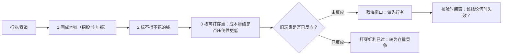

# 蓝海赛道与成本结构打穿法：新技术如何制造时间差

> 本篇把[判据篇](00-pontzi-increment-judgement.md)的 Q1（有没有增量）落到**行业选择**上：增量从哪里来、怎么识别、什么时候会消失。
> 素材来自主文的蓝海段（F-050~F-057）与办法段（F-055、F-056）。
> **本篇的方法论内核可用，四个例证的数据层几乎全部有口径问题**——读者若照搬"某某行业已被打崩"的说法，会在错误前提上做决策。

## 一、作者的定义

| 编号 | 原文主张 | 类型 |
|---|---|---|
| F-050 | 创业路径：要远离行业红海（如餐饮、奶茶），利用一切最新出现的技术去打崩老登摊子；新技术应用领域全是蓝海 | 作者建议 |
| F-051 | 蓝海赛道的本质不是某个赛道天降黄金，而是**新技术把旧行业的成本结构打穿以后，旧玩家还没有反应过来的时间差** | 作者观点 |
| F-052 | 四个打崩案例：电商打崩了传统快消渠道；直播、流媒体打崩了卡拉 OK、夜场等本地娱乐；新媒体打崩了报纸电台电视台等传统媒体三件套；AI 短剧打崩了传统短剧 | 原文例证（**四条均有口径问题**） |
| F-053 | 判据：判断任何一个行业是否值得做，要先问「**哪些钱是因为过去技术做不到，才不得不花的**」；如果你能大幅降低其中一个关键环节的成本，你就有机会 | 作者建议 |
| F-054 | 新技术是人人都知道的明牌，而只有那些深入剖析了行业的成本结构和商业闭环流程的人群，才能拿到结果 | 作者观点 |
| F-055 | 两个办法：① 阅读感兴趣行业的典型公司的招股书和年报、阅读行业券商研报，理解产业链与赚钱链条如何运转；② 利用 AI 这个「对任何行业的商业逻辑和成本结构都非常了解的助手」剖析行业 | 作者建议 |
| F-056 | 作者提及去年初在知识星球写过一篇如何用 AI 快速剖析行业的文章，指引读者查看 2025 年 2 月精华区 | 元信息（**外部不可得**） |
| F-057 | 结论：小登行业是新型交易结构的重构和诞生地，暴利诞生于新的交易结构；否则会沦为老登庞氏的接盘者而不自知 | 作者观点 |

**E-11（理论归属，必读）**：「新技术打穿旧行业成本结构 → 时间差」这一表述是 **Blue Ocean Strategy 的「价值创新」与 Christensen 破坏性创新的通俗转述，不是作者原创**。引用时须标注理论出处，否则会把学术概念当个人洞见。同理，**E-12**：「哪些钱是因为过去技术做不到才不得不花」（F-053）是**作者的判据**，可作方法使用，但**不得称行业共识**。

> **本篇的贡献边界**：作者的原创贡献是把"成本打穿"与"增量判据"连起来——即**新技术的价值不在技术本身，而在它制造的旧玩家反应时间差，而这个时间差会自动关闭**。F-054 说"新技术是人人都知道的明牌"，等于承认：明牌本身无价值，**只有识别出旧行业成本结构中的"不得不花的钱"，明牌才变成机会**。

## 二、四个打崩案例：逐条核验后的正确表述

这是本篇最重要的一张表。**原文的四个案例是全文传播度最高、也最容易被误引的部分**——四条里三条有口径问题、一条是硬错误。

| # | 原文表述（F-052） | 核验结论 | **正文应呈现的正确表述** | 勘误 |
|---|---|---|---|---|
| 1 | 电商打崩了传统快消渠道 | ⚠️ 口径夸大 | **实为份额迁移，不是渠道崩塌**：尼尔森 IQ 口径下线下快消仅约 **-0.7%**，线上份额上升、线下份额下降 | E-06 |
| 2 | 直播、流媒体打崩了卡拉 OK、夜场等本地娱乐 | ⚠️ 口径错配 | 相关降幅为较 2019 年**累计 -40%**（不是同比）；且文旅部口径下仍有约 **6.0 万处场所、430.4 亿元营收**；「**夜场 ≠ KTV**」，两类场所被混为一谈 | E-07 |
| 3 | 新媒体打崩了报纸电台电视台等传统媒体三件套 | ✅ 方向成立（修辞简写） | 传统媒体**五类**广告合计约 **604.0 亿元、同比 -16.9%**；「三件套」是简写，实际涉及五类 | E-08 |
| 4 | AI 短剧打崩了传统短剧 | ❌ **硬错误（口径）** | 成立范围限**真人实拍生产端**：开机量下滑约 **3/4**、片酬腰斩、AI 微短剧占上线量 **>95%**；但**短剧总供给与投放量反而暴涨**——「打崩」不成立于总量层 | E-09 |

### 2.1 从四条案例中真正抽得出的判据

四条案例的**修辞形式**（"新技术打崩旧行业"）几乎都站不住，但它们指向的**共同结构**是成立的：

> 新技术不是"摧毁"旧行业，而是**在旧行业成本结构的某个环节上制造出一个更低的替代方案**，旧行业的产能因此从"有需求"变成"有需求但不再盈利"。

用第 4 条最能说明：AI 微短剧没有让短剧需求消失（总供给与投放量反而暴涨），它只是让**真人实拍的生产成本**失去竞争力。所以准确的说法不是"AI 短剧打崩了短剧"，而是"**AI 微短剧打崩了真人实拍短剧的生产端**"。

**这就是本篇的核心判据，也是 F-053 的精确版本**：

> **打穿 = 在旧行业成本结构的某一个具体环节上，出现了一个成本低到让该环节无法盈利的替代方案。**

它的三个必要条件：

1. **存在一个"不得不花的钱"**——旧玩家在现有技术下必须花这笔钱（F-053）；
2. **新技术能把这一环节的成本降到旧玩家无法承受**（不是"更好用"，是"成本量级不同"）；
3. **旧玩家的资产与流程无法快速迁移**（这才是时间差的来源，也是它会关闭的原因）。

### 2.2 时间差为什么会关闭

F-054 说"新技术是人人都知道的明牌"，这句话里藏着一个重要推论：**明牌意味着时间差必然被压缩到有限长度**。作者在 F-050 说"新技术应用领域全是蓝海"，但这句话在时间维度上是错的——它只在**新技术刚出现、旧玩家尚未反应**的那段窗口内成立。

因此本篇补一条**编者补充的判据（原文未写）**：

> **蓝海不是"新技术领域"这个静态标签，而是"技术出现"到"旧玩家完成反应"之间的动态窗口。**

判读要点：

- 判断一个赛道现在是不是蓝海，要问的不是"这个赛道新不新"，而是"**旧玩家是否已完成成本结构改造**"；
- 一个已经被打穿的赛道，最好的位置不是"跟着新技术走"，而是"**去旧玩家还没改造完但已经开始改造的环节里做服务**"——这恰好也解释了 F-043 说的企业主圈子里有供应商和客户。

> **编者补充的边界**：这一段是编者从 F-050 / F-054 推出的，原文未做此论证，属待验证假设。

## 三、F-053 的判据化：从一句提问到一张成本清单

F-053 原文是一句话："哪些钱是因为过去技术做不到，才不得不花的？"要把它变成可执行动作，需要把它拆成**三个可查的环节**。

| 步骤 | 动作 | 对应资源 | 备注 |
|---|---|---|---|
| ① 画出成本链 | 找出这个行业从"投入"到"交付"的完整环节序列（上游 / 生产 / 分销 / 售后） | 招股书「业务与技术」章节、年报「主营业务分行业/分产品」 | F-055 办法一 |
| ② 标出"不得不花" | 对每个环节标注：现有技术下**必须花这笔钱**吗？花了买到了什么？ | 同上 | F-053 |
| ③ 找可打穿点 | 对每个"不得不花"的环节问：新技术的成本量级是否低到该环节无法盈利？ | 同行新玩家的单份成本、公开报价 | F-051、F-053 |

**举例：某行业一个环节上的成本结构**

以原文的第 3 个案例（传统媒体）为例，按上表走：

| 环节 | 旧结构下的"不得不花的钱" | 新技术打穿点 | 核验后的实际结果 |
|---|---|---|---|
| 广告分发 | 报纸/电台/电视台的时段与版面采购 | 自媒体与信息流投放 | 广告额 -16.9%（同比），**结构转移而非需求消失** |
| 内容生产 | 自有编辑部、拍摄与印制的固定成本 | 自媒体与 AI 工具 | 供给侧成本大幅下降 |

**注意：这张表的第二列与第三列在旧行业里往往是同一个钱**——这正是"打穿"的技术特征：不是省掉一个环节，而是**用更低成本完成同一环节**。

### 3.1 F-055 的两个办法的可用性评估

| 办法 | 原文表述 | 可用性 | 处置 |
|---|---|---|---|
| ① 读招股书 / 年报 / 券商研报 | F-055 | **可用且有独立佐证** | 见[第三篇](03-industry-analysis-playbook.md)，有可照做的读表路径（巨潮资讯网 → 第九节财务报告），并含勘误 E-22 |
| ② 用 AI 剖析行业 | F-055、F-056 | **部分可用** | AI 的行业知识覆盖广但**成本结构数据通常不完整**（非上市环节的采购价、履约成本几乎不公开）。F-056 指向的知识星球文章属**外部付费内容、本包不可得**，无法核验其方法 |

> **对办法②的诚实提示**：原文称 AI「对任何行业的商业逻辑和成本结构都非常了解」（F-055）。这一表述**过强**——AI 能提供的是公开语料中的结构描述，而成本打穿判据恰恰依赖**非公开的成本细节**。正确用法是：让 AI 帮你列出成本链的**候选环节与可能的钱在哪**（广度），再用招股书、年报、供应商报价去**验证哪些环节真的存在那笔钱**（深度）。**顺序不能反**——直接采信 AI 给出的成本数字会重复本包已犯过的"单源数字升格"错误。

## 四、蓝海判据与 Q1 判据的对齐

| Q1 判据（判据篇） | 蓝海判据（本篇） | 关系 |
|---|---|---|
| Q1：分母（营收、岗位、用户、可兑现收益）在扩大还是缩小 | 蓝海 = 存在成本打穿点，旧玩家尚未反应 | **蓝海是 Q1 成立的机制解释**：为什么这个赛道的分母还在长——因为新技术正在替代旧成本结构，而替代还没完成 |
| Q2：兑现收益的人数/层级是否与增量同步增长 | F-053 的判据指向"能不能大幅降低其中一个关键环节的成本" | 兑现者的数量 = 愿意承担新成本结构早期亏损的先行者数量 |
| Q3：质疑系统时的第一反应 | — | 不适用 |

**关键区分（避免误用）**：

- **蓝海 ≠ 高增长行业**。一个行业可以高速增长但没有蓝海（增量来自渗透率而非成本打穿）；也可以有蓝海但短期不增长（新技术正在破坏旧成本结构，行业总量先萎缩）。
- **蓝海 ≠ 新技术行业**。F-050 说"新技术应用领域全是蓝海"，但这只在窗口期成立；窗口关闭后，**新技术行业自己会成为下一个"老登赛道"**，正如电商已成为传统品牌的默认渠道、AI 短剧已成为短剧的默认供给。
- **蓝海 ≠ 低竞争**。成本打穿点的竞争极其激烈，正因为机会可见（明牌）——F-054 说的正是这一点。

## 五、失效条件

这套方法有明确的失效场景，越界使用会得出错误结论：

| 失效条件 | 说明 | 依据 |
|---|---|---|
| **窗口已关闭** | 旧玩家已完成成本结构改造，打穿点不再是机会 | F-050、F-054 的时间维度推论 |
| **"不得不花的钱"并不存在** | 有些成本是**监管、信任、转换成本**造成的，不是技术做不到；新技术无法打穿这类成本（如金融风控、奢侈品品牌溢价、医疗信任） | 编者补充，原文未讨论 |
| **成本打穿但需求同步消失** | 技术替代可能同时消灭需求（而不只是降低成本）——此时是行业萎缩而非蓝海 | 第 2 节第 4 条案例的镜像 |
| **新增成本而非降低成本** | 有些新技术提高单位成本、降低总成本（规模化才成立），先行者需要忍受负毛利 | 编者补充 |
| **四个例证的强结论不可直接引用** | 全文传播度最高的"打崩"表述有三条口径问题、一条硬错误 | E-06~E-09 |
| **理论归属** | "成本打穿 → 时间差"是价值创新与破坏性创新的通俗转述 | E-11 |
| **系统性单源** | 8 篇均为同一作者连续输出，判据层可迁移、数据层不可迁移 | 见[核验报告](../references/verification.md)四视角审查 |

## 六、一页纸速查

**三个必须同时回答的问题**（对应 F-051、F-053、F-054）：

1. 这个行业里**哪些钱是现有技术逼出来的**？
2. 新技术能把其中哪一环的成本压到**量级不同**（不是"更便宜一点"）？
3. 旧玩家**改造完成本结构需要多久**——这个窗口还剩多久？

## 相关文档

- [判据篇：广义庞氏结构与增量判据](00-pontzi-increment-judgement.md)——Q1/Q2/Q3 三问的来源
- [第一篇：优绩主义、圈层迷信与资源互换](01-circle-superstition-and-resource-exchange.md)——为什么人会选错系统
- [第三篇：行业拆解与个人行动手册](03-industry-analysis-playbook.md)——F-055 办法一的完整落地路径
- [原文事实清单](../references/article-source.md)：F-001~F-196 双份登记之一
- [核验报告](../references/verification.md)：22 项 P0 结论、23 条入库必标勘误
