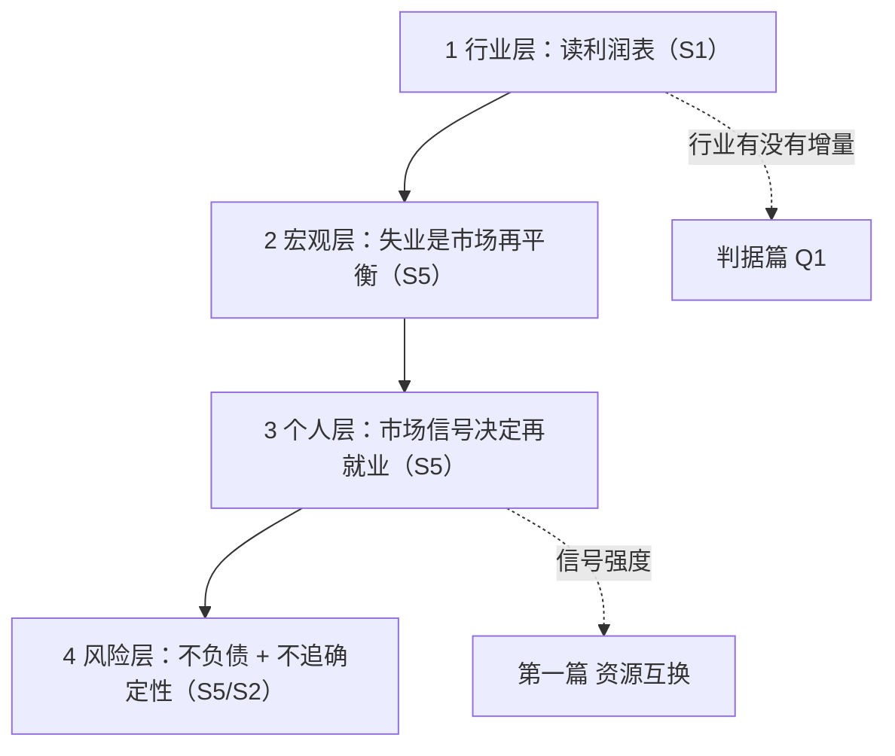

# 行业拆解与个人行动手册：读表路径、失业机制与市场信号

> 本篇是全包的**行动篇**：前三篇给判据，本篇给可执行清单。
> 素材来自 S1《利润表解析》（读表方法）、S5《裁员正在失控》（失业机制与市场信号）、S2《职场奋斗到终点》（职业收益上限）。
> **本篇的方法层可用，数据层几乎全是单源**——凡涉及失业规模、命中率、概率的原文数字，均已按[核验报告](../references/verification.md)降级。

## 一、四张表：从行业拆解到个人决策的链条

原文散落在三篇子页面里的方法，可以接成一条完整链条：

**为什么顺序不能反**：先有行业层的读数，才知道宏观层的裁员是"行业出清"还是"周期波动"；先有宏观层的位置，才知道个人层该发什么信号；最后才是风险层的底线选择。

## 二、① 行业层：利润表的读法

### 2.1 基本立场

| 编号 | 原文主张 | 类型 |
|---|---|---|
| F-062 | 财报最重要的三张表是资产负债表、利润表、现金流量表；读懂三张表是分析企业基本面的基础，也是估值的基础 | 作者观点 |
| F-063 | 利润表直接展示企业的盈利能力，也是重要指标 PE 中的 E（EPS）的来源 | 作者观点 |
| F-064 | 股票投资一定要获取第一手信息；若仅以互联网上汇总好的利润数据以及计算好的 PE、PB 等指标来估值，很容易掉进坑里，因为无法识别造假的公司 | 作者建议 |
| F-065 | 以当年最新的美的集团财报为例，从巨潮资讯网获得财报，下载后直接跳到第九节看财务报告 | 作者做法 |
| F-073 | 利润表在哪些行业不适用、常见财报作假手法识别放在下一期分享 | 元信息（**本期不可得**） |

**F-064 是本节的方法论内核，且完全站得住**：二手汇总数据（PE/PB 聚合表、财经门户的"利润榜"）的问题不只是滞后，而是**它们无法呈现口径**——同一个"营收"数字，可能来自合并报表、可能剔除了关联交易、可能改了会计政策（而利润表本身就在 F-070 提到研发费用 2018 年从管理费用移出这类口径变动）。

### 2.2 F-065 的可复现路径（这是全包唯一可照做的操作）

| 步骤 | 操作 | 产出 | 备注 |
|---|---|---|---|
| 1 | 打开**巨潮资讯网**（cninfo.com.cn） | 法定信息披露平台 | 中国证监会指定披露渠道，**一手信源** |
| 2 | 检索目标公司，找到最新一期定期报告 | 年报 / 半年报 / 季报 PDF | 无需第三方整理 |
| 3 | 下载 PDF，**直接跳到第九节「财务报告」** | 审计报告 + 三张表 | F-065 原文明确指出这个位置 |
| 4 | 先看**审计意见类型** | 风险排除的快速筛子 | 见 2.3 |
| 5 | 再按 2.4 的链条从利润表顶层往里拆 | 收入质量 → 利润质量 | |

> **为什么必须跳到第九节而不是直接找利润表**：因为先看审计意见是**成本最低的排除法**（F-067）——若审计意见不是无保留，后面的拆表工作就没有必要做。

### 2.3 审计意见：风控排除法及其口径修正

| 编号 | 原文主张 | 类型 |
|---|---|---|
| F-066 | 会计事务所从上市公司拿钱，一般不会揭发上市公司造假，但如果真发现造假痕迹，不敢顶着牌照风险说出「无保留审计意见」；审计意见类型共有五种 | 作者观点（**口径不完整，见 E-22**） |
| F-067 | 如果审计意见不是「无保留审计意见」，该公司股票可以直接纳入风控排除 | 作者建议 |

**E-22（口径不完整，必读）**：原文说"五种"，方向不误但不完整。中国注册会计师审计准则第 1502 号规定**非无保留意见为三种**（保留、否定、无法表示意见），加上无保留意见共 4 类；**证监会口径**将"带有解释性说明的无保留意见"单列，合计才是 5 类。

因此正文须写明采用哪一套划分：

| 划分口径 | 类别数 | 内容 |
|---|---|---|
| 准则口径（非无保留意见三种） | 4 类 | 无保留意见 / 保留意见 / 否定意见 / 无法表示意见 |
| 证监会口径（解释性说明单列） | 5 类 | 上述四类 + 带解释性说明的无保留意见 |

**F-067 的风控逻辑是可用的**：无论采用哪套口径，"非无保留意见 = 排除"这一筛选规则都成立——**因为它的触发条件是"不是无保留"，而不是"属于第几类"**。

**F-066 的机制陈述也成立**（审计机构与被审计方存在付费关系、存在牌照风险约束），但它是**机制性推断而非实证统计**，原文未给出数据。

### 2.4 利润表的自上而下拆解链

原文给的公式链（F-069、F-070、F-071）是标准结构，可直接照用：

| 层级 | 公式（F 编号） | 读什么 | 陷阱 |
|---|---|---|---|
| ① 收入 | 营业总收入 ≠ **营业收入**（F-068）；只有后者代表日常活动获得的营收 | 收入规模与口径 | 混用两个"营收"是常见误读 |
| ② 毛利 | 毛利润 = 营业收入 − 营业成本；毛利率 =（营业收入 − 营业成本）/ 营业收入（F-069） | **毛利率是行业属性**，跨行业比较无效 | 只看绝对毛利额会误判小规模高毛利生意 |
| ③ 营业利润 | 营业利润 = 毛利润 − 三费 − 资产减值 + 投资收益（F-070） | 费用结构与减值 | 研发费用 2018 年从管理费用移出（口径变动）；**资产减值与信用减值一般是公司操纵利润的重要手段**（F-070） |
| ④ 利润总额 | 利润总额 = 营业利润 + 营业外收支（F-071） | 营业外项目的规模 | 偶发大额营业外损益会掩盖主业 |
| ⑤ 净利润 | 净利润 = 利润总额 − 所得税（F-071） | 税负与一次性因素 | 需回到利润总额看 |
| ⑥ 归母 | **PE 用的是归母净利润**，差别在少数股东损益（F-071、F-072） | 估值口径 | 下面这条算例必须自己算一遍 |

**F-072 的算例（务必手算一次）**：

> A 上市公司利润 100 亿，持有子公司 B 的 80% 股份，B 公司利润 10 亿。
> 则 A 的归母净利润 = 100 亿 + 10 亿 × 80% = **108 亿**；少数股东损益 = 10 亿 × 20% = **2 亿**。

这个算例的作用不是记数字，而是校准一个直觉：**当母公司利润低于子公司利润时，归母净利润会高于合并净利润**。用合并净利润直接除以市值算 PE 会低估估值——这是很多"低 PE 股票"筛选结果的来源。

### 2.5 本节的边界

- **F-073 承诺的下期内容（利润表不适用的行业、财报作假手法）在本包中不可得**——这是**已知缺口**，不是遗漏；
- 公式链是通用会计结构，**不是**作者的原创方法；作者的贡献在于"先看审计意见、再拆利润表"的**顺序**与"必须用一手 PDF"的纪律；
- 原文未涉及资产负债表与现金流量表，尽管 F-062 提到三张表。本篇同样不展开。

## 三、② 宏观层：失业是市场再平衡

S5 提供了主文中"人到中年接到一封裁员的邮件"（F-036）的宏观解释。**这套解释在结构上完整，但其宏观推论未做数据验证**。

### 3.1 货币与债务的恒等式

| 编号 | 原文主张 | 类型 |
|---|---|---|
| F-132 | 远古时代没有一般等价物时，种地的用粮食与裁缝的劳动交换；可以给粮食、让他写欠条，欠条可在未来换取衣服 | 作者论证 |
| F-133 | 欠条就是对裁缝未来劳动的索取权；现代财富就是对社会产品和服务的索取权，即对他人劳动的索取权，所以欠条就是远古时代的货币 | 作者观点 |
| F-134 | 恒等式：你的财富总额（欠条总额）= 裁缝的负债总额；扩展到远古全社会，社会财富总额 = 社会负债总额 | 原文公式（**可直接引用**） |
| F-135 | 现代货币体系把欠条的生成与使用规范化：裁缝银行贷款 10 万，银行创造 10 万货币支付给农民，所有人的债务挂在银行，欠条（货币）由银行统一创造 | 作者论证 |
| F-136 | 新增任何一笔债务一定创造等额现金；归还一笔债务一定消灭等额现金；债务和现金分别挂在需求方和供给方，代表前者欠后者的劳动，像正负电荷一样同生同灭 | 作者观点 |
| F-137 | 你的存款就是你供给劳动和购买劳动的差额，本质是社会欠你的劳动；因此可以用存款索取产品和服务 | 作者观点 |
| F-138 | 简化恒等式（暂不考虑基础货币）：**货币总额 = 负债总额** | 原文公式（**可直接引用**） |
| F-139 | 如果每个人都希望向社会供给更多劳动、购买更少劳动以获取存款，多出的劳动必然无人购买，多余的劳动会被市场强制出清——这就是失业体量 | 作者论证 |

**F-134 与 F-138 是本包中少有的"可以直接引用"的原创公式**，因为它们是对既有记账恒等式的重述，逻辑自洽且不依赖任何未经核验的统计数字。

**F-136 是这套论证的枢纽**，也是最容易被误读的一句。它的严格含义是：**债务扩张 = 货币扩张，债务偿还 = 货币收缩**（这是现代货币体系的记账事实）。但需注意：

- 这是**总量恒等**，说明的是"债务与货币同增同减"，**不是**"发债一定导致物价上涨"；
- 从"失业 = 劳动供给出清"（F-139）到"因此应当制造货币"之间，原文没有做这一步推导，本包也不做补足。

### 3.2 四个劳动净需求引擎

| 编号 | 原文主张 | 类型 |
|---|---|---|
| F-140 | 四个劳动净需求引擎：① 净出口（获取外汇变为央行资产并发行等额基础货币，目前出口增长的主要支撑为 AI 产业链）；② AI 资本开支（为企业融资，消耗股市投资者的存款，变为 AI 企业上下游利润或 AI 企业打工人收入）；③ 中产买房；④ 财政赤字（居民和企业都不愿增债时由政府加杠杆创造等额现金，通过投资订单或消费国补变成收入） | 作者观点 |
| F-141 | 举例：工资每月 1 万、首付 30 万、购买 100 万的房子，等于购买 100 人月的劳动，其中 70 人月是净需求、以欠条方式用未来 30 年偿还；30 人月购买开发商上下游打工人的劳动，70 人月变为土地出让金，购买公务员劳动或政府订单承接商的劳动 | 原文例证 |
| F-142 | 只要中产始终处于净负债状态（债务 > 存款），他们就是社会财富的净供给方；他们越是负债，整个社会就越容易赚到钱 | 作者观点 |
| F-143 | 如何让中产愿意负债涉及房价上涨和货币贬值的信仰；只要信仰在，就有人心甘情愿背债维持庞氏；一旦信仰动摇，中产负债意愿度下降，中产如果开始化债，必然从劳动净需求方转变为净供给方 | 作者观点 |
| F-144 | 居民的存款要净增加，就需要他的劳动供给超过其劳动购买（劳动净供给），需要别人的劳动净需求来配平；如果居民减少消费而工资不变，则每个居民的劳动净供给就会变多，势必要求更多的劳动净需求 | 作者论证 |
| F-145 | 每年赤字率有上限、负债买房意愿低、中产缩表去杠杆后也转变为劳动净供给、出口增多则引发他国抗拒——当劳动净供给无法被消化时，多余的劳动供给只能以最市场化最惨烈的方式出清，那就是失业 | 作者论证 |
| F-155 | 五条总结：① 市场劳动净需求必然恒等于劳动净供给；② 国家增加赤字、增加出口、中产贷款买房都在提供劳动净需求，对冲和配平劳动净供给；③ 当居民预期不好减少消费就增加劳动净供给，无法被消化则部分劳动供给被挤出市场，这就是失业，是市场机制的再平衡和促进化债的必然方式；④ 既然劳动净供给十分充足，劳动价格就便宜、通胀很难发生，若无负债可借低物价享受他人劳动的充分供给；⑤ 若有负债且人到中年，再就业需要的市场信号取决于长期积累的人脉，而这取决于职场预期管理的方式 | 作者观点 |

**F-155 第 ③ 条是本节的论点核心**：失业不是意外，而是**再平衡的出口**。这条判断把"裁员"从一个道德问题（公司坏）转为一个**结构问题**（供需已失衡）。

**必须标注的边界**：

- 四个引擎的**相对权重**（哪个引擎当下在起作用、占多少）原文未量化，也未做数据验证；
- F-140 说"目前出口增长的主要支撑为 AI 产业链"——**属单源判断**，无可核验的分解数据；
- F-141 的"100 人月 / 70 人月 / 30 人月"是一个**示意性算例**（按 1 万月薪折算 100 万房价），不是统计；
- **F-145 的四个约束条件（赤字率上限、买房意愿、出口抗拒）都未给时点数据**，因此这条推演无法被读者独立检验。

### 3.3 一条关键的因果闭环

把 F-139、F-143、F-144、F-145 串起来，得到本节唯一真正有用的推论：

> **当居民停止负债买房（即从劳动净需求方转为净供给方），原先由购房需求吸收的劳动供给就会失去出口；这部分劳动供给最终以失业的形式被出清。**

这条推论的可迁移价值在于：它把"个人是否应该上杠杆"从个人财务问题，升级为**宏观需求侧的结构问题**——也正是[判据篇](00-pontzi-increment-judgement.md)里"居民杠杆率"作为校准链 A 的原因。**同一条杠杆率链，一头连着房价，一头连着就业。**

## 四、③ 个人层：再就业的市场信号

这是 S5 对个人最直接的部分，也是本包中**单源密度最高、但操作价值也最高**的部分。

| 编号 | 原文主张 | 类型 |
|---|---|---|
| F-146 | 建议一（保命秘籍）：不要负债——只要你不负债，由于劳动净供给十分充足，产能必然充足、物价必然便宜、通胀必然很难发生，即使失业也可以用较少的存款支撑你到退休 | 作者建议 |
| F-147 | 建议二：若已失业且有负债，「提升工作能力、考证报班学新技术」是完全错误的方向——再就业的卡点在于市场无法辨认你，再就业的决定因素在于你给予市场的信号，而非你的工作能力 | 作者建议 |
| F-148 | 引诺奖得主斯宾塞的「市场信号」概念：应聘者需要向老板提供一个非常有效的区分方法，让老板能把自己从平庸者中区分出来，而这个区分方法必须有一个核心特征——极高的伪装成本 | 原文引述 |
| F-149 | 经高考强制分层的名校文凭对应届生就是最完美的市场信号，但仅在毕业的前 5~10 年有效；毕业 20 年后这个信号失效，这时年龄、失业后的空窗期变成新信号，负面市场信号随年龄越大、空窗期越久而越大 | 作者观点 |
| F-150 | 举例：30 岁失业半年的招聘者可能脑补他在挑机会，而 45 岁失业半年的招聘者可能脑补被裁员是不是不好管、绩效差，半年找不到工作是不是能力差 | 原文例证 |
| F-151 | 失业后拼命报班考证变强是没用的，这么做的前提是基于有人在看你；而招聘者根据几个市场信号就把你筛掉了，根本就看不到你 | 作者观点 |
| F-152 | 对文凭失效的中年人，最强的市场信号在于有人脉给你背书——陌生雇主不信你的简历，但他信他认识的人说"这人靠谱" | 作者观点 |
| F-153 | 反常识点：对你越有用的人往往不是每天在一起工作的同事，而是和你关系不太近的同事（如研发最有用的是运营、商务拓展）；因为和你每天一起工作的人圈子高度重合、能介绍的机会你大概率也知道，新机会往往在那些不太熟的人手上 | 作者观点（**⚠️ 出处缺失**） |
| F-154 | 对方的好感往往基于你的代价而非对他们的绝对帮助量——大富豪捐几亿你毫无感觉，节俭同事捐一千你会觉得他道德高尚；职场中产品经理改需求时说"举手之劳几分钟就改好了"会有接不完的需求变更，说"这个很难、要全代码排查，但今天一定帮你改好"并深夜 12 点告知，对方不但感恩以后也会掂量 | 作者观点 |

### 4.1 F-148 的理论出处（核验通过）

核验结论：**"市场信号"（job market signaling）出自 2001 年诺贝尔经济学奖得主 Michael Spence 的研究**，Spence 本人的代表作是 1973/74 年的论文《Job Market Signaling》。F-148 的概念引用**准确**，这是原文少有的可溯源学术引用。

### 4.2 "伪装成本"是这一节真正的判据

F-148 指出有效信号必须具备"**极高的伪装成本**"。把这句话与 F-149~F-153 对齐，得到一张信号强度表：

| 信号 | 伪装成本 | 有效期 | 编号 |
|---|---|---|---|
| 名校文凭 | 极高（14~16 年） | 毕业前 5~10 年 | F-149 |
| 年轻 | 高（不可逆） | 短期 | F-149、F-150 |
| 无空窗期 | 高（不可逆） | 持续 | F-149、F-150 |
| **有可信的人背书** | 高（绑定他人信誉） | 持续 | F-152 |
| 技能证书 / 报班 | **低（花钱即可）** | 近乎无效 | F-147、F-151 |
| "我能力很强"的自述 | **零** | 无效 | F-151 |

**这张表是本篇最有迁移价值的产出**：它把"我该不该去考证"从一个消费决策变成了**信号经济学问题**——**伪装成本低的信号，在筛选环节会被自动折价甚至归零**。F-151 说得很直接：报班的前提是"基于有人在看你"，而招聘者已经在筛选阶段把你筛掉了。

### 4.3 F-153 的处置（必读）

作者称"过去有人做过数据统计并已证实"，但**因篇幅不展开，未给出任何出处**——无研究者、无机构、无年份、无数据。检索亦无独立佐证。

- **可引用**：结论方向——机会更可能来自圈层不重合的人；
- **不可引用**：统计强度——"有人做过数据统计"这层背书在本包中按**单源**处理；
- **本包不把它算作已核验的支持证据**。

> 讽刺的是，F-153 主张的"弱连接"机制在学术上有明确对应（Granovetter 弱连接理论），但**作者本人的引用方式（"有人做过统计"却不给出处）恰恰是他所批判的那种单源做法**。这正是本包做 P0 核验的原因。

### 4.4 F-146 的力度与风险

F-146 是全包中**最激进也最可操作**的建议：**不要负债**。它的论证链是：劳动净供给充足 → 产能充足 → 物价便宜 → 通胀难发生 → 即使失业也能用较少存款支撑到退休。

**必须补注的三点**：

1. **"物价便宜"是相对判断，不是绝对水平**——原文说的是"物价必然便宜、通胀必然很难发生"，指的是通胀率低，不是物价水平低；
2. **"支撑到退休"隐含了一个假设**：个人消费水平与社会供给能力同步。这要求个人的消费结构简单——若个人负债购买的是高息消费（而非可折旧的资产），去杠杆会同时摧毁其收入能力；
3. **原文未处理"无负债但无收入能力"的情形**：F-146 假定失业前的存款足够，但中年失业的典型痛点恰恰是"存款不多、负债不少"——那正是 F-147 讨论的场景。**F-146 与 F-147 是两个不同场景的处方，不应混用**。

## 五、④ 职业收益的上限与不可继承性（S2）

S2 提供了"留在职场向上走"这条路的**收益侧约束**，与[第一篇](01-circle-superstition-and-resource-exchange.md)的"路径依赖"形成成本—收益对照。

| 编号 | 原文主张 | 类型 |
|---|---|---|
| F-074 | 一年前（作者从蚂蚁金服离职半年后）一位做 BD 的老同事约饭并告知将离职；该同事太太在一家民企上市公司当 CEO | 作者经历 |
| F-075 | 转述：该同事太太已离职，因为工作强度太大，怀着第二胎仍每天工作到深夜一两点、周末也加班，公司所有事最终都汇报给她，365 天几乎都是随时待命，强度比其丈夫在蚂蚁更大 | 作者转述 |
| F-076 | 引王兴关于美团高管除睡觉 8 小时外都应想着公司、马云关于高管 24 小时属于公司的说法；高管给的钱多自然有很多人抢着扑上去 | 原文引述（**单源转述**） |
| F-077 | 所谓职业发展一定是越往上私人时间越少，直到最后完全没有了自己的时间；高管承受业绩压力和献出全年无休时间所换来的收益，作者「常常觉得是不值得的」 | 作者观点 |
| F-078 | 并不是每个高管都能在创业早期加入到一个未来的阿里、拿到丰厚原始股；每家上市公司核心高管的工资和股票激励其财报都有披露，并没有大家想象的那么高 | 作者观点 |
| F-079 | 引董明珠采访：那些做得不如她的家电同行情身都是她几十倍，因为她是高管不是大股东，而同行对手都是大股东；作者称董明珠已是高管中的天花板，属于最好的 0.1% | 原文引述（**单源转述**） |
| F-080 | 称从上市公司年报估算，更多的高管一辈子做下来能赚到的钱也就几千万体量（并称胡润报告算出的也是这个数字） | 原文数据主张（**单源**） |
| F-081 | 高管打拼下来的任何事业结果子女没办法继承——公司发展再好是老板和大股东的，大股东股权与控制权可父业子承，但高管职位不可以，高管赚到的只有现金流 | 作者观点 |
| F-082 | 几千万的财富体量在一线城市也不足以支撑多生孩子扩张和家族躺平，高管的子女依然要从大头兵干起 | 作者观点 |
| F-083 | 回到 90 后名校刚毕业年轻人的视角重新审视职业发展，最大优势是年轻、有充足时间和无限的可能性 | 作者观点 |
| F-084 | 引胡润报告：70% 的人靠创业，30% 的人靠炒房和炒股；靠在职场做到高管并赚到 1 亿「一个小目标」的不足 1% | 原文数据主张（**出处缺失，见 E-18**） |
| F-085 | 职级越往上工作越累私人时间越少，到了一定级别开始摸鱼；所以「我们不是怕吃苦，而是怕吃苦的背后没有相应的回报」 | 作者观点 |
| F-086 | 观察：在蚂蚁时看到刚入职的年轻人工作非常勤奋，代码提交时间常常是半夜两三点、周末也不休息；作者担心他们回忆起年轻时如果除了加班场景别的什么都回忆不起来，不知是否会后悔 | 作者观察 |
| F-087 | 自述：入职蚂蚁之初看到周围同事拼命工作就放弃了绩效和晋升；几年间所负责项目没出过任何问题，不但没有任何年份拿到垫底 3.25 的绩效，有的年份还能拿到股份激励 | 作者经历 |
| F-088 | 认知框架：朝九晚六职场打工赚钱可以，抓住顺周期和投资机会大赚一笔可以，创立一番事业也可以 996 强度去工作；但如果牺牲晚上和周末时间、24 小时随时待命只是为了多赚点钱、对下一代没有任何复利效应，那可能就会犹豫 | 作者观点 |
| F-089 | 建议避开消费领域的内卷：和牛比普通牛贵 10 倍以上但本质还是牛；豪车、奢侈品包使用价值可能提升 10% 而价格提升 10 倍；一线城市核心区的房子除上班近一点居住体验上没什么区别 | 作者建议 |
| F-090 | 结论：如果你在职场做的事对下一代没什么复利效应，就不要选天天加班的工作；人生是用来体验的，不是用来演绎职场完美的 | 作者观点 |

**E-18（出处缺失，必读）**：F-084 的"70% 靠创业、30% 靠炒房炒股、高管赚到 1 亿不足 1%"，原文未给出报告年份与原始口径，**无法回溯核验**。正文只能标为"作者引用的胡润报告口径，未给年份"，**不得作为概率或比例引用**。

**F-080 的"几千万"同理**：作者说是从年报估算并称胡润报告一致，但没有给出测算方法与样本。**可用的只是定性结论**：高管一生的现金收入量级远低于股权量级。

### 5.1 F-081 是本节最有价值的结构性判断

> **高管职位不可继承，大股东股权可继承。**

这一条把"职业积累"的价值上限说清楚了：靠职级与薪资积累的财富，**没有复利**——它既不能传给下一代（F-081），也不能在你离职后继续产生现金流（F-077）。

**F-088 与 F-090 由此收口**：作者给出的决策标准不是"加班值不值"，而是"**这份工作有没有复利效应**"。

| 有复利 | 无复利 |
|---|---|
| 股权 / 期权 / 可转让的资产 | 高管职位与薪资 |
| 可迁移的能力与行业知识（对应[第一篇](01-circle-superstition-and-resource-exchange.md)的"导弹型知识"） | 只能在单一系统内兑换的职级 |
| 可积累的弱连接与背书关系（对应 F-152、F-153） | 组织内部的绩效排名 |

**F-089 提供了作者自认为最极端的消费案例**（和牛、豪车、核心区房产），可作为"溢价 vs 使用价值"的思考素材；但这些是**作者个人偏好下的举例**，不是通用消费决策框架。

### 5.2 F-087 的自证局限

F-087 是作者放弃绩效与晋升的自述，其论证力受两点限制：

1. **幸存者偏差**：作者放弃了晋升但获得了股份激励与不垫底绩效，"摸鱼可行"这一结论只在他的具体处境下成立；
2. **F-086 的反向证据**：他同时观察到年轻人提交代码到半夜两三点、周末不休——即**同一组织内存在不同的投入强度分布**，而"投多少"由激励结构决定，不由个人品质决定。

**因此可用的结论是**：在同一组织内，投入强度与晋升回报之间可以不一致（F-086、F-087 同时给出）；**不可用的结论是**"不努力也能有回报"。

## 六、一页纸行动清单

按执行顺序排列，每条都注明来源与状态：

| # | 行动 | 依据 | 状态 |
|---|---|---|---|
| 1 | 用**巨潮资讯网**拉目标行业代表公司的年报 PDF，跳到**第九节财务报告** | F-065 | ✅ 可直接执行 |
| 2 | 先看**审计意见类型**，非无保留则直接排除 | F-066、F-067 | ✅ 可执行；E-22 口径须写明 |
| 3 | 按 2.4 的链条拆利润表，**手算一次归母净利润** | F-069~F-072 | ✅ 可执行 |
| 4 | 对行业做[第二篇](02-blue-ocean-cost-structure.md)的成本链三步法，找出"不得不花的钱" | F-053、F-055 | ✅ 可执行 |
| 5 | 检查自己的**负债结构**：负债买的是可折旧/可增值资产，还是高息消费 | F-146 | ⚠️ 作者建议极激进，须自行校准 |
| 6 | 若失业，**先盘点信号而非课程**（文凭时效、年龄、空窗、背书关系） | F-147~F-152 | ✅ 方法可用；F-153 出处缺失 |
| 7 | 建立**弱连接**（跨圈层的人脉），并用"让对方感知到真实代价"的方式提供帮助 | F-152、F-153、F-154 | ✅ 方法可用；F-153 出处缺失 |
| 8 | 评估所选工作是否产生**复利**（股权/可迁移能力/可积累关系） | F-081、F-088、F-090 | ✅ 判据可用 |
| 9 | **不要**用"某某行业已被新技术打崩"做决策 | E-06~E-09 | ❌ 原文四条例证三条口径问题、一条硬错误 |

## 七、已知缺口

| 缺口 | 说明 | 处置 |
|---|---|---|
| F-073 承诺的"利润表不适用行业"与"财报作假手法" | S1 明确说放在下一期，本包不可得 | 标记为不可得，不臆补 |
| F-056 指向的知识星球文章（AI 快速剖析行业） | 外部付费内容，本包不可得 | 标记为不可得；F-055 办法二的可信度已在[第二篇](02-blue-ocean-cost-structure.md)限定 |
| 失业规模、命中率的官方数据 | 原文无官方口径；替代参照见[核验报告](../references/verification.md)二、替代指标表 | 只能作量级参照，不得合并为失业率 |
| "还需 18 个月触底"的时间外推 | 已由 E-21 作废 | 不得引用 |

## 相关文档

- [判据篇：广义庞氏结构与增量判据](00-pontzi-increment-judgement.md)——Q1/Q2/Q3 三问
- [第一篇：优绩主义、圈层迷信与资源互换](01-circle-superstition-and-resource-exchange.md)——弱连接与资源互换的完整论证
- [第二篇：蓝海赛道与成本结构打穿法](02-blue-ocean-cost-structure.md)——行业拆解的成本链方法
- [原文事实清单](../references/article-source.md)：F-001~F-196 双份登记之一
- [核验报告](../references/verification.md)：22 项 P0 结论、23 条入库必标勘误与替代指标表
