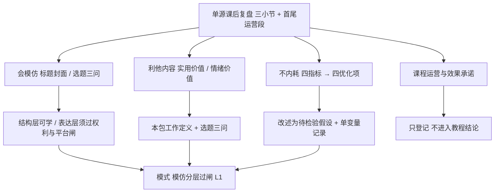

# 内容创作三原则：模仿、利他与数据复盘

> **状态：flagged · 路线：chaptered-summary（深度摘要 + 原创改写）。** 源材料是一篇公开发布的**付费课程班主任课后复盘文字**，属单一信源的商业培训语境材料。本包不是课程转录、不是课堂讲义复刻，也不提供任何平台的操作手册：只对可操作的三组方法陈述做结构化改写与证据分层，逐字营销话术与课程运营安排一律不进入教程层。去品牌化处理与采集边界见[来源清单](references/source-manifest.md)。

源文以三个编号小节组织，分别谈「会模仿」「只做利他内容」「不内耗自己」，并在第三节给出四组「指标 → 优化项」映射（F-007、F-010）。它同时混入课程运营通知与效果承诺（F-011、F-030）。因此读这篇的第一步不是学方法，而是先分清**页面事实、作者主张、官方核验、本包操作化定义**四种陈述，见[阅读与证据](concepts/00-reading-and-evidence.md)。

## 按用途选择路径

| 路径 | 要回答的问题 | 本包能提供什么 |
|---|---|---|
| [先分清四种陈述](concepts/00-reading-and-evidence.md) | 哪些是页面事实，哪些只是单源主张？ | 四层陈述分层、来源性质与本包覆盖边界 |
| [会模仿：分层与边界](concepts/01-imitation-and-boundary.md) | 「抄不等于抄袭」这句话能不能当判据？ | 结构层／表达层拆分、平台官方条款的反向约束 |
| [利他内容与两种价值](concepts/02-altruistic-content.md) | 什么叫「有用」，怎么避免自嗨？ | 实用／情绪价值二分、本包给出的工作定义与选题三问 |
| [四指标诊断当假设用](concepts/03-metrics-diagnosis.md) | 数据不好时该先改什么？ | 四组映射的改述、单指标归因的失效场景与最小记录法 |
| [单源主张与时效边界](concepts/04-claims-and-boundaries.md) | 哪些句子不能用、为什么？ | 营销话术剥离、勘误、适用范围与复核触发条件 |

只想取方法的读者可直接读第 01～03 篇；但每篇的「本包不覆盖」段落请一并读完，那里写的才是这套方法的真实边界。

## 三条主线



## 证据怎样使用

F-001～F-040 共 40 条，是本包唯一的事实台账，见[文章事实与作者主张登记](references/article-source.md)。其中 F-001～F-012 是页面事实，F-013～F-030 是作者主张（单源），F-031～F-037 来自平台官方条款原文，F-038～F-040 是负向事实与适用边界。事实表只回答「页面写了什么」「条款写了什么」，**不认证任何方法的有效性、任何平台规则对源文语境的适用性、任何效果承诺**。逐项裁决与勘误见[核验与勘误](references/verification.md)，四视角攻击与采纳记录见[对抗审查](references/adversarial-review.md)。

三条负向事实值得先记住：正文没有平台官方规则链接、统计来源、案例样本量或效果数据（F-038）；正文没有课程价格、退款条款与适用平台名称（F-039）；所引官方条款属于**微信视频号原创声明功能**，不自动适用于源文未指明的平台（F-040）。因此本包对「什么算合规、什么指标算低」保持空白，不用常识补写。

> **表格 ≠ 课堂原表。** 本包所有表格均为依据源文陈述或官方条款整理的**原创改述**，不是课堂讲义中的表格，也不是平台后台字段说明。

## 文档清单

本包共 14 篇 Markdown：5 篇教程、5 篇参考正文（来源清单、事实登记、核验与勘误、对抗审查、知识地图）、3 篇索引与 1 篇更新日志。不建 `examples/`：源文没有可照做的配置、调用或发布流程，可复现性两问皆否，理由见[知识地图](references/knowledge-map.md)。

## 主题关联

- [壁纸主题选择与上传判断](../wallpaper-selection-directions/index.md)：同一来源簇的课程日更转化包，演示「清单只能当候选池」；本包处理的是内容原则而非素材主题，两包 F 编号独立。
- [快手发布壁纸作品引流](../kuaishou-wallpaper-publish-traffic/index.md)：讲师口播转写的全流程还原，与本包同属「课程内容转化」，可对照看「有步骤」与「只有原则」两类源材料的处理差异。
- [零基础 AI 实操赚钱项目](../ai-side-hustle-playbook/index.md)：一般副业路径、工具成本与合规红线；本包不含定价、交付与收益内容。
- [AI 图像服务与内容变现](../ai-image-service-monetization/index.md)：四条路径与分层授权，可为第 01 篇的「表达层权利来源」提供旁证。
- [个人变现方向发现](../monetization-direction/index.md)：适合尚未确定方向的读者；本包假设读者已决定做内容型账号。

## 更新边界

2026-12-31 为复核期限，不是自动巡检任务。触发复核的条件：所引平台条款改版、目标平台发布新的原创／搬运／标识规则、四指标的名称或口径在后台发生变化、或出现可复核的第三方效果数据。完整覆盖清单与幂等规则见[来源清单](references/source-manifest.md)，执行记录见[更新日志](log.md)。

```{toctree}
:hidden:
:maxdepth: 2

concepts/index
references/index
log
```
